# Índice de pedidos do Codex

## Regras operacionais permanentes

- A placa Pokegochi conectada por USB normalmente aparece como `USB-SERIAL CH340` na `COM6` ou `COM7`.
- Em qualquer pedido de leitura, diagnóstico ou atualização da placa, testar `COM6` e `COM7` diretamente e consultar `Get-PnpDevice -PresentOnly -Class Ports` antes de concluir que ela não está conectada. `Win32_SerialPort` pode omitir temporariamente a CH340 e não deve ser usado sozinho.
- Não pedir ao usuário para informar a porta nem afirmar que a placa desapareceu antes de testar as duas portas conhecidas. Confirmar a placa pelo chip/MAC retornado pelo `esptool`.
- Nunca publicar um APK Android somente porque o Gradle terminou em `BUILD SUCCESSFUL`. Antes de assinar ou subir, abrir o APK final e comparar o `pokegochi.pak` interno com o pacote canônico por versão, quantidade/tamanho e SHA-256. Essa classe de falha já ocorreu duas vezes: R20261028-239 e R20261029-253.

## R20261029-260 - publicar APK, firmware e código final

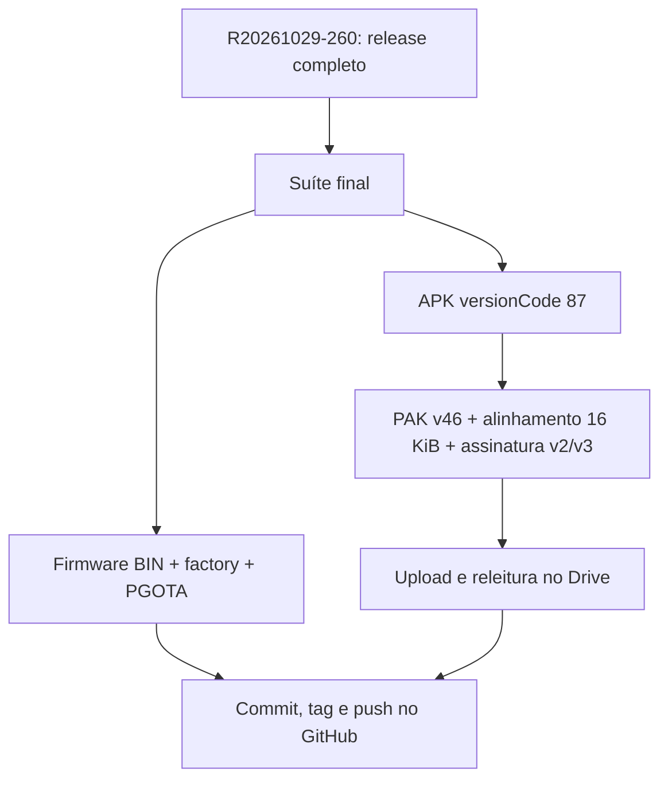

| ID | Data | Pedido | Status | Resultado |
|---|---|---|---|---|
| R20261029-260 | 2026-10-29 | Depois das correções, gerar releases do APK e firmware, subir o APK no Drive e atualizar o código no GitHub | Concluído, validado e publicado | A suíte completa terminou em `All native tests passed.`. O APK Android 2.0 avançou para `versionCode 87`, foi compilado em release, alinhado para páginas de 16 KiB e assinado pelos esquemas v2/v3 com o certificado de atualização SHA-256 `B292392661941B1BE5C26013634CB28BEFBD51259DDF8BEBA08B620FC1EDCE7D`. O APK final possui 10.467.114 bytes e SHA-256 `5F3A6261074FDCD8B4FBA2AC243E5DCD61B1FD8E186B2C38B48F95142BCF56B6`; seu PAK interno foi relido e coincide com o canônico v46 de 24.295.916 bytes e SHA-256 `BDB31050328AE846AE1754BA831F0986578E1B1C97DB94AF800EA87F8AC3F740`. O arquivo foi enviado e relido no Drive como `Pokegochi-Android-2.0-r260-ble-bag-release.apk`: https://drive.google.com/file/d/102y6SU-dLV_v7-Adh4HRm9Hjvu4oem6S/view?usp=drivesdk. O firmware final compilou com 113.584/327.680 bytes de RAM e 1.947.656/1.966.080 bytes de flash; o BIN tem 1.959.312 bytes e SHA-256 `30D52A2C4765897037C1109073A6773282A47DF1E7128E3982F71F54E25C4917`, a imagem factory tem 2.024.848 bytes e SHA-256 `0240232933E993144396E693575AB689215CC253320087C556DD64B427E1649C`, e o PGOTA P-256/SHA-256 tem 27.407.703 bytes e SHA-256 `C461C4010A0B6D9F7C25AEB5130A3E9C59F7C4915BB8DF51872BB50CB9E7333D`. Os artefatos e `SHA256SUMS.txt` ficaram em `dist/release-r260`; o código foi sincronizado na `main` do GitHub e marcado com a tag `release-r260`. |

## R20261029-259 - corrigir Bag e bloqueio após trades BLE

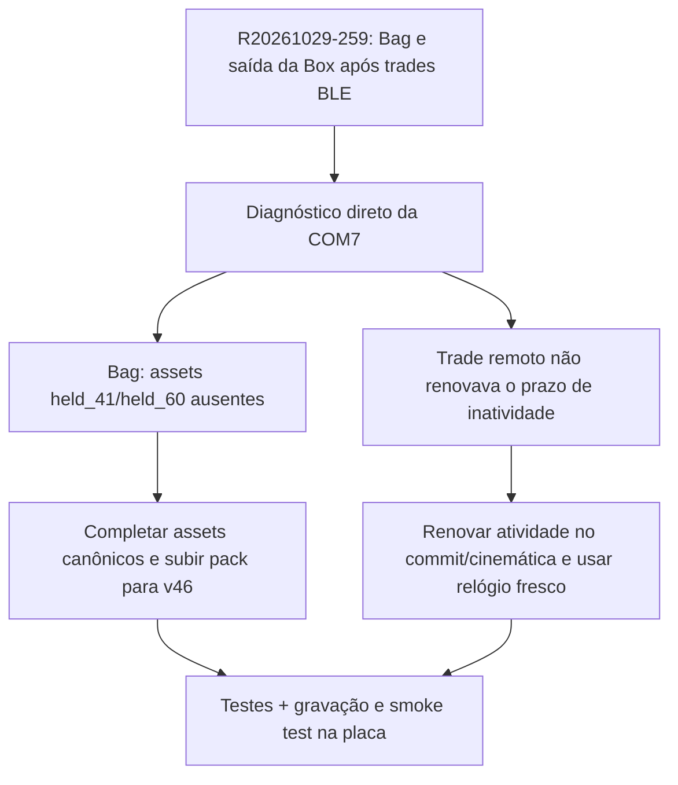

| ID | Data | Pedido | Status | Resultado |
|---|---|---|---|---|
| R20261029-259 | 2026-10-29 | Investigar a placa que, depois de dois trades com o aplicativo por BLE, ficava presa na Box e bloqueava ao tentar sair; corrigir também a Bag ainda defeituosa | Concluído, gravado e validado na placa | O log da COM7 separou duas causas. A Bag tentava abrir `held_41.pkg` e `held_60.pkg`, ausentes do pacote, entrava em repetidas falhas de preload e parecia travada; o gerador agora cobre canonicamente os held items 1--65 e 67--91, incluindo Quick Powder, e o pack v46 possui 12.919 assets, 24.295.916 bytes e SHA-256 `BDB31050328AE846AE1754BA831F0986578E1B1C97DB94AF800EA87F8AC3F740`. No fluxo BLE, commits recebidos e a cinemática bloqueante de troca não renovavam `lastInteractionMs`; ao terminar, o cálculo ainda usava o `millis()` antigo e podia disparar imediatamente o pocket lock, explicando a tela preta seguida da Pokébola. A atividade remota e o fim da cinemática agora renovam o prazo, o timeout usa uma leitura fresca e o estado transitório da Box é limpo. A regressão valida o arquivo PGA3 real byte a byte e as proteções do trade; a suíte completa terminou em `All native tests passed.`. Foi feito backup prévio de NVS/SPIFFS em `backups/r252-20261029-111934-COM7`, o pack v46 foi instalado e a fonte final, incluindo R258, foi recompilada e gravada na COM7 sem apagar o save. O firmware final tem 1.959.312 bytes e SHA-256 `576C2354BAD0FC5A0279070F8CC43E62F4291AE4E3D6D50510CFC607CF4896C8`. No boot final: `Save OK`, `archive probe OK`, pack OK e Player ID 56925 preservado. O smoke test percorreu Home -> Bag -> held items -> item 60 -> Home -> Box -> Home; houve zero `scene asset failed`, `open failed`, `retained cache miss`, panic, abort ou brownout. |

## R20261029-258 - Master Ball por 100% de cada região

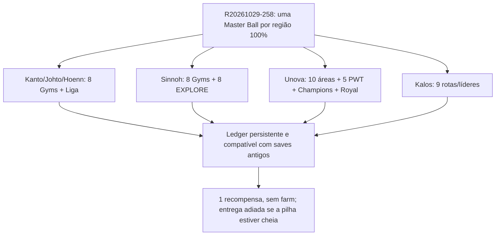

| ID | Data | Pedido | Status | Resultado |
|---|---|---|---|---|
| R20261029-258 | 2026-10-29 | Dar 1 Master Ball ao completar tudo de cada região, contando ao menos uma conclusão das missões repetíveis | Concluído e validado | A regra agora cobre as seis regiões. Kanto, Johto e Hoenn exigem seus oito Gyms e a Liga; Sinnoh exige os oito líderes e ao menos um EXPLORE bem-sucedido em cada um dos oito locais; Unova exige os dez chefes, as cinco divisões do PWT, Champions e uma viagem completa no Royal Unova; Kalos exige as nove rotas/líderes, incluindo Diantha. Cada recompensa possui flag persistente, é idempotente entre reinícios e fica pendente se a pilha de Master Balls estiver em 999. O ledger de Kanto--Hoenn migra saves antigos sem duplicar as bolas que as versões anteriores já davam ao vencer a Liga. A tela de Sinnoh passou a mostrar `EXP N/8`, e os avisos de batalha/Home confirmam a entrega. O contrato `test_region_completion_reward_contract.py` entrou na suíte permanente; todos os testes terminaram em `All native tests passed.`. O Android release compilou e confirmou dentro do APK o PAK v46 de 24.295.916 bytes com SHA-256 `BDB31050328AE846AE1754BA831F0986578E1B1C97DB94AF800EA87F8AC3F740`. O firmware `esp32-2432S028R` compilou usando 113.456/327.680 bytes de RAM e 1.947.760/1.966.080 bytes de flash. |

## R20261029-257 - centralizar contador de páginas em Regions

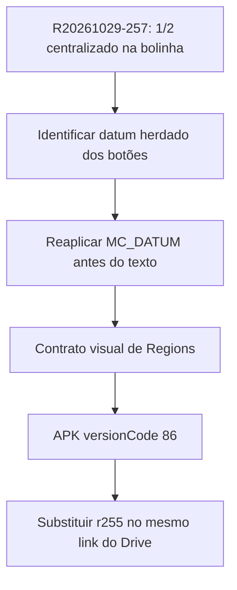

| ID | Data | Pedido | Status | Resultado |
|---|---|---|---|---|
| R20261029-257 | 2026-10-29 | Centralizar o indicador `1/2` dentro da bolinha/pílula do cabeçalho de Regions | Concluído, validado e publicado | As setas de paginação são desenhadas por `button()`, que restaura `TL_DATUM`; por isso o `1/2`, embora recebesse as coordenadas geométricas centrais da pílula, era interpretado como canto superior esquerdo e aparecia deslocado para baixo e para a direita. O renderer agora reaplica `MC_DATUM` imediatamente antes do contador, mantendo centro em `(283,28)` dentro da área `(263,16,40,23)`. O contrato de Regions passou a exigir essa ordem. O Android release avançou para `versionCode 86`, passou pelos contratos e pela validação do PAK v46, foi alinhado e assinado v2/v3. O APK `Pokegochi-Android-2.0-r257-theme-selector-regions-fix.apk` substituiu o r255 no mesmo Drive: https://drive.google.com/file/d/1JuzKPEdSgcrt5ug1QyTPuB3spjDgq-7a/view?usp=drivesdk (10.446.634 bytes; SHA-256 `015BF29112EF8D47B53F80FBC5885DC4FC5A63C97DBF001FACBE72CAE94AECD1`). |

## R20261029-256 - publicar APK do seletor de temas

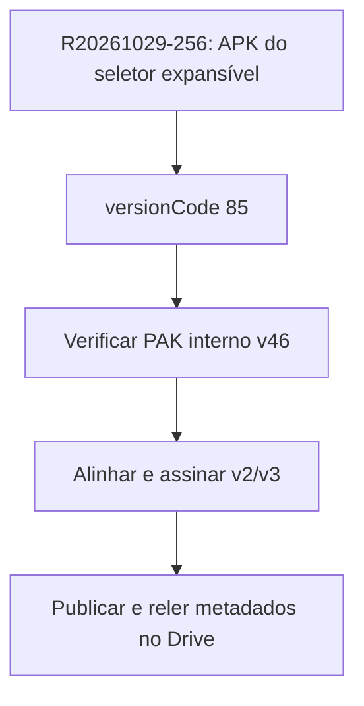

| ID | Data | Pedido | Status | Resultado |
|---|---|---|---|---|
| R20261029-256 | 2026-10-29 | Gerar e subir no Drive o APK com o seletor de temas expansível de R20261029-255 | Concluído e validado; upload substituído pela revisão R20261029-257 | O app permaneceu na versão 2.0 e avançou para `versionCode 85`, permitindo atualização sobre o r253. O release passou pelo verificador obrigatório: o PAK interno é v46, possui 24.295.916 bytes e SHA-256 `BDB31050328AE846AE1754BA831F0986578E1B1C97DB94AF800EA87F8AC3F740`, idêntico ao canônico. O APK foi alinhado e assinado pelos esquemas v2/v3 com o mesmo certificado das instalações anteriores. Antes da entrega final, o usuário identificou o contador deslocado em Regions; por isso o arquivo r255 foi substituído no mesmo link pela revisão r257 registrada acima, evitando manter no Drive uma versão já obsoleta. |

## R20261029-255 - seletor de temas expansível

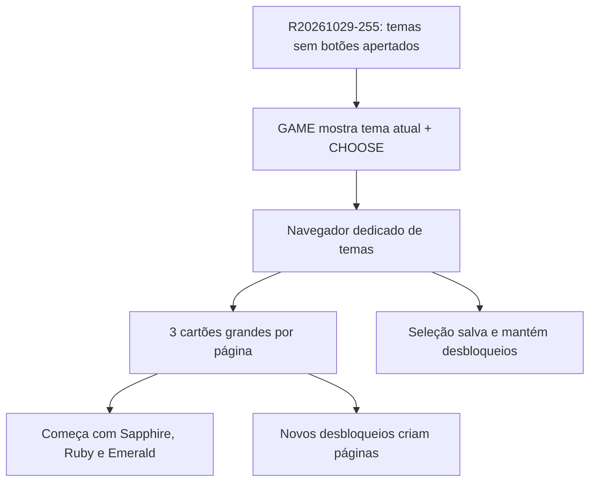

| ID | Data | Pedido | Status | Resultado |
|---|---|---|---|---|
| R20261029-255 | 2026-10-29 | Substituir a fileira de temas que ficava cada vez mais apertada por um seletor preparado para novas gerações, começando com três opções e crescendo conforme os temas são desbloqueados | Concluído e validado | A aba GAME agora mostra somente o tema atual e um botão `CHOOSE`. Ele abre `COLOR THEMES`, um navegador dedicado com três cartões grandes e paletas visuais por página, indicador `N/M`, setas e destaque `SELECTED`. Um save inicial apresenta exatamente Sapphire, Ruby e Emerald em uma página; Platinum, Black e X/Y entram na lista somente após seus desbloqueios e criam páginas adicionais em vez de reduzir a área de toque. A lista é filtrada por desbloqueio, portanto continua válida mesmo se um futuro tema não for contíguo. A escolha centralizada preserva corretamente os flags especiais de Unova/Kalos e o tema persistente das três primeiras gerações, sem mudar a ABI do save. Foi criado o contrato `test_theme_selector_contract.py`, incluído na suíte permanente; a suíte terminou em `All native tests passed.`. O Android release passou incluindo a comparação do asset pack interno, e o firmware `esp32-2432S028R` compilou com 113.456/327.680 bytes de RAM e 1.946.584/1.966.080 bytes de flash. |

## R20261029-254 - registrar reincidência de asset pack obsoleto no APK

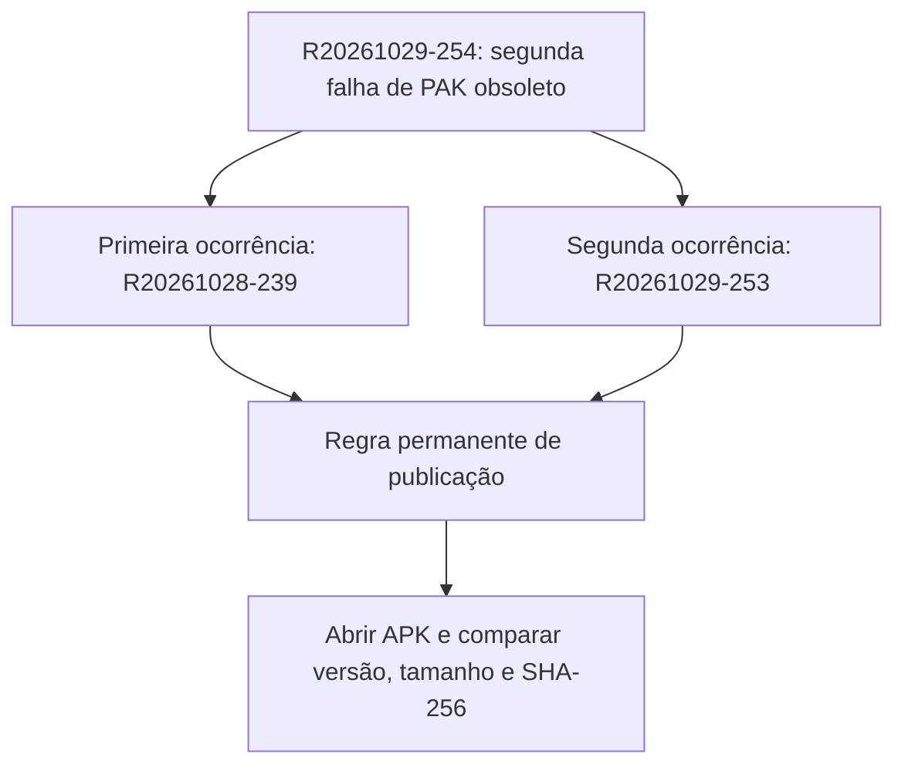

| ID | Data | Pedido | Status | Resultado |
|---|---|---|---|---|
| R20261029-254 | 2026-10-29 | Registrar no índice que o `SPRITE ASSET READ FAIL` causado por APK com asset pack antigo já aconteceu pela segunda vez | Registrado como reincidência e regra permanente | A primeira ocorrência foi R20261028-239: o APK levava catálogo/PGA3 anterior ao runtime Gen 6. A segunda foi R20261029-253: o APK r252 levava pack 45 enquanto o binário exigia pack 46. O índice agora proíbe considerar apenas `BUILD SUCCESSFUL` como validação de publicação; todo APK deve ser aberto depois de pronto e seu `pokegochi.pak` interno deve coincidir com o canônico por versão, tamanho e SHA-256 antes da assinatura e do upload. O pipeline r253 já automatiza essa barreira em debug e release. |

## R20261029-253 - corrigir a segunda ocorrência de SPRITE ASSET READ FAIL no APK r252

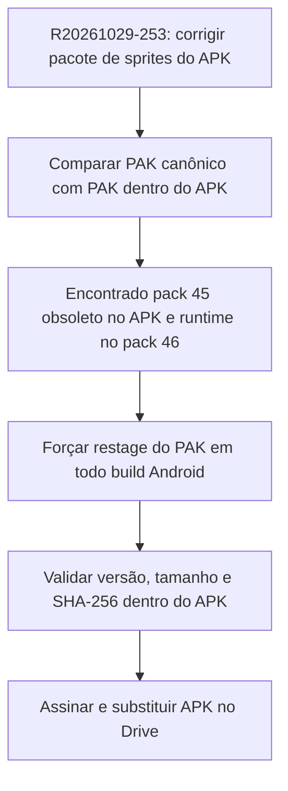

| ID | Data | Pedido | Status | Resultado |
|---|---|---|---|---|
| R20261029-253 | 2026-10-29 | Corrigir o APK que mostrava `SPRITE ASSET READ FAIL` e subir uma versão funcional | Concluído, validado e publicado; segunda ocorrência da classe de falha registrada em R20261029-254 | A falha foi reproduzida no próprio APK r252: ele continha um `pokegochi.pak` antigo de 24.286.924 bytes e marcador 45, enquanto o runtime e o pacote canônico já exigiam a versão 46 de 24.295.916 bytes. Esta foi a segunda ocorrência, após o incidente R20261028-239. O `stageAndroidAssets` do Gradle agora nunca reutiliza a cópia intermediária e o build passa por uma verificação final que abre o APK e compara versão, tamanho e SHA-256 do PAK empacotado com o canônico. O contrato Android também garante que os verificadores façam parte dos builds debug e release. O release r253 foi confirmado com pack 46, 12.919 assets e SHA-256 interno `BDB31050328AE846AE1754BA831F0986578E1B1C97DB94AF800EA87F8AC3F740`; o APK foi alinhado, assinado com o certificado de atualização existente e validado pelos esquemas v2/v3. O arquivo `Pokegochi-Android-2.0-r253-asset-pack-fix.apk` substituiu o upload quebrado no Drive em https://drive.google.com/file/d/1VSOCsPtzig0L2TvCMlwI73SFkAl3rcrt/view?usp=drivesdk (10.446.634 bytes; SHA-256 `14F8638C49D640C9D843789F938A31DFA0368AE6F5A09AA9D1DDC12C3C5A4150`). |

## R20261029-252 - completar formas, Prison Bottle, Rayquaza e UI de Regions

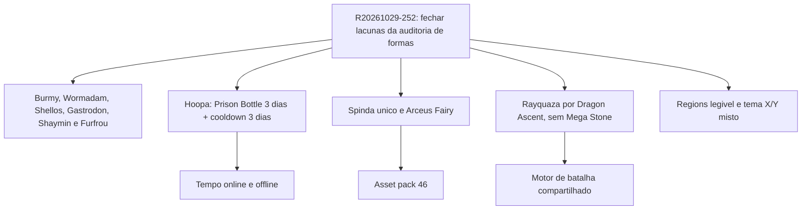

| ID | Data | Pedido | Status | Resultado |
|---|---|---|---|---|
| R20261029-252 | 2026-10-29 | Corrigir todas as lacunas da tabela anterior, exceto Cosplay Pikachu; criar Prison Bottle em Key Items para Hoopa Unbound por 3 dias e cooldown de 3 dias; corrigir Spinda e Arceus; fazer Rayquaza rejeitar Mega Stone e Mega Evoluir com Dragon Ascent, mantendo Kyogre/Groudon na pedra; mover o indicador 1/2 de Regions; renomear o tema X para X/Y e misturar as cores das duas versoes | Concluido e validado | Burmy agora recebe Plant/Sandy/Trash Cloak pelo terreno da batalha e Wormadam preserva o manto, stats, tipos e learnset corretos; Shellos/Gastrodon recebem e preservam West/East Sea; Shaymin Sky reverte a noite, congelado ou na Box; os trims de Furfrou expiram em 5 dias ou ao ir para a Box. Hoopa ganhou Prison Bottle real em Key Items: fica Unbound por 72 horas, volta a Confined e respeita 72 horas de cooldown, inclusive consumindo corretamente o tempo offline sem reiniciar o prazo; a movepool sincroniza Hyperspace Hole/Fury. Spinda usa os quatro masks oficiais derivados da personalidade e Arceus Fairy ganhou sprite/paleta propria na forma 17. Rayquaza nao aceita nem conserva Mega Stone e ativa Mega/Delta Stream ao usar Dragon Ascent durante a batalha; Kyogre e Groudon continuam usando a pedra. O contador de paginas foi movido para o cabecalho de Regions, e o tema agora se chama X/Y com azul/ciano de X e vermelho/magenta de Y. Cosplay Pikachu permaneceu fora por decisao explicita. Foram adicionados 89 assets e o pack subiu para 46. A suite completa terminou em `All native tests passed.`, o firmware compilou com 113.456/327.680 bytes de RAM e 1.945.616/1.966.080 bytes de flash, e o Android release terminou em `BUILD SUCCESSFUL`. |

## R20261029-251 - auditar formas e mecânicas especiais ainda ausentes

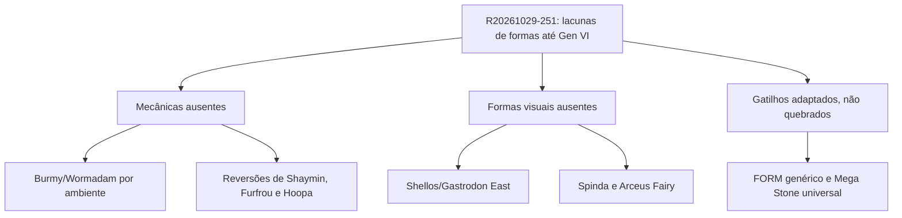

| ID | Data | Pedido | Status | Resultado |
|---|---|---|---|---|
| R20261029-251 | 2026-10-29 | Verificar se ainda existe algum Pokémon com transformação ou mecânica especial não tratada | Auditado; nenhuma regra de jogo alterada | O catálogo e o motor foram cruzados com as tabelas de formas até a Gen VI. As lacunas funcionais confirmadas são os mantos de Burmy/Wormadam e as reversões condicionais de Shaymin Sky, Furfrou e Hoopa Unbound. Shellos/Gastrodon East, os pontos individuais de Spinda e a arte Fairy de Arceus são lacunas visuais; Cosplay Pikachu é conteúdo opcional de ORAS, fora do núcleo de Pokémon Y. Deoxys, Rotom, Shaymin, os gênios e Hoopa usam o seletor `FORM` como adaptação, enquanto Rayquaza e as Primals usam a Mega Stone universal. As transformações de batalha importantes já estão implementadas: Castform, Cherrim, Darmanitan, Aegislash, Meloetta, Xerneas, Zygarde, Ditto/Imposter, Zoroark/Illusion e Protean. |

## R20261029-250 - remover cura gratuita do PWT

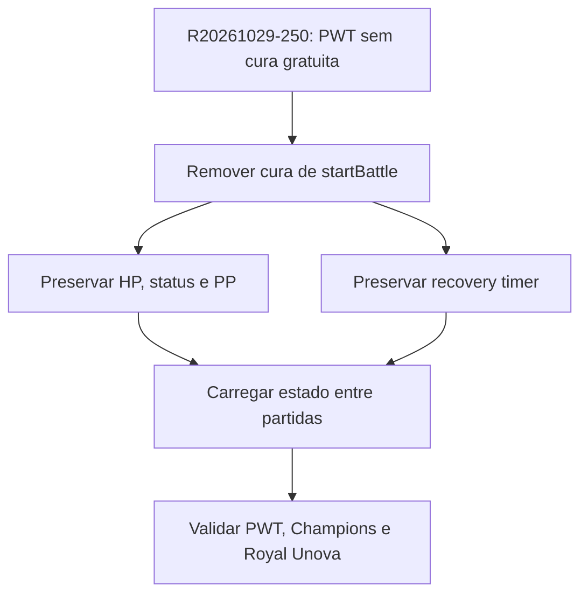

| ID | Data | Pedido | Status | Resultado |
|---|---|---|---|---|
| R20261029-250 | 2026-10-29 | Corrigir o exploit em Unova que permitia entrar em uma batalha do PWT e sair para recuperar gratuitamente toda a Party | Concluído e validado | A causa era uma chamada de cura total dentro de `UnovaTournament::startBattle()`, executada antes de cada combate e persistida na coleção real. Essa chamada foi removida dos modos PWT, Champions Tournament e Royal Unova. HP, status, PP e recovery timer agora entram na batalha exatamente como estavam e continuam entre as partidas; Pokémon ainda em recuperação não são aceitos como lead. A tela do torneio passou a informar `HP, PP AND STATUS CARRY BETWEEN MATCHES`, eliminando a instrução antiga de restauração. A regressão mantém simultaneamente dano, Burn, Poison, PP gasto e recovery timer ao iniciar todos os modos, além de confirmar que o torneio não libera um lead incapacitado. O teste dedicado, a suíte completa (`All native tests passed.`) e o Android release (`BUILD SUCCESSFUL`) passaram. |

## R20261029-249 - corrigir reset visual e HP do Zygarde

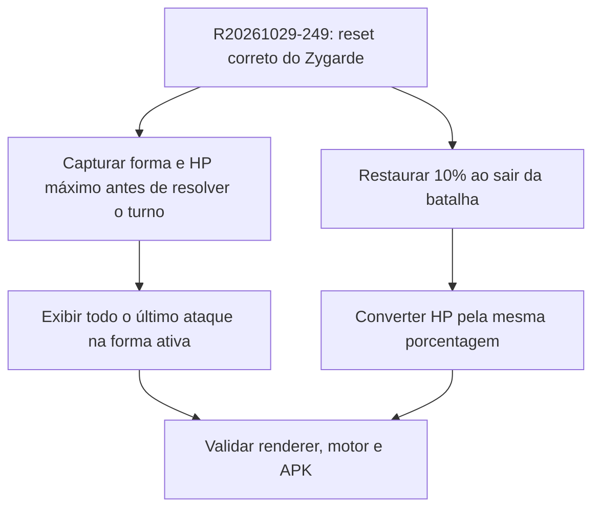

| ID | Data | Pedido | Status | Resultado |
|---|---|---|---|---|
| R20261029-249 | 2026-10-29 | Corrigir o Zygarde que voltava visualmente para 10% antes da animação do ataque final e preservar a porcentagem de HP ao retornar para 10%, em vez de deixá-lo com 1 HP | Concluído, validado e publicado | A apresentação de batalha agora captura forma e HP máximo de ambos os lados antes de o motor resolver qualquer ataque, item, troca, fuga ou ação multiplayer. Assim, mesmo que a batalha termine e o registro persistente já seja restaurado para 10%, o journal conserva a forma 50%/Complete e seu HP máximo até o último ataque, dano, faint e texto final terminarem. A restauração para 10% passou a recalcular o HP proporcionalmente, com arredondamento e mínimo de 1 apenas para porcentagens realmente muito baixas; normalização de saves e capturas de uma forma temporária usam a mesma regra. A regressão força um Complete ferido a 37%, troca-o de campo e confirma 10% com a mesma proporção e HP maior que 1. O contrato de apresentação, o teste nativo específico, o Android release (`BUILD SUCCESSFUL`) e a suíte completa (`All native tests passed.`) passaram. O APK `Pokegochi-Android-2.0-zygarde-reset-r249.apk` foi alinhado para páginas de 16 KiB, assinado pelos esquemas v2/v3 com o certificado de atualização existente e publicado no Drive em https://drive.google.com/file/d/1BtFyZ7nyFrfIjgn4-qpsFmo5Pjjh7n87/view?usp=drivesdk (10.323.754 bytes; SHA-256 `C6E8247357B97A7D107AE813FC7B63563C48F6A75A9411C4DF5A662B2D673285`). |

## R20261029-248 - progressão de formas do Zygarde por HP

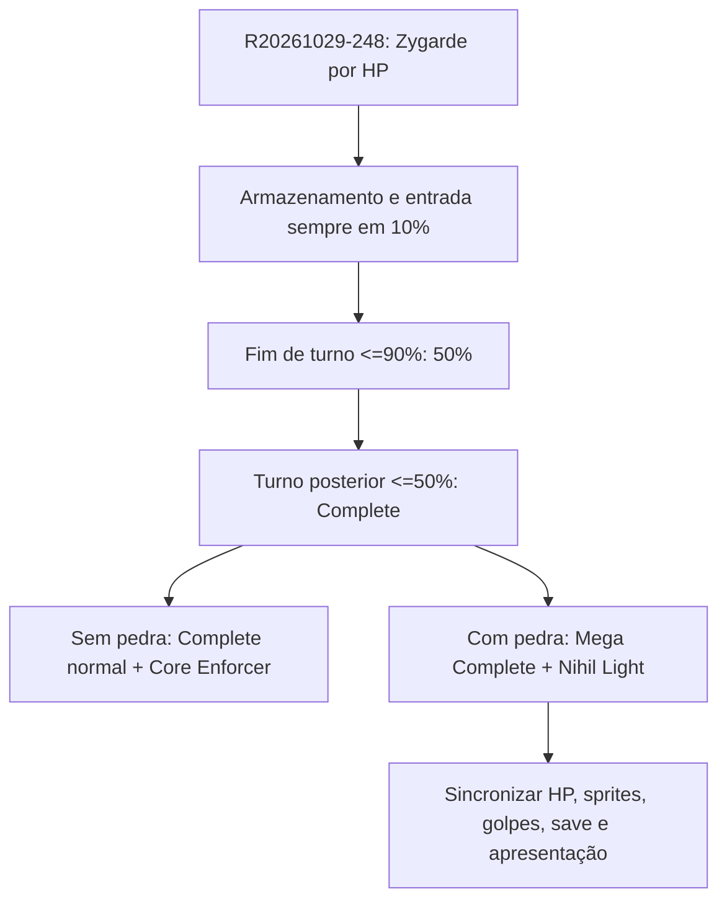

| ID | Data | Pedido | Status | Resultado |
|---|---|---|---|---|
| R20261029-248 | 2026-10-29 | Fazer Zygarde começar sempre em 10%, passar a 50% ao terminar um turno com até 90% de HP e chegar a Complete em um turno posterior com até 50%; a Mega Stone deve poder ser equipada desde 10%, mas ativar somente na passagem final | Concluído, validado e publicado | Zygarde agora é criado, capturado, recebido e armazenado canonicamente em 10%, não possui mais seleção manual e reinicia sua cadeia ao entrar ou sair da batalha. Cada fim de turno vivo avalia o HP depois de residuais e avança no máximo uma etapa: 10% -> 50% em `HP <= 90%`, depois 50% -> Complete em `HP <= 50%`. Sem Mega Stone, a última etapa usa Complete normal e mantém Core Enforcer; com a pedra já equipada, somente essa etapa ativa Mega Complete e troca o golpe para Nihil Light. A retirada da pedra, troca de Pokémon e fim da batalha restauram 10%/Core Enforcer; uma batalha salva preserva a etapa ativa ao reabrir o app. Stats, HP máximo/atual, Ability, tipo, sprite e golpe são recalculados na mesma transição. A apresentação mantém forma e HP máximo antigos até o evento correto, então o sprite, texto e preenchimento da barra avançam juntos. Regressões cobrem 90%+1, <=90%, 50%+1, <=50%, uma única etapa por turno, com/sem pedra, troca de Pokémon e golpes. A suíte terminou em `All native tests passed.`, o Android release em `BUILD SUCCESSFUL` e o firmware compilou com 113.456/327.680 bytes de RAM e 1.940.796/1.966.080 bytes de flash. O APK `Pokegochi-Android-2.0-zygarde-hp-r248.apk` foi alinhado, assinado com o certificado compatível com os releases anteriores, validado pelos esquemas APK Signature v2/v3 e publicado no Drive em https://drive.google.com/file/d/1p7E7qZViNRz3e4pPg_V9mvqzGpTeTWM7/view?usp=drivesdk (10.323.754 bytes; SHA-256 local `73CE2DE2B100577EF882DD1F3E02FB5FA8CB4A937A6676D0B51C70A7A8D5C599`). |

## R20261029-247 - corrigir movepools de formas e Mega Zygarde

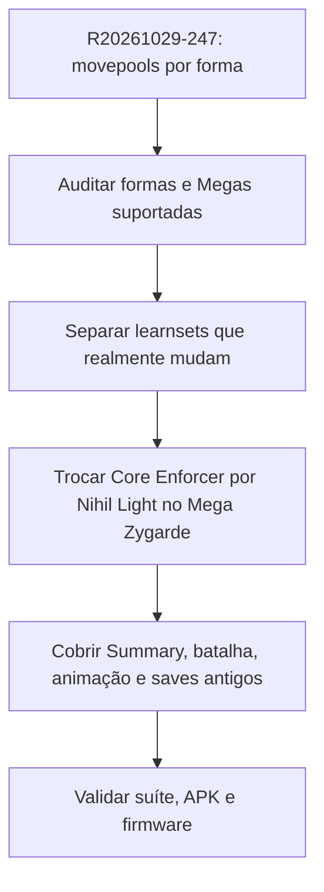

| ID | Data | Pedido | Status | Resultado |
|---|---|---|---|---|
| R20261029-247 | 2026-10-29 | Corrigir todos os Pokémon com mais de uma forma, principalmente Megas, e fazer Nihil Light aparecer para Mega Zygarde | Concluído, validado e publicado | Todos os learnsets por forma suportados foram auditados. Deoxys Attack/Defense/Speed, Rotom, Shaymin Sky, Kyurem Black/White, Meowstic-F, Floette Eternal e Hoopa Unbound agora usam suas exceções reais; Megas comuns preservam a movepool base, enquanto Mega Zygarde, a exceção do romhack, troca Core Enforcer por Nihil Light. O Summary distingue a variante Mega e lista o golpe correto; equipar ou remover a Mega Stone sincroniza Core Enforcer/Nihil Light inclusive em saves existentes, preservando PP e evitando duplicatas. Também foram incluídos os golpes ausentes Origin Pulse, Precipice Blades, Dragon Ascent, Hyperspace Fury, Core Enforcer e Nihil Light, com animações compatíveis. Nihil Light atravessa Protect, ignora alterações defensivas/evasivas do alvo e trata Fairy como dano neutro apenas quando usado pelo Mega Zygarde. Os testes percorrem todas as formas oficiais registradas e todos os golpes novos; a suíte terminou em `All native tests passed.`, o Android release terminou em `BUILD SUCCESSFUL` e o firmware compilou com 113.440/327.680 bytes de RAM e 1.939.340/1.966.080 bytes de flash. APK 2.0 `versionCode 84`, alinhado para páginas de 16 KiB e assinado v2/v3 com o certificado de atualização existente: `Pokegochi-Android-2.0-forms-moves-r247.apk`, 10.303.274 bytes, SHA-256 `67FEF3D4...310F7`; publicado e relido no [Drive](https://drive.google.com/file/d/1cd23jvNE8nJGAiSBDz9r7i56kEKbCdv2/view?usp=drivesdk). |

## R20261028-246 - completar megas e formas de Kalos

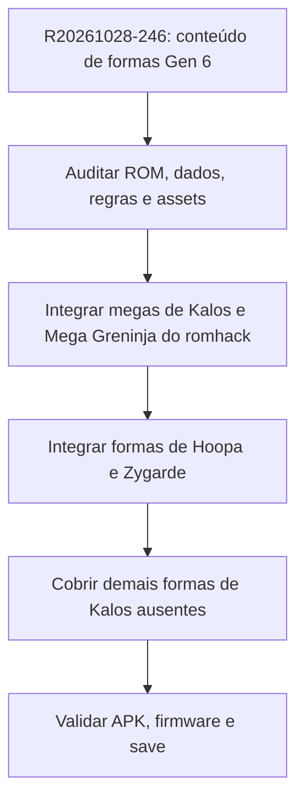

| ID | Data | Pedido | Status | Resultado |
|---|---|---|---|---|
| R20261028-246 | 2026-10-28 | Implementar o conteúdo de Kalos que ficou faltando, incluindo megas, Mega Greninja e formas de Hoopa e Zygarde | Concluído, validado, publicado e gravado na placa | O catálogo do romhack foi auditado e recebeu 12 megas de espécies de Kalos: Chesnaught, Delphox, Greninja, Pyroar, Floette, Meowstic, Malamar, Barbaracle, Dragalge, Hawlucha, Zygarde e Diancie. Hoopa Confined/Unbound, Zygarde 50%/10%/Complete e Floette Eternal agora compartilham forma, stats, tipo, Summary, Box, batalha, ícone e sprites normal/shiny; a Mega Stone usa o seletor existente e Fire Mane ganhou efeito real de +30% para golpes Fire. O pack v44 contém 12.803 assets e 24.169.976 bytes (SHA-256 `B55138CB...F4101`); o contrato conferiu 1.336 caminhos base/forma/Mega byte a byte dentro do PGA3 e a suíte terminou em `All native tests passed.`. Firmware compilou com 113.568/327.680 bytes de RAM e 1.936.656/1.966.080 bytes de flash; binário de 1.948.320 bytes, SHA-256 `6036123F...1A216`. O pacote OTA assinado P-256/SHA-256 de 27.260.680 bytes foi enviado integralmente à placa MAC `B4:BF:E9:21:3C:E4` na COM7, preservou o save, iniciou em `app1`, aceitou o candidato e confirmou `Save OK`, `archive probe OK`, `sprite asset pack OK` e `Ready`. APK 2.0 `versionCode 84`, alinhado 16 KiB e assinado v2/v3 com o certificado existente: 10.295.082 bytes, SHA-256 `2D23B880...E2F041`; publicado e relido no [Drive](https://drive.google.com/file/d/1pnmF8Sqfr8B9Ey5DbLHUbK6FNOWtAx6R/view?usp=drivesdk). |

## R20261028-245 - corrigir conexão BLE iniciada pelo app

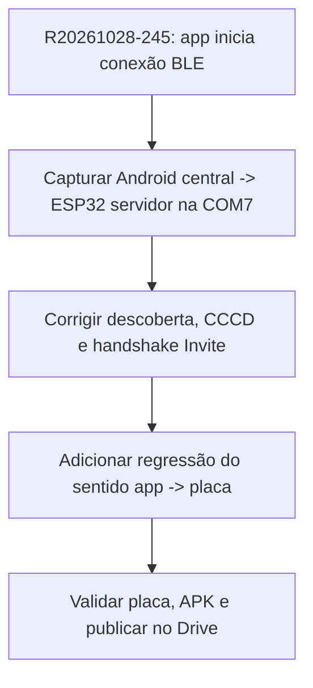

| ID | Data | Pedido | Status | Resultado |
|---|---|---|---|---|
| R20261028-245 | 2026-10-28 | Corrigir o Bluetooth no sentido em que o app inicia a conexão; quando a placa inicia, já funciona | Implementado, validado em transporte e publicado | A captura física provou que a placa anuncia o fabricante/protocolo correto e aceita conexão, descoberta de serviço, CCCD e `Invite` quando um central BLE externo inicia; portanto o bloqueio estava na transição de papéis do Android. O app agora encerra scan e advertising, cancela descoberta Bluetooth Classic, aguarda 320 ms para o rádio estabilizar, abre GATT LE em PHY 1M no handler serializado e aplica timeout/três tentativas limitadas. O sentido simultâneo preserva a conexão recebida e após falha volta a anunciar. Contratos Java/Python, suíte nativa e build release passaram; o APK `versionCode 84` foi publicado no Drive junto do R246. A validação física final do caminho especificamente iniciado pelo Android depende do teste no celular, que não estava conectado ao PC nesta execução. |

## R20261028-244 - reforçar conexão Bluetooth entre app e placa

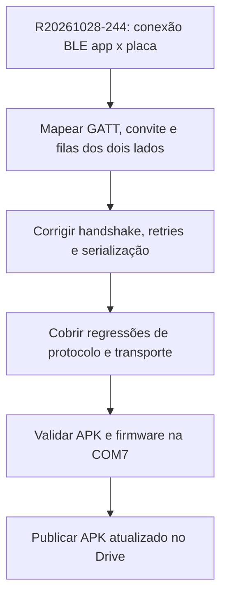

| ID | Data | Pedido | Status | Resultado |
|---|---|---|---|---|
| R20261028-244 | 2026-10-28 | Melhorar o protocolo Bluetooth porque app e placa se encontram, mas a conexão sempre falha | Concluido, validado, publicado e gravado na placa | Foram corrigidas tres causas concretas. No Android, o `Invite` drenado antes do GATT pronto agora permanece enfileirado e e enviado logo apos service discovery/CCCD; callbacks foram serializados, conexoes recebidas ganharam 12 s para completar o handshake, o central ganhou tres tentativas limitadas e notificacoes do servidor so avancam depois de `onNotificationSent`. Na ESP32, advertisements repetidos foram movidos para um mailbox coalescente e nao podem mais expulsar eventos criticos; a fila critica passou a oito slots, o GATT faz duas tentativas e so declara transporte conectado depois de service/subscribe. O protocolo reenvia `InviteAccept` perdido e desempata convites simultaneos pelo menor player ID. Testes novos cobrem os dois casos e a suite terminou em `All native tests passed.`; Android e firmware compilaram, com 113.568/327.680 bytes de RAM e 1.935.968/1.966.080 bytes de flash. APK 2.0 `versionCode 83`, alinhado 16 KiB e assinado v2/v3: `Pokegochi-Android-2.0-ble-r244.apk`, 10.245.731 bytes, SHA-256 `6492FD4D3926951459087CB76873F6E72001C46F473563B0398CD3A024631DD7`; publicado e relido no [Drive](https://drive.google.com/file/d/1svlz8kdVBvFDzJrOSRLD1MAnwbDB2CUi/view?usp=drivesdk). A placa MAC `B4:BF:E9:21:3C:E4` foi gravada na COM7 preservando o save; digest conferido, boot com `Save OK`, assets `OK` e `Ready`. O harness fisico abriu a aba Multiplayer e ligou o radio: advertising e scan iniciaram, a arena BLE ficou com 21.684 bytes livres e maior bloco de 12.788 bytes, sem overflow ou reset. |

## R20261028-243 - tema X como recompensa de Kalos

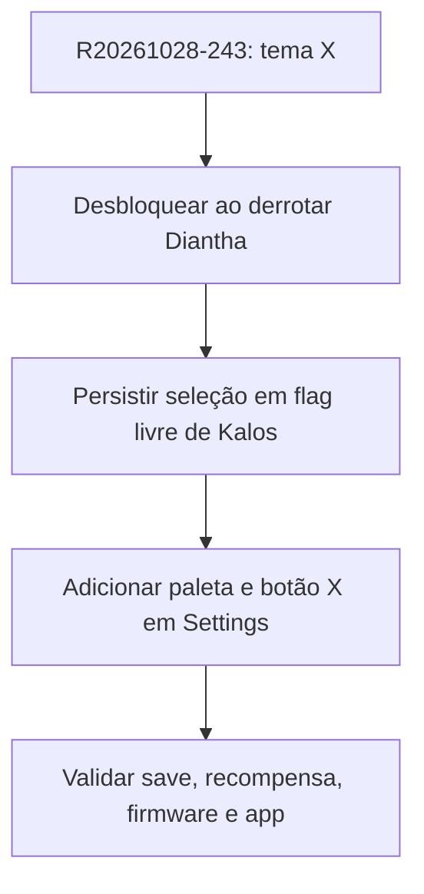

| ID | Data | Pedido | Status | Resultado |
|---|---|---|---|---|
| R20261028-243 | 2026-10-28 | Criar um tema X como recompensa por zerar Kalos | Concluído e validado | Derrotar Diantha agora libera retroativamente o tema `X`, anuncia `KALOS COMPLETE! X THEME UNLOCKED!` e acrescenta sua paleta azul/ciano ao seletor de Settings. A seleção usa um bit livre do estado persistente de Kalos, sem ampliar nem migrar o save, e é mutuamente exclusiva com o tema Black. O contrato de interface e a suíte completa terminaram em `All native tests passed.`; firmware ESP32 compilou com 113.208/327.680 bytes de RAM e 1.935.432/1.966.080 bytes de flash, e o Android release ARM64/x86-64 terminou em `BUILD SUCCESSFUL`. |

## R20261028-242 - colocar Zygarde e Hoopa na placa

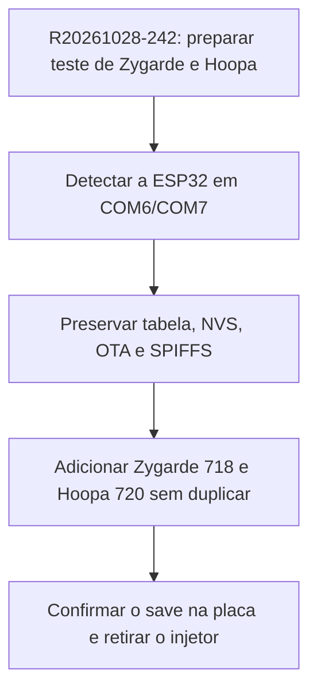

| ID | Data | Pedido | Status | Resultado |
|---|---|---|---|---|
| R20261028-242 | 2026-10-28 | Colocar um Zygarde e um Hoopa na placa conectada para testar suas formas | Concluído e validado na placa | A ESP32 `B4:BF:E9:21:3C:E4` foi confirmada na COM7. Tabela de partições, NVS, OTA e SPIFFS foram preservados antes da alteração; o snapshot anterior tem SHA-256 `F8CF7420...AE284D`. Um injetor temporário, idempotente e baseado no construtor/serializador reais adicionou Zygarde 718 (UID 28) e Hoopa 720 (UID 29), ambos no nível 75 e forma base, marcou a Pokédex e elevou a coleção a 23 Pokémon. O segundo boot confirmou ambos sem duplicar; o snapshot posterior tem SHA-256 `1DA2FD07...120BD4`. O injetor foi removido do código e a imagem de produção `F61204E6...05B0835` foi restaurada e verificada em `app1`; o boot final confirmou `running=app1 selected=app1`, `Save OK`, pack de assets OK e `Ready`, sem qualquer log do injetor. |

## R20261028-241 - corrigir sprites default dos Pokemon de Kalos

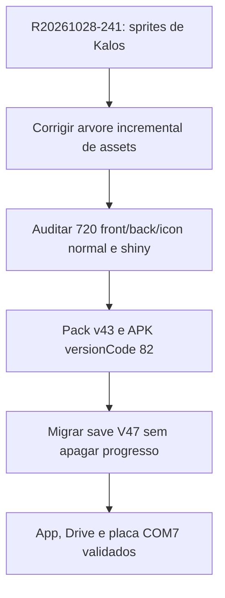

| ID | Data | Pedido | Status | Resultado |
|---|---|---|---|---|
| R20261028-241 | 2026-10-28 | Corrigir Kalos no app, onde os Pokemon apareciam com o sprite default roxo por falha nos assets | Concluido, validado, publicado e gravado na placa | A causa era estrutural no modo incremental de Kalos: ele emitia caminhos obsoletos como `pokemon/650/front.pkg`, enquanto o runtime consulta `pokemon/front/650.pkg`, `pokemon/back/650.pkg`, `pokemon/icons/650_0.pkg` e os equivalentes shiny/evolution. O gerador agora produz a arvore canonica, remove 576 entradas legadas e audita byte a byte 720 assets base (front/back/icon normal e shiny para #650-#721), dimensoes e payloads do PGA3. O pack v43 contem 12.659 assets, 23.978.834 bytes e SHA-256 `369D3A04EE857D41EB12D229264146753F49D811B1B4B9A518EB683470B73C77`. Durante o teste fisico foi encontrado um segundo defeito: o `GameSave` V47 de 53.712 bytes excedia em 476 bytes o maior bloco continuo da ESP32. O V48 mantem as 721 especies e 63 reservas (784 slots), compacta todos os ocupados de saves V47 de 800 slots e recusa um save realmente superlotado em vez de truncar Pokemon; um teste preserva deliberadamente um shiny no ultimo slot antigo, UID, party, Pokedex e progresso de Kalos. A suite terminou em `All native tests passed.`. APK 2.0 `versionCode 82` ARM64/x86-64 alinhado 16 KiB e assinado v2/v3: `Pokegochi-Android-2.0-kalos-sprites-r241.apk`, 10.217.258 bytes, SHA-256 `63A3EDF38AF103D9B9EE6835A31DD92D33BDC021E1BEBC1E4A4CE8A9B89E5745`; substituido e relido no mesmo [Drive](https://drive.google.com/file/d/1RaCKH7dI7BPRtOMDerd8OQWFntT8dawA/view?usp=drivesdk). O emulador confirmou `Save OK`, `archive probe OK`, `sprite asset pack OK` e `Ready`. Firmware com 113.336 bytes de RAM e 1.934.536/1.966.080 bytes de flash; `firmware.bin` tem 1.946.192 bytes e SHA-256 `F61204E6915AF244A80D5B8DD7432B0BFC0D45786C90852965103885505B0835`. A placa MAC `B4:BF:E9:21:3C:E4` na COM7 foi gravada sem apagar o save, recebeu por BLE o pacote assinado de 27.052.572 bytes, iniciou em `app1`, aceitou a candidata e confirmou `PGA3 versioned asset source`, `Save OK`, `archive probe OK`, `sprite asset pack OK` e `Ready`; START retomou a batalha persistida sem crash. |

## R20261028-240 - corrigir o fundo da tela New Champion na placa

```mermaid
graph TD
    R20261028_240["R20261028-240: fundo New Champion na ESP32"]
    R20261028_240 --> C1["Comparar cache Android e workspace ESP32"]
    C1 --> W1["Restaurar o banco normal apos a batalha"]
    W1 --> L1["Tratar victory_bg como cena grande"]
    L1 --> V1["Contrato, suite completa e build do firmware"]
```

| ID | Data | Pedido | Status | Resultado |
|---|---|---|---|---|
| R20261028-240 | 2026-10-28 | Corrigir a tela `NEW CHAMPION` que mostra apenas riscos no fundo da placa, embora o APK mostre o Hall of Fame corretamente | Concluido em fonte e validado; placa nao conectada para gravacao | Os riscos eram o fallback deliberado da tela: na ESP32, a vitoria e aberta diretamente depois da batalha, e uma animacao podia deixar o workspace compartilhado reduzido ao tamanho exato de seu plano. O fundo 320x240 de 57.600 bytes entao nao ficava residente; o Android escondia o defeito com seu cache de 4 MiB. `LeagueComplete` agora restaura o banco normal fora da composicao retida antes de preparar o manifesto, e `pokemon_league/victory_bg.pkg` passou a ser tratado como cena grande, preservando a paleta fora do workspace de pixels. Um contrato novo verifica a ordem restauracao->manifesto, a classificacao dos dois fundos e o limite de 57 KiB. A suite terminou em `All native tests passed.`. O firmware ESP32 compilou com 113.336/327.680 bytes de RAM e 1.933.384/1.966.080 bytes de flash. COM6 e COM7 nao estavam presentes, portanto nenhuma placa foi alterada neste pedido. |

## R20261028-239 - corrigir sprite asset read fail no APK de Kalos

```mermaid
graph TD
    R20261028_239["R20261028-239: sprite asset read fail"]
    R20261028_239 --> L1["Reproduzir o boot Android e capturar o log nativo"]
    L1 --> C1["Sincronizar catalogo do binario e do pack"]
    C1 --> A1["Mesclar os frames Gen 6 ausentes no PGA3"]
    A1 --> V1["Contrato, suite completa e boot de atualizacao"]
    V1 --> D1["Substituir o APK defeituoso no mesmo link do Drive"]
```

| ID | Data | Pedido | Status | Resultado |
|---|---|---|---|---|
| R20261028-239 | 2026-10-28 | Corrigir o erro `sprite asset read fail` no aplicativo Android | Concluido, validado e publicado | O boot real em Android identificou duas inconsistencias do empacotamento incremental: o APK continha o catalogo antigo `2bf91af231161bed`, enquanto o binario Gen 6 exigia `d1499bc18f7dd328`, e o PGA3 nao tinha 213 dos novos frames auditados. O gerador incremental agora sincroniza sempre os metadados de runtime e ganhou um modo dedicado que exportou/mesclou os 2.042 frames de animacao; o pack v42 passou de 12.302 para 12.515 assets e 23.679.890 bytes. Um novo contrato verifica catalogo do audit, constante nativa, marcador Android, versao/cabecalho do arquivo e todos os frames; o Gradle tambem bloqueia APK com catalogo divergente antes de `stageAndroidAssets`. A suite terminou em `All native tests passed.`. O app 2.0 `versionCode 81` foi instalado por cima do v80 preservando dados e o log confirmou `Save OK`, `archive probe OK`, `sprite asset pack OK` e `Ready`. APK assinado v2/v3 com 10.196.579 bytes e SHA-256 `298F3024956B15C454FA854ECDE9ECA66C1F9B2E587D521265B711EF38DB5B7F`; o arquivo defeituoso foi substituido no mesmo Drive ID e relido: `https://drive.google.com/file/d/1RaCKH7dI7BPRtOMDerd8OQWFntT8dawA/view?usp=drivesdk`. |

## R20261028-238 - publicar o APK Android com Kalos

```mermaid
graph TD
    R20261028_238["R20261028-238: subir APK"]
    R20261028_238 --> V1["Incrementar versionCode para 80"]
    V1 --> B1["Recompilar release ARM64/x86-64"]
    B1 --> S1["Alinhar e assinar com o certificado existente"]
    S1 --> D1["Enviar e reler no Google Drive"]
```

| ID | Data | Pedido | Status | Resultado |
|---|---|---|---|---|
| R20261028-238 | 2026-10-28 | Subir o APK mais recente no Google Drive | Substituido pelo APK corrigido do R239 | O app 2.0 com todo o conteudo de Kalos/Gen 6 do R237 foi recompilado com `versionCode 80` para ARM64 e x86-64, alinhado para paginas de 16 KiB e assinado em APK Signature Scheme v2/v3 com o mesmo certificado de atualizacao `B2923926...1EDCE7D`. O pacote original tinha 10.184.291 bytes e SHA-256 `B3632A997E6DD524F6ED595809BBAA65B2247DCA7195BEBE44DAB883321178F2`, mas foi publicado com catalogo de animacao antigo e falhava no diagnostico de assets. O mesmo arquivo/ID do Drive foi substituido pelo `versionCode 81` corrigido e validado no R239. |

## R20261028-237 - iniciar a Generation VI a partir de Pokemon Y

```mermaid
graph TD
    R20261028_237["R20261028-237: base da Gen 6"]
    R20261028_237 --> D1["Baixar e identificar o dump de Pokemon Y"]
    D1 --> P1["Generalizar o pipeline usado em White/Gen 5"]
    P1 --> S1["Species, moves, abilities, forms e learnsets"]
    P1 --> G1["Progressao e conteudo inspirado em Kalos"]
    S1 --> V1["Contratos gerados, testes e limite do ESP32"]
    G1 --> V1
```

| ID | Data | Pedido | Status | Resultado |
|---|---|---|---|---|
| R20261028-237 | 2026-10-28 | Baixar o arquivo de Pokemon Y enviado ao Drive e iniciar para a Gen 6 um trabalho semelhante ao feito com a Gen 5 | Concluido em fonte e validado; APK publicado no R238 | O ZIP de 1.807.578.194 bytes foi baixado e extraido para o pipeline local. O leitor GARC de Pokemon Y agora gera a National Dex ate #721, 617 moves, 189 abilities oficiais, 355 evolucoes, 14.696 entradas de learnset e compatibilidade de 129 TMs/HMs, incluindo TM83 Infestation, TM98 Power-Up Punch, TM99 Dazzling Gleam e TM100 Confide. Kalos ganhou nove areas persistentes, oito lideres, Diantha, Team Flare, Friend Safari com Hidden Ability, encontros lendarios, uma cura sem revive por rota, party travada e retomada exata. Foram integrados Fairy, terrains, efeitos/abilities Gen VI, formas de Vivillon, flores, Furfrou, Meowstic, Aegislash, Pumpkaboo/Gourgeist e Xerneas, alem das evolucoes especiais adaptadas e prioridade para Sylveon/Leafeon/Glaceon no seletor compacto. O save migra V46 para V47; o pack v42 recebeu 1.067 assets de Kalos e totaliza 12.302 assets/23.601.498 bytes. A auditoria executou as 58 moves novas dos dois lados, validou 58/58 animacoes e a suite terminou em `All native tests passed.`. Firmware compilado com 113.336 bytes de RAM e 1.933.280/1.966.080 bytes de flash (98,3%); Android release ARM64/x86-64 tambem compilado. O APK foi publicado posteriormente no R238; firmware e GitHub continuam fora do escopo deste pedido. |

## R20261028-236 - distribuir a correção das categorias dos moves

```mermaid
graph TD
    R20261028_236["R20261028-236: release corrigida"]
    R20261028_236 --> A1["App 2.0 / versionCode 79"]
    R20261028_236 --> F1["Firmware 3.0 corrigido"]
    A1 --> D1["APK assinado no Google Drive"]
    F1 --> G1["Código e binários no GitHub"]
    D1 --> V1["Verificar hashes e metadados"]
    G1 --> V1
```

| ID | Data | Pedido | Status | Resultado |
|---|---|---|---|---|
| R20261028-236 | 2026-10-28 | Gerar e subir o APK atualizado no Drive e atualizar o GitHub/release com a auditoria das categorias física/especial | Concluído, validado e publicado | App 2.0 `versionCode 79` recompilado para ARM64/x86-64, alinhado, assinado em v2/v3 com o mesmo certificado `B2923926...1EDCE7D` e validado pelo `aapt`; APK com 9.881.386 bytes e SHA-256 `67CB7C15...8FD4DCF9`. Firmware 3.0 recompilado com 113.272 bytes de RAM e 1.954.476/1.966.080 bytes de flash; binário com SHA-256 `53BC9E71...250F6A91` e pacote OTA P-256/SHA-256 com `F841765B...7A2BC7A7`. A suíte completa confirmou o contrato de categoria 559/559 e terminou em `All native tests passed`. APK enviado e relido no Drive: `https://drive.google.com/file/d/1mEjWoqOvf6AqBNeFMj8lPAhmHzc_ow7X/view?usp=drivesdk`. Código publicado na `main` (`e4193c5`), tag conjunta atualizada e release com os cinco artefatos/novas notas validada por download e hash: `https://github.com/Issamaysin/Pokegochi/releases/tag/app-v2.0-fw-v3.0`; execução: `https://github.com/Issamaysin/Pokegochi/actions/runs/40684713583`. |

## R20261028-235 - auditar categoria física/especial dos moves e o Summary

```mermaid
graph TD
    R20261028_235["R20261028-235: categoria dos 559 moves"]
    R20261028_235 --> D1["Comparar Gen 1-4 com Platinum por ID"]
    R20261028_235 --> D2["Comparar Gen 5 com o byte de categoria de White"]
    D1 --> B1["Validar ATK/DEF versus SP.ATK/SP.DEF na batalha"]
    D2 --> B1
    B1 --> S1["Fazer o Summary exibir a mesma categoria"]
```

| ID | Data | Pedido | Status | Resultado |
|---|---|---|---|---|
| R20261028-235 | 2026-10-28 | Conferir moves que fogem do padrão do tipo, incluindo golpe de Thunder usando ATK, validar a mecânica e o texto do Summary | Concluído e validado | Os 559 moves foram comparados com Platinum (IDs 1-467) e White (IDs 468-559). O split individual contém legitimamente 62 moves físicos de tipos antes especiais e 54 especiais de tipos antes físicos. Corrigidas três categorias que caíam indevidamente no fallback por nome: `THUNDER PUNCH` Special→Physical, `SONIC BOOM` Physical→Special e `ANCIENT POWER` Physical→Special. O gerador passou a relacionar Platinum pelo ID canônico. O Summary agora lê `move->category`, a mesma fonte usada pelo cálculo de dano, em vez de inferir pelo tipo. Testes confirmam Thunder Punch em ATK/DEF e Reflect, Ancient Power em SP.ATK/SP.DEF e Light Screen, contrato 559/559, `All native tests passed`, build ESP32 3.0 aprovado (1.954.476/1.966.080 bytes) e build Android release aprovado. |

## R20261027-234 - subir APK 2.0 no Drive e gravar firmware 3.0 na placa

```mermaid
graph TD
    R20261027_234["R20261027-234: distribuir e instalar release"]
    R20261027_234 --> D1["Publicar APK 2.0 v78 no Google Drive"]
    R20261027_234 --> P1["Detectar COM6/COM7 e confirmar o chip"]
    P1 --> F1["Gravar e validar firmware 3.0 corrigido"]
    F1 --> V1["Verificar OTA, boot, save e asset pack 41"]
    V1 --> G1["Atualizar main, tag e release no GitHub"]
```

| ID | Data | Pedido | Status | Resultado |
|---|---|---|---|---|
| R20261027-234 | 2026-10-27 | Subir o APK 2.0 no Drive, gravar o firmware 3.0 na placa conectada e publicar a release 3.0 corrigida | Concluído | Placa ESP32-D0WD-V3 `B4:BF:E9:21:3C:E4` detectada na `COM7`; o firmware 3.0 corrigido foi gravado e depois validado pelo fluxo OTA assinado na partição `app1`, mantendo `Save OK`, aceitando a candidata e carregando o asset pack 41. Corrigidos suspensão por bateria baixa durante OTA, recuperação de FAT já inválido, montagem de cartão saudável sem assets e criação da árvore `/pokegochi/assets` na primeira instalação. Suíte completa: `All native tests passed`. APK 2.0 `versionCode 78` alinhado e assinado, 9.881.386 bytes, SHA-256 `03bd408a8931aed9f7798804bdfc288b2b3bab4305111c29452b835ec5782b95`; Drive: `https://drive.google.com/file/d/184KAdaS5jEE55uQN2yzBvw0DQLgVqaZw/view?usp=drivesdk`. `main` e tag `app-v2.0-fw-v3.0` atualizadas; release corrigida e cinco assets verificados no GitHub: `https://github.com/Issamaysin/Pokegochi/releases/tag/app-v2.0-fw-v3.0` (publicação validada pela execução `https://github.com/Issamaysin/Pokegochi/actions/runs/40524050677`). |

## R20261027-233 - publicar app 2.0 e firmware 3.0 no GitHub

```mermaid
graph TD
    R20261027_233["R20261027-233: release público coordenado"]
    R20261027_233 --> A1["Android App 2.0 / versionCode 77"]
    R20261027_233 --> F1["Firmware 3.0 UNOVA"]
    A1 --> V1["Testes, assinatura e APK"]
    F1 --> V2["Testes, firmware e atualização sem fio"]
    V1 --> G1["Commit e push de todo o projeto atualizado"]
    V2 --> G1
    G1 --> R1["GitHub Release com binários e checksums"]
```

| ID | Data | Pedido | Status | Resultado |
|---|---|---|---|---|
| R20261027-233 | 2026-10-27 | Mudar o aplicativo para 2.0 e o firmware para 3.0, gerar os releases e subir todo o projeto atualizado no GitHub | Concluído, validado e publicado | Todo o estado acumulado do projeto foi versionado e enviado à `main`, incluindo código, gerados, testes e documentação de Unova. O app passou para `2.0`/`versionCode 77`, manteve o certificado de atualização `B2923926...1EDCE7D`, foi alinhado e validado em assinatura v2/v3; APK com 9.881.386 bytes e SHA-256 `7BF58400...479D3C98`. O firmware passou para `3.0 UNOVA`, compilou com 113.144 bytes de RAM e 1.954.220/1.966.080 bytes de flash; binário de 1.961.712 bytes e SHA-256 `3E5E82ED...E12C1EF5`. O pacote sem fio usa sequência `1793104046`, asset pack 41, assinatura P-256/SHA-256 e SHA-256 `8022F670...260D3C39`. Suíte completa aprovada com `All native tests passed.`. Release conjunto: [GitHub](https://github.com/Issamaysin/Pokegochi/releases/tag/app-v2.0-fw-v3.0). |

## R20261026-232 - auditar e corrigir todas as formas alternativas da Gen 5

```mermaid
graph TD
    R20261026_232["R20261026-232: consistência das formas de Unova"]
    R20261026_232 --> P1["Pool de golpes e reaprendizado por forma"]
    R20261026_232 --> A1["Stats, tipos e abilities efetivos"]
    R20261026_232 --> S1["Sprites e nomes de todas as formas"]
    R20261026_232 --> T1["Gatilhos, reversão e persistência"]
    P1 --> K1["Kyurem normal, Black e White"]
    A1 --> F1["Basculin, Darmanitan e trio Therian"]
    S1 --> V1["Deerling, Sawsbuck, Keldeo, Meloetta e Genesect"]
    T1 --> C1["Matriz de regressão comum para firmware e app"]
```

| ID | Data | Pedido | Status | Resultado |
|---|---|---|---|---|
| R20261026-232 | 2026-10-26 | Corrigir o movepool do Kyurem e outras inconsistências das muitas formas alternativas da Gen 5 | Concluído, validado e publicado | Kyurem normal/Black/White agora possuem pools, aprendizado por nível e reaprendizado próprios; o Summary usa a forma efetiva. A auditoria também corrigiu Basculin (stripe independente do slot de ability e Rock Head), nomes genéricos das espécies com formas, PP Ups na troca de golpe e a separação do Kyurem sem apagar TMs/edições feitas enquanto fundido. Regressões cobrem stats, tipos, abilities, gatilhos/reversões e os 240 sprites de Basculin, Darmanitan, Deerling/Sawsbuck, trio Therian, Kyurem, Keldeo, Meloetta e Genesect. Suíte completa aprovada, APK app 1.1 v76 assinado e publicado no Drive (`1Pixn1eoEVMIQyLgLDnfjZByRC7ZyshKH`), firmware v41 compilado; placa não enumerada em COM6/COM7, portanto não gravada. |

## R20261026-231 - diagnosticar movepool idêntico nas formas de Kyurem

```mermaid
graph TD
    R20261026_231["R20261026-231: movepool do Kyurem não muda"]
    R20261026_231 --> E1["Golpes equipados na fusão"]
    R20261026_231 --> M1["Pool do Summary / relearner"]
    E1 --> E2["Troca condicional já implementada"]
    M1 --> M2["Formas 0, 1 e 2 usam a mesma tabela"]
    M2 --> B1["Bug confirmado no pool form-aware"]
```

| ID | Data | Pedido | Status | Resultado |
|---|---|---|---|---|
| R20261026-231 | 2026-10-26 | Verificar se é correto o movepool do Kyurem permanecer igual em todas as formas | Concluído em R20261026-232 | Confirmado e corrigido: Black Kyurem substitui `Scary Face`/`Glaciate` por `Fusion Bolt`/`Freeze Shock`; White Kyurem usa `Fusion Flare`/`Ice Burn`. A regra agora vale para Summary, relearner, aprendizado por nível, Rare Candy e ganho de nível em batalha. |

## R20261026-230 - tornar o DNA Splicers acionável no pocket

```mermaid
graph TD
    R20261026_230["R20261026-230: Splicer aparece, mas não abre"]
    R20261026_230 --> S1["Separar a seleção do Trainer Card e do DNA Splicers"]
    S1 --> A1["Tocar no Splicer abre o Kyurem correto na Box"]
    A1 --> F1["Abrir diretamente o seletor FORM"]
    F1 --> V1["Validar app, firmware e preservar o save"]
```

| ID | Data | Pedido | Status | Resultado |
|---|---|---|---|---|
| R20261026-230 | 2026-10-26 | Fazer o DNA Splicers exibido em Key Items ser clicável, em vez de o único `OPEN` abrir sempre o Trainer Card | Concluído, validado, publicado e instalado na placa | Key Items agora trata Trainer Card e DNA Splicers como ações independentes, com cursor, ícone, descrição e rótulo `OPEN`/`USE` próprios. Tocar no Splicer ou usar seu botão localiza o Kyurem real, abre sua página correta da Box e entra diretamente no mesmo `FormSelect` usado por `BOX -> FORM`; ausência de Kyurem ou dos dragões doadores produz mensagem explícita, sem alterar o save. A suíte completa terminou em `All native tests passed.`, Android release e firmware canônico v41 compilaram, e a placa MAC `B4:BF:E9:21:3C:E4` recebeu pela COM7 somente a partição app compatível com seu pack v40 (`3E139DB0...1C8D11C`), preservando o SPIFFS; o boot confirmou `Save OK`, assets OK e `Ready`. APK app 1.1 `versionCode 75`, 9.881.386 bytes, assinatura v2/v3 e SHA-256 `F5D4743B...AB69C294`: [Drive](https://drive.google.com/file/d/17xSkWJE_FL5Hra62fy7zRq2QCHCzfEEV/view?usp=drivesdk). |

## R20261026-229 - preparar corretamente o save para testar DNA Splicers

```mermaid
graph TD
    R20261026_229["R20261026-229: Splicers não apareceu"]
    R20261026_229 --> G1["Confirmar a regra de desbloqueio"]
    G1 --> K1["Kyurem libera o DNA Splicers"]
    K1 --> D1["Reshiram ou Zekrom funciona como doador"]
    D1 --> P1["Adicionar Kyurem à placa sem alterar o restante do save"]
```

| ID | Data | Pedido | Status | Resultado |
|---|---|---|---|---|
| R20261026-229 | 2026-10-26 | Verificar por que DNA Splicers não apareceu mesmo com Reshiram e Zekrom no mesmo save | Concluído e validado na placa | A regra está correta: DNA Splicers é liberado ao possuir Kyurem 646 e funde Kyurem com Reshiram 643 ou Zekrom 644; os dois doadores não fundem entre si. A placa foi confirmada na COM7 pela MAC `B4:BF:E9:21:3C:E4`, o SPIFFS inteiro foi salvo antes de qualquer tentativa (`A8BB2A87...32FC77FE`) e o verificador idempotente confirmou `KYUREM ALREADY PRESENT`, sem criar duplicata nem alterar a coleção. Portanto, para liberar a função no save do app, é preciso trocar esse Kyurem da placa para o app e manter junto Reshiram ou Zekrom. O código temporário foi removido e o boot final normal confirmou `Save OK`, assets OK e `Ready`. |

## R20261026-228 - diagnosticar segundo trade que não conclui entre placa e app

```mermaid
graph TD
    R20261026_228["R20261026-228: segundo trade bloqueado"]
    R20261026_228 --> L1["Capturar estado e eventos BLE na COM7"]
    L1 --> P1["Identificar etapa ou validação que rejeita"]
    P1 --> F1["Corrigir sem alterar o save fora do trade"]
    F1 --> V1["Validar dois trades consecutivos"]
```

| ID | Data | Pedido | Status | Resultado |
|---|---|---|---|---|
| R20261026-228 | 2026-10-26 | Investigar na placa por que um trade normal concluiu, mas o segundo não está indo | Concluído, placa atualizada e APK publicado | A captura na COM7 provou que descoberta e advertising funcionavam, mas o GATT físico da sessão anterior permanecia ocupado depois do fechamento lógico; em paralelo, `tradeCommitOffered_` e o estado da transação anterior não eram zerados, fazendo o coordenador recusar o commit do segundo trade. App e firmware agora encerram explicitamente links obsoletos em close/reject, limpam filas e zeram integralmente o estado de trade antes de reutilizar a sessão. O contrato nativo passou com duas trocas consecutivas (incluindo Reshiram/Zekrom), encerramento, recusa e reconexão. A placa recebeu a firmware final compatível com seu pack v40 (`D7C5CA3A...81D578E7`), preservando o save; o boot confirmou app0, `Save OK`, asset pack OK e `Ready`. APK app 1.1 `versionCode 74`, 9.881.386 bytes, assinatura v2/v3 e SHA-256 `2DF49E79...0819BEC`: [Drive](https://drive.google.com/file/d/17slSZBibz3Htvt5gtpfJEGn2h6GZRG1o/view?usp=drivesdk). |

## R20261026-227 - inserir Reshiram e Zekrom na Box da placa para testar DNA Splicers

```mermaid
graph TD
    R20261026_227["R20261026-227: preparar teste do Splicers na placa"]
    R20261026_227 --> P1["Detectar ESP32 em COM6 ou COM7"]
    P1 --> B1["Fazer backup verificável do save"]
    B1 --> E1["Adicionar Reshiram e Zekrom em slots vazios"]
    E1 --> V1["Validar coleção e regravar o save"]
    V1 --> R1["Confirmar leitura na placa"]
```

| ID | Data | Pedido | Status | Resultado |
|---|---|---|---|---|
| R20261026-227 | 2026-10-26 | Usar o cabo para colocar Reshiram e Zekrom diretamente na Box da placa e permitir o teste do DNA Splicers | Concluído e validado na placa | A CH340 foi confirmada na COM7 pelo MAC `B4:BF:E9:21:3C:E4`. Antes da alteração foram preservados tabela de partições, NVS, OTA e os 196.608 bytes completos do SPIFFS (`21A86AF9...CE124D`). Um injetor temporário e idempotente usou o serializador real do jogo para adicionar Reshiram 643 (UID 19) e Zekrom 644 (UID 20), ambos no nível 75, marcar a Pokédex e elevar a Box a 18 Pokémon; a placa confirmou `added=2` e o snapshot posterior mudou para `A0822E32...CCB62`. O injetor foi retirado integralmente do projeto. Como o microSD físico ainda contém o pack v40, a placa recebeu a mesma firmware atual em uma variante somente de compatibilidade com esse cartão (`334C6D5A...F1CEE`), enquanto o repositório e seu artefato padrão continuam exigindo v41. O boot final confirmou app0, `Save OK`, `archive probe OK`, `sprite asset pack OK`, player 56925 e `Ready`. |

## R20261026-226 - corrigir a fase visual instantânea de Solar Beam

```mermaid
graph TD
    R20261026_226["R20261026-226: Solar Beam no Sol"]
    R20261026_226 --> C1["Determinar se o golpe realmente exige carga"]
    C1 --> J1["Registrar setup ou liberação no journal visual"]
    J1 --> N1["Tempo comum: carregar e depois disparar"]
    J1 --> S1["Sun, Harsh Sun e Mega Sol: disparar imediatamente"]
    N1 --> T1["Testar jogador e oponente"]
    S1 --> T1
```

| ID | Data | Pedido | Status | Resultado |
|---|---|---|---|---|
| R20261026-226 | 2026-10-26 | Fazer Solar Beam exibir diretamente o feixe quando Sunny Day elimina o turno de carga, preservando as duas animações fora do Sol | Concluído e validado | O journal visual agora deriva a fase do resultado real de `isChargingMove`: clima comum registra setup no primeiro turno e liberação no segundo; Sun, Harsh Sun e o Sol pessoal de Mega Sol registram diretamente a liberação. A mesma regra foi aplicada ao jogador e ao oponente, sem vazar Mega Sol para o outro lado. Regressões confirmaram as duas fases normais, Sunny Day instantâneo nos dois lados, Mega Sol e o caso sem vazamento. A matriz direcionada e a suíte completa passaram (`All native tests passed.`), o Android release compilou e o firmware ESP32 fechou com 113.144 bytes de RAM e 1.952.764/1.966.080 bytes de flash. |

## R20261026-225 - renomear o tema White 2 para Black

```mermaid
graph TD
    R20261026_225["R20261026-225: nome do tema"]
    R20261026_225 --> U1["Trocar todo rótulo visível para BLACK"]
    U1 --> S1["Preservar enum, save e assets internos"]
    S1 --> T1["Validar Settings e aviso de desbloqueio"]
```

| ID | Data | Pedido | Status | Resultado |
|---|---|---|---|---|
| R20261026-225 | 2026-10-26 | Trocar o nome exibido do tema White 2 para apenas Black | Concluído e validado | Settings, `themeName()` e o aviso de conclusão de Unova agora exibem apenas `BLACK`/`BLACK THEME`. A identidade persistente interna `UiColorTheme::White2` e seus flags foram preservados, portanto saves existentes continuam compatíveis. O contrato da tela passou e o firmware compilou com 113.144 bytes de RAM e 1.952.736/1.966.080 bytes de flash. |

## R20261025-224 - implementar as Mega Evoluções de espécies da Gen 5

```mermaid
graph TD
    R20261025_224["R20261025-224: Megas da Gen 5"]
    R20261025_224 --> H1["Validar formas, dados e arte no ROM hack"]
    H1 --> C1["Cadastrar as 8 formas no catálogo Mega"]
    C1 --> A1["Implementar Piercing Drill, Eelevate e Unseen Fist"]
    C1 --> S1["Exportar sprites normal, shiny, front, back e ícones"]
    A1 --> T1["Regressões de batalha e transformação"]
    S1 --> T1
    T1 --> V1["Suíte, asset pack e firmware"]
```

| ID | Data | Pedido | Status | Resultado |
|---|---|---|---|---|
| R20261025-224 | 2026-10-25 | Verificar se as oito Megas de espécies da Gen 5 existem no ROM hack e, existindo, implementá-las como nas Gens 1–4 | Concluído e validado | As oito formas do `pokeemerald-expansion` foram integradas com os stats, tipos e abilities exatos: Mega Emboar, Excadrill, Audino, Scolipede, Scrafty, Eelektross, Chandelure e Golurk. Piercing Drill e Unseen Fist atravessam proteção apenas com contato; Eelevate cobre imunidade Ground, Spikes/Toxic Spikes, Arena Trap, interação com Mold Breaker e boost do maior stat após KO. O pack v41 recebeu 64 assets normal/shiny (front, back e dois ícones por forma), totalizando 11.235 entradas; o APK Android release compilou com o pack v41 embutido. A suíte terminou em `All native tests passed.` e o contrato dedicado confirmou 8 formas, 3 abilities e 64 assets. O firmware ESP32 compilou com 113.144 bytes de RAM e 1.952.752/1.966.080 bytes de flash. |

## R20261025-223 - listar as Mega Evoluções de espécies da Gen 5

```mermaid
graph TD
    R20261025_223["R20261025-223: Megas da Gen 5"]
    R20261025_223 --> O1["Conferir catálogo oficial atual"]
    R20261025_223 --> P1["Conferir catálogo implementado no Pokegochi"]
    O1 --> R1["8 formas oficiais"]
    P1 --> R2["0 formas Gen 5 implementadas"]
```

| ID | Data | Pedido | Status | Resultado |
|---|---|---|---|---|
| R20261025-223 | 2026-10-25 | Listar as Mega Evoluções de Pokémon da Gen 5 | Respondido | A lista oficial atual contém Mega Emboar, Mega Excadrill, Mega Audino, Mega Scolipede, Mega Scrafty, Mega Eelektross, Mega Chandelure e Mega Golurk. O catálogo atual do Pokegochi não implementa nenhuma Mega de espécie Gen 5; `kForms` termina nas cinco espécies Mega da Gen 4. |

## R20261024-222 - corrigir Wonder Room e auditar accuracy 101

```mermaid
graph TD
    R20261024_222["R20261024-222: moves com accuracy 101"]
    R20261024_222 --> A1["Interpretar 101 como sem rolagem"]
    R20261024_222 --> P1["Cobrir eventos Gen 5 no apresentador"]
    A1 --> T1["Testar 22 moves nos dois lados"]
    P1 --> T2["Impedir efeito válido virar FAILED"]
    T1 --> V1["Suíte completa"]
    T2 --> V1
```

| ID | Data | Pedido | Status | Resultado |
|---|---|---|---|---|
| R20261024-222 | 2026-10-24 | Corrigir Wonder Room, que sempre aparenta falhar, e conferir todos os golpes com accuracy 101 | Concluído e validado | O valor 101 importado de Black/White agora é tratado como o sentinel de precisão `--`: alcance e imunidades continuam válidos, mas não há rolagem comum de Accuracy/Evasion. A IA também normaliza esse valor para 100 ao comparar e pontuar golpes. Os 22 golpes Gen 5 com 101 foram executados pelos dois lados sob Accuracy -6 contra Evasion +6 (44/44 cenários sem miss indevido). Wonder Room já alterava o estado, porém seus eventos sem apresentação caíam no `default` enganoso `But it failed!`; ativação e encerramento agora têm mensagens próprias. A auditoria revelou e cobriu os 11 eventos Gen 5 que faltavam, fechando 136/136 `BattleMoveEffect` com apresentação explícita. A suíte completa terminou em `All native tests passed.` e o firmware ESP32 compilou com 113.144 bytes de RAM e 1.952.136/1.966.080 bytes de flash. |

## R20261024-221 - retirar Heal Pulse das batalhas 1x1

```mermaid
graph TD
    R20261024_221["R20261024-221: Heal Pulse no 1x1"]
    R20261024_221 --> A1["Bloquear aquisição, relearn e IA"]
    R20261024_221 --> S1["Sanear slots de saves antigos"]
    A1 --> H1["Preservar handler canônico"]
    S1 --> T1["Validar sem apagar moves válidas"]
    H1 --> T1
```

| ID | Data | Pedido | Status | Resultado |
|---|---|---|---|---|
| R20261024-221 | 2026-10-24 | Excluir Heal Pulse do formato 1x1, pois ele apenas cura o oponente | Concluído e validado | Heal Pulse permanece no catálogo canônico, mas agora é filtrado da aquisição, reaprendizado, seleção normal e IA do formato 1x1. O saneamento de coleção remove o golpe de saves antigos sem alterar os demais slots nem PP Ups; se ele era o único golpe válido, o moveset é reconstruído pelo learnset normal. A regressão ainda chama diretamente o handler importado nos dois lados e confirma cura e evento de HP corretos. O sweep fecha 92/92 moves auditadas, 89 utilizáveis executadas em 178/178 lados e três exclusões deliberadas (Rage Powder, Ally Switch e Heal Pulse); a suíte completa terminou em `All native tests passed.`. |

## R20261024-220 - publicar APK com a auditoria das moves Gen 5

```mermaid
graph TD
    R20261024_220["R20261024-220: APK atualizado"]
    R20261024_220 --> V1["Incrementar versionCode"]
    V1 --> B1["Compilar release Android"]
    B1 --> S1["Alinhar e assinar com certificado existente"]
    S1 --> D1["Publicar na pasta existente do Drive"]
    D1 --> C1["Reler metadados e conferir arquivo"]
```

| ID | Data | Pedido | Status | Resultado |
|---|---|---|---|---|
| R20261024-220 | 2026-10-24 | Gerar e subir um APK atualizado com a auditoria e correções das novas moves | Concluído, validado e publicado | APK Android 1.1 `versionCode 73` compilado para arm64-v8a e x86_64 com o sweep R219, alinhado para páginas de 16 KiB e assinado em v2/v3 com o mesmo certificado das versões anteriores (`B292392661941B1BE5C26013634CB28BEFBD51259DDF8BEBA08B620FC1EDCE7D`). O pacote final `Pokegochi-Android-1.1-gen5-move-sweep-r220.apk` possui 9.852.515 bytes e SHA-256 `CF699D4551ABF170A0F29ABB559F89542207B204835FF07494332F399760FD9A`. Publicado na pasta existente do Drive como arquivo `1KCIYOXA_vKqbm-fiyQkGaXAxk-e576PG`; a leitura posterior confirmou nome, MIME, tamanho e pasta. [Drive](https://drive.google.com/file/d/1KCIYOXA_vKqbm-fiyQkGaXAxk-e576PG/view?usp=drivesdk). |

## R20261024-219 - auditar individualmente as novas moves da Gen 5

```mermaid
graph TD
    R20261024_219["R20261024-219: sweep das moves 468–559"]
    R20261024_219 --> M1["Executar cada move nos dois lados"]
    R20261024_219 --> V1["Validar programa e runtime visual"]
    M1 --> C1["Separar condição legítima de falha da engine"]
    V1 --> C1
    C1 --> F1["Corrigir grupos defeituosos"]
    F1 --> T1["Fixar regressão permanente por move"]
```

| ID | Data | Pedido | Status | Resultado |
|---|---|---|---|---|
| R20261024-219 | 2026-10-24 | Repetir o check move a move, apenas para as 92 moves novas da Gen 5, pois algumas parecem falhar sempre | Concluído e validado | As 92 moves 468–559 foram auditadas individualmente. Após o refinamento R221, o teste permanente executa as 89 moves utilizáveis pelo jogador e pelo adversário (178/178 cenários), confirma dano real em todo golpe ofensivo e executa os dois turnos de Sky Drop, Freeze Shock e Ice Burn. After You e Quash deixaram de falhar incondicionalmente; o handler canônico de Heal Pulse registra corretamente a alteração de HP, mas o golpe foi excluído do 1x1 porque só curaria o oponente; Circle Throw e Dragon Tail não reportam falha quando causam dano sem reserva para trocar. Rage Powder, Ally Switch e Heal Pulse são filtrados da aquisição/IA e removidos de saves antigos sem tocar nos demais slots. O catálogo visual fechou 92/92 programas, e o harness físico agora aceita toda a faixa até 559. A auditoria manual foi estendida move a move, a suíte completa terminou em `All native tests passed.` e o firmware ESP32 compilou com 113.144 bytes de RAM e 1.951.428/1.966.080 bytes de flash. |

## R20261024-218 - corrigir estado visual do Champions Tournament

```mermaid
graph TD
    R20261024_218["R20261024-218: Champions replayável após vitória"]
    R20261024_218 --> G1["Unificar condição visual e condição de entrada"]
    G1 --> C1["Primeira vitória marca COMPLETED"]
    C1 --> R1["Card continua habilitado para replay"]
    C1 --> U1["Royal Unova permanece desbloqueado"]
```

| ID | Data | Pedido | Status | Resultado |
|---|---|---|---|---|
| R20261024-218 | 2026-10-24 | Corrigir Champions Tournament que aparece como LOCKED depois da primeira vitória, embora ainda permita entrar | Concluído e validado | `UnovaTournament::championsUnlocked()` agora é a fonte única das condições de acesso, usada tanto pela tela quanto por `beginChampions()`. Concluir o torneio não o bloqueia: o card passa a mostrar `COMPLETED`, mantém o botão `ENTER` habilitado para replay e o Royal Unova continua desbloqueado. A regressão confirmou acesso antes e depois da primeira vitória, início de uma segunda tentativa e abandono normal. Teste dedicado e suíte completa passaram (`All native tests passed.`); firmware ESP32 compilado com 113.272 bytes de RAM e 1.950.984/1.966.080 bytes de flash. |

## R20261023-217 - publicar APK com correções R215 e R216

```mermaid
graph TD
    R20261023_217["R20261023-217: distribuir correções recentes"]
    R20261023_217 --> A1["Incrementar versionCode e revisão"]
    A1 --> A2["Compilar APK release"]
    A2 --> A3["Alinhar, assinar e verificar"]
    A3 --> D1["Subir na pasta existente do Drive"]
    D1 --> D2["Reler metadados do arquivo"]
```

| ID | Data | Pedido | Status | Resultado |
|---|---|---|---|---|
| R20261023-217 | 2026-10-23 | Gerar e subir no Drive o APK com as correções mais recentes | Concluído e validado | APK Android 1.1 revisão r217 (`versionCode 72`) compilado para arm64-v8a e x86_64 com as correções R215/R216, alinhado para páginas de 16 KiB e assinado com o mesmo certificado de atualização (`B292392661941B1BE5C26013634CB28BEFBD51259DDF8BEBA08B620FC1EDCE7D`). Verificações `zipalign` e `apksigner` v2/v3 aprovadas; arquivo de 9.852.714 bytes, SHA-256 `AEAEA5EA44FABE834FA66C369F4BC5D0C50398066E3C7485263B8FC3AAF27706`. Publicado na pasta existente do Drive como `Pokegochi-Android-1.1-unova-heal-hidden-ability-r217.apk`, arquivo `1-G0wBkAZPgOlWSd-7v4ogo-Vmr4fXDSL`; metadados relidos confirmaram nome, MIME, tamanho e pasta. |

## R20261023-216 - preservar Hidden Ability ao retirar Mega Stone

```mermaid
graph TD
    R20261023_216["R20261023-216: Hidden Ability sobrevive ao ciclo Mega"]
    R20261023_216 --> E1["Equipar Mega Stone"]
    E1 --> M1["Usar habilidade temporária da Mega"]
    M1 --> U1["Retirar Mega Stone"]
    U1 --> H1["Restaurar Hidden Ability original"]
    R20261023_216 --> A1["Eliminar geração implícita em refreshAbility"]
    A1 --> H1
```

| ID | Data | Pedido | Status | Resultado |
|---|---|---|---|---|
| R20261023-216 | 2026-10-23 | Corrigir Pokémon com Hidden Ability que volta para a habilidade normal depois de usar e retirar Mega Stone | Concluído e validado | O bit persistente da Hidden Ability já sobrevivia, mas a interface recalculava a habilidade com o antigo valor padrão de Gen 3 depois de equipar ou retirar o item. `refreshAbility` agora exige a geração explicitamente, todas as chamadas foram classificadas pelo contexto real e as operações da Bag/Box usam `unlockedContentGeneration()`. A regressão equipa Mega Stone em um Venusaur de Hidden Ability, confirma a habilidade temporária da Mega, retira a pedra e confirma a restauração exata da Hidden Ability e de sua procedência. Não restou chamada com geração implícita; teste dedicado e suíte completa passaram (`All native tests passed.`). Firmware ESP32 compilado com 113.272 bytes de RAM e 1.950.964/1.966.080 bytes de flash. |

## R20261023-215 - fechar exploit da enfermeira em Unova

```mermaid
graph TD
    R20261023_215["R20261023-215: cura de área sem reviver"]
    R20261023_215 --> H1["Curar integralmente membros aptos"]
    R20261023_215 --> F1["Preservar HP e trava dos desmaiados"]
    F1 --> T1["Executar o próximo tick de recuperação"]
    H1 --> T1
    T1 --> V1["Garantir que nenhum desmaiado reviva"]
```

| ID | Data | Pedido | Status | Resultado |
|---|---|---|---|---|
| R20261023-215 | 2026-10-23 | Corrigir o exploit em que a enfermeira de Unova deixa Pokémon desmaiados com HP cheio e eles revivem no tick seguinte | Concluído e validado | A cura de área agora só completa o HP de membros aptos. Pokémon com HP zero ou com a trava `recoverySecondsRemaining` ativa preservam exatamente o HP e continuam incapacitados; status e PP ainda são tratados sem antecipar a recuperação. A regressão cobre simultaneamente um membro vivo, um desmaiado em 0 HP e outro com recuperação parcial, executa o tick seguinte e confirma que nenhum revive. O teste dedicado e a suíte completa passaram (`All native tests passed.`). Firmware ESP32 compilado com 113.272 bytes de RAM e 1.950.956/1.966.080 bytes de flash. |

## R20261023-214 - fixar detecção da placa em COM6 ou COM7

```mermaid
graph TD
    R20261023_214["R20261023-214: tornar a porta conhecida parte do procedimento"]
    R20261023_214 --> P1["Testar COM6 e COM7 diretamente"]
    P1 --> P2["Consultar CH340 também pelo PnP"]
    P2 --> P3["Confirmar chip e MAC com esptool"]
    P3 --> P4["Só então considerar a placa ausente"]
```

| ID | Data | Pedido | Status | Resultado |
|---|---|---|---|---|
| R20261023-214 | 2026-10-23 | Parar de perder a placa conectada e registrar que ela normalmente fica na COM6 ou COM7 | Concluído | A regra foi promovida para instrução permanente no topo deste índice: toda operação física deve testar COM6 e COM7 diretamente, usar PnP para localizar a CH340 e confirmar chip/MAC pelo `esptool`; uma consulta WMI vazia não será mais tratada como placa desconectada. |

## R20261023-213 - publicar APK atualizado e gravar a placa

```mermaid
graph TD
    R20261023_213["R20261023-213: distribuir build acumulada"]
    R20261023_213 --> A1["Incrementar versionCode e revisão Android"]
    A1 --> A2["Compilar, alinhar, assinar e verificar APK"]
    A2 --> D1["Subir no Google Drive e reler metadados"]
    R20261023_213 --> P1["Detectar ESP32 conectada"]
    P1 --> P2["Gravar firmware preservando save"]
    P2 --> P3["Verificar digest e boot"]
```

| ID | Data | Pedido | Status | Resultado |
|---|---|---|---|---|
| R20261023-213 | 2026-10-23 | Gerar o APK mais recente, publicar no Drive e atualizar a placa conectada | Concluído e validado | APK Android 1.1 revision r213 (`versionCode 71`) compilado, alinhado para páginas de 16 KiB e assinado com o certificado de atualização existente; verificação `apksigner` v2/v3 aprovada, tamanho 9.848.419 bytes e SHA-256 `18DBCD24CC5E1F964567C14AC7E7493C3CF03B599F1D8F79E02B1C87E2D2F66B`. Publicado e relido no Drive como `Pokegochi-Android-1.1-special-egg-r213.apk` (arquivo `1QLm6eMZL0EpQ-YrHKQpg4aiJtNoxsEpD`). Firmware ESP32 compilado com 113.272 bytes de RAM e 1.950.944/1.966.080 bytes de flash, gravado na COM7 da placa MAC `b4:bf:e9:21:3c:e4` preservando o save; digest da flash conferido. Boot serial confirmou firmware `2.3.2 SINNOH`, `Save OK`, pacote de sprites `OK` e `[BOOT] Ready`. |

## R20261023-212 - ampliar lendários do Special Egg por geração

```mermaid
graph TD
    R20261023_212["R20261023-212: Special Egg acompanha o progresso"]
    R20261023_212 --> G3["Endgame inicial: lendários Gen I-III"]
    G3 --> G4["Sinnoh desbloqueada: incluir lendários Gen IV"]
    G4 --> G5["Unova desbloqueada: incluir lendários Gen V"]
    R20261023_212 --> S1["Manter somente os nove iniciais Gen I-III no pool prioritário"]
    G5 --> T1["Validar limites e cobertura por geração"]
    S1 --> T1
```

| ID | Data | Pedido | Status | Resultado |
|---|---|---|---|---|
| R20261023-212 | 2026-10-23 | Fazer o Special Egg incluir lendários até a geração desbloqueada, sem acrescentar os iniciais das Gens 4 e 5 | Concluído e validado | Battle Tower e BOSS agora passam a geração de conteúdo efetivamente liberada ao Special Egg. Depois de obter os nove iniciais das Gens 1-3, o pool usa a classificação oficial da Pokédex e fica limitado a 386 na Gen 3, inclui 480-493 ao liberar Sinnoh/Gen 4 e inclui 494/638-649 ao liberar Unova/Gen 5. Os iniciais de Sinnoh e Unova não foram adicionados: mesmo com Gen 5 aberta, o pool prioritário continua contendo somente os nove iniciais antigos que ainda faltam. A regressão percorreu 4.096 seeds por estágio, confirmou a presença dos lendários novos, ausência de espécies futuras e exclusão dos iniciais posteriores. Suíte completa aprovada (`All native tests passed.`); firmware ESP32 compilado com 113.272 bytes de RAM e 1.950.944/1.966.080 bytes de flash. |

## R20261023-211 - ocultar o aviso antecipado do Kyurem na Trainer Card

```mermaid
graph TD
    R20261023_211["R20261023-211: restaurar texto normal da Trainer Card"]
    R20261023_211 --> N1["Antes de Kyurem: mostrar somente progresso de badges e Liga"]
    N1 --> K1["Ao obter Kyurem: revelar diretamente DNA Splicers"]
    K1 --> U1["Unificar desenho completo e atualização parcial"]
    U1 --> T1["Validar regressão da interface"]
```

| ID | Data | Pedido | Status | Resultado |
|---|---|---|---|---|
| R20261023-211 | 2026-10-23 | Tirar da Trainer Card o texto antecipando Kyurem, restaurar o texto anterior à Gen 5 e revelar a função somente após obter Kyurem | Concluído e validado | O aviso `DNA SPLICERS APPEAR HERE WHEN KYUREM IS OWNED.` foi removido. Antes do desbloqueio, o pocket voltou ao layout normal com `CHECK BADGES AND LEAGUE PROGRESS.`; depois que a obtenção de Kyurem concede o DNA Splicers, o item aparece diretamente no painel, sem antecipação. A composição completa e a atualização parcial agora usam o mesmo helper, e o asset do Splicers só entra no manifesto quando está desbloqueado. Contrato específico e suíte completa passaram (`All native tests passed.`); firmware ESP32 compilado com 113.272 bytes de RAM e 1.950.908/1.966.080 bytes de flash. |

## R20261023-210 - otimizar Summary e Edit Moveset na placa

```mermaid
graph TD
    R20261023_210["R20261023-210: acelerar páginas do Summary"]
    R20261023_210 --> D1["Medir cache, SD e recomposição retida"]
    D1 --> C1["Reutilizar fundos e dados derivados entre páginas"]
    C1 --> P1["Limitar repaints do editor de moveset"]
    P1 --> T1["Compilar, gravar e validar na ESP32"]
```

| ID | Data | Pedido | Status | Resultado |
|---|---|---|---|---|
| R20261023-210 | 2026-10-23 | Otimizar novamente a placa, com foco na troca lenta de páginas do Summary e Edit Moveset | Concluído e validado na placa | O Summary deixou de reconstruir o pool completo de golpes em cada uma das 30 faixas retidas, as páginas Edit Moveset/EV passaram a ser compostas sem abrir assets do SD e mudanças locais invalidam somente suas regiões. Skills/Moves não carregam mais o sprite frontal que não exibem, e a fonte interrompe cedo o raster de linhas fora da faixa lógica atual. Na ESP32 física, abrir Edit Moveset caiu de ~498 para 58 ms, a paginação interna de ~295 para 5-7 ms, Edit/EV de ~440-452 para 14 ms, Summary de 607 para 261 ms e Skills/Moves de 576-701 para 229-245 ms. O contador permaneceu em 8 acessos ao SD durante Edit/EV; stack, heap e save ficaram estáveis. O firmware final (1.958.464 bytes) foi gravado em app0 na COM7, teve digest verificado e iniciou com Save OK/Ready. Build: 113.272 bytes de RAM e 1.950.976/1.966.080 bytes de flash; contrato de desempenho aprovado. |

## R20261023-209 - atualizar a placa conectada

```mermaid
graph TD
    R20261023_209["R20261023-209: gravar firmware atual na placa"]
    R20261023_209 --> P1["Identificar ESP32 CH340 em COM7"]
    P1 --> S1["Preservar e verificar a partição de save"]
    S1 --> B1["Compilar e gravar app0"]
    B1 --> V1["Verificar flash e boot serial"]
```

| ID | Data | Pedido | Status | Resultado |
|---|---|---|---|---|
| R20261023-209 | 2026-10-23 | Atualizar a placa conectada com o firmware mais recente | Concluído e validado na placa | A ESP32 CH340 em `COM7` (MAC `B4BFE9213CE4`) recebeu o firmware atual em app0. O layout SPIFFS já era o ampliado, portanto o save permaneceu no lugar sem migração ou formatação. A gravação de 1.957.984 bytes e o readback passaram pela verificação de digest; apenas os metadados OTA foram reiniciados. O boot confirmou firmware 2.3.2 SINNOH em app0, Save OK, archive probe OK, sprite asset pack OK, velocidade 3x restaurada e Ready. Build: 113.264 bytes de RAM e 1.950.504/1.966.080 bytes de flash. |

## R20261023-208 - gerar e publicar APK com a progressão do Lucky Egg

```mermaid
graph TD
    R20261023_208["R20261023-208: APK atualizado no Drive"]
    R20261023_208 --> V1["Incrementar versionCode e revisão Android"]
    V1 --> B1["Compilar runtime compartilhado e APK release"]
    B1 --> S1["Alinhar e assinar com o certificado já publicado"]
    S1 --> D1["Subir no Google Drive e verificar o arquivo"]
```

| ID | Data | Pedido | Status | Resultado |
|---|---|---|---|---|
| R20261023-208 | 2026-10-23 | Gerar o APK com a progressão completa do Lucky Egg e subir no Google Drive | Concluído, validado e publicado | O release incorpora os níveis permanentes do Lucky Egg de +50% no Ginásio 5 de Kanto, +100% na primeira Liga de Kanto e +125% ao desbloquear Sinnoh/Gen 4. Usa versão 1.1, `versionCode 70` e revisão `android-app-1.1-lucky-egg-progression-r208-release`; foi compilado para arm64-v8a/x86_64, alinhado para páginas de 16 KiB e assinado em v2/v3 com o mesmo certificado já publicado (`b2923926...1edce7d`). Arquivo `Pokegochi-Android-1.1-lucky-egg-progression-r208.apk`, 9.852.714 bytes, SHA-256 `A13E2996EFA25B797E03131C6ED63C1C40E2570A84DF120524E0AFF9A354FB30`; [Drive](https://drive.google.com/file/d/1jQVM1pIDwezGTE3XGVzraB8NwL46OqEE/view?usp=drivesdk). |

## R20261023-207 - ampliar o Lucky Egg ao desbloquear a geração 4

```mermaid
graph TD
    R20261023_207["R20261023-207: terceiro nível do Lucky Egg"]
    R20261023_207 --> G4["Detectar desbloqueio de Sinnoh/Gen 4"]
    G4 --> B1["Elevar bônus de +100% para +125%"]
    B1 --> C1["Manter derivação retroativa pelo progresso salvo"]
    C1 --> T1["Validar EXP total de 2,25x"]
```

| ID | Data | Pedido | Status | Resultado |
|---|---|---|---|---|
| R20261023-207 | 2026-10-23 | Adicionar mais 25% ao bônus do Lucky Egg quando o jogador desbloquear a geração 4 | Concluído e validado | O desbloqueio efetivo de Sinnoh/Gen 4 agora eleva automaticamente o Lucky Egg de +100% para +125%, totalizando 2,25x a EXP-base antes da divisão da equipe. O nível é derivado do progresso existente e também beneficia saves antigos. A regressão cobre o cálculo real de 2,25x; a suíte terminou em `All native tests passed.` e o firmware compilou com 113.136 bytes de RAM e 1.950.640/1.966.080 bytes de flash. |

## R20261023-206 - Lucky Egg progressivo em Kanto

```mermaid
graph TD
    R20261023_206["R20261023-206: Lucky Egg progressivo"]
    R20261023_206 --> G1["Ginásio 5 de Kanto concede +50% EXP"]
    G1 --> L1["Primeira Liga de Kanto aprimora para +100%"]
    L1 --> S1["Derivar os níveis do progresso já salvo"]
    S1 --> T1["Validar cálculo, migração, textos e recompensas"]
```

| ID | Data | Pedido | Status | Resultado |
|---|---|---|---|---|
| R20261023-206 | 2026-10-23 | Entregar o Lucky Egg no quinto ginásio da geração 1 com +50% de EXP e aprimorá-lo para +100% na primeira Liga de Kanto | Concluído e validado | O bônus agora possui níveis permanentes derivados da Soul Badge, da conclusão da Liga e do desbloqueio de Sinnoh, sem alterar o formato do save. O item é concedido no Ginásio 5 com +50%, aprimorado na Liga para +100% e aplicado à EXP total antes da divisão da equipe. A regressão cobre concessão, migração e ambos os cálculos; a suíte terminou em `All native tests passed.`. |

## R20261023-205 - simplificar as formas dos gênios de Unova

```mermaid
graph TD
    R20261023_205["R20261023-205: remover Reveal Glass"]
    R20261023_205 --> F1["Usar FORM comum para Tornadus, Thundurus e Landorus"]
    R20261023_205 --> K1["Manter DNA Splicers e a fusão real de Kyurem"]
    R20261023_205 --> S1["Preservar compatibilidade com saves anteriores"]
```

| ID | Data | Pedido | Status | Resultado |
|---|---|---|---|---|
| R20261023-205 | 2026-10-23 | Remover o item especial dos gênios e tratá-los como as outras formas, mantendo o item do Kyurem | Concluído | Reveal Glass deixou de ser concedido, exibido e exigido. Tornadus, Thundurus e Landorus agora usam diretamente a ação `FORM` da Box. DNA Splicers continua obrigatório para fundir Kyurem com Reshiram ou Zekrom. O bit antigo foi preservado apenas para compatibilidade binária com saves existentes. |

## R20261023-204 - confirmar bônus do primeiro Lucky Egg

```mermaid
graph TD
    R20261023_204["R20261023-204: bônus do Lucky Egg"]
    R20261023_204 --> C1["Conferir cálculo de experiência"]
    C1 --> R1["Confirmar 2x EXP permanente para toda a conta"]
```

| ID | Data | Pedido | Status | Resultado |
|---|---|---|---|---|
| R20261023-204 | 2026-10-23 | Confirmar quanto o primeiro Lucky Egg aumenta a experiência | Consulta concluída | O primeiro e único Lucky Egg, recebido na primeira vitória da Liga de Kanto, ativa permanentemente um multiplicador de `2x` na EXP para todo o grupo/conta, equivalente a `+100%`. O bônus não exige equipar o item. |

## R20261023-203 - esclarecer o texto dos Key Items de Unova

```mermaid
graph TD
    R20261023_203["R20261023-203: texto claro nos Key Items"]
    R20261023_203 --> T1["Remover a referência ambígua a itens acima"]
    T1 --> C1["Explicar que os Key Items de Unova aparecem no mesmo pocket"]
```

| ID | Data | Pedido | Status | Resultado |
|---|---|---|---|---|
| R20261023-203 | 2026-10-23 | Corrigir o texto confuso `UNIQUE UNOVA TOOLS APPEAR ABOVE` no card da Trainer Card | Concluído | A descrição agora diz `OPEN THE TRAINER CARD. UNOVA KEY ITEMS APPEAR IN THIS POCKET.`, deixando claro que DNA Splicers e Reveal Glass aparecem no pocket de Key Items. |

## R20261023-202 - gerar e publicar APK com Hidden Grottos por geração

```mermaid
graph TD
    R20261023_202["R20261023-202: APK atualizado no Drive"]
    R20261023_202 --> V1["Incrementar versionCode e revisão Android"]
    V1 --> B1["Compilar runtime nativo e APK release"]
    B1 --> S1["Alinhar e assinar com a chave já publicada"]
    S1 --> D1["Subir no Google Drive e verificar metadados"]
```

| ID | Data | Pedido | Status | Resultado |
|---|---|---|---|---|
| R20261023-202 | 2026-10-23 | Gerar o APK com as mudanças mais recentes e subir no Google Drive | Concluído, validado e publicado | O APK incorpora o estado atual do jogo, incluindo os Hidden Grottos por geração do R201, usa `versionCode 69`, versão 1.1 e revisão `android-app-1.1-hidden-abilities-r202-release`. O protocolo multiplayer passou, o release compilou para arm64-v8a/x86_64, foi alinhado para páginas de 16 KiB e assinado em v2/v3 com o mesmo certificado das versões anteriores (`b2923926...1edce7d`). Arquivo `Pokegochi-Android-1.1-hidden-abilities-r202.apk`, 9.848.419 bytes, SHA-256 `F18E5B9E225C577FF8EF773F5E63A57DA59D8C8457D0B3871266F097F4E35318`; [Drive](https://drive.google.com/file/d/13TPmc7nbz34tJaBWY5pCpUWO9ZjWKBwJ/view?usp=drivesdk). |

## R20261023-201 - disponibilizar Hidden Abilities das gerações 1 a 4

```mermaid
graph TD
    R20261023_201["R20261023-201: antigos com Hidden Ability"]
    R20261023_201 --> P1["Separar o pool dos Grottos por geração"]
    P1 --> G1["Garantir somente espécies com HA oficial"]
    G1 --> C1["Priorizar espécies cuja HA ainda não está na coleção"]
    C1 --> U1["Informar a geração na seleção de área e no card"]
    U1 --> T1["Validar gerações 1 a 5 e persistência na captura"]
```

| ID | Data | Pedido | Status | Resultado |
|---|---|---|---|---|
| R20261023-201 | 2026-10-23 | Criar uma forma de o jogador encontrar Pokémon das gerações 1 a 4 com Hidden Ability | Concluído e validado | Os dez Hidden Grottos agora são distribuídos em pares: áreas 1-2 oferecem Gen I, 3-4 Gen II, 5-6 Gen III, 7-8 Gen IV e 9-10 Gen V. O pool elimina espécies sem HA oficial, prioriza variantes HA ainda ausentes da coleção e só repete depois de completar a geração; são 141/92/111/86/128 espécies comuns elegíveis respectivamente. Lendários com HA oficial mantêm um sorteio separado de 1/240, com 4/5/3/4/3 candidatos por geração. A seleção de área e o card do Grotto mostram `GEN X H.A.`; nenhum campo de save foi adicionado. O teste cobre as cinco faixas, persistência na Box, prevenção de repetição e lendário HA raro. A suíte terminou em `All native tests passed.` e o firmware ESP32 compilou com 113.136 bytes de RAM e 1.950.924/1.966.080 bytes de flash. |

## R20261023-200 - esclarecer Hidden Abilities das gerações anteriores

```mermaid
graph TD
    R20261023_200["R20261023-200: Hidden Abilities das gerações 1 a 4"]
    R20261023_200 --> D1["Conferir dados de espécies anteriores a Unova"]
    D1 --> G1["Separar suporte da mecânica e roster dos Grottos"]
    G1 --> C1["Confirmar limitação atual aos encontros de Unova"]
```

| ID | Data | Pedido | Status | Resultado |
|---|---|---|---|---|
| R20261023-200 | 2026-10-23 | Esclarecer se Pokémon das gerações 1 a 4 possuem Hidden Ability ou se a mecânica vale apenas para a geração 5 | Consulta concluída | Os dados do jogo incluem Hidden Abilities retroativas para espécies das gerações 1 a 4, ativadas quando Unova/Gen 5 está desbloqueada. A limitação está no conteúdo atual dos Hidden Grottos: os rosters comuns das dez áreas usam apenas espécies de Unova, então Pokémon antigos não são oferecidos atualmente nesses encontros, embora o motor suporte suas Hidden Abilities. |

## R20261023-199 - conferir Hidden Abilities nos Hidden Grottos

```mermaid
graph TD
    R20261023_199["R20261023-199: Hidden Abilities nos Grottos"]
    R20261023_199 --> M1["Auditar sorteio de sala, item e encontro"]
    M1 --> R1["Relacionar o encontro ao roster de cada área"]
    R1 --> E1["Identificar espécies sem Hidden Ability oficial"]
```

| ID | Data | Pedido | Status | Resultado |
|---|---|---|---|---|
| R20261023-199 | 2026-10-23 | Explicar onde são encontrados os Pokémon com Hidden Ability e como o Hidden Grotto ficou | Consulta concluída | O card `HIDDEN GROTTO` pode surgir entre as três rotas dos andares comuns das dez áreas de Unova. Ao escolhê-lo, o resultado atual é item ou encontro; o encontro usa o roster de 12 espécies da área e persiste a Hidden Ability na captura. A auditoria encontrou uma ressalva: Tynamo, Eelektrik, Eelektross, Yamask, Cofagrigus, Cryogonal e Hydreigon não possuem Hidden Ability oficial nos dados Gen 5, portanto esses sorteios conservam a habilidade normal apesar de terem vindo do Grotto. |

## R20261023-198 - seleção de 1 a 50 encontros no EXPLORE de Sinnoh

```mermaid
graph TD
    R20261023_198["R20261023-198: sequência configurável em Sinnoh"]
    R20261023_198 --> S1["Reutilizar seletor de 1 a 50 encontros"]
    S1 --> S2["Fixar a sequência no site visível ao tocar EXPLORE"]
    S2 --> B1["Preservar HP, captura, nível, raridade e 1 Research por vitória"]
    B1 --> R1["Retornar a Sinnoh ao concluir, perder, fugir ou cancelar"]
```

| ID | Data | Pedido | Status | Resultado |
|---|---|---|---|---|
| R20261023-198 | 2026-10-23 | Permitir escolher até 50 Pokémon em sequência nos EXPLORE de Sinnoh | Concluído e validado sem compilar | O EXPLORE de qualquer site desbloqueado agora abre o seletor compartilhado de 1 a 50 encontros. A escolha do site é congelada no toque, todas as batalhas seguintes usam a tabela daquele local, cada vitória ou captura mantém a recompensa normal de 1 Research e a sequência encerra ao perder, fugir ou ficar sem o Pokémon selecionado. Cancelar ou concluir retorna à tela de Sinnoh; a mensagem de encontro mostra o progresso atual. Um contrato de regressão cobre o limite, o contexto do site e o relançamento correto. Firmware e APK não foram compilados nem gravados, conforme solicitado para acumular mudanças. |

## R20261023-197 - otimização integral de desempenho na placa

```mermaid
graph TD
    R20261023_197["R20261023-197: deixar o Pokegochi mais liso e rápido"]
    R20261023_197 --> D1["Medir CPU, heap, SD e tempo de render na placa"]
    D1 --> G1["Localizar gargalos reais em telas e batalhas"]
    G1 --> O1["Otimizar composição, cache, assets e esperas"]
    O1 --> R1["Preservar timing visual e integridade do save"]
    R1 --> T1["Validar suíte, firmware e fluxos físicos"]
```

| ID | Data | Pedido | Status | Resultado |
|---|---|---|---|---|
| R20261023-197 | 2026-10-23 | Otimizar ao máximo a fluidez e velocidade do Pokegochi físico sem quebrar nada, usando a placa conectada para diagnóstico e testes | Concluído e validado na placa | O renderer agora mantém os offsets PGA3 entre cenas, resolve manifests grandes por varredura sequencial, usa um raster de fonte com metade da altura, recompõe com segurança depois de saves sob pressão e impede save no meio de uma apresentação de batalha. O loop principal caiu de 3.440 para 336 bytes de frame ao isolar os grandes estados de multiplayer; no hardware, a margem mínima observada em batalha subiu de 140 para mais de 3.300 bytes. O microSD passou por varreduras simples, mistas e intercaladas com TFT sem erro até 20 MHz, adotado com fallback automático; o boot mediu 1.054 KiB/s contra cerca de 719 KiB/s antes. Home frio caiu de aproximadamente 1.657 para 898 ms e os retornos usuais ficaram em 480-482 ms; Box frio caiu de 1.162 para 859 ms, Dex para 87 ms e Bag ficou estável em 302 ms. Run, save, HP e animações Tackle, Thunderbolt, Synthesis, Twister e Acid foram reproduzidos no ESP32 sem reset, asset ausente ou corrupção; o save foi preservado. Firmware final gravado em COM7, 1.957.440 bytes, SHA-256 `98C106FE9C135A26075B1931B78F89E383CD341484B1C0D70FED4C799EE70F55`. O pacote assinado `dist/pokegochi-performance-r197.pgota` usa sequência 1792765930 e SHA-256 `08754CBD0B1DDFB71B60D766F1E115FD6AA15BB98C83BE34D4776D576E202952`. A suíte completa terminou em `All native tests passed.`. |

## R20261023-196 - restaurar animações de todas as moves da Gen 5

```mermaid
graph TD
    R20261023_196["R20261023-196: animações das moves Gen 5"]
    R20261023_196 --> A1["Auditar IDs 468-559 no catálogo"]
    A1 --> G1["Importar programas e assets exatos do expansion"]
    G1 --> T1["Validar cobertura integral das 92 moves"]
    T1 --> B1["Gerar e publicar APK atualizado"]
```

| ID | Data | Pedido | Status | Resultado |
|---|---|---|---|---|
| R20261023-196 | 2026-10-23 | Corrigir todas as novas moves da Gen 5 que estão sem animação | Concluído, validado e publicado | A causa estrutural foi removida: o gerador importava o expansion somente até o ID 467 e agora compila os scripts exatos das 92 moves de IDs 468-559. Foram traduzidos os comandos multi-alvo e os callbacks próprios de Shell Smash, Reflect Type, Searing Shot, Ally Switch, Bestow, Grudge e demais tarefas alcançáveis; a auditoria fecha com 559 programas, zero script ausente, zero comando não traduzido, 692 recursos visuais e 1.829 frames. Um contrato novo exige cobertura visual e programa executável para 92/92 moves Gen 5, e a suíte completa terminou em `All native tests passed.`. O pack PGA1 v40 contém 11.171 assets e catálogo `2bf91af231161bed`. O APK `versionCode 68` foi alinhado, assinado em v2/v3, instalado por cima sem limpar dados e retomou a batalha persistida sem fatal. Arquivo: `Pokegochi-Android-1.1-gen5-animations-r196.apk`, 9.832.234 bytes, SHA-256 `35643905E2B3AD349D830ED308503D829D81AB0C63A2B6F911C120B490AE0C36`; [Drive](https://drive.google.com/file/d/1KconbzmiSs0hEGvkLGwXsMvU4wIDo3Rl/view?usp=drivesdk). |

## R20261023-195 - corrigir alinhamento dos símbolos e textos no hub de regiões

```mermaid
graph TD
    R20261023_195["R20261023-195: reparar cards de Sinnoh e Unova"]
    R20261023_195 --> I1["Centralizar os pixels visíveis dos dois símbolos"]
    R20261023_195 --> T1["Restaurar alinhamento central antes de cada card"]
    I1 --> P1["Promover o pack de assets para v39"]
    T1 --> V1["Validar o layout e gerar APK versionCode 67"]
    P1 --> V1
```

| ID | Data | Pedido | Status | Resultado |
|---|---|---|---|---|
| R20261023-195 | 2026-10-23 | Corrigir o símbolo de Sinnoh fora do centro e o card de Unova com símbolo e textos desalinhados | Concluído, validado e publicado | Corrigidas as duas causas independentes: o gerador agora recorta e recentraliza os pixels visíveis dos marcadores de Sinnoh e Unova em canvases transparentes de 32x32, e o renderer restaura `MC_DATUM` antes de desenhar cada card para que o botão anterior não contamine o alinhamento dos textos seguintes. O contrato específico valida margens simétricas nos dois PKG2, centro único para ícone/nome/descrição e pack v39; a suíte completa terminou em `All native tests passed.`. O APK `versionCode 67` contém o pack PGA1 v39 com 10.987 assets, foi alinhado e assinado em v2/v3. Arquivo: `Pokegochi-Android-1.1-region-hub-layout-r195.apk`, 9.713.450 bytes, SHA-256 `B722AF100CB5D12BAC449F6B3B06ED2D13855AC184AC0F4138DB7ABE9705C0E1`; [Drive](https://drive.google.com/file/d/118SDPpNwUKS5NEWwqbLbVbDREXmXNhcG/view?usp=drivesdk). |

## R20261022-194 - conceder 20 pontos de exploração por ginásio de Sinnoh

```mermaid
graph TD
    R20261022_194["R20261022-194: recompensa de exploração dos ginásios"]
    R20261022_194 --> G1["Conceder 20 Research na primeira vitória"]
    G1 --> G2["Impedir farm em revanche e limitar o total a 999"]
    G2 --> T1["Cobrir os oito líderes e o limite em testes"]
    T1 --> A1["Gerar, validar e publicar APK versionCode 66"]
```

| ID | Data | Pedido | Status | Resultado |
|---|---|---|---|---|
| R20261022-194 | 2026-10-22 | Fazer cada ginásio de Sinnoh conceder 20 pontos de exploração | Concluído, validado e publicado | A primeira vitória sobre cada um dos oito líderes agora concede 20 Research no mesmo registro atômico da insígnia. Repetir um líder não concede pontos novamente, e o contador continua limitado a 999; o aviso da vitória mostra o ganho real ou `RESEARCH MAX`. Os testes cobrem os oito prêmios, a proteção contra farm e o teto, e a suíte completa terminou em `All native tests passed.`. O APK `versionCode 66` foi alinhado, assinado em v2/v3 e instalado sobre o 65 sem limpar dados; retomou a batalha persistida, carregou o pack com `archive probe OK`/`sprite asset pack OK`, chegou a `Ready` e não registrou fatal. Arquivo: `Pokegochi-Android-1.1-sinnoh-gym-research-r194.apk`, 9.713.450 bytes, SHA-256 `625725272E955C987AE3F0C1E18C3041DAC7ABA5463245324FC5DA56EE18F1DA`; [Drive](https://drive.google.com/file/d/1f4iltGRFx7eGkTzzs3ifRbCz3WGvZSl0/view?usp=drivesdk). |

## R20261022-193 - corrigir transparência dos líderes de Sinnoh no Android

```mermaid
graph TD
    R20261022_193["R20261022-193: remover quadrados brancos dos NPCs"]
    R20261022_193 --> C1["Auditar PNG, PKG2 e renderer"]
    C1 --> C2["Preservar o alpha embutido dos oito retratos"]
    C2 --> A1["Regenerar e validar os payloads no pack v38"]
    A1 --> B1["Gerar e testar APK versionCode 65"]
    B1 --> D1["Publicar correção no Drive"]
```

| ID | Data | Pedido | Status | Resultado |
|---|---|---|---|---|
| R20261022-193 | 2026-10-22 | Corrigir o recorte dos NPCs que aparece com um quadrado branco ao redor | Concluído, validado e publicado | Os PNGs oficiais dos oito líderes já continham recorte correto, mas o carregador genérico para sprites GBA sobrescrevia o canal alpha assumindo que o índice de paleta 0 era sempre transparente; em sete retratos isso transformava o canvas em branco opaco. O gerador agora preserva o `tRNS`/alpha embutido dessa fonte e rejeita retratos sem transparência nos quatro cantos. As oito máscaras dos PKG2 foram comparadas pixel a pixel com os PNGs, auditadas visualmente sobre tabuleiro e verificadas novamente dentro do pack v38 e do APK. A suíte completa passou. O `versionCode 65` foi instalado sobre o 64 preservando o save e retomando a batalha, com `archive probe OK`, `sprite asset pack OK`, `Ready` e nenhum fatal. Arquivo: `Pokegochi-Android-1.1-sinnoh-alpha-r193.apk`, 9.713.450 bytes, SHA-256 `FC37F0C08FE606832EAD203B414E87CA60AE1EE0E3C053EF48F5163A879E03E4`; [Drive](https://drive.google.com/file/d/1EBpQU1uXJ_snrfP-cMQuFfJvrtl6X0FB/view?usp=drivesdk). |

## R20261022-192 - gerar APK acumulado mais recente e publicar no Drive

```mermaid
graph TD
    R20261022_192["R20261022-192: APK mais recente"]
    R20261022_192 --> S1["Consolidar Unova, Rare Candy e ginásios de Sinnoh"]
    S1 --> A1["Promover o pacote de assets para v38"]
    A1 --> T1["Executar testes nativos e auditorias do pacote"]
    T1 --> B1["Compilar, alinhar e assinar o APK release"]
    B1 --> V1["Instalar sobre a versão anterior e validar o boot"]
    V1 --> D1["Publicar no Google Drive"]
```

| ID | Data | Pedido | Status | Resultado |
|---|---|---|---|---|
| R20261022-192 | 2026-10-22 | Gerar um APK novo com todas as atualizações mais recentes do jogo e subir no Google Drive | Concluído, validado e publicado | A árvore acumulada agora compila no Android com Unova, as correções de evolução/Rare Candy e os oito ginásios de Sinnoh. O pack PGA3 foi promovido de v37 para v38 preservando os 10.971 payloads existentes e acrescentando os oito líderes 80x80 e as oito insígnias 64x64 oficiais: 10.987 assets, 21.800.892 bytes, índice íntegro e payloads novos conferidos byte a byte. A suíte completa terminou em `All native tests passed.`; duas falhas exclusivas do compilador Android no fluxo de Unova foram corrigidas e o release arm64-v8a/x86_64 foi alinhado e assinado em v2/v3. O `versionCode 64` foi instalado por cima do 63 sem limpar dados; após START, o jogo retomou a batalha persistida, permaneceu em primeiro plano e registrou `archive probe OK`, `sprite asset pack OK` e `Ready`, sem fatal. Arquivo: `Pokegochi-Android-1.1-unova-sinnoh-gyms-r192.apk`, 9.713.450 bytes, SHA-256 `2C427576E72AD414ECDA400EA709F3CD67AC0486C2CC158AB7DDC6EA9988B0A6`; [Drive](https://drive.google.com/file/d/102y3hE28av90KQFlEQ-eyVpZSBHOTzSs/view?usp=drivesdk). |

## R20261022-191 - adicionar oito ginásios à expedição de Sinnoh

```mermaid
graph TD
    R20261022_191["R20261022-191: oito ginásios de Sinnoh"]
    R20261022_191 --> S1["Associar um líder e uma insígnia a cada site"]
    S1 --> G1["Exigir a vitória para liberar o site seguinte"]
    G1 --> F1["Concluir Sinnoh somente após o oitavo ginásio"]
    S1 --> V1["Usar dados e sprites oficiais de Platinum"]
    F1 --> M1["Migrar saves antigos sem relocar Unova já concluída"]
    M1 --> T1["Cobrir progressão, batalhas, UI e persistência"]
```

| ID | Data | Pedido | Status | Resultado |
|---|---|---|---|---|
| R20261022-191 | 2026-10-22 | Tornar Sinnoh menos simples adicionando um ginásio em cada um dos oito sites | Concluído e validado localmente | Os oito sites agora recebem, em ordem, Roark, Gardenia, Fantina, Maylene, Crasher Wake, Byron, Candice e Volkner, com equipes, moves, itens, retratos e insígnias de Platinum adaptados ao endgame. Research e a vitória no líder anterior são necessários para avançar; o oitavo badge conclui Sinnoh, entrega Platinum/Master Ball e libera Unova. O save continua com 12 bytes: o antigo ledger de fósseis é limpo e reaproveitado para os badges, enquanto saves que já concluíram os oito sites mantêm recompensas e Unova sem ganhar badges falsos. UI, intro, batalha, premiação, retorno, boot log e asset pack v38 foram integrados. A suíte nativa completa passou; firmware e SD não foram compilados nem gravados conforme solicitado. |

## R20261022-190 - corrigir Rare Candy e cadeias de evolução tardias

```mermaid
graph TD
    R20261022_190["R20261022-190: auditar Rare Candy e evoluções"]
    R20261022_190 --> R1["Reproduzir primeira evolução em nível alto"]
    R1 --> G1["Unificar o limite com a geração de conteúdo desbloqueada"]
    R1 --> L1["Recuperar evolução elegível no nível 100"]
    G1 --> B1["Corrigir Rare Candy e batalhas Wild/Trainer"]
    L1 --> T1["Cobrir cadeias Gen 4/5 e progressão normal"]
```

| ID | Data | Pedido | Status | Resultado |
|---|---|---|---|---|
| R20261022-190 | 2026-10-22 | Verificar e corrigir Pokémon de nível alto que fazem a primeira evolução com Rare Candy e depois não alcançam a terceira forma nem com Candy nem com XP normal | Concluído e validado | Rare Candy agora usa a geração de conteúdo realmente desbloqueada e reconhece evoluções tardias das Gen 4/5. No nível 100, o Candy só é aceito e consumido quando existe uma evolução válida: dispara a evolução sem criar nível 101; formas finais e evoluções ainda bloqueadas não aceitam nem consomem o item. Batalhas também voltam a oferecer evoluções elegíveis no nível 100, e os fluxos genéricos Wild/Trainer respeitam Unova. Cobertura adicionada para Togepi/Togetic/Togekiss, Elekid/Electabuzz/Electivire, Roggenrola e Porygon2/Porygon-Z; contratos, matrizes de golpes/passivas e toda a suíte nativa passaram. |

## R20261021-189 - implementar Unova completa

```mermaid
graph TD
    R20261021_189["R20261021-189: implementar Unova"]
    R20261021_189 --> D1["National Dex 649, moves, passivas, TMs e formas"]
    R20261021_189 --> S1["Migrar save e ampliar Box sem perdas"]
    R20261021_189 --> A1["Dez áreas procedurais com salas, pistas, Gate Trainer e Boss"]
    A1 --> W1["Fenômenos, Hidden Grottos e lendários raros"]
    R20261021_189 --> P1["PWT, Benga, Champions Tournament e Royal Unova"]
    R20261021_189 --> V1["Assets oficiais, tema White 2 e interface polida"]
    V1 --> T1["Suíte nativa e auditoria integral do pack v37"]
    T1 --> H1["Build e hardware adiados por solicitação"]
```

| ID | Data | Pedido | Status | Resultado |
|---|---|---|---|---|
| R20261021-189 | 2026-10-21 | Implementar integralmente tudo que foi aprovado para Unova, planejando antes, preservando o índice e usando sprites autênticos nas salas e interfaces | Concluído em fonte e validado; firmware adiado a pedido | Entregues National Dex #649, 559 moves, 165 habilidades oficiais Gen I-V, 25 TMs de Unova, Box 720/save V46, conteúdo retroativo bloqueado pelo unlock, dez áreas procedurais com grupo persistente/uma cura/sem Bag, fenômenos e Hidden Grottos, lendários raros, cinco PWTs, Benga, Champions Tournament, tema White 2, Royal Unova diário, itens/formas Gen 5, multiplayer e UI completa. O pack PGA3 v37 contém 10.971 assets e 21.758.082 bytes, com 264 recursos obrigatórios de Unova presentes e auditoria sem frames inválidos. `scripts/test.ps1` terminou em `All native tests passed.`. Nenhum firmware/OTAP/APK foi compilado ou gravado neste lote, conforme solicitado. |

## R20261021-188 - pesquisar e projetar a progressão de Unova

```mermaid
graph TD
    R20261021_188["R20261021-188: estudar Unova após Sinnoh"]
    R20261021_188 --> R1["Inspecionar as ROMs locais de White e White 2"]
    R1 --> R2["Confirmar White íntegro e detectar White 2 truncado"]
    R20261021_188 --> A1["Auditar a base Gen 5 do pokeemerald-expansion"]
    A1 --> A2["Confirmar 156 espécies-base, formas e sprites completos no histórico"]
    R20261021_188 --> M1["Comparar Treehollow, PWT, Hidden Grotto, Subway e atividades laterais"]
    M1 --> D1["Recomendar campanha procedural inspirada no White Treehollow"]
    D1 --> D2["Usar PWT como checkpoints e Hidden Grottos como captura especial"]
    D2 --> D3["Desbloquear Unova somente ao completar todos os sites de Sinnoh"]
```

| ID | Data | Pedido | Status | Resultado |
|---|---|---|---|---|
| R20261021-188 | 2026-10-21 | Examinar White e White 2, verificar as fontes visuais da romhack e propor uma região de Unova posterior a Sinnoh que não repita o sistema de pesquisa nem seja apenas uma sequência de ginásios | Pesquisa concluída; proposta aguardando aprovação | A ROM local de White foi validada e aberta como `IRAO`, com 256 MiB, 237 arquivos NARC e 237 overlays ARM9. O ZIP de White 2 perdeu exatamente 393.216 bytes no início e não pode ser descomprimido; a mecânica exclusiva foi validada pelo manual oficial e documentação do jogo. O histórico completo de `pokeemerald-expansion` possui os 156 Pokémon-base da Gen 5, 199 registros contando formas e os assets de batalha, ícone, overworld e paletas necessários. A proposta recomendada é uma campanha procedural de dez áreas inspirada no White Treehollow, com HP/PP persistentes, Bag bloqueada, uma cura limitada, Gate Trainer e Boss; PWT em checkpoints de progressão; e Hidden Grottos/fenômenos como camada de captura e acesso a Hidden Abilities. Battle Subway foi descartado como núcleo por duplicar a Battle Tower atual. Nenhum sistema de Unova foi implementado ou compilado nesta etapa. |

## R20261021-187 - gerar APK com o firmware e pack v36 mais recentes

```mermaid
graph TD
    R20261021_187["R20261021-187: publicar APK atualizado"]
    R20261021_187 --> A1["Incorporar o hub de regiões do firmware atual"]
    A1 --> A2["Gerar Town Map e Adamant Orb no pack v36"]
    A2 --> T1["Executar suíte completa e contrato do Region Hub"]
    T1 --> B1["Compilar e assinar APK versionCode 63"]
    B1 --> D1["Testar instalação e publicar no Google Drive"]
```

| ID | Data | Pedido | Status | Resultado |
|---|---|---|---|---|
| R20261021-187 | 2026-10-21 | Gerar um APK com as mudanças mais recentes do firmware e subir no Google Drive | Concluído, validado e publicado | O APK agora incorpora o Region Hub de R20261021-186 e usa `versionCode 63`, versão 1.1 e revisão Android `1.1-63`. Como a ROM proprietária não está presente, o gerador ganhou um caminho incremental atômico que preservou os 9.141 payloads anteriores e acrescentou Town Map e Adamant Orb oficiais; o PGA3 v36 final contém 9.143 assets e ambos foram relidos e comparados byte a byte. A suíte terminou em `All native tests passed.` e `Region hub contract passed.`. O APK foi inspecionado para confirmar `RegionHub` e os dois caminhos de asset no binário, alinhado, assinado em v2/v3 e instalado sobre o save existente; o boot confirmou `archive probe OK`, `sprite asset pack OK` e ausência de fatal. Arquivo: `Pokegochi-Android-1.1-region-hub-r187.apk`, 8.693.347 bytes, SHA-256 `E717EFF8BB795C19725C1DB3F5A2CBB07B340BA6E461785BB91CF7A50D74AB1E`; [Drive](https://drive.google.com/file/d/1PDs950HJkKY-6V6SgY-owHnwZJRd-zwX/view?usp=drivesdk). |

## R20261021-186 - implementar o hub de regiões com Town Map e Adamant Orb

```mermaid
graph TD
    R20261021_186["R20261021-186: hub extensível de regiões"]
    R20261021_186 --> H1["Usar o Town Map oficial de Platinum no antigo slot de Gyms"]
    H1 --> H2["Manter o slot vazio até Sinnoh ser desbloqueada"]
    H2 --> H3["Abrir o seletor de regiões com duas opções por página"]
    R20261021_186 --> S1["Usar o Adamant Orb oficial para Sinnoh"]
    S1 --> S2["Abrir as expedições e voltar ao hub"]
    R20261021_186 --> P1["Remover o atalho de Sinnoh da Pokédex"]
    R20261021_186 --> A1["Adicionar os dois sprites ao asset pack v36"]
```

| ID | Data | Pedido | Status | Resultado |
|---|---|---|---|---|
| R20261021-186 | 2026-10-21 | Fixar o candidato 2, Adamant Orb, como ícone de Sinnoh e implementar o hub de regiões anteriormente aprovado com o Town Map | Concluído em fonte; compilação adiada a pedido do usuário | O antigo slot de Gyms agora permanece vazio no intervalo entre a migração dos desafios para o Battle Fist e o desbloqueio de Sinnoh. Depois disso, exibe o Town Map oficial de Platinum, abre um seletor extensível com até duas regiões por página e apresenta Sinnoh com o Adamant Orb oficial. A notificação de novidade foi transferida para esse fluxo e é dispensada ao abrir Sinnoh. O atalho anterior foi removido da Pokédex, cujo botão BACK voltou a ser fixo. Os dois assets entraram no pack v36 e `test/test_region_hub_contract.py` cobre o contrato da navegação e das fontes visuais. Nenhum firmware, APK ou pack foi compilado nesta etapa, conforme solicitado. |

## R20261021-185 - aprovar Town Map e renovar símbolos de Sinnoh

```mermaid
graph TD
    R20261021_185["R20261021-185: segunda rodada visual de regiões"]
    R20261021_185 --> H1["Aprovar Town Map de Platinum para o hub"]
    R20261021_185 --> S1["Descartar os dez candidatos anteriores de Sinnoh"]
    S1 --> S2["Excluir qualquer Pokémon dos novos candidatos"]
    S2 --> S3["Apresentar dez símbolos oficiais inéditos"]
```

| ID | Data | Pedido | Status | Resultado |
|---|---|---|---|---|---|
| R20261021-185 | 2026-10-21 | Fixar o Town Map de Platinum como ícone do hub e sugerir outros dez símbolos para Sinnoh sem incluir Pokémon | Hub escolhido; nova escolha de Sinnoh pendente | O candidato `Town Map (Platinum)` foi registrado como escolha visual do hub de regiões. A segunda prancha de Sinnoh não repete nenhum dos dez candidatos anteriores e usa somente símbolos oficiais não-Pokémon de Platinum: Griseous Orb, Adamant Orb, Lustrous Orb, Azure Flute, Lunar Wing, Galactic Key, Old Charm, Poffin Case, Gracidea e Odd Keystone. Nenhum código, asset pack ou firmware foi alterado/compilado. |

## R20261021-184 - planejar o hub de regiões e o ícone de Sinnoh

```mermaid
graph TD
    R20261021_184["R20261021-184: novos ícones de regiões"]
    R20261021_184 --> H1["Mover o acesso de Sinnoh da Pokédex para o antigo slot de Gyms"]
    H1 --> H2["Manter o slot vazio antes do desbloqueio"]
    H2 --> H3["Abrir um seletor extensível para regiões futuras"]
    R20261021_184 --> V1["Comparar 15 símbolos oficiais para o hub"]
    R20261021_184 --> V2["Comparar 10 símbolos oficiais para Sinnoh"]
```

| ID | Data | Pedido | Status | Resultado |
|---|---|---|---|---|---|
| R20261021-184 | 2026-10-21 | Planejar a mudança do botão de Sinnoh para o antigo slot de Gyms e sugerir símbolos para um hub extensível de regiões e para a primeira opção Sinnoh | Sugestões preparadas; escolha visual pendente | Foram extraídos exclusivamente sprites oficiais já presentes nos decomps de FireRed, Emerald e Platinum, sem arte gerada. A prancha do hub compara 15 opções de navegação/viagem e a prancha de Sinnoh compara 10 emblemas da região. Recomendação inicial: `Town Map (Platinum)` para o hub e `Giratina`, `Red Chain` ou `Explorer Kit` para Sinnoh. Nenhum código, asset pack ou firmware foi alterado/compilado nesta etapa. |

## R20261021-183 - corrigir APK compilado da árvore antiga

```mermaid
graph TD
    R20261021_183["R20261021-183: publicar APK consolidado"]
    R20261021_183 --> S1["Identificar a origem do APK sem o hub"]
    S1 --> S2["Usar a árvore com Battle Fist e Challenge Hub"]
    S2 --> S3["Preservar relógio, renderização e BLE Android recentes"]
    S3 --> S4["Testar, assinar e inspecionar o APK versionCode 62"]
    S4 --> S5["Publicar e reler o arquivo no Google Drive"]
```

| ID | Data | Pedido | Status | Resultado |
|---|---|---|---|---|
| R20261021-183 | 2026-10-21 | Explicar por que o APK mais recente não mostrava Battle Tower e Boss unificados e entregar uma versão que realmente contenha a mudança | Concluído, validado e publicado | Confirmado que o APK r175 foi compilado da cópia antiga `C:\Users\rpepe\Documents\Pokegochi`, enquanto o Challenge Hub implementado em R20261021-179 estava nesta árvore de trabalho. O APK consolidado usa `versionCode 62`, versão 1.1 e pack v35; a inspeção do próprio APK confirmou `ChallengeHub` e `emerald/challenge_hub/home_icon.pkg` no código/manifesto. Foram preservadas as correções Android posteriores de relógio local, progressão fechada, renderização Home/trade, BLE e rotação de 4 horas do Mart endgame. `scripts/test.ps1` passou, a instalação incremental e o boot com save existente passaram sem fatal, e a assinatura APK v2/v3 e o alinhamento foram validados. Arquivo: `Pokegochi-Android-1.1-challenge-hub-r183.apk`, 8.689.251 bytes, SHA-256 `B5D4159D20363C80C56E752A1E9F58EBF8FC0FAFED2E5E3B5CD9FCA51572B362`; [Drive](https://drive.google.com/file/d/1vURL6mugxWxiN6Y03tk2DDwZMsWZ92Bd/view?usp=drivesdk). |

## R20261021-182 - recompilar e publicar o Pokegochi Updater

```mermaid
graph TD
    R20261021_182["R20261021-182: recuperar APK do updater"]
    R20261021_182 --> C1["Confirmar compatibilidade do protocolo OTAP v1"]
    C1 --> B1["Compilar Pokegochi Updater 2.4"]
    B1 --> V1["Validar manifesto, alinhamento e assinatura APK v2"]
    V1 --> D1["Enviar e reler metadados no Google Drive"]
```

| ID | Data | Pedido | Status | Resultado |
|---|---|---|---|---|---|
| R20261021-182 | 2026-10-21 | Verificar se o updater precisava de atualização e, independentemente disso, gerar uma APK e enviá-la ao Google Drive | Concluído, validado e publicado | O firmware e o gerador `.pgota` continuam no protocolo v1 aceito pelo updater, portanto nenhuma alteração de compatibilidade era necessária. A fonte limpa mais recente foi recompilada como `PokegochiUpdater` 2.4 (`versionCode 6`, pacote `com.pokegochi.updater`, Android 8+). A APK possui 876.488 bytes, SHA-256 `7D17391EE7D8BB0C3E640F9B608B1E721366AEDE06DFBFD7B4EACAE4004DBCF7`, alinhamento válido e assinatura APK v2 válida. O upload `PokegochiUpdater-v2.4.apk` foi relido no Drive com mesmo nome, MIME e tamanho pelo ID `1HJx7kX3VzcvYhSZ02w9nnrpBXwbtiK5o`. |

## R20261021-181 - compilar e publicar o OTAP acumulado no Drive

```mermaid
graph TD
    R20261021_181["R20261021-181: publicar OTAP do firmware atual"]
    R20261021_181 --> T1["Executar suíte nativa completa"]
    T1 --> A1["Montar SD pack v35"]
    A1 --> F1["Compilar firmware ESP32"]
    F1 --> S1["Assinar e reabrir bundle P-256/SHA-256"]
    S1 --> D1["Enviar arquivo verificado ao Google Drive"]
```

| ID | Data | Pedido | Status | Resultado |
|---|---|---|---|---|---|
| R20261021-181 | 2026-10-21 | Gerar um arquivo OTAP do firmware acumulado mais recente e enviá-lo ao Google Drive | Concluído e validado | A suíte terminou em `All native tests passed.`. Como a ROM proprietária original já não estava no computador, o pack v35 foi reconstruído atomicamente a partir do pack v33 previamente validado: os 9.136 payloads existentes foram preservados byte a byte e foram acrescentados os quatro assets da Golden Ball e o Battle Fist, totalizando 9.141 assets. O firmware compilou com 123.416 bytes de RAM e 1.819.948/1.835.008 bytes do slot. O bundle `pokegochi-v2.3.2-sinnoh-pack35-20261021.pgota` tem 21.603.195 bytes, sequência `1792592995` e SHA-256 `CBA9963CDC1176CB1AAA27A667811DDB436C158E512E1711DE2730FF87648319`; assinatura, firmware, pack e metadados foram reabertos e conferidos. O upload foi confirmado no Drive pelo ID `1Vm49dB1tAR6CZFAR43ziMwBSP5NWtDZR`, com o mesmo tamanho. |

## R20261021-180 - antecipar Wild Chain para o primeiro ginásio

```mermaid
graph TD
    R20261021_180["R20261021-180: Wild Chain após o primeiro Gym"]
    R20261021_180 --> G1["Sem Badge: encontro Wild direto"]
    G1 --> G2["Primeira vitória de Gym"]
    G2 --> G3["Liberar seletor de 1 a 50 encontros"]
    R20261021_180 --> G4["Desvincular dos oito sites de Sinnoh"]
    G4 --> G5["Manter Platinum e Master Ball no fim de Sinnoh"]
```

| ID | Data | Pedido | Status | Resultado |
|---|---|---|---|---|---|
| R20261021-180 | 2026-10-21 | Liberar o seletor de várias batalhas Wild logo depois do primeiro ginásio, em vez de apenas no endgame | Implementado; validação acumulada pendente | Wild Chain agora deriva sua disponibilidade dos bits de Badges já persistidos: zero Badges mantém o encontro único e qualquer primeira vitória de Gym libera imediatamente o seletor existente de 1/5/10/25/50 encontros. O requisito dos oito sites de Sinnoh foi removido sem alterar o save. As mensagens de conclusão de Sinnoh voltaram a anunciar somente Platinum e Master Ball. A regressão cobre zero Badges, Pewter como primeiro Gym e um Badge de outra região. Compilação e suíte permanecem adiadas conforme solicitado para este lote. |

## R20261021-179 - implementar o hub com Battle Fist

```mermaid
graph TD
    R20261021_179["R20261021-179: Battle Fist na Home"]
    R20261021_179 --> H1["Usar o punho vermelho original de Emerald"]
    H1 --> H2["Substituir VS Seeker após a Mega Stone"]
    H2 --> H3["Abrir seletor de desafios"]
    H3 --> H4["Battle Tower com o ícone atual"]
    H3 --> H5["Boss com o ícone atual e cooldown"]
    R20261021_179 --> H6["Liberar o antigo slot do Boss"]
```

| ID | Data | Pedido | Status | Resultado |
|---|---|---|---|---|
| R20261021-179 | 2026-10-21 | Usar o candidato Battle Fist e implementar a unificação de Battle Tower e Boss em um único botão da Home | Implementado; validação acumulada pendente | O punho vermelho autêntico de `pokeemerald` agora é empacotado como ícone 24x24 sem redesenho, apenas recorte e ajuste nearest-neighbor. Após concluir o desafio da Mega Stone, ele substitui o VS Seeker e abre uma nova tela com dois cartões que reutilizam os ícones atuais de Battle Tower e Boss. Cada cartão encaminha ao convite existente; o Boss fica desabilitado e mostra seu cooldown no próprio seletor. O antigo slot do Boss é apagado e não aceita toque invisível. O manifesto obrigatório sobe para v35. Compilação, geração do pack e suíte continuam adiadas conforme solicitado para este lote. |

## R20261021-178 - renovar os candidatos do hub sem badges douradas

```mermaid
graph TD
    R20261021_178["R20261021-178: dez novas opções visuais"]
    R20261021_178 --> N1["Descartar integralmente a prancha anterior"]
    R20261021_178 --> N2["Não usar badges ou medalhas douradas"]
    R20261021_178 --> N3["Usar somente arte autêntica das ROMs e do ROM hack"]
    N3 --> N4["Exibir cada opção no tamanho real de 24 px e ampliada"]
```

| ID | Data | Pedido | Status | Resultado |
|---|---|---|---|---|
| R20261021-178 | 2026-10-21 | Sugerir dez símbolos diferentes para o hub Battle Tower/Boss, descartando as badges douradas anteriores | Concluído; Battle Fist escolhido em R20261021-179 | Criada a prancha `docs/mockups/challenge-hub-icon-candidates-rom-sprites-v2.png` com dez alternativas novas e sem badges: logo e recepção da Battle Frontier, troféu prateado, punho, espada, guarda, alvo, VS Recorder, Point Card e guia da Trainer Tower. Todas as figuras vieram diretamente de Emerald, Crystal, FireRed, Platinum ou `pokeemerald-expansion`; a prancha apenas recorta, centraliza e aplica nearest-neighbor para mostrar a aparência no slot real de 24 px. Nenhuma arte foi gerada. O usuário escolheu o Battle Fist, implementado no pedido R20261021-179. |

## R20261021-177 - adicionar a Golden Ball infinita de Sinnoh

```mermaid
graph TD
    R20261021_177["R20261021-177: Golden Ball"]
    R20261021_177 --> U1["Desbloqueada junto de Sinnoh"]
    U1 --> U2["Aparece no bolso de Poke Balls"]
    U2 --> U3["Catch rate 1x da Poke Ball"]
    U2 --> U4["Quantidade infinita e sem consumo"]
    R20261021_177 --> A1["Sprite FireRed recolorido em dourado"]
    A1 --> A2["Icone e tres frames de captura"]
    R20261021_177 --> S1["Sem alterar ABI do save"]
```

| ID | Data | Pedido | Status | Resultado |
|---|---|---|---|---|
| R20261021-177 | 2026-10-21 | Criar uma Golden Ball recebida ao desbloquear Sinnoh, visualmente dourada, no bolso de Balls, com catch rate de Poke Ball e uso infinito | Implementado; validação acumulada pendente | A Golden Ball foi acrescentada como quinto tipo sem ampliar o array persistido das quatro Balls consumíveis. Sua posse é derivada do desbloqueio já existente de Sinnoh, portanto saves antigos compatíveis a recebem automaticamente; a interface mostra `x INF`, o motor aplica multiplicador 1x e nunca decrementa inventário. O desbloqueio novo recebe diálogo próprio. Como nenhuma ROM fornecida contém uma Golden Ball, o gerador troca apenas a paleta quente do sprite original de FireRed por dourado, preservando pixels, contorno e os três frames da animação; o pack exigido sobe para v34. Foram adicionadas regressões para posse retroativa, equivalência exata da rolagem de captura e imutabilidade dos contadores. Compilação, geração do pack e suíte permanecem adiadas conforme solicitado para este lote. |

## R20261021-176 - apresentar candidatos visuais reais para o hub de desafios

```mermaid
graph TD
    R20261021_176["R20261021-176: dez sprites reais para escolha"]
    R20261021_176 --> V1["Emerald: seis Frontier Symbols"]
    R20261021_176 --> V2["FireRed: VS Seeker"]
    R20261021_176 --> V3["pokeemerald-expansion: Relic Crown e Mega Symbol"]
    R20261021_176 --> V4["Platinum: Sinnoh Champion Ribbon"]
    V1 --> V5["Prancha sem arte gerada"]
    V2 --> V5
    V3 --> V5
    V4 --> V5
```

| ID | Data | Pedido | Status | Resultado |
|---|---|---|---|---|
| R20261021-176 | 2026-10-21 | Substituir as sugestões textuais por imagens de dez sprites já existentes nas ROMs fornecidas, incluindo o ROM hack, sem gerar arte | Concluído; aguardando escolha | Foi criada a prancha `docs/mockups/challenge-hub-icon-candidates-rom-sprites.png` com dez candidatos autênticos: Tactics, Spirits, Guts, Knowledge, Luck e Brave Symbols de Emerald; VS Seeker de FireRed; Relic Crown e Mega Symbol de `pokeemerald-expansion`; e Sinnoh Champion Ribbon de Platinum. Os sprites foram apenas centralizados em um quadro comum e ampliados com nearest-neighbor para inspeção; os seis Symbols usam a paleta dourada oficial do Frontier Pass. Nenhum pixel de ícone foi desenhado ou gerado. |

## R20261021-175 - escolher o ícone do hub Battle Tower/Boss

```mermaid
graph TD
    R20261021_175["R20261021-175: hub de desafios na Home"]
    R20261021_175 --> H1["Um novo ícone neutro na Home"]
    H1 --> H2["Tela intermediária com duas escolhas"]
    H2 --> H3["Battle Tower usa o ícone atual"]
    H2 --> H4["Boss usa o ícone atual"]
    R20261021_175 --> H5["Apresentar dez conceitos antes de implementar"]
```

| ID | Data | Pedido | Status | Resultado |
|---|---|---|---|---|
| R20261021-175 | 2026-10-21 | Unificar Battle Tower e Boss em um novo ícone da Home, abrindo um seletor que reutiliza os dois ícones atuais; primeiro sugerir dez opções para o novo símbolo | Implementado em R20261021-179 | Depois de duas rodadas de candidatos reais das ROMs, o usuário escolheu o Battle Fist de Emerald. O fluxo completo foi implementado em R20261021-179: um único botão na Home abre o seletor que reutiliza os ícones de Tower e Boss. |

## R20261021-174 - garantir a exibição do CONTINUE após batalha Wild

```mermaid
graph TD
    R20261021_174["R20261021-174: CONTINUE sempre visível"]
    R20261021_174 --> C1["Concluir o journal da batalha"]
    C1 --> C2["Limpar deferimentos e cliques antigos"]
    C2 --> C3["Invalidar todo o painel inferior"]
    C3 --> C4["Solicitar e apresentar o frame final"]
    C4 --> C5["Só então voltar a ler novos toques"]
```

| ID | Data | Pedido | Status | Resultado |
|---|---|---|---|---|
| R20261021-174 | 2026-10-21 | Corrigir o botão `CONTINUE` invisível ao derrotar um Pokémon Wild enquanto o jogador toca rapidamente para avançar os textos | Implementado; validação acumulada pendente | A causa era uma corrida entre estado e apresentação: o encerramento diferido marcava a batalha como inativa e ativava a hitbox, mas, por ocorrer fora de `handleTap()`, redesenhava o HUD sem solicitar um novo frame ao compositor retido. O encerramento agora limpa também o deferimento final, invalida os 80 pixels inferiores e solicita explicitamente a apresentação do painel de resultado antes de o loop voltar a processar toques. Assim, estado visual e área clicável chegam juntos à tela. Compilação e suíte permanecem adiadas conforme solicitado para este lote. |

## R20261021-173 - navegação circular entre páginas da Box

```mermaid
graph TD
    R20261021_173["R20261021-173: setas circulares na Box"]
    R20261021_173 --> P1["Seta esquerda da primeira abre a última"]
    R20261021_173 --> P2["Seta direita da última volta à primeira"]
    P1 --> P3["Navegação normal"]
    P1 --> P4["Destino de MOVE"]
    P1 --> P5["Alvo de item da Bag"]
    P2 --> P3
    P2 --> P4
    P2 --> P5
```

| ID | Data | Pedido | Status | Resultado |
|---|---|---|---|---|
| R20261021-173 | 2026-10-21 | Fazer as setas da Box circularem entre a primeira e a última página, como já ocorre no Market e na Bag | Implementado; validação acumulada pendente | A paginação da Box foi centralizada em funções de normalização, página anterior e próxima, derivadas automaticamente da capacidade total e dos 30 slots por página. A seta esquerda da Box 1 agora abre a última Box, e a seta direita da última retorna à Box 1. O comportamento foi aplicado igualmente à navegação comum, à seleção de destino de `MOVE` e à seleção de alvo aberta pela Bag. As duas bordas possuem verificações `static_assert`; compilação e suíte continuam adiadas conforme solicitado para este lote. |

## R20261021-172 - encerrar Protect ao usar item ou Ball

```mermaid
graph TD
    R20261021_172["R20261021-172: Protect dura somente o turno atual"]
    R20261021_172 --> T1["Centralizar início de cada turno de comando"]
    T1 --> T2["Expirar Protect, Endure e Roost anteriores"]
    T2 --> T3["Item, Ball, RUN e troca quebram a sequência"]
    T3 --> T4["Ação rejeitada preserva turno e estado"]
    T4 --> T5["Cobrir item e captura em regressões"]
```

| ID | Data | Pedido | Status | Resultado |
|---|---|---|---|---|
| R20261021-172 | 2026-10-21 | Corrigir Protect, que continuava bloqueando golpes indefinidamente quando o jogador usava item ou jogava uma Poké Ball | Implementado; validação acumulada pendente | O início do turno foi centralizado no motor: todo comando aceito expira os estados de turno anterior (`Protect`/`Detect`, `Endure`, `Roost`, snapshots de dano e ordenação). Ações não-golpe do jogador também zeram a sequência probabilística de Protect; isso vale para item, Ball, tentativa de RUN e troca comum. Comando de item/Ball rejeitado não consome turno nem altera a proteção. Foram adicionadas regressões para item inválido, item válido seguido do ataque inimigo e captura falha seguida do ataque selvagem. Compilação e suíte permanecem deliberadamente adiadas para o lote solicitado pelo usuário. |

## R20261021-171 - liberar Wild Chain ao concluir todos os sites de Sinnoh

```mermaid
graph TD
    R20261021_171["R20261021-171: Wild Chain somente após Sinnoh completa"]
    R20261021_171 --> S1["Acompanhar máscara dos oito sites"]
    S1 --> S2["Manter bloqueado enquanto faltar qualquer site"]
    S2 --> S3["Liberar seletor de 1 a 50 encontros"]
    S3 --> S4["Anunciar junto de Platinum e Master Ball"]
    S4 --> S5["Preservar ABI e fluxo de batalhas existente"]
```

| ID | Data | Pedido | Status | Resultado |
|---|---|---|---|---|
| R20261021-171 | 2026-10-21 | Desbloquear em Sinnoh o seletor de até 50 batalhas Wild consecutivas quando o jogador abrir o último dos oito sites | Substituído por R20261021-180 | Esta regra chegou a vincular Wild Chain à máscara completa dos oito sites, mas foi posteriormente antecipada por decisão do usuário. Desde R20261021-180, o seletor abre após a primeira vitória de Gym; Platinum e Master Ball continuam ligados à conclusão de Sinnoh. |

## R20261020-170 - instalar a progressão de Balls por OTAP

```mermaid
graph TD
    R20261020_170["R20261020-170: OTAP com código 821649"]
    R20261020_170 --> O1["Assinar firmware e SD v33"]
    O1 --> O2["Localizar e autenticar o Pokegochi"]
    O2 --> O3["Transferir com MTU 517"]
    O3 --> O4["Aceitar candidato e reiniciar"]
    O4 --> O5["Confirmar saída do updater"]
```

| ID | Data | Pedido | Status | Resultado |
|---|---|---|---|---|
| R20261020-170 | 2026-10-20 | Instalar por OTAP a progressão reforçada de Great e Ultra Balls usando o código `821649` | Concluído | O pacote P-256/SHA-256 de sequência `1792504605` foi autenticado no Pokegochi `56925` (`B4:BF:E9:21:3C:E6`) com MTU `517` e payload confirmado de `508` bytes. O bundle de 21.598.675 bytes, SHA-256 `30C97CD4395130E20761ACBF2103477D010FA408A95D9695E72FCB7541C7E466`, processou os cinco objetos e transferiu o firmware de 1.825.008 bytes com a nova progressão do Market. A placa recebeu 100% dos 21.596.950 bytes de payload, aceitou o candidato, reiniciou para o autoteste e deixou de anunciar o updater BLE, confirmando a saída correta do modo OTAP. |

## R20261020-169 - reforçar a oferta progressiva de Poké Balls no Market

```mermaid
graph TD
    R20261020_169["R20261020-169: mais Balls no midgame e endgame"]
    R20261020_169 --> B1["Garantir Great Ball após 4 Badges"]
    R20261020_169 --> B2["Garantir Ultra Ball após 12 Badges"]
    B1 --> B3["Escalonar estoque por progresso"]
    B2 --> B3
    B3 --> B4["Reforçar Ultra Ball em Sinnoh"]
    B4 --> B5["Validar unicidade, rotação, suíte e firmware"]
```

| ID | Data | Pedido | Status | Resultado |
|---|---|---|---|---|
| R20261020-169 | 2026-10-20 | Melhorar a distribuição de Balls no Market, com mais Great Balls no meio do jogo e mais Ultra Balls no final/endgame | Concluído e validado | A oferta progressiva agora garante Great Ball com estoque 8/12/16 após 4/8/12 Badges e Ultra Ball com estoque 8/12/18/24 após 12/16/20/24 Badges; Sinnoh aberta eleva Ultra Ball para 32 por rotação. Poké Ball continua em 12, cada tipo ocupa somente uma oferta e preços, limite 999, raridade da Master Ball e rotação de seis horas foram preservados. Regressões determinísticas cobrem todos os patamares e unicidade das vinte ofertas. A suíte terminou em `All native tests passed.` e o firmware ESP32 compilou com 123.416 bytes de RAM e 1.817.528/1.835.008 bytes do slot; `firmware.bin` tem 1.825.008 bytes e SHA-256 `E5549651BB1374555073E100448F21136F65B9B4E3DDA735023394B131BE65C8`. |

## R20261019-168 - instalar a auditoria integral das passivas por OTAP

```mermaid
graph TD
    R20261019_168["R20261019-168: OTAP com código 176993"]
    R20261019_168 --> O1["Completar o pacote SD com Cherrim"]
    O1 --> O2["Assinar firmware e recursos"]
    O2 --> O3["Autenticar com MTU alto"]
    O3 --> O4["Transferir os cinco objetos"]
    O4 --> O5["Confirmar candidato, reboot e saída do updater"]
```

| ID | Data | Pedido | Status | Resultado |
|---|---|---|---|---|
| R20261019-168 | 2026-10-19 | Instalar por OTAP a auditoria integral e as correções das 153 passivas usando o código `176993` | Concluído | O pacote P-256/SHA-256 de sequência `1792415138` foi autenticado no Pokegochi `56925` (`B4:BF:E9:21:3C:E6`) com MTU `517` e payload confirmado de `508` bytes. O pacote SD v33 foi preservado byte a byte e ampliado de 9.128 para 9.136 recursos com os oito sprites oficiais do Cherrim; arquivo final SHA-256 `ECAF166EF82160AEF37D7EFC66D8F180FA6A0771E2DE1C17CCA4256CB64C23D7`. Os cinco objetos, incluindo o firmware de 1.824.848 bytes (`5F96A4395A3B72E4652EC203D45302EFE2FACE92A93E1A4AF1F0017E71835313`), chegaram a 100%; a placa aceitou o candidato, reiniciou para o autoteste e deixou de anunciar o updater BLE, confirmando a saída do modo OTAP. |

## R20261019-167 - auditoria manual integral das passivas

```mermaid
graph TD
    R20261019_167["R20261019-167: revisar cada passiva individualmente"]
    R20261019_167 --> A1["Gen I-III"]
    R20261019_167 --> A2["Gen IV"]
    R20261019_167 --> A3["Mega e Primal"]
    A1 --> A4["Conferir todos os gatilhos e os dois lados"]
    A2 --> A4
    A3 --> A4
    A4 --> A5["Corrigir divergências e criar regressões"]
    A5 --> A6["Validar suíte e firmware"]
```

| ID | Data | Pedido | Status | Resultado |
|---|---|---|---|---|
| R20261019-167 | 2026-10-19 | Repetir para todas as passivas a auditoria manual, nominal e integral feita nos 467 golpes | Concluído e validado localmente | As 153 passivas jogáveis foram conferidas nominalmente contra FireRed, Platinum e pokeemerald-expansion: 116 estavam corretas, 26 foram corrigidas, 1 foi corrigida e adaptada ao 1x1, e 10 são adaptações 1x1 documentadas. Foram reparados Unburden, Simple, Mold Breaker, Motor Drive, Storm Drain, Download, Snow Cloak/Ice Body, Magic Guard, Leaf Guard, Technician, Reckless, Iron Fist, Sharpness, Sheer Force, Prankster, Anger Point, Aftermath, Innards Out, Flower Gift/Cherrim, Castform e Mega Sol, com regressões bilaterais dedicadas. Auditoria de inventário, matriz de passivas, matriz de golpes e suíte nativa completa passaram. O firmware ESP32 compilou pelo pipeline padrão: 1.824.848 bytes, SHA-256 `5F96A4395A3B72E4652EC203D45302EFE2FACE92A93E1A4AF1F0017E71835313`, usando 123.416 bytes de RAM e 1.817.360/1.835.008 bytes do slot. Não houve gravação física: nenhuma ESP32 USB nem microSD removível estava presente; somente COM3 AMT e COM4/COM5 Bluetooth serial. O exportador dos oito sprites oficiais de batalha do Cherrim está pronto, mas o pacote SD integral não pôde ser reconstruído nesta máquina porque a ROM FireRed exigida pelo pipeline não está presente. |

## R20261019-166 - instalar a correção do Mega Meganium por OTAP

```mermaid
graph TD
    R20261019_166["R20261019-166: OTAP com código 412908"]
    R20261019_166 --> O1["Gerar pacote assinado atual"]
    O1 --> O2["Localizar o Pokegochi via BLE"]
    O2 --> O3["Autenticar e transferir"]
    O3 --> O4["Confirmar commit e reboot"]
```

| ID | Data | Pedido | Status | Resultado |
|---|---|---|---|---|
| R20261019-166 | 2026-10-19 | Instalar por OTAP usando o código `412908` | Concluído | Pacote P-256/SHA-256 de sequência `1792408385` autenticado no Pokegochi `56925`. A sessão negociou MTU `517` e payload confirmado de `508` bytes; os objetos SD v33 já idênticos foram pulados por hash, o firmware foi transferido até `100%`, o candidato foi aceito e a placa reiniciou. Após o reboot, o anúncio do updater desapareceu como esperado, confirmando a saída do modo OTAP. |

## R20261019-165 - isolar a passiva do Mega Meganium

```mermaid
graph TD
    R20261019_165["R20261019-165: MEGA SOL somente no portador"]
    R20261019_165 --> S1["Remover o sol global da entrada"]
    S1 --> S2["Resolver sol local para o próprio portador"]
    S2 --> S3["Impedir bônus no adversário"]
    S3 --> S4["Validar jogador e oponente"]
    S4 --> S5["Executar suíte e compilar firmware"]
```

| ID | Data | Pedido | Status | Resultado |
|---|---|---|---|---|
| R20261019-165 | 2026-10-19 | Fazer a passiva do Mega Meganium afetar apenas o próprio Mega Meganium, nunca o inimigo | Concluído e validado | `MEGA SOL` não altera mais o clima global: o sol é resolvido localmente apenas para o portador, em ambos os lados da batalha. Synthesis e Solar Beam foram validados no próprio Mega Meganium e também contra o adversário para provar que o efeito não vaza. Suíte nativa completa aprovada e firmware ESP32 compilado (RAM 124.568 B; flash 1.816.200 B). |

## R20261017-164 - auditoria manual integral dos 467 golpes

```mermaid
graph TD
    R20261017_164["R20261017-164: revisar manualmente todos os golpes"]
    R20261017_164 --> M1["IDs 001-165"]
    R20261017_164 --> M2["IDs 166-251"]
    R20261017_164 --> M3["IDs 252-354"]
    R20261017_164 --> M4["IDs 355-467"]
    M1 --> M5["Corrigir cada divergência encontrada"]
    M2 --> M5
    M3 --> M5
    M4 --> M5
    M5 --> M6["Validar regressões e firmware"]
    M6 --> M7["Gravar e conferir boot na ESP32"]
```

| ID | Data | Pedido | Status | Resultado |
|---|---|---|---|---|
| R20261017-164 | 2026-10-17 | Conferir manualmente, um por um, todos os 467 golpes contra o jogo-fonte e corrigir toda inconsistência funcional | Implementado e validado; gravação física pendente | IDs 001–467 conferidos e documentados individualmente contra FireRed/Platinum. Divergências corrigidas nos dois lados da batalha e regressões dedicadas adicionadas. A suíte nativa completa passou e o firmware ESP32 linkou (RAM 124.568 B; flash 1.816.980 B). A gravação não foi declarada concluída: neste momento o Windows expõe somente COM3 (Intel AMT) e COM4/COM5 (Bluetooth), sem a placa USB. |

## R20261017-163 - recarga de Hyper Beam bloqueado por Protect

```mermaid
graph TD
    R20261017_163["R20261017-163: corrigir Hyper Beam contra Protect"]
    R20261017_163 --> H1["Separar bloqueio por Protect de erro de precisão"]
    H1 --> H2["Armar recarga mesmo sem dano"]
    H2 --> H3["Aplicar aos dois lados da batalha"]
    H3 --> H4["Validar mensagem, PP e turno de exaustão"]
```

| ID | Data | Pedido | Status | Resultado |
|---|---|---|---|---|
| R20261017-163 | 2026-10-17 | Fazer Hyper Beam bloqueado por Protect não contar como miss e ainda obrigar o atacante a recarregar | Concluído e validado | Protect agora gera o evento próprio de bloqueio e arma a recarga nos dois lados para todos os golpes `RECHARGE`; erro real de precisão, imunidade e absorção continuam sem recarga. Regressões simétricas de PP, HP, evento e turno de exaustão passaram na suíte nativa completa. |

## R20261015-162 - conferir a animação de X-Scissor na placa

```mermaid
graph TD
    R20261015_162["R20261015-162: auditar X-Scissor no hardware"]
    R20261015_162 --> X1["Preservar o save e abrir fixture de batalha"]
    X1 --> X2["Executar move 404 pelo jogador e pelo inimigo"]
    X2 --> X3["Conferir frames, geometria, timing e restauração da arena"]
    X3 --> X4["Restaurar estado e registrar o diagnóstico"]
```

| ID | Data | Pedido | Status | Resultado |
|---|---|---|---|---|
| R20261015-162 | 2026-10-15 | Conferir diretamente na placa se a animação do golpe X-Scissor está correta | Concluído e validado | Move `404` executado na ESP32 pela COM7 em 1x, 2x e 3x, tanto pelo jogador quanto pelo inimigo. O programa autoral completo foi usado (13 comandos/65 ticks: avanço elíptico, rastro, dois cortes cruzados, tremor e blend), sem fallback, falha de I/O, overflow, reset ou vazamento visual. O recorte parcial inicial no alvo do canto superior é o comportamento original do `AnimCuttingSlice`. Snapshot SPIFFS restaurado e verificado; boot final com save OK, velocidade original 3x e nenhuma batalha ativa. |

## R20261015-161 - gerar feature graphic para APKPure

```mermaid
graph TD
    R20261015_161["R20261015-161: feature graphic APKPure"]
    R20261015_161 --> F1["Usar a tela inicial com os Pokemons"]
    F1 --> F2["Cortar somente margens laterais pretas"]
    F2 --> F3["Exportar JPEG RGB em 1024x500"]
```

| ID | Data | Pedido | Status | Resultado |
|---|---|---|---|---|
| R20261015-161 | 2026-10-15 | Criar a feature graphic usando a tela inicial do jogo | Concluido e validado | Gerado `APKPure-feature-graphic-1024x500.jpg` em JPEG RGB sem alpha, exatamente 1024x500, usando a captura do hub inicial com os Pokemons e icones. |

## R20261015-160 - normalizar screenshots para APKPure

```mermaid
graph TD
    R20261015_160["R20261015-160: pacote de screenshots APKPure"]
    R20261015_160 --> I1["Converter para JPEG RGB sem alpha"]
    I1 --> I2["Ajustar proporcao para no maximo 2:1"]
    I2 --> I3["Validar dimensoes e gerar ZIP"]
```

| ID | Data | Pedido | Status | Resultado |
|---|---|---|---|---|
| R20261015-160 | 2026-10-15 | Preparar o pacote de imagens para os requisitos da APKPure | Concluido e validado | As 6 imagens originais foram preservadas. O pacote `APKPure-ready` foi gerado com JPEG RGB sem alpha, 1440x720, sem informacoes promocionais, e compactado em `APKPure-ready.zip`. |

## R20261015-159 - publicar politica de privacidade para APKPure

```mermaid
graph TD
    R20261015_159["R20261015-159: URL de privacidade Android"]
    R20261015_159 --> P1["Auditar permissoes e armazenamento do app"]
    P1 --> P2["Escrever politica sem coleta de dados"]
    P2 --> P3["Publicar pagina no GitHub"]
    P3 --> P4["Entregar URL para APKPure"]
```

| ID | Data | Pedido | Status | Resultado |
|---|---|---|---|---|
| R20261015-159 | 2026-10-15 | Fornecer uma URL de politica de privacidade para o cadastro na APKPure | Concluido e publicado | Criado `PRIVACY_POLICY.md` com o comportamento real do release Android: save local, multiplayer BLE direto entre aparelhos, nenhum servidor, nenhum analytics/anuncios e sem dumps no release. A pagina sera publicada em `github.com/Issamaysin/Pokegochi/blob/main/PRIVACY_POLICY.md`. |

## R20261015-158 - publicar codigo e APK Android 1.0 no GitHub

```mermaid
graph TD
    R20261015_158["R20261015-158: publicar release Android no GitHub"]
    R20261015_158 --> G1["Separar codigo de temporarios locais"]
    G1 --> G2["Adicionar APK 1.0 ao pacote versionado"]
    G2 --> G3["Commit e push para origin/main"]
    G3 --> G4["Entregar link direto do APK"]
```

| ID | Data | Pedido | Status | Resultado |
|---|---|---|---|---|
| R20261015-158 | 2026-10-15 | Atualizar o repositorio GitHub e disponibilizar o APK Android 1.0 | Concluido e publicado | O APK `Pokegochi-Android-1.0-release-r157.apk` foi colocado em `POKEGOCHI_V2/app/`, com SHA-256 `621BCC0391D49F758AF04469AB06897CE095101BB9E45FAD52FF161904DE599F`; apos o push, o download direto sera [GitHub](https://github.com/Issamaysin/Pokegochi/raw/main/POKEGOCHI_V2/app/Pokegochi-Android-1.0-release-r157.apk). Dumps, screenshots e caches locais ficaram fora do commit. |

## R20261015-157 - preparar release Android 1.0

```mermaid
graph TD
    R20261015_157["R20261015-157: release Android 1.0"]
    R20261015_157 --> V1["Atualizar versionName e tela Settings"]
    V1 --> V2["Incrementar versionCode e build nativo"]
    V2 --> V3["Rodar suite nativa e build release"]
    V3 --> V4["Validar AAPT e assinatura v2/v3"]
    V4 --> V5["Publicar APK final no Drive"]
```

| ID | Data | Pedido | Status | Resultado |
|---|---|---|---|---|
| R20261015-157 | 2026-10-15 | Promover a versao estavel do aplicativo Android para release 1.0 | Concluido e publicado no Drive | A tela Settings agora exibe `APP 1.0 RELEASE`; o APK usa `versionName 1.0`, `versionCode 52` e build nativo `android-app-1.0-release-r157`. A suite `scripts/test.ps1` passou, o release foi assinado e verificado em v2/v3, e o diagnostico continua desativado no release. APK: [Drive](https://drive.google.com/file/d/1YnxAcNR7ZgF0udODEOduiN0E5kljbfks/view?usp=drivesdk), 8.587.050 bytes, SHA-256 `621BCC0391D49F758AF04469AB06897CE095101BB9E45FAD52FF161904DE599F`. O firmware ESP32 nao foi alterado. |

## R20261014-156 - barra de status da Home desaparecendo no Android

```mermaid
graph TD
    R20261014_156["R20261014-156: restaurar barra de status da Home"]
    R20261014_156 --> H1["Localizar drawHomeStatusLine"]
    H1 --> H2["Correlacionar repaint parcial com clip 146..185"]
    H2 --> H3["Recompor o overlay apos drawHomeScene"]
    H3 --> H4["Testar nativo, compilar debug/release"]
    H4 --> H5["Publicar APKs r156 no Drive"]
```

| ID | Data | Pedido | Status | Resultado |
|---|---|---|---|---|
| R20261014-156 | 2026-10-14 | Barra de texto/status acima dos icones ausente na Home do aplicativo Android | Concluido e publicado no Drive | O repaint parcial Android redesenhava a cena, mas nao o overlay `drawHomeStatusLine()`, entao qualquer dano nas linhas 146..185 deixava a barra apagada. A recomposicao agora redesenha o overlay no mesmo `logicalClip` depois da cena. `scripts/test.ps1` e builds Android debug/release passaram; release assinado e verificado em v2/v3, versionCode 51, versionName `0.9 beta`. Debug: [Drive](https://drive.google.com/file/d/1ge2jv5aVlAqbxQkBRL__VdRw2k6PvNl8/view?usp=drivesdk), 10.073.182 bytes, SHA-256 `3650E9C0CC3516C2A94F3291C39BA6607EE809B29AA769D6BAEA56EA32074B50`. Release: [Drive](https://drive.google.com/file/d/1YnxAcNR7ZgF0udODEOduiN0E5kljbfks/view?usp=drivesdk), 8.587.050 bytes, SHA-256 `50DA6E144442AE0AA32B3218770F2580C7643CFB3AEF0E1CC00389131EDCE15E`. |

## R20261014-155 - corrigir recorte do framebuffer Android que derrubava sprites

```mermaid
graph TD
    R20261014_155["R20261014-155: recorte Android correto"]
    R20261014_155 --> D1["Ler o dump r153 do Drive"]
    D1 --> D2["Correlacionar fallback com retangulo danificado"]
    D2 --> D3["Unificar calculo de linhas visiveis"]
    D3 --> D4["Testar nativo, Android e ESP32"]
    D4 --> D5["Publicar debug e release no Drive"]
```

| ID | Data | Pedido | Status | Resultado |
|---|---|---|---|---|
| R20261014-155 | 2026-10-14 | Corrigir sprites e fundo alternando para default no meio da batalha Android | Concluido e publicado no Drive | O dump mais recente disponivel no Drive era o r153 e mostrou `battle preload OK` seguido de `Android battle terrain recovery fallback`, sem crash, sem drops e com a Surface saudavel. A causa deterministica estava no recorte: o Android publica um retangulo danificado iniciado abaixo de `y=0`, mas as primitivas indexadas calculavam as linhas somente pelo canvas; o primeiro `writableRow565()` falhava contra o viewport e os chamadores caiam para fundo procedural ou sprite default. O renderer agora usa o cruzamento entre canvas e `logicalClip` para `drawIndexed`, scrolling, mirror, metallic, transformacao, affine, palette, dither, mascaras e composicao de planos. `scripts/test.ps1`, Android debug/release e ESP32 `esp32-2432S028R` passaram; release assinado e verificado em v2/v3. Debug: [Drive](https://drive.google.com/file/d/1ge2jv5aVlAqbxQkBRL__VdRw2k6PvNl8/view?usp=drivesdk), 12.978.431 bytes, SHA-256 `87E93A197BF440C19C08EF874A8B3BC7C91BA16BC9C12A225D4B14FEFA9BBB13`. Release: [Drive](https://drive.google.com/file/d/1YnxAcNR7ZgF0udODEOduiN0E5kljbfks/view?usp=drivesdk), 8.587.050 bytes, SHA-256 `700518102186BE4EC2F57A296AA3623293202632B8E00462F549CA3EF9F1372D`. Firmware: 1.803.840 bytes, SHA-256 `51016E9E49F3B64834F003F30D900BD5CF28B39C9A024DEEFB4AE9CD89A9CC24`. |

## R20261014-154 - sprites da arena e dos battlers alternando para default

```mermaid
graph TD
    R20261014_154["R20261014-154: manter assets da batalha residentes"]
    R20261014_154 --> C1["Encontrar limpeza do cache no preload do plano"]
    C1 --> C2["Preservar banco de sprites Android"]
    C2 --> C3["Exigir terreno e battlers antes do fast-path"]
    C3 --> C4["Testar, compilar e publicar APK"]
```

| ID | Data | Pedido | Status | Resultado |
|---|---|---|---|---|
| R20261014-154 | 2026-10-14 | Corrigir sprites do fundo e dos Pokémon sumindo no meio da batalha Android | Concluído e publicado no Drive | A causa era a limpeza incondicional de `clearSpriteCache()` em `preloadBattlePlane()`: o Android perdia sprites residentes e desenhava o fallback default. A limpeza agora só ocorre quando o banco Android de 4 MiB realmente está cheio; a guarda de cena também exige que terreno/background e os dois battlers estejam residentes. `scripts/test.ps1`, Android debug/release e ESP32 `esp32-2432S028R` passaram; release assinado e verificado em v2/v3. Debug: [Drive](https://drive.google.com/file/d/1ge2jv5aVlAqbxQkBRL__VdRw2k6PvNl8/view?usp=drivesdk), 12.945.327 bytes, SHA-256 `6508E0B4F81E8F2FCE2D6D4EBB9039DB6881A1F0C564A176A06F6BCDB9D9F333`. Release: [Drive](https://drive.google.com/file/d/1YnxAcNR7ZgF0udODEOduiN0E5kljbfks/view?usp=drivesdk), 8.587.050 bytes, SHA-256 `8E0E3ECA930480CF1C47607BD85793F51B166C4C7DD4940F06EC7CAB187B07E4`. |

## R20261014-153 - batalha presa quando o terreno Android some do cache

```mermaid
graph TD
    R20261014_153["R20261014-153: destravar batalha no Android"]
    R20261014_153 --> L1["Analisar dump do Drive"]
    L1 --> L2["Recuperar arena sem abortar a apresentacao"]
    L2 --> L3["Testar e compilar debug/release"]
    L3 --> L4["Atualizar APKs no Drive"]
```

| ID | Data | Pedido | Status | Resultado |
|---|---|---|---|---|
| R20261014-153 | 2026-10-14 | Corrigir o travamento das batalhas no Android | Concluído e publicado no Drive | O dump [`Pokegochi-dump-android-app-0.9-beta-home-touch-r148-debug (1).txt`](https://drive.google.com/file/d/1_-RYbG6yvMuNF9q6i9YZwLUaAdyTeL58/view?usp=drivesdk) mostra `battle base unavailable`, cancelamento repetido de cena Android e `HP_ANIM frame=1 composed=0`; o preload do terreno retorna OK e o plano desaparece antes do stripe seguinte. O Android agora usa uma arena procedural opaca apenas como recuperação quando a base indexada some do cache, evitando o lock do journal e mantendo sprites, HP e texto avançando. `scripts/test.ps1`, Android debug/release e ESP32 `esp32-2432S028R` passaram; release assinado e verificado em v2/v3. Debug: [Drive](https://drive.google.com/file/d/1ge2jv5aVlAqbxQkBRL__VdRw2k6PvNl8/view?usp=drivesdk), 12.945.327 bytes, SHA-256 `9B4B258B511105679ADA3B55C65707D4BA01A1BF6B9E9E6D7C62D2A8ACE875DB`. Release: [Drive](https://drive.google.com/file/d/1YnxAcNR7ZgF0udODEOduiN0E5kljbfks/view?usp=drivesdk), 8.587.050 bytes, SHA-256 `2FA7EE36994EEA07D936906E34E74C8A1CD5BA545997D895AC7A221C18D20CA9`. |

## R20261014-152 - corrigir salto da barra de HP e gravar na placa

```mermaid
graph TD
    R20261014_152["R20261014-152: corrigir evento de HP descartado"]
    R20261014_152 --> F1["Recuperar identidade do battler exibido"]
    F1 --> F2["Impedir taps enfileirados de ultrapassar ShowEvent"]
    F2 --> T1["Adicionar regressão do KO após sequência pesada"]
    T1 --> B1["Testar e compilar ESP32"]
    B1 --> H1["Gravar e verificar COM7"]
```

| ID | Data | Pedido | Status | Resultado |
|---|---|---|---|---|
| R20261014-152 | 2026-10-14 | Corrigir o evento de HP descartado após Dragon Claw e gravar a correção na placa conectada | Concluído, gravado e validado no hardware | A reprodução passiva R151 revelou a perda do HP antes do desmaio; o teste ativo R152 encontrou a causa comum: taps acumulados durante animações bloqueantes eram atendidos antes de `ShowEvent` e consumiam o evento silencioso de HP sem desenhá-lo. A engine agora bloqueia qualquer avanço enquanto há apresentação, HP/status, level-up ou finalização pendente, executa `Advance` por último e mantém recuperação segura da identidade do battler. A suíte nativa completa passou. Na COM7, sob keepalive/taps deliberadamente enfileirados, a sequência Roar of Time → Dragon Breath → Flash Cannon → Dragon Claw publicou respectivamente HP `1→0`, `1→0`, `999→880` (30 frames) e `880→733` (37 frames), sempre com `HP_BARRIER` antes do evento seguinte; não houve `HP_TARGET ignored`, defer, panic, corrupção ou reset durante a batalha. Evidência: `backups/r152-hp-target-fix-20261014/sequence-scheduler-fixed.log`, SHA-256 `7332CCBCA75989B15DE8DB9E0C8D32E4B0888DD280A13D081DCAD41EE7C9C12D`. Firmware final de 1.804.016 bytes gravado e verificado na app0, SHA-256 `352B590ED6C93B176A256296636E545BC5BBA76F6F90149042F0D0357F1B21BD`. O snapshot SPIFFS anterior ao teste foi regravado e verificado ainda no flasher contra os 393.216 bytes exatos, SHA-256 `709D70DEC2AE23B812797E661F7A79D760190E122F3AFBC06B9CAEBEA7FAEE6F`; boot final confirmou app0 selecionada, SD/assets/save OK e player `56925`. |

## R20261014-151 - captura passiva durante reprodução manual

```mermaid
graph TD
    R20261014_151["R20261014-151: observar sem interferir"]
    R20261014_151 --> C1["Conectar monitor contínuo na COM7"]
    C1 --> C2["Usuário reproduz a sequência na placa"]
    C2 --> C3["Isolar o trecho exato do log e diagnosticar"]
```

| ID | Data | Pedido | Status | Resultado |
|---|---|---|---|---|
| R20261014-151 | 2026-10-14 | Manter captura contínua da placa conectada enquanto o usuário reproduz visualmente o bug, sem controlar a batalha nem alterar o firmware | Capturado | Reprodução confirmada contra Goldeen às 12:10:09. O Dragon Claw (337) publicou seus 6 frames normalmente, mas o evento silencioso de HP no índice 1 foi consumido sem qualquer `HP_ANIM`/`HP_FRAME`/`HP_BARRIER`; o fluxo entrou diretamente em `GOLDEEN fainted!` no índice 2. A tentativa imediatamente anterior contra Solrock publicou 46 frames de HP e a barreira corretamente. Isso isola o defeito no descarte do evento de HP pela guarda de identidade da apresentação, não no script gráfico do Dragon Claw. Log integral preservado em `backups/r151-passive-user-repro-20261014/live.log`. |

## R20261014-150 - repaint da Home e travamento da batalha apos moves

```mermaid
graph TD
    R20261014_150["R20261014-150: corrigir repaint e PRESENT_CANCEL"]
    R20261014_150 --> R1["Reproduzir bloco vermelho com tema Ruby"]
    R1 --> R2["Localizar shell tematico sobre o playfield"]
    R2 --> R3["Compor apenas background e overlays no repaint"]
    R3 --> R4["Fallback do terreno quando background de move falha"]
    R4 --> R5["Regressao, build e APK no Drive"]
```

| ID | Data | Pedido | Status | Resultado |
|---|---|---|---|---|
| R20261014-150 | 2026-10-14 | Corrigir os blocos no repaint da Home e o travamento da batalha depois de qualquer move | Concluído | O vermelho/preto não vinha do background: era `themePrimary()` da moldura da Home sendo redesenhado no recorte parcial antes do cenário. O repaint Android agora separa shell e playfield e recompõe somente background, Pokemons e efeitos na área danificada. O dump acessível no Drive também mostrou `bg_03.pkg` ausente seguido de `incomplete Android scene cancelled before publish`/`PRESENT_CANCEL`; quando o plano visual do move falhar ou sair do cache, o Android agora usa o terreno de batalha já residente como base opaca e mantém as camadas de tarefa/sprites, sem abortar o journal da batalha. Native tests, Android debug/release, assinatura v2/v3 e ESP32 `esp32-2432S028R` passaram. Debug: [Drive](https://drive.google.com/file/d/1ge2jv5aVlAqbxQkBRL__VdRw2k6PvNl8/view?usp=drivesdk), SHA-256 `833FEE3296D0F3DB6181FE9563D63BFF9AE2AB5DA6C4D4048E7C5224642A9170`. Release: [Drive](https://drive.google.com/file/d/1YnxAcNR7ZgF0udODEOduiN0E5kljbfks/view?usp=drivesdk), SHA-256 `D65848837625E931EA72BDD6A67E06EAC3F4C274806A277CD680C5D1AFEF496C`. |

## R20261014-149 - Dragon Claw quebra apos sequencia de animacoes

```mermaid
graph TD
    R20261014_149["R20261014-149: estado residual antes do Dragon Claw"]
    R20261014_149 --> S1["Roar of Time no primeiro oponente"]
    S1 --> S2["Dragon Breath no segundo"]
    S2 --> S3["Flash Cannon no terceiro"]
    S3 --> D1["Dragon Claw e diagnostico continuo na COM7"]
    D1 --> C1["Corrigir a engine comum e repetir a sequencia"]
```

| ID | Data | Pedido | Status | Resultado |
|---|---|---|---|---|
| R20261014-149 | 2026-10-14 | Reproduzir e corrigir o Dragon Claw que continua bugado quando usado somente depois de Roar of Time, Dragon Breath e Flash Cannon em oponentes sucessivos da mesma batalha | Concluido, gravado e validado no hardware | A COM7 executou a cadeia real completa em 2x, com journal, HP, faint e duas trocas: Roar of Time (459) derrotou o primeiro alvo, Dragon Breath (225) derrotou o segundo, Flash Cannon (430) deixou o terceiro em 880/999 e Dragon Claw (337) o levou a 734/999. No quarto golpe a barra publicou 37 quadros, desceu de 74 para 61 pixels e concluiu a barreira fisica antes de a mensagem/animacao do Splash inimigo comecar; Dragon Claw terminou em 844 ms, 6 quadros de efeito, 0 OOB e 0 overflow. A fixture serial `SEQSETUP`/`SEQREADY`/`SEQMOVE` permite repetir esse fluxo real sem cliques, e a regressao nativa agora cobre a sequencia inteira em vez de apenas o golpe isolado. Suite completa e build ESP32 passaram. Firmware final gravado e lido de volta byte a byte: SHA-256 `FE757B86D6911BFA346C35E55981ED7893142F0B573FE12D459084DE66BC67C3`. O SPIFFS original foi restaurado e confirmado byte a byte: SHA-256 `43A3F70896B466D8EC8B822A349F49E98D869C1407EC183C6DF06E77FB0C3F64`. Boot final: app0 selecionado, SD/assets/save OK, nenhuma batalha ativa e placa deixada na Home. |

## R20261014-148 - quadrados pretos apos preservar o repaint da Home

```mermaid
graph TD
    R20261014_148["R20261014-148: manter framebuffer durante repaint parcial"]
    R20261014_148 --> B1["Reproduzir clique e quadrado preto"]
    B1 --> B2["Localizar limpeza TFT_BLACK antes do background"]
    B2 --> B3["Manter pixels antigos ate a composicao concluir"]
    B3 --> B4["Regressao, build e APK no Drive"]
```

| ID | Data | Pedido | Status | Resultado |
|---|---|---|---|---|
| R20261014-148 | 2026-10-14 | Corrigir as partes pretas que aparecem no background da Home apos o ajuste dos quadrados verdes | Concluido e publicado | O repaint retido ja preservava a cena anterior, mas `drawHome()` ainda limpava todo retangulo danificado com `TFT_BLACK` antes da recomposicao. Essa limpeza agora fica bloqueada somente durante o repaint parcial Android, mantendo os pixels validos ate o background novo ser escrito. A suite nativa passou; Android debug/release compilaram; a release foi assinada e verificada em v2/v3; ESP32 `esp32-2432S028R` compilou com 143 bytes livres na DRAM estatica. Debug: 12.943.855 bytes, SHA-256 `AF3B5309DE573F421E465C35EFDDAB560729A91939D11F98EA188CEAF8DB45A1`, [Drive](https://drive.google.com/file/d/1ge2jv5aVlAqbxQkBRL__VdRw2k6PvNl8/view?usp=drivesdk). Release assinada: 8.587.050 bytes, SHA-256 `EA9446D1D0793602426D2CAAC2A810B9D86C5A75B1268F29873353DBC6EEE2E9`, [Drive](https://drive.google.com/file/d/1YnxAcNR7ZgF0udODEOduiN0E5kljbfks/view?usp=drivesdk). Firmware: 1.801.584 bytes, SHA-256 `BB6FA4F6CD990DFAB67E5A8E8CB7790089674DCB09B902A72344287EE73C3F08`; factory: 1.932.656 bytes, SHA-256 `4AA255BE25E393ED0421141FB387BA2EDBF0742BC75AB8998A5E7A14A5CD0E5A`. |

## R20261014-147 - quadrados verdes ao clicar na Home do Android

```mermaid
graph TD
    R20261014_147["R20261014-147: preservar fundo nos repaints parciais"]
    R20261014_147 --> T1["Reproduzir clique normal na Home"]
    T1 --> T2["Distinguir entrada de tela e frame retido"]
    T2 --> T3["Nao resetar homeLayeredBackground por toque"]
    T3 --> T4["Regressao, build e APK no Drive"]
```

| ID | Data | Pedido | Status | Resultado |
|---|---|---|---|---|
| R20261014-147 | 2026-10-14 | Corrigir quadrados verdes que aparecem em partes do background ao clicar normalmente na tela inicial Android | Concluido e publicado | O repaint retido do Android estava sendo tratado como entrada de tela e resetava o estado do background a cada toque. A Home agora reutiliza explicitamente a cena residente durante a recomposicao parcial, sem resetar o fundo nem abrir o fallback verde em cada tile danificado. A suite nativa passou; Android debug/release compilaram; a release foi assinada e verificada em v2/v3; ESP32 `esp32-2432S028R` compilou com 143 bytes livres na DRAM estatica. Debug: 12.943.663 bytes, SHA-256 `3D3B3284E5BC01C7AFEEA1762E783618F5C583687AA823D89D00499940EB4351`, [Drive](https://drive.google.com/file/d/1ge2jv5aVlAqbxQkBRL__VdRw2k6PvNl8/view?usp=drivesdk). Release assinada: 8.587.050 bytes, SHA-256 `BF7480A1120587CE9C0D2FFA0A6556F849AF4056F19C47911CA0CB7EE1863729`, [Drive](https://drive.google.com/file/d/1YnxAcNR7ZgF0udODEOduiN0E5kljbfks/view?usp=drivesdk). Firmware: 1.801.584 bytes, SHA-256 `00921F1EED3C50BD1E63696117517ED2403BB756AD4BA38769E8214F04554B54`; factory: 1.932.656 bytes, SHA-256 `86034056E2006457909C02A647995C5F2A7D0047C4BFDE3F267A426B21C095C4`. |

## R20261014-146 - background verde ao sair da batalha no Android

```mermaid
graph TD
    R20261014_146["R20261014-146: restaurar background da Home apos batalha"]
    R20261014_146 --> G1["Reproduzir Battle -> Home com fundo verde"]
    G1 --> G2["Rastrear workspace compartilhado do renderer"]
    G2 --> G3["Reexpandir banco normal antes do preload da Home"]
    G3 --> G4["Regressao, build e APK no Drive"]
```

| ID | Data | Pedido | Status | Resultado |
|---|---|---|---|---|
| R20261014-146 | 2026-10-14 | Corrigir o background que fica verde principalmente depois de sair de uma batalha no aplicativo Android | Concluido e publicado | A causa era o workspace compartilhado continuar alocado no tamanho exato de um plano de batalha; a Home aceitava esse bloco como valido, falhava ao carregar o background grande e caia no `TFT_GREEN`, enquanto Pokemons e chrome continuavam normais. `restoreSceneWorkspace(false)` agora invalida os descritores e reexpande um banco reduzido para o tamanho normal; toda transicao Android Battle -> Home chama essa restauracao antes do preload. A suite nativa passou; Android debug/release compilaram; a release foi assinada e verificada em v2/v3; ESP32 `esp32-2432S028R` compilou com 143 bytes livres na DRAM estatica. Debug: 12.943.647 bytes, SHA-256 `5D54CB135978DB6BAB67142CBDF7F0A178BDD7E9124D6FB004677AEF3D3EF5F3`, [Drive](https://drive.google.com/file/d/1ge2jv5aVlAqbxQkBRL__VdRw2k6PvNl8/view?usp=drivesdk). Release assinada: 8.587.050 bytes, SHA-256 `63ED32EEBC848FB1119F85453ADC58C8763A27CA9196B9C932A1852C40ECA829`, [Drive](https://drive.google.com/file/d/1YnxAcNR7ZgF0udODEOduiN0E5kljbfks/view?usp=drivesdk). Firmware: 1.801.584 bytes, SHA-256 `EDDFD948FA3B9073FC512F2378A5C0FA623064C5B58DA896580F2F849ADAEC1B`; factory: 1.932.656 bytes, SHA-256 `0A1B0E1A10D470188FDBEE95055E422628249E8AA9D47DFFA4738AB9D37866AA`. |

## R20261014-145 - HP do inimigo atrasado apos Dragon Claw

```mermaid
graph TD
    R20261014_145["R20261014-145: animar HP no momento do dano"]
    R20261014_145 --> R1["Reproduzir Dialga + Dragon Claw na COM7"]
    R1 --> D1["Correlacionar journal, frames e turno inimigo"]
    D1 --> C1["Corrigir a barreira comum de dano"]
    C1 --> T1["Regressao, build e validacao no hardware"]
```

| ID | Data | Pedido | Status | Resultado |
|---|---|---|---|---|
| R20261014-145 | 2026-10-14 | Corrigir a barra de HP do inimigo que, apos o Dialga usar Dragon Claw, nao anima no dano e so aparece totalmente reduzida ao fim do turno inimigo | Concluido, gravado e validado no hardware | A barreira anterior confundia composicao concluida com frame fisicamente entregue, mesmo quando o deduplicador enviava zero pixels ao LCD. Mudancas visiveis de HP agora invalidam os tiles exatos da barra e o journal so aceita cada amostra depois da transferencia fisica correspondente; a semantica ficou coberta por regressao dedicada e pelo caso Dialga/Dragon Claw, alem da suite nativa completa. Na COM7/MAC `B4:BF:E9:21:3C:E4`, o binario final foi testado em uma batalha real na ordem critica: Dialga usou Dragon Claw primeiro, o Swampert inimigo caiu de 364 para 240 HP em 31 amostras/1.031 ms, o ultimo frame transferiu 2.560 pixels e confirmou a barreira, e somente depois foi liberado `SWAMPERT used EARTHQUAKE!`. Um segundo cenario real com Dragonite tambem confirmou a animacao 358 -> 135 antes da resposta inimiga. Firmware de 1.801.584 bytes (SHA-256 `00921F1EED3C50BD1E63696117517ED2403BB756AD4BA38769E8214F04554B54`) gravado na app0 e conferido por leitura byte a byte. O SPIFFS fresco foi salvo em `backups/r145-dragon-claw-20261014-104500-B4BFE9213CE4/spiffs-before.bin` e restaurado byte a byte depois dos testes (393.216 bytes, SHA-256 `860DBBDA013557C5FB427034880BABE66F166BC93D11FB677B1F97E039474BF9`). O boot final confirmou app0, Save OK, microSD/assets OK, velocidade 2x, nenhuma batalha ativa e placa deixada na Home. |

## R20261014-144 - Roar of Time com efeitos quase invisiveis

```mermaid
graph TD
    R20261014_144["R20261014-144: tornar Roar of Time fiel e legivel"]
    R20261014_144 --> H1["Reproduzir move 459 na COM7"]
    H1 --> S1["Comparar script canonico e comandos gerados"]
    S1 --> V1["Corrigir amostragem, composicao e timing"]
    V1 --> T1["Regressoes, build e validacao no hardware"]
```

| ID | Data | Pedido | Status | Resultado |
|---|---|---|---|---|
| R20261014-144 | 2026-10-14 | Corrigir o Roar of Time, cujos efeitos mal aparecem e deixam principalmente um pisca estranho na tela | Concluido, gravado e validado no hardware | A engine descartava o coeficiente final das tarefas de paleta: o fundo preto/branco voltava sozinho durante os holds e o fade reverso criava outro salto. O runtime agora preserva o registrador final de paleta ate a tarefa inversa e mantem impactos curtos estacionarios como keyframes obrigatorios em 1x/2x/3x, sem transformar movimento continuo em quadros extras. O script canonico continua intacto: sete orbes de carga, quatro fades e seis explosoes alternadas. A suite nativa passou e o build ESP32 fechou com 143 bytes livres na janela DRAM estatica. Na COM7/MAC `B4:BF:E9:21:3C:E4`, o move 459 passou de 12 frames/7 keyframes para 17 frames/12 keyframes em 2x, nos dois lados, com 44 comandos/219 ticks, zero OOB, zero overflow e nenhuma leitura do SD durante o playback; 1x e 3x tambem preservaram os impactos. Refresh, Aura Sphere, Blizzard, Sunny Day e um impacto curto passaram em sequencia, e o Roar repetiu identico depois deles, sem reset nem camada residual. Firmware de 1.800.896 bytes (SHA-256 `C93B23AC611918B523D817D213864ED8045BDF7BF55D61953913EF6AA7A2AE66`) gravado e verificado na app0. O SPIFFS anterior aos testes foi restaurado e conferido byte a byte (SHA-256 `5E85E1778C8CDCF62A5313F0EA7D3DF648A852AD7D506108593E2129E91DBE5C`); boot final confirmou app0, save/microSD/assets OK, velocidade 2x e nenhuma batalha ativa, deixando a placa na Home. |

## R20261014-143 - Home fica verde depois de um toque no Android

```mermaid
graph TD
    R20261014_143["R20261014-143: preservar background da Home no toque"]
    R20261014_143 --> P1["Ignorar apresentacao sem pixels alterados"]
    P1 --> P2["Manter framebuffer Home durante repaint retido"]
    P2 --> P3["Impedir fallback verde transitorio"]
    P3 --> P4["Regressoes, build e APK no Drive"]
```

| ID | Data | Pedido | Status | Resultado |
|---|---|---|---|---|
| R20261014-143 | 2026-10-14 | Corrigir o background da tela inicial que fica verde apenas ao clicar depois da correcao de toque no Android | Concluido e publicado | O presenter Android agora ignora requests sem dano, preserva a Home residente durante um repaint retido e nao substitui uma camada valida pelo fallback verde em uma falta transitoria de cache. O `drawHome()` tambem reutiliza a cena residente durante a recomposicao, sem resetar o cache a cada clique; essa reutilizacao ficou protegida por `POKEGOCHI_ANDROID`, sem alterar o caminho original da ESP32. A suite nativa passou; Android debug/release e ESP32 `esp32-2432S028R` compilaram. Debug: 12.942.351 bytes, SHA-256 `EB2D6B7BCEC64F0A18BAA45A8A0A15D7BB1B26CA4F401C7FE885A8FA21E3A37A`, [Drive](https://drive.google.com/file/d/1ge2jv5aVlAqbxQkBRL__VdRw2k6PvNl8/view?usp=drivesdk). Release assinada v2/v3: 8.582.954 bytes, SHA-256 `250509A107DC711CD22DF16049225B07D61E3333DFB5CA3071019D142FD7AABE`, [Drive](https://drive.google.com/file/d/1YnxAcNR7ZgF0udODEOduiN0E5kljbfks/view?usp=drivesdk). Firmware: 1.800.048 bytes, SHA-256 `B58D221CD24ECD2ED62CA430BE416EDBD5E70C1E78B4E5754041D388289C2A8B`; factory: 1.931.120 bytes, SHA-256 `3881E380B9B42EE0FDF8037FF856BF3879DE64A1CB5F9575848F2D0370E11158`. |

## R20261014-142 - barra de HP atrasada apos animacoes pesadas

```mermaid
graph TD
    R20261014_142["R20261014-142: barra de HP deve animar no momento do dano"]
    R20261014_142 --> A1["Reproduzir apos Blizzard e outros fundos pesados"]
    A1 --> A2["Restaurar a arena antes do evento de HP"]
    A2 --> A3["Avancar somente frames realmente apresentados"]
    A3 --> A4["Retomar sem salto apos falha transitoria"]
    A4 --> A5["Regressoes, build e validacao"]
```

| ID | Data | Pedido | Status | Resultado |
|---|---|---|---|---|
| R20261014-142 | 2026-10-14 | Corrigir a barra de HP que, apos animacoes pesadas como Blizzard, deixa de animar e salta de uma vez apenas no fim do turno | Concluido e gravado | A entrega de frames agora informa se o LCD realmente recebeu a composicao; o journal de HP somente avanca em frames confirmados, desfaz o estado visual em falha transitoria e repete o mesmo evento sem saltar ao valor final. A arena tambem e restaurada antes da barra, inclusive depois de fundos pesados, com cobertura para dano, cura e HP acumulado de boss. A suite nativa completa passou e o firmware ESP32 compilou. Na COM7, Blizzard -> dano apresentou 66 frames em 2437 ms, Aura Sphere -> dano apresentou 46 frames em 1550 ms e Blizzard -> cura apresentou 66 frames em 2436 ms, sem cancelamento, reset ou salto. Firmware de 1.800.144 bytes, SHA-256 `B954043B1836A04D2DCE0214415CE71B51602310E3E161EF1A228DA3DA482768`, gravado e verificado na placa `B4:BF:E9:21:3C:E4`; save e SD preservados, boot em app0 confirmado e batalha de diagnostico encerrada. |

## R20261014-141 - toque segurado acumula acoes no Android

```mermaid
graph TD
    R20261014_141["R20261014-141: toque segurado nao acumula cliques"]
    R20261014_141 --> A1["Coalescer eventos MOVE no Android"]
    A1 --> A2["Remover auto-repeat do mesmo toque"]
    A2 --> A3["Testar filtros e publicar APK"]
```

| ID | Data | Pedido | Status | Resultado |
|---|---|---|---|---|
| R20261014-141 | 2026-10-14 | Corrigir cliques acumulados quando o jogador segura a tela, possivelmente causados pelo delay de 300 ms | Concluido, publicado e compilado | O Android agora coalesce `ACTION_MOVE`, preserva apenas as bordas `DOWN/UP` e nao transforma um toque segurado em auto-repeat: nova acao exige release ou movimento deliberado para outro controle; os 300 ms continuam limitando essa troca no Android. A suite nativa completa passou, debug/release Android compilaram e a release foi verificada em assinatura v2/v3. Debug: 12.940.559 bytes, SHA-256 `71F9C9F7ECD32F8E9189E6C29967752A31C85D2E3E7EB34355CEE9C99BF62E08`, [Drive](https://drive.google.com/file/d/1MMNkwtTdGtTpg0Cb85T_U6z0P_IPG4-G/view?usp=drivesdk). Release 0.9 beta: 8.582.954 bytes, SHA-256 `D006BD28E38A9A518F5C6C66DA638E72B5B7BC0903CB7337280B1E58450EEEA1`, [Drive](https://drive.google.com/file/d/1YnxAcNR7ZgF0udODEOduiN0E5kljbfks/view?usp=drivesdk). O alvo ESP32 `esp32-2432S028R` tambem compilou; `firmware.bin` 1.799.280 bytes, SHA-256 `08052A0F6ED65A39AEB00DE4A529B1C54532A1D7C47D602816F65A1B72CB6E99`. |

## R20261013-140 - revisar animacao do Roar of Time

```mermaid
graph TD
    R20261013_140["R20261013-140: Roar of Time do Dialga"]
    R20261013_140 --> S1["Localizar script e recursos canonicos"]
    S1 --> H1["Reproduzir move 459 na placa, nos dois lados"]
    H1 --> C1["Comparar comandos, timing, posicoes e restauracao"]
    C1 --> F1["Corrigir gerador ou engine na origem"]
    F1 --> T1["Regressoes, build, gravacao e validacao na ESP32"]
```

| ID | Data | Pedido | Status | Resultado |
|---|---|---|---|---|
| R20261013-140 | 2026-10-13 | Conferir na placa e corrigir a animacao do Roar of Time do Dialga | Concluido, gravado e validado no hardware | A reproducao bilateral na COM7 mostrou que os 44 comandos, recursos, explosoes e timing do move 459 ja seguiam o script do Platinum, mas `RGB_WHITEALPHA` nao existia no resolvedor e virava `0`, igual a `RGB_BLACK`; por isso o impacto fazia outro fade preto no lugar do clarao branco original. O gerador agora preserva todos os `RGB_*` nomeados de `rgb.h`, entende `RGB`/`RGB2`/`_RGB`/`RGB2GBA` e falha se surgir uma cor de fonte sem mapeamento. A regressao percorre o bytecode real do Roar of Time e exige os quatro fades, na ordem: preto 0->16, preto 16->0, branco opaco 0->16 e branco opaco 16->0. A suite nativa completa passou; o catalogo SD permaneceu compativel (`494b2012ceeb4e7e`) e o programa passou a `9c20c4d39fa9ecb3`. Firmware de 1.799.312 bytes (SHA-256 `27AB6D0307E4BA14A189BDE2313F46A5AFB22498B6F1D378254F54B59530DEDB`) gravado e verificado na COM7/MAC `B4:BF:E9:21:3C:E4`. Na placa, atacante e inimigo completaram o move a 1x e 2x, sempre com 44 comandos/219 ticks, zero OOB, zero overflow, sem reset e sem camada residual; a 2x ambos terminaram em aproximadamente 1,98 s. O SPIFFS anterior aos testes foi restaurado e verificado byte a byte (SHA-256 `137455D13782449009CE42B56F1E7FA279F0B5F2678CE8215394731ACC64C54F`), preservando o save com Dialga e a configuracao 2x. O boot final confirmou app0, Save/microSD/assets OK e a placa ficou na tela inicial sem batalha ativa. |

## R20261013-139 - restaurar confirmacao do RUN em batalha

```mermaid
graph TD
    R20261013_139["R20261013-139: RUN modal invisivel"]
    R20261013_139 --> O1["Toque abre estado modal"]
    O1 --> P1["Compor painel RUN em sua propria regiao"]
    P1 --> A1["Validar OK e CANCEL"]
    A1 --> B1["Validar wild, trainer e PvP"]
    B1 --> T1["Regressoes, build e placa real"]
```

| ID | Data | Pedido | Status | Resultado |
|---|---|---|---|---|
| R20261013-139 | 2026-10-13 | Corrigir RUN: a confirmacao nao aparece e o jogo fica preso no modal invisivel | Concluido, gravado e validado no hardware | Reproduzido na COM7: o estado modal abria e CANCEL ainda respondia, mas o painel era invisivel porque seu desenho em `y=46..144` estava aninhado no painter do command pane, composto apenas em `y>=160`, e a abertura nao invalidava sua regiao. A confirmacao agora e um overlay proprio da arena; abrir e fechar invalidam o mesmo retangulo completo, a composicao seleciona todas as faixas que o intersectam e o touch handler nao faz mais uma apresentacao aninhada. A regressao cobre os limites de OK/CANCEL e as intersecoes verticais e horizontais do compositor; a suite nativa completa e o build ESP32 passaram sem aumentar a DRAM. Firmware de 1.799.312 bytes (SHA-256 `604855FB64CD49CD83240D0BF6A7966B29ADD98D7B54B69D4EEC14030E3A097B`) gravado e verificado na COM7/MAC `B4:BF:E9:21:3C:E4`. Na placa, RUN abriu, CANCEL fechou e permitiu reabrir, e OK executou uma tentativa real; a fuga falhou pelas regras, o wild atacou e o fluxo voltou normalmente a `phase=Idle`, sem travar ou resetar. O SPIFFS pre-teste foi restaurado e verificado (SHA-256 `FF2B6C3B8B9C08A908FFE63D9E42AD570803EF4500E51C8763FACF3CAA40D193`); boot final confirmou app0, Save/microSD/assets OK, e a placa ficou na Home sem batalha ativa. |

## R20261013-138 - concluir animacao de HP crescente

```mermaid
graph TD
    R20261013_138["R20261013-138: ordem visual da cura"]
    R20261013_138 --> H1["Animar HP ate o valor curado"]
    H1 --> F1["Fixar o frame final da barra"]
    F1 --> Y1["Ceder um ciclo ao display"]
    Y1 --> N1["Avancar mensagem ou proximo evento"]
    N1 --> T1["Regressoes de move, item, drain e held item"]
    T1 --> E1["Build, gravacao e validacao ESP32"]
```

| ID | Data | Pedido | Status | Resultado |
|---|---|---|---|---|
| R20261013-138 | 2026-10-13 | Fazer a barra de HP terminar de subir em curas antes de avancar o restante da batalha | Concluido, gravado e validado no hardware | Todo evento real de HP agora fixa tanto o valor quanto a largura exata do medidor no frame final e cede um ciclo completo ao display antes de mensagem, golpe ou turno seguinte; a mesma barreira atende cura e dano, sem regra especial por move. As regressoes cobrem Soft-Boiled, Potion, Dream Eater/drain, Oran Berry e Leftovers, alem das direcoes crescente, decrescente e evento sem mudanca; a suite nativa completa passou. Build ESP32 aprovado e firmware de 1.799.168 bytes (SHA-256 `16261D6901BBF8E3F0FEF92591B7AE303DC9C31756A7A8E3C1AAAA8B8DFE5CDE`) gravado e verificado na COM7/MAC `B4:BF:E9:21:3C:E4`, com backup previo de SPIFFS/NVS/OTA. O boot confirmou `2.3.2 SINNOH`, `running=app0`, `selected=app0`, Save/microSD/asset pack OK e o progresso Sinnoh/Platinum preservado. Na placa, a healthbox real subiu de 30 para 240 em 53 frames/1.887 ms a 2x, terminou exatamente em 240, nao resetou e restaurou o estado; a placa ficou na Home, sem batalha ativa. |

## R20261013-137 - concluir barra de HP antes do level up

```mermaid
graph TD
    R20261013_137["R20261013-137: ordem visual do KO"]
    R20261013_137 --> D1["Golpe causa KO"]
    D1 --> H1["Animar HP inimigo ate zero"]
    H1 --> F1["Apresentar faint/EXP"]
    F1 --> L1["Abrir tabelas de level up"]
    L1 --> T1["Regressao nativa e build ESP32"]
```

| ID | Data | Pedido | Status | Resultado |
|---|---|---|---|---|
| R20261013-137 | 2026-10-13 | Fazer a barra de HP do inimigo terminar de descer no KO antes de mostrar as tabelas de level up | Concluido, gravado e validado | O KO agora fixa e apresenta o frame canonico de HP zero em um ciclo separado antes de abrir o painel; a ordem HP zero -> faint -> EXP -> level ganhou regressao dedicada. Suite nativa completa e build ESP32 aprovados. A placa foi localizada em COM7 (MAC `B4:BF:E9:21:3C:E4`), teve SPIFFS/NVS/OTA preservados em backup, recebeu a firmware de 1.799.008 bytes na app0 e passou na verificacao de digest (SHA-256 `22B5097B80C9460BB43EB0AF151665B6D971D8B5E0D2F4D10E7A8F25252966B5`). O boot confirmou `2.3.2 SINNOH`, `running=app0`, `selected=app0`, Save/microSD/asset pack OK e Player ID 56925. O readback mostrou progresso byte a byte preservado; a unica diferenca no payload foi o contador esperado de boots, de 739 para 743. |

## R20261013-136 - IA condicionada para Dream Eater

```mermaid
graph TD
    R20261013_136["R20261013-136: IA de Dream Eater"]
    R20261013_136 --> A1["Detectar se o alvo esta dormindo"]
    A1 -->|"acordado"| A2["Rejeitar Dream Eater e priorizar sono"]
    A1 -->|"dormindo"| A3["Pontuar Dream Eater normalmente"]
    A2 --> T1["Testes deterministas da selecao da IA"]
    A3 --> T1
    T1 --> H1["Validar junto da batalha real no ESP32"]
```

| ID | Data | Pedido | Status | Resultado |
|---|---|---|---|---|
| R20261013-136 | 2026-10-13 | Melhorar a IA de Pokemon com Dream Eater para nao tentar o golpe antes de colocar o alvo para dormir | Concluido, gravado e validado | A selecao da IA agora trata Dream Eater como um combo condicionado: rejeita o golpe contra alvo acordado, com Substitute ou imune; filtra sono bloqueado por status, Safeguard, Uproar, Soundproof, Insomnia, Vital Spirit, Leaf Guard, Magic Bounce e restricoes normais; escolhe primeiro o golpe de sono utilizavel de maior precisao; e aproveita deterministicamente a janela de sono com Dream Eater. Sem golpe de sono ou contra uma condicao invalida, escolhe outro ataque em vez de falhar. A regressao cobriu 32 sementes acordadas, 32 dormindo e 32 sem setup, alem de poison e Substitute; a suite nativa completa passou. Firmware final gravado na app0 e bootado na placa, 1.798.544 bytes, SHA-256 `AB77310B4BD16C9DC2617699F97971060B047AE5103FBD29F685AAF618C8BBA2`. |

## R20261013-135 - regressao dos efeitos de clima

```mermaid
graph TD
    R20261013_135["R20261013-135: efeitos de clima"]
    R20261013_135 --> W1["Sunny Day"]
    R20261013_135 --> W2["Rain Dance"]
    R20261013_135 --> W3["Sandstorm"]
    R20261013_135 --> W4["Hail"]
    W1 --> V1["Animacao dos dois lados"]
    W2 --> V1
    W3 --> V2["Persistencia e dano residual"]
    W4 --> V2
    V1 --> R1["Restauracao do campo e das telas"]
    V2 --> R1
    R1 --> H1["Teste real, gravacao e save restaurado"]
```

| ID | Data | Pedido | Status | Resultado |
|---|---|---|---|---|
| R20261013-135 | 2026-10-13 | Testar tambem os efeitos de clima, incluindo Sunny Day, Sandstorm e equivalentes | Concluido, gravado e validado no hardware | Sunny Day, Rain Dance, Sandstorm e Hail passaram no compositor da COM7 nos lados player e foe. Turnos reais passaram em 1x/2x/3x: Sandstorm e Hail apresentaram continuacao e causaram exatamente 1/16 (301->283 e 240->225), Sunny/Rain nao causaram dano, cada clima permaneceu por quatro turnos apos o turno de uso e Rain expirou no quinto com retorno a `weather=0/0`. Nao houve reset, fallback, erro de SD, overflow, cache miss ou residuo de fundo; heap permaneceu em 11.472 bytes. Foi acrescentada a sonda serial `WEATHERTEST` para repetir engine, journal, animacao e barras sem depender de toque manual. O SPIFFS de 393.216 bytes foi restaurado e confirmado byte a byte no bootloader, SHA-256 `5CC33FDC83C69C83FD05609EB2E092441912D9B39996769984A5A77D333E9598`; a placa ficou na Home, sem batalha, BLE desligado e velocidade salva em 1x. Suite nativa completa e build final passaram. |

## R20261013-134 - rework da animacao da barra de HP

```mermaid
graph TD
    R20261013_134["R20261013-134: barra de HP fiel ao jogo original"]
    R20261013_134 --> A1["Replicar passos fixed-point de 48 px do FireRed"]
    R20261013_134 --> A2["Corrigir cores e minimo visivel com HP maior que zero"]
    A1 --> O1["Atualizacao parcial do card sem saltos nem residuos"]
    A2 --> O1
    O1 --> T1["Testes de dano, cura, KO e limites 50/20 por cento"]
    T1 --> H1["Gravar e validar na ESP32"]
```

| ID | Data | Pedido | Status | Resultado |
|---|---|---|---|---|
| R20261013-134 | 2026-10-13 | Refazer a animacao da barra de vida, que passou a descer de forma bugada apos as otimizacoes, deixando-a mais fiel ao jogo original | Concluido, gravado e validado no hardware | Removido o atalho de 1-2 frames. A barra agora reproduz o medidor virtual de 48 px do FireRed, inclusive Q24.8 abaixo de 48 HP, arredondamento distinto em dano/cura, filete minimo para Pokemon vivo e cores verde acima de 50%, amarela acima de 20% e vermelha no restante. O ESP32 agrupa 2/4/6 ticks em 1x/2x/3x e apresenta a 34 ms para preservar a duracao original sem exceder seu compositor; apenas a regiao dinamica do card e invalidada. Na COM7, 48 HP em 1x produziram 24 frames em 818 ms no player e 793 ms no foe; 96 HP em 2x levaram 825 ms e 144 HP em 3x, 829 ms. Dano ate 1 HP, KO, cura, Aura Sphere e um turno real Refresh/Explosion passaram sem reset, residuo ou cancelamento; o turno real animou 301->115 e 165->0 corretamente. O filtro tambem preserva o UID zero de batalhas legadas. Suite nativa completa, build, flash e readback passaram. Firmware final de 1.797.136 bytes, SHA-256 `31665FDD7A27B680E7ACBED6CEF87F3372013C30E00EF7615BD62942A50BEB32`. O save de teste foi restaurado e verificado byte a byte (SHA-256 `FBFEC007F577DD2D560E405DE2ECFE4B43608A794C670706F9F2DC6F3797AFEE`); placa deixada na Home, sem batalha ativa, BLE desligado e velocidade original 3x. |

## R20261013-133 - regressao completa das telas no ESP32

```mermaid
graph TD
    R20261013_133["R20261013-133: testar o restante do jogo"]
    R20261013_133 --> U1["Home, Bag e Mart"]
    R20261013_133 --> U2["Box, Party e Summary"]
    R20261013_133 --> U3["Pokedex, Sinnoh e Settings"]
    U1 --> S1["Ciclos repetidos e memoria"]
    U2 --> S1
    U3 --> S1
    S1 --> V1["Corrigir, regravar e validar"]
```

| ID | Data | Pedido | Status | Resultado |
|---|---|---|---|---|
| R20261013-133 | 2026-10-13 | Depois das animacoes, testar tambem o restante do jogo na placa: Bag, Box, Summary e demais telas; corrigir o fundo quebrado do Berry Garden | Concluido, gravado e validado no hardware | O Berry Garden falhava com `scene-cache-full`: o background 320x192 agora usa o banco de cena grande e a tela prepara atomicamente background, seis arvores e berry selecionada. Na COM7, tres composicoes completas passaram em 381-391 ms, sempre com `assets=6 OK`, sem placeholder ou miss. A regressao autonoma percorreu Home, todos os pockets da Bag, Trainer Card, Badge Case, Box/Party, cinco paginas de Summary e retorno a Box, Pokedex/detail/Sinnoh, Mart, Pokecenter, Settings, Paint, Memory, Catch e Tower/Team. O diagnostico serial passou a atravessar o mesmo pipeline de stroke/slider do touch fisico. Ciclos repetidos de Bag, Box, Dex, Mart e Pokecenter mantiveram heap em 11.472 bytes, maior bloco em 2.548 e stack high-water seguro em 1.300 palavras; nenhum reset, watchdog, `scene-cache-full`, cache miss ou corrupcao apareceu. Build ESP32, gravacao/readback na app0 e toda a suite nativa passaram; save, progresso, inventario e Pokemon foram preservados. A placa ficou na Home, BLE desligado e velocidade de batalha em 1x. |

## R20261013-132 - viabilidade de battle speed 1x 2x 3x no ESP32

```mermaid
graph TD
    R20261013_132["R20261013-132: battle speed no hardware"]
    R20261013_132 --> A1["Habilitar 1x/2x/3x no Settings fisico"]
    R20261013_132 --> A2["Medir compositor real pela serial"]
    A2 --> O1["Decodificar direto no canvas e preservar battlers"]
    O1 --> O2["Amostragem estavel 8/16/24 ticks"]
    A1 --> V1["Validar botoes e persistencia"]
    O2 --> V2["Sweep 467 moves nos dois lados"]
```

| ID | Data | Pedido | Status | Resultado |
|---|---|---|---|---|
| R20261013-132 | 2026-10-13 | Avaliar, implementar e testar 1x, 2x e 3x nas batalhas do ESP32 como no Android; otimizar as animacoes atuais na placa sem depender de toques manuais | Concluido, gravado e validado no hardware | O ESP32 agora usa a velocidade persistente do save, oferece botoes `1X/2X/3X` na pagina GAME e manteve 1x para saves antigos. O compositor decodifica sprites, affine, palette cycle, dither e masks direto na faixa RGB565; evita trabalho fora do clip; preserva battlers no cache ao restaurar terreno; e amostra a VM FireRed de 60 Hz em uma cadencia fisica sustentavel de 8/16/24 ticks. Na placa COM7, Double-Edge caiu de 4102 para 2735 ms, Refresh de 3675 para 3503 ms, DragonBreath de 1441 para 1136 ms e Luster Purge de 6854 para 4248 ms; o restore de fundo caiu de cerca de 315 para 165 ms. 2x/3x foram medidos em Aura Sphere, Close Combat, Luster Purge, Double-Edge, Sandstorm, Refresh e ExtremeSpeed. Os 467 moves passaram nos lados player e foe (934 execucoes) em 3x com `readyfail=0`, `fallback=0`, `io=0` e `overflow=0`; atraso maximo do sweep: 55 ms player e 50 ms foe. Suite nativa, build ESP32, flash/verificacao e os quatro toques fisicos `1x -> 2x -> 3x -> 1x` passaram. Save foi preservado; a batalha wild temporaria da bancada foi encerrada pelo comando diagnostico e a placa ficou em Settings GAME com 1x selecionado. |

## R20261013-131 - auditar o bug de captura do Ditto no firmware ESP32

```mermaid
graph TD
    R20261013_131["R20261013-131: Ditto apos Transform no ESP32"]
    R20261013_131 --> A1["Confirmar caminho de captura compartilhado"]
    A1 --> A2["Compilar alvo esp32-2432S028R"]
    A2 --> A3["Validar captura pela especie original"]
```

| ID | Data | Pedido | Status | Resultado |
|---|---|---|---|---|
| R20261013-131 | 2026-10-13 | Conferir se o bug de capturar Ditto transformado tambem existe no firmware ESP32 | Concluido e verificado | Nao existe caminho paralelo: o firmware chama o mesmo `src/game/BattleEngine.cpp` e `BattleEngine::throwBallInto()` do Android. A correcao comum preserva a especie original do Ditto na captura. O alvo `esp32-2432S028R` compilou com sucesso; `firmware.bin` tem 1.794.608 bytes, SHA-256 `FAA2B0DB30507AC6687505B0645CD26BD07D5FBD0FDB99AD3A3B5BA4BA831FAC`; `firmware.factory.bin` tem 1.925.680 bytes, SHA-256 `5D7CBC95A8D9180B577CD6AC87D71F8125581BAA600454C5964800A960611CC3`. Nenhuma placa foi regravada nesta auditoria. |

## R20261013-130 - Ditto capturado apos Transform vira o Pokemon transformado

```mermaid
graph TD
    R20261013_130["R20261013-130: captura do Ditto preserva especie original"]
    R20261013_130 --> A1["Rastrear Transform e captura"]
    A1 --> A2["Separar snapshot visual do Pokemon capturado"]
    A2 --> A3["Testar e publicar APK"]
```

| ID | Data | Pedido | Status | Resultado |
|---|---|---|---|---|
| R20261013-130 | 2026-10-13 | Corrigir Ditto capturado depois de Transform salvar a especie/form transformada | Concluido e publicado | `BattleEngine::throwBallInto()` agora calcula catch rate pela especie original, restaura o snapshot somente em captura confirmada e grava Ditto (132), nunca o alvo copiado. Teste nativo de regressao e toda a suite passaram. Debug Android r129: 12.934.991 bytes, SHA-256 `86BB0F4D6B4C4496A5024A2243F5D14AFAF1499797700119411AECCD6D33BFED`, [Drive](https://drive.google.com/file/d/1ikOZ8wos073KVkFK64otVMclSHdU95iS/view?usp=drivesdk). Release 0.9 beta r129: 8.578.858 bytes, SHA-256 `1A2220584451DE0C2C2EBCB16FC4F3554132AE0567B283615525F4840D1B5B56`, assinatura v2/v3 verificada, [Drive](https://drive.google.com/file/d/1YnxAcNR7ZgF0udODEOduiN0E5kljbfks/view?usp=drivesdk). O boot via adb nao foi repetido porque nao havia dispositivo conectado nesta sessao. |

## R20261012-129 - atualizar segunda placa antiga e seu microSD

```mermaid
graph TD
    R20261012_129["R20261012-129: segunda unidade antiga"]
    R20261012_129 --> P1["ESP32 CH340 em COM7"]
    P1 --> S1["Confirmar Save OK do player 56925"]
    S1 --> M1["Migrar save e gravar firmware atual"]
    R20261012_129 --> D1["Localizar e atualizar microSD"]
    M1 --> V1["Verificar firmware/save"]
    D1 --> V1
```

| ID | Data | Pedido | Status | Resultado |
|---|---|---|---|---|
| R20261012-129 | 2026-10-12 | Atualizar outra placa com save bem antigo e o respectivo microSD | Concluido e verificado | Placa COM7, MAC `B4:BF:E9:21:3C:E4`: dois slots V33 de 25.920 bytes foram extraidos e guardados em `backups/ota-layout-20261012-141310-B4BFE9213CE4`, migrados para o layout atual e confirmados por readback SHA-256. Firmware atual de 1.794.544 bytes gravado/verificado na app0. Dois boots consecutivos confirmaram `2.3.2 SINNOH`, `Save OK`, player 56925 e `[BOOT] Ready`; o segundo confirmou a conversao persistida no formato atual. O microSD `POKEGOCHI` de 8 GB estava montado sem letra; recebeu `D:` temporariamente e foi atualizado sem formatacao do pack v3 (9.829.148 bytes) para v33 (18.921.388 bytes), com catalogo e SHA-256 `E14D821D4B0FD9F530499B391EA0A3BAB7DC3BEF52E812407570990F1B0C57C9` verificados. |

## R20261012-128 - atualizar placa USB e microSD preservando o save

```mermaid
graph TD
    R20261012_128["R20261012-128: atualizar hardware antigo"]
    R20261012_128 --> D1["Identificar ESP32 em COM7"]
    R20261012_128 --> S1["Identificar microSD POKEGOCHI em D:"]
    D1 --> B1["Backup/migracao automatica do save"]
    B1 --> F1["Gravar e verificar firmware atual"]
    S1 --> P1["Copiar e verificar pack atual sem formatar"]
    F1 --> V1["Confirmar boot e save preservado"]
    P1 --> V1
```

| ID | Data | Pedido | Status | Resultado |
|---|---|---|---|---|
| R20261012-128 | 2026-10-12 | Atualizar pelo cabo uma placa com firmware antigo e o microSD inserido no PC, preservando o save | Concluido e verificado | O microSD `POKEGOCHI` FAT32 em `D:` foi atualizado de pack v15 para v33 sem formatacao; o arquivo de 18.921.388 bytes passou na verificacao SHA-256 `E14D821D4B0FD9F530499B391EA0A3BAB7DC3BEF52E812407570990F1B0C57C9`. A placa CH340 em COM7, MAC `B4:BF:E9:C8:C6:E0`, tinha o layout SPIFFS antigo; os dois slots de save de 26.088 bytes foram extraidos, guardados em `backups/ota-layout-20261012-123142-B4BFE9C8C6E0`, migrados para o layout atual, regravados e confirmados por readback SHA-256. Firmware de 1.794.544 bytes gravado na app0 e verificado por digest; metadados OTA reiniciados. O boot serial confirmou `2.3.2 SINNOH`, app0, `Save OK`, player 86295 e `[BOOT] Ready`; o SD ainda estava no PC durante esse boot. |

## R20261012-127 - gate duplo de Sinnoh e aviso na DEX

```mermaid
graph TD
    R20261012_127["R20261012-127: nova progressao de Sinnoh"]
    R20261012_127 --> M1["Concluir Mega Stone"]
    M1 --> T1["Concluir uma Battle Tower"]
    M1 --> B1["Derrotar um Boss"]
    T1 --> S1["Liberar Sinnoh somente com os dois feitos"]
    B1 --> S1
    S1 --> N1["Mostrar ! vermelho na DEX"]
    N1 --> A1["Remover para sempre ao abrir DEX -> SINNOH"]
```

| ID | Data | Pedido | Status | Resultado |
|---|---|---|---|---|
| R20261012-127 | 2026-10-12 | Alterar a progressao do endgame para liberar Sinnoh somente depois de concluir uma Battle Tower e derrotar um Boss; mostrar um aviso `!` na DEX ate Sinnoh ser aberto uma vez | Implementado e validado | Sinnoh agora exige Mega Stone concluida, uma Tower completa de tres NPCs e um Boss inteiro derrotado, em qualquer ordem. Os dois feitos usam um ledger persistente no byte de cursor obsoleto, sem alterar a ABI V44; saves que realmente jogaram Sinnoh sao migrados sem relock. O conteudo Gen IV e o primeiro site so abrem na segunda conquista. A DEX recebe um `!` vermelho persistente e ele e reconhecido somente ao abrir o no SINNOH pela primeira vez. Suite nativa, build ESP32 e build Android debug passaram; a compilacao ESP32 tambem recebeu a guarda ausente do campo psiquico exclusivo do Android. |

## R20261011-126 - Aurora Beam com fundo sem raio

```mermaid
graph TD
    R20261011_126["R20261011-126: Aurora Beam sem feixe"]
    R20261011_126 --> A1["Rastrear programa e assets"]
    A1 --> A2["Ativar renderer de anéis no Android"]
    A2 --> A3["Validar build e publicar APKs"]
```

| ID | Data | Pedido | Status | Resultado |
|---|---|---|---|---|
| R20261011-126 | 2026-10-11 | Corrigir o Aurora Beam quando o fundo aparece mas o raio não é desenhado | Concluído | O Android agora desvia o move 62 para o renderer FireRed de anéis, pré-carrega os frames `rainbow_rings_00..02` e limpa o plano ao final. Suíte nativa passou; build debug/release, assinatura v2/v3, instalação sem limpar save e boot `[BOOT] Ready` passaram. Debug: 12.932.671 bytes, SHA-256 `86962BD52F7FD883FCB764344499D5311D311312D3ADE101F704DF9BAF4DC239`, Drive: https://drive.google.com/file/d/1sCgNvs0cdprOmiDbM1yxFldoDDmjUoHS/view?usp=drivesdk. Release 0.9 beta: 8.558.378 bytes, SHA-256 `E9299A1884FE234472894DDC7CE959263DFB7945D4D906159615C3A3A8ECC8FB`, Drive atualizado: https://drive.google.com/file/d/1YnxAcNR7ZgF0udODEOduiN0E5kljbfks/view?usp=drivesdk. |

## R20261011-125 - dump novo: Confusion cancelado no compositor

```mermaid
graph TD
    R20261011_125["R20261011-125: Confusion cancelado antes do publish"]
    R20261011_125 --> A1["Ler o dump r125 do Drive"]
    A1 --> A2["Separar background authored de fallback procedural"]
    A2 --> A3["Validar composição Android e publicar APKs"]
```

| ID | Data | Pedido | Status | Resultado |
|---|---|---|---|---|
| R20261011-125 | 2026-10-11 | Corrigir o Confusion ainda bugado usando o dump novo do Drive | Concluído | O dump `Pokegochi-dump-android-app-0.9-beta-confusion-r125-debug.txt` confirmou `move=93` e a task psíquica ativa, mas todos os frames eram cancelados por `bg_03.pkg` sem base residente. No Android, Confusion/Psychic agora ignoram esse `ChangeBackground` opcional, mantêm o terreno residente e compõem o campo procedural; também foi bloqueado o reaproveitamento de um background preparado antigo. Suíte nativa, build debug/release, assinatura v2/v3 e boot do debug r127 passaram. Debug: 12.930.063 bytes, SHA-256 `127697AC00C09D2A567AD378F1E47FE6D0EB972EB15F566EA91EF17408FA1B02`, Drive: https://drive.google.com/file/d/1L5qEJc75fMZu7u773T2yBrVzWpMyYcX1/view?usp=drivesdk. Release 0.9 beta: 8.554.282 bytes, SHA-256 `217F698C17BF0EDE824C0443AFA3F33CC618AE731A5E3065910A26E3D4E205DC`, Drive atualizado: https://drive.google.com/file/d/1YnxAcNR7ZgF0udODEOduiN0E5kljbfks/view?usp=drivesdk. |

## R20261011-124 - regressão: Confusion sem efeito e release sem dump

```mermaid
graph TD
    R20261011_124["R20261011-124: regressão do campo psíquico"]
    R20261011_124 --> A1["Separar o plano persistente do primitive legado"]
    A1 --> A2["Validar build diagnóstica e framebuffer"]
    A2 --> A3["Publicar debug para teste e release sem logs"]
```

| ID | Data | Pedido | Status | Resultado |
|---|---|---|---|---|
| R20261011-124 | 2026-10-11 | Corrigir a regressão em que nenhum Confusion aparece e esclarecer a ausência de dump | Concluído | O release não gera arquivos de diagnóstico por design. A correção remove o uso concorrente do primitive legado no Confusion/Psychic e deixa o plano retido como única fonte visual. Auditoria, testes nativos, build debug/release e boot do release no emulador passaram. Debug r125: 12.929.839 bytes, SHA-256 `5CA6D94A9B3828B127A8670A5DDED0475BDA6E953CFDBABB9641CE8EA5C8B797`, Drive: https://drive.google.com/file/d/1XKECHq6quBhlJyadiDmVMxd2gAMBkvxT/view?usp=drivesdk. Release 0.9 beta sem logs: 8.554.282 bytes, SHA-256 `470AA937DC3DF99CB63463DAB8269733D278E7C5D4F1086508A99AA894378549`, Drive atualizado: https://drive.google.com/file/d/1YnxAcNR7ZgF0udODEOduiN0E5kljbfks/view?usp=drivesdk. |

## R20261011-123 - instrumentar e blindar Confusion que ainda não aparece no Android

```mermaid
graph TD
    R20261011_123["R20261011-123: Confusion sem efeito visível"]
    R20261011_123 --> A1["Registrar lookup, programa, task e composição"]
    A1 --> A2["Gerar build de diagnóstico com dump compartilhável"]
    A2 --> A3["Comparar dump, blindar o plano psíquico e validar pixels publicados"]
```

| ID | Data | Pedido | Status | Resultado |
|---|---|---|---|---|
| R20261011-123 | 2026-10-11 | Investigar por que Confusion ainda não aparece e permitir logs novamente | Correção aplicada, validada e publicada | O dump do Drive registrou uma execução completa de Confusion: 162 frames compostos/publicados, sem `PRESENT_CANCEL`, sem erro de asset e sem descarte. Para cobrir os casos em que a task psíquica chega atrasada ou é reconstruída entre keyframes, o Android agora semeia o plano visual de Confusion/Psychic no início de cada frame e mantém a task exata como dona da fase; também registra amostras reais do framebuffer antes do publish. Auditoria, testes nativos, build debug/release, instalação e boot passaram. Diagnóstico r124: 12.928.335 bytes, SHA-256 `6C931116DF13030BFE9C54197760DFDACF90A82EB18590A647D0BD7A60DC15FD`, https://drive.google.com/file/d/10Ni8klgEBltN6wa9ztBIYw_Mi1I9rha9/view?usp=drivesdk. Release 0.9 beta, versionCode 49, sem arquivos de log: 8.554.282 bytes, SHA-256 `0AEA188BC7549FA1FF08D566799E9B80FACC168E4BECDD0E7FB6C230CB451F10`, Drive atualizado: https://drive.google.com/file/d/1YnxAcNR7ZgF0udODEOduiN0E5kljbfks/view?usp=drivesdk |

## R20261011-122 - corrigir Confusion ainda sem animação no Android

```mermaid
graph TD
    R20261011_122["R20261011-122: Confusion ainda bugado"]
    R20261011_122 --> A1["Rastrear task, primitive e presenter frame a frame"]
    A1 --> A2["Reproduzir no Android e localizar a perda visual"]
    A2 --> A3["Corrigir, testar e publicar nova build"]
```

| ID | Data | Pedido | Status | Resultado |
|---|---|---|---|---|
| R20261011-122 | 2026-10-11 | Corrigir Confusion que ainda permanece bugado no Android | Implementado, validado e publicado no Drive | O campo psíquico passou a ser um plano retido independente do primitive principal; o primeiro frame, as bandas de fundo e os pulsos de atacante/alvo agora sobrevivem à composição de tasks simultâneos. Incluído trace rate-limited `[ANIM_PSYCHIC]` no logcat Android, sem gerar arquivo. `scripts/audit_battle_visuals.py` e `scripts/test.ps1` passaram; release compilado, assinado v2/v3, instalado e aberto no emulador. APK `Pokegochi-Android-0.9-beta.apk`, 8.550.186 bytes, SHA-256 `AC36919A88DDDA6097DEEA4F1572224F00DB5556C95919BA1E8BFD53D2240977`, Drive atualizado: https://drive.google.com/file/d/1YnxAcNR7ZgF0udODEOduiN0E5kljbfks/view?usp=drivesdk |

## R20261011-121 - auditar backgrounds e ataques compostos além dos psíquicos

```mermaid
graph TD
    R20261011_121["R20261011-121: auditoria de ataques com background"]
    R20261011_121 --> A1["Inspecionar Aura Sphere, Megahorn, SolarBeam e Extreme Speed"]
    A1 --> A2["Comparar tarefas exatas, primitivas e backgrounds"]
    A2 --> A3["Corrigir qualquer caminho comum afetado e validar"]
```

| ID | Data | Pedido | Status | Resultado |
|---|---|---|---|---|
| R20261011-121 | 2026-10-11 | Auditar se o problema de animação com background também afeta Aura Sphere, Megahorn, SolarBeam, Extreme Speed e outros ataques compostos | Implementado, validado e publicado no Drive | Aura Sphere, Megahorn e Extreme Speed usam `SlidingBackground` com handler exato; SolarBeam usa `SolarBeamOrbs` exato e seus sprites de orb. A matriz agora valida nominalmente os quatro caminhos, além da cobertura fail-closed de todas as tarefas geradas. A tela Android passou a exibir `APP 0.9 BETA` e o APK usa `versionName 0.9 beta`, `versionCode 49`; ESP32 nao foi alterado. `scripts/test.ps1`, build release, assinatura v2/v3, instalação/boot no emulador e `[BOOT] Ready` passaram. APK `Pokegochi-Android-0.9-beta.apk`, 8.558.179 bytes, SHA-256 `FBAD898AB24E1C24E51506DDAE251901610376E5B5D6FB39BE429C00CCAB6CFA`, Drive atualizado no mesmo link: https://drive.google.com/file/d/1YnxAcNR7ZgF0udODEOduiN0E5kljbfks/view?usp=drivesdk |

## R20261011-120 - corrigir Confusion e moves com background de ataque

```mermaid
graph TD
    R20261011_120["R20261011-120: backgrounds de moves"]
    R20261011_120 --> A1["Mapear Confusion e todos os backgrounds"]
    A1 --> A2["Comparar IDs, camadas e composicao"]
    A2 --> A3["Corrigir caminho comum e testar"]
```

| ID | Data | Pedido | Status | Resultado |
|---|---|---|---|---|
| R20261011-120 | 2026-10-11 | Corrigir a animacao de Confusion e revisar moves que usam background junto do ataque | Implementado, validado e publicado no Drive | O motor agora compoe `PsychicField` dentro do handler exato de `PsychicPaletteCycle`, antes do `continue` fail-closed; isso corrige Confusion, Psychic, Hypnosis, Meditate, Teleport, Amnesia, Kinesis, Dream Eater, Psywave, Future Sight, Skill Swap, Imprison, Extrasensory e Miracle Eye pelo caminho comum. A auditoria dos pacotes confirmou que somente `bg_00`/`bg_01` sao duplicados intencionais (`dark`); `bg_03` usado pelo grupo psiquico e unico. Adicionada guarda de regressao no `audit_battle_visuals.py`. `scripts/test.ps1`, build release, assinatura APK v2/v3, install/boot no emulador e `Ready` sem crash passaram. APK `versionCode 48`, `versionName App 1.0`, 8.558.179 bytes, SHA-256 `79B5679967A5712EA78C0F568565D232C9E324F0223CA6788842EBEE9519D207`, Drive atualizado mantendo o mesmo link: https://drive.google.com/file/d/1YnxAcNR7ZgF0udODEOduiN0E5kljbfks/view?usp=drivesdk |

## R20261011-119 - remover metadados do firmware do Settings Android

```mermaid
graph TD
    R20261011_119["R20261011-119: Settings Android App 1.0"]
    R20261011_119 --> A1["Remover barra ID/FW/ASSETS do Android"]
    A1 --> A2["Preservar metadados no ESP32"]
    A2 --> A3["Rebuild e atualizar APK no Drive"]
```

| ID | Data | Pedido | Status | Resultado |
|---|---|---|---|---|
| R20261011-119 | 2026-10-11 | Remover do Settings mobile a barra que exibe ID, FW 2.3.2 SINNOH e ASSETS, sem alterar o original | Implementado, validado e publicado no Drive | O footer `ID/FW/ASSETS` agora e compilado somente no caminho ESP32; o Settings Android exibe apenas `APP 1.0 RELEASE`. Build release, assinatura APK v2/v3, instalacao sobre save existente, boot sem crash e `scripts/test.ps1` passaram. APK atualizado `Pokegochi-Android-App-1.0-release.apk`, 8.562.474 bytes, SHA-256 `0237498523A3A4D5D0411A64A39E2EE5AA86CF6E669E2281ACFB6CCD19960FC7`, Drive: https://drive.google.com/file/d/1YnxAcNR7ZgF0udODEOduiN0E5kljbfks/view?usp=drivesdk |

## R20261011-118 - release Android App 1.0 sem Kids Games e sem arquivos de log

```mermaid
graph TD
    R20261011_118["R20261011-118: Android App 1.0 release"]
    R20261011_118 --> A1["Remover Kids Games do fluxo Android"]
    A1 --> A2["Desativar geracao de dumps e arquivos de diagnostico"]
    A2 --> A3["Gerar e validar APK release"]
    A3 --> A4["Publicar APK no Drive"]
```

| ID | Data | Pedido | Status | Resultado |
|---|---|---|---|---|
| R20261011-118 | 2026-10-11 | Preparar release Android App 1.0 sem Kids Games, sem geracao de logs/dumps e publicar o APK no Drive | Implementado, validado e publicado no Drive | Kids Games removido do Settings/fluxo do Android por compilacao condicional; o firmware ESP32 original permanece com o recurso. Release `versionCode 47`, `versionName App 1.0`, provider de dump removido do manifest release, caminhos Java vazios, `POKEGOCHI_RELEASE=1` no nativo e handler de crash nao instalado impedem arquivos de runtime/crash/dump. `scripts/test.ps1`, build Gradle release, assinatura APK v2/v3 e smoke sobre save existente passaram sem crash. APK `Pokegochi-Android-App-1.0-release.apk`, 8.562.474 bytes, SHA-256 `F60E9FA682C05111942989D4F27EC871C7EED121D0CBC6D02B068FE2C06BDEC5`, Drive: https://drive.google.com/file/d/1YnxAcNR7ZgF0udODEOduiN0E5kljbfks/view?usp=drivesdk |

## R20261011-116 - aplicar redesenho integral dos fundos por OTAP

```mermaid
graph TD
    R20261011_116["R20261011-116: OTAP fundos sem flash"]
    R20261011_116 --> A1["Autenticar codigo 478977"]
    A1 --> M1["Negociar MTU alto"]
    M1 --> T1["Transferir pacote seq. 1791735170"]
    T1 --> V1["Aceitar candidato e reiniciar"]
```

| ID | Data | Pedido | Status | Resultado |
|---|---|---|---|---|
| R20261011-116 | 2026-10-11 | Aplicar por OTAP a correcao que redesenha os fundos completos sem clarão branco ou preto, usando o codigo `478977` | OTAP aceito; placa reiniciada para self-test | A placa `20:50:0D:34:0F:A2` conectou com MTU 517 e payload confirmado de 508 bytes, autenticou o codigo, aceitou o manifesto assinado e recebeu os cinco objetos. A transferencia chegou a `21.538.994/21.538.994` bytes (`100%`); o candidato seq. `1791735170` foi aceito e a placa reiniciou. Save preservado. |

## R20261011-115 - importar save PGS1 no aplicativo Android

```mermaid
graph TD
    R20261011_115["R20261011-115: SAVE DA PLACA NO APP"]
    R20261011_115 --> V1["Validar PGS1 V44, tamanho e dois CRCs"]
    V1 --> I1["Encerrar somente o processo do jogo"]
    I1 --> B1["Preservar slots atuais em backup privado"]
    B1 --> W1["Gravar dois slots redundantes e atomicos"]
    W1 --> R1["Reler CRC e abrir o jogo"]
```

| ID | Data | Pedido | Status | Resultado |
|---|---|---|---|---|
| R20261011-115 | 2026-10-11 | Passar para o aplicativo o save `.pgsav` recem-exportado da placa sem interferir na tarefa paralela do app | Implementado e validado isoladamente | Foi adicionada uma Activity de importacao em processo separado, acionavel ao abrir/compartilhar um `.pgsav`. Ela valida PGS1, ABI V44, tamanho e CRCs, encerra apenas o processo ativo do jogo, preserva os arquivos anteriores em `files/save_backups`, converte o payload para os dois slots redundantes do `PersistentSave`, usa substituicao atomica e rele os registros antes de liberar o jogo. O arquivo real do player 77736 passou: 33.584 bytes de payload. O BLE, o multiplayer, o motor e a versao do APK nao foram tocados por este pedido. |

## R20261011-114 - exportar save da placa para o aplicativo

```mermaid
graph TD
    R20261011_114["R20261011-114: backup BLE para o app"]
    R20261011_114 --> B1["Abrir o updater BLE na placa"]
    B1 --> E1["Exportar o container PGS1"]
    E1 --> V1["Validar ABI V44 e CRCs"]
    V1 --> F1["Entregar arquivo .pgsav no PC"]
```

| ID | Data | Pedido | Status | Resultado |
|---|---|---|---|---|
| R20261011-114 | 2026-10-11 | Salvar no PC, via BLE, o save atual da placa para importar no aplicativo | Concluido e validado | A placa `20:50:0D:34:0F:A2` autenticou com MTU 517 e payload 508. O save PGS1 V44 do player 77736 foi exportado em modo somente leitura, com cabecalho e payload CRC validos, para `C:/Users/rpepe/Downloads/Pokegochi-save-player-77736-2026-10-11.pgsav`. Arquivo de 33.608 bytes, SHA-256 `1F38CD725C1DB7A1343D23E4EB4D1B3BEF58CEB5FD85E1EC322E4F314A435EC0`; nenhum dado da placa foi alterado. |

## R20261011-113 - apresentar fundos em quadro inteiro sem piscar

```mermaid
graph TD
    R20261011_113["R20261011-113: frame inteira do fundo"]
    R20261011_113 --> S1["Pre-compor arena 320x184"]
    S1 --> C1["Reusar assets indexados residentes"]
    C1 --> P1["Uma unica transacao TFT para 23 faixas"]
    P1 --> V1["Sem faixas, branco ou preto"]
```

| ID | Data | Pedido | Status | Resultado |
|---|---|---|---|---|
| R20261011-113 | 2026-10-11 | Redesenhar os fundos inteiros de uma vez, como os elementos dos golpes, sem piscar a tela | Implementado, auditado e empacotado; OTAP aguardando codigo BLE | As trocas agora forcam a arena 320x184 completa e reutilizam o caminho RAM-only dos fundos em movimento numa unica transacao TFT. Foi removido o quadro preto intermediario e o commit nao usa DISPLAY OFF, desligamento do backlight nem um segundo framebuffer impossivel na RAM real. A auditoria dos 467 golpes, `scripts/test.ps1`, `git diff --check` e a build `esp32-2432S028R` passaram (firmware 1.793.744 bytes; DRAM estatica 124.432 bytes). Pacote `dist/pokegochi-whole-background-commit.pgota`, seq. `1791735170`, total 21.540.717 bytes, SHA-256 `337305B83665F4C5D7D1B24AED8D283A2FE9ED6639C7A39C89C5622E8BE3CEA7`. |

## R20261011-112 - aplicar remocao do clarão branco por OTAP

```mermaid
graph TD
    R20261011_112["R20261011-112: OTAP sem clarão branco"]
    R20261011_112 --> B1["Codigo BLE 209316"]
    R20261011_112 --> B2["Pacote assinado seq. 1791732611"]
    B1 --> V1["Autenticar com MTU alto"]
    B2 --> V2["Transferir, aceitar e reiniciar"]
```

| ID | Data | Pedido | Status | Resultado |
|---|---|---|---|---|
| R20261011-112 | 2026-10-11 | Aplicar por OTAP a remocao do clarão branco usando o codigo `209316` | OTAP aceito; placa reiniciada para self-test | A placa `20:50:0D:34:0F:A2` autenticou com MTU 517 e payload 508. O manifesto assinado e os cinco objetos foram aceitos em `21.538.722/21.538.722` bytes (`100%`), incluindo firmware de 1.793.472 bytes. A placa confirmou `OTA candidate accepted` e reiniciou; save preservado. |

## R20261011-117 - revisar dump r112 e reduzir telemetria de toque

```mermaid
graph TD
    R20261011_117["R20261011-117: AUDITAR DUMP E OTIMIZAR LOG"]
    R20261011_117 --> A1["Sessao atual sem crash"]
    A1 --> A2["full_drop=0 stale_drop=0 overflow=0"]
    A1 --> A3["3x com atraso maximo de 1 ms"]
    R20261011_117 --> O1["INPUT_TRACE repetido durante toque segurado"]
    O1 --> O2["Limitar a uma linha por intervalo de 300 ms"]
    R20261011_117 --> V1["Rebuild Android e ESP32"]
```

| ID | Data | Pedido | Status | Resultado |
|---|---|---|---|---|
| R20261011-117 | 2026-10-11 | Conferir o dump no Drive e procurar erros ou otimizacoes antes do teste multiplayer | Implementado, validado e publicado no Drive | Dump `0.2.34-r112` auditado: sessao atual sem crash, 31 animacoes, 28 HP animations, 87 textos, 0 full/stale drops, overflow 0 e atraso maximo de 1 ms em 3x. Os `oob` observados pertencem a camadas que saem intencionalmente da viewport (moves 145/258), sem overflow; o `retained scene mismatch` e a barreira de seguranca do cache e foi seguido por preload normal. A unica otimizacao concreta foi limitar o spam de `INPUT_TRACE` durante toque segurado a uma linha por intervalo de 300 ms, sem mudar o debounce. Vetores Java/C++, suite nativa, build Android, smoke test sem crash e build ESP32 passaram (RAM 124.432; flash 1.786.268). APK `Pokegochi-Android-0.2.35-r114-dump-optimized.apk`, versionCode 46, 10.046.782 bytes, SHA-256 `F5BE2C863A70541A2A4A67F6871B1C1B5F8FEA4196566FE42F06C79DF6C10115`, publicado em `https://drive.google.com/file/d/17LuKAzP0J5i7ySvWBHVB0nkz0ILvfSHc/view?usp=drivesdk`. O dump ainda nao contem teste multiplayer: o radio aparece OFF, entao a descoberta continua pendente de uso da tela Multiplayer. |

## R20261011-113 - APK r109 recusado pelo Android

```mermaid
graph TD
    R20261011_113["R20261011-113: R109 NAO INSTALA"]
    R20261011_113 --> V1["r109 = versionCode 43"]
    V1 --> V2["Instalacao atual = versionCode 44 ou 45"]
    V2 --> C1["Android bloqueia downgrade preservando dados"]
    C1 --> S1["Instalar r112 versionCode 45 sem desinstalar"]
```

| ID | Data | Pedido | Status | Resultado |
|---|---|---|---|---|
| R20261011-113 | 2026-10-11 | Investigar por que `Pokegochi-Android-0.2.32-r109-emerald-hp-3x.apk` nao instala no celular | Triagem corrigida; usar r112 | O usuario esclareceu que r109 era a versao mais recente que o Drive lhe mostrava, portanto a hipotese inicial de escolha acidental de APK antigo nao foi tratada como causa confirmada. A pasta foi relida: agora mostra r112/versionCode 45 como primeiro arquivo, seguida de r111 e r109. A r112 inclui todo o conteudo da r109 e deve ser instalada sem remover o app; se tambem for recusada, o texto exato do Android sera necessario para separar assinatura, pacote corrompido ou permissao do instalador. |

## R20261011-112 - descoberta multiplayer entre Android e Pokegochi

```mermaid
graph TD
    R20261011_112["R20261011-112: APP E ESP32 SE ENCONTRAREM"]
    R20261011_112 --> D1["Normalizar anuncio BLE manufacturer data"]
    D1 --> C1["Android anuncia no formato aceito pelo ESP32 atual"]
    D1 --> C2["Android reconhece anuncio legado do ESP32"]
    D1 --> C3["ESP32 reconhece anuncios Android antigos e novos"]
    R20261011_112 --> P1["Corrigir permissoes de scan em Android 8-11"]
    R20261011_112 --> V1["Vetores de protocolo, builds e teste real"]
```

| ID | Data | Pedido | Status | Resultado |
|---|---|---|---|---|
| R20261011-112 | 2026-10-11 | Corrigir o multiplayer porque o aplicativo Android e o Pokegochi fisico nao aparecem um para o outro | Implementado, validado e publicado no Drive | A causa era a diferenca entre o Android, que separa os 2 bytes do fabricante, e o NimBLE, que entrega o campo completo: cada lado descartava o anuncio PGCH do outro. O Android agora anuncia o registro canonico de 9 bytes aceito pelo firmware atual, reconstrui anuncios do ESP32 e aceita o enquadramento Android antigo; o ESP32 aceita os dois formatos. Tambem foi corrigida a permissao de localizacao necessaria ao scan no Android 8-11 e adicionada telemetria de anuncio/descoberta. Vetores Java/C++, suite nativa, build Android, smoke test sem crash e build ESP32 passaram (RAM 124.432 bytes; flash 1.786.860 bytes). APK `Pokegochi-Android-0.2.34-r112.apk`, versionCode 45, 10.046.218 bytes, SHA-256 `ABE4F5A2EB36035F3365313E4DC3FDB543496BD295606D5802E773E58D220C8F`, publicado em `https://drive.google.com/file/d/1OhyHumBTPuFjfWv6k0HWVUndBFao3H6w/view?usp=drivesdk`. |

## R20261011-111 - velocidade global da batalha no Android

```mermaid
graph TD
    R20261011_111["R20261011-111: BATTLE SPEED 1x / 2x / 3x"]
    R20261011_111 --> C1["Um relogio logico para toda a batalha"]
    C1 --> A1["Golpes e efeitos"]
    C1 --> A2["Textos automaticos"]
    C1 --> A3["Barras de HP e EXP"]
    C1 --> A4["Captura, entrada, faint e itens"]
    R20261011_111 --> S1["Persistir nos bits livres de Settings"]
    S1 --> V1["Save antigo inicia em 3x"]
    R20261011_111 --> E1["ESP32 permanece fixo em 1x"]
```

| ID | Data | Pedido | Status | Resultado |
|---|---|---|---|---|
| R20261011-111 | 2026-10-11 | Adicionar ao Settings velocidade de batalha 1x, 2x e 3x, controlando golpes, textos, barras e as demais sequencias da batalha | Implementado, validado e publicado no Drive | O Android ganhou um relogio central de apresentacao da batalha e seletor persistente `1X / 2X / 3X` em Settings > Game. A escala cobre golpes gerados e legados, textos automaticos, barras de HP/EXP, captura, entrada, faint, itens e efeitos; saves Android antigos iniciam em 3x sem reset, enquanto o ESP32 continua fixo em 1x. No emulador, o mesmo golpe mediu 338/174/112 ms em 1x/2x/3x, sem drops ou crash, e a preferencia 2x sobreviveu ao reinicio com a batalha retomada. Suite nativa, build Android e build ESP32 passaram. APK `Pokegochi-Android-0.2.33-r111.apk`, versionCode 44, 10.046.270 bytes, SHA-256 `E8931A2BBFC818F32AACE877343822AF3967D6783EE4F03B943C9F863C0CD502`, publicado em `https://drive.google.com/file/d/1qK8nRVAL2f1Kf79EH3_gsjZxK1bXKFRS/view?usp=drivesdk`. |

## R20261011-110 - remover clarão branco das transicoes de fundo

```mermaid
graph TD
    R20261011_110["R20261011-110: transicao sem clarão"]
    R20261011_110 --> C1["Fundo animado ja esta correto"]
    C1 --> D1["DISPLAY OFF fica branco com inversao do CYD"]
    D1 --> B1["Segurar backlight no quadro preto"]
    B1 --> V1["Testar entrada e saida sem faixas nem branco"]
```

| ID | Data | Pedido | Status | Resultado |
|---|---|---|---|---|
| R20261011-110 | 2026-10-11 | Remover o piscar branco de tela inteira ao entrar e sair dos fundos de golpes; o fundo em movimento ja esta correto | Implementado, auditado e empacotado; OTAP aguardando codigo | A causa era o `DISPLAY OFF` do ILI9341 aparecer branco com a inversao exigida pelo CYD. A barreira atomica agora desliga somente o backlight durante o quadro preto autoral, preserva o estado anterior da luz e o restaura depois que todas as faixas chegaram a GRAM. Uma auditoria impede reintroduzir `DISPLAY OFF/ON` nesse caminho. Suíte nativa, auditoria dos 467 golpes com zero fallback e build ESP32 passaram (firmware OTA 1.793.472 bytes; RAM estatica 124.432 bytes). Pacote `dist/pokegochi-background-no-white-flash.pgota`, seq. `1791732611`, 21.540.445 bytes, SHA-256 `96C6C773C79BE40D4F4AE2E0B3EB5A426963D98AB1CA88BAF15A7F0B866096CF`. |

## R20261011-108 - aplicar fundos atomicos e Sinnoh 95 por OTAP

```mermaid
graph TD
    R20261011_108["R20261011-108: OTAP fundos + Sinnoh 95"]
    R20261011_108 --> B1["Codigo BLE 326083"]
    R20261011_108 --> B2["Pacote assinado seq. 1791731483"]
    B1 --> V1["Autenticar com MTU alto"]
    B2 --> V2["Transferir, aceitar e reiniciar"]
```

| ID | Data | Pedido | Status | Resultado |
|---|---|---|---|---|
| R20261011-108 | 2026-10-11 | Aplicar por OTAP a revelacao atomica dos fundos e o teto 95 de Sinnoh usando o codigo `326083` | OTAP aceito; placa reiniciada para self-test | A placa `20:50:0D:34:0F:A2` autenticou com MTU 517 e payload 508. O manifesto assinado foi aceito e os cinco objetos chegaram a `21.537.986/21.537.986` bytes (`100%`), incluindo firmware de 1.792.736 bytes. A placa confirmou `OTA candidate accepted` e reiniciou; save preservado. |

## R20261011-109 - animar a barra de HP como no Pokemon Emerald

```mermaid
graph TD
    R20261011_109["R20261011-109: progressao da barra de HP"]
    R20261011_109 --> E1["Reproduzir os passos do Emerald"]
    E1 --> A1["Agrupar 3 passos por quadro mobile"]
    A1 --> P1["Publicar cada quadro no Android"]
    P1 --> V1["Testar batalha e gerar APK"]
```

| ID | Data | Pedido | Status | Resultado |
|---|---|---|---|---|
| R20261011-109 | 2026-10-11 | Fazer a barra de vida descer progressivamente como no Pokemon Emerald, em aproximadamente 3x da velocidade original | Implementado, validado e publicado no Drive | No Android, a barra agora segue a progressao do medidor de 48 pixels do Emerald e agrupa tres passos originais em cada quadro de aproximadamente 60 Hz. Cada framebuffer intermediario e publicado durante o evento sincrono; somente o card de HP atingido e recomposto, e o caminho limitado do ESP32 foi preservado. Os testes reais registraram `18 -> 10` em 8 quadros e `10 -> 3` em 7 quadros, chegando exatamente ao HP final sem crash. Testes nativos e build Android passaram. APK `0.2.32`/versionCode `43`/build `android-0.2.32-r109`, 10.044.302 bytes, SHA-256 `8d563f41dbacc78c2ad8df9dc6993be19dff116efff9215f57315e6e660c520e`: https://drive.google.com/file/d/1E9FCU6z2_DFoo6ItNBeVEBTuZxewsJU4/view?usp=drivesdk |

## R20261011-107 - remover a aba SCREEN do aplicativo

```mermaid
graph TD
    R20261011_107["R20261011-107: Settings mobile sem SCREEN"]
    R20261011_107 --> S1["Remover SCREEN somente no Android"]
    S1 --> T1["Redistribuir GAME, HOME, WORLD e MORE"]
    T1 --> V1["Validar toques e layout"]
    V1 --> D1["Publicar APK no Drive"]
```

| ID | Data | Pedido | Status | Resultado |
|---|---|---|---|---|
| R20261011-107 | 2026-10-11 | Remover do aplicativo a opcao de tela que nao funciona e retirar a aba SCREEN inteira | Concluido | Somente no Android, a aba SCREEN e todo o seu conteudo foram removidos; Settings agora abre em GAME e distribui GAME, HOME, WORLD e MORE em quatro botoes. O caminho ESP32 preserva as cinco abas originais. Testes nativos e build Android passaram; os quatro alvos foram validados no emulador sem crash nem fila de render. APK 0.2.31 (versionCode 42, build android-0.2.31-r107), 10042122 bytes, SHA-256 e6d4387eb2090467010872e4a6af6c8908b0e6b5f7a81b099cbc931d3305a829: https://drive.google.com/file/d/1zg0qknfGZLOpRI9niUb5SE0ILZ6mxVFI/view?usp=drivesdk |

## R20261011-106 - adicionar Absol ao save da placa

```mermaid
graph TD
    R20261011_106["R20261011-106: Absol para teste"]
    R20261011_106 --> C1["Detectar a placa conectada"]
    C1 --> S1["Executar ADDMON 359 70"]
    S1 --> V1["Confirmar ADDMON OK e persistencia do save"]
```

| ID | Data | Pedido | Status | Resultado |
|---|---|---|---|---|
| R20261011-106 | 2026-10-11 | Colocar um Absol na Box para testar suas formas Mega | Concluido por BLE | A placa `20:50:0D:34:0F:A2` autenticou com MTU 517 e payload 508. O save V44 do player 77736 foi exportado e preservado em `backups/player-77736-before-absol-R20261011-106.pgsav`; CRCs e ABI foram validados antes e depois da alteracao. Um Absol especie 359, nivel 70, UID 142 foi adicionado, levando a Box de 126 para 127 Pokemon. A importacao foi aceita e a placa reiniciou. |

## R20261011-104 - restaurar teto de nivel 95 em Sinnoh

```mermaid
graph TD
    R20261011_104["R20261011-104: teto de Sinnoh"]
    R20261011_104 --> L1["Encontros escalam com a equipe"]
    L1 --> C1["Limite global volta de 90 para 95"]
    C1 --> V1["Validar todos os sites"]
```

| ID | Data | Pedido | Status | Resultado |
|---|---|---|---|---|
| R20261011-104 | 2026-10-11 | Voltar os Pokemon encontrados em Sinnoh a terem nivel maximo 95 | Implementado, testado e empacotado; OTAP aguardando codigo | O teto global dos encontros de todos os sites de Sinnoh voltou para 95. O teste fixa explicitamente esse contrato e percorre encontros com equipe nivel 100 para impedir qualquer resultado 96+. Suíte nativa e build ESP32 passaram; incluido no pacote `dist/pokegochi-atomic-background-sinnoh95.pgota`. |

## R20261011-103 - corrigir Aura Sphere ainda defeituoso

```mermaid
graph TD
    R20261011_103["R20261011-103: Aura Sphere ainda bugado"]
    R20261011_103 --> R1["Reproduzir quadro a quadro"]
    R1 --> E1["Rastrear programa e compositor"]
    E1 --> C1["Corrigir causa na engine"]
    C1 --> V1["Auditar golpes relacionados e validar no ESP32"]
```

| ID | Data | Pedido | Status | Resultado |
|---|---|---|---|---|
| R20261011-103 | 2026-10-11 | A pre-selecao foi corrigida, mas Aura Sphere continua com o mesmo defeito visual | Implementado, auditado e empacotado; OTAP aguardando codigo | O programa autoral de Aura Sphere estava correto; o defeito era o ILI9341 exibir a GRAM enquanto o compositor de 8 linhas gravava uma troca de fundo completa. `fadetobg`, `changebg` e a restauracao da arena agora mantem a saida do painel no quadro preto da propria transicao e revelam apenas depois que todas as faixas chegaram a GRAM. A volta para o terreno comum foi adiada ate o preload seguro, sem redesenhar o plano temporario, e Luster Purge/Aura Sphere ganharam contratos explicitos na auditoria. Os 467 golpes passaram com zero fallback, toda a suíte nativa passou e a build ESP32 passou (firmware OTA 1.792.736 bytes; RAM estatica 124.432 bytes). Pacote assinado e reaberto `dist/pokegochi-atomic-background-sinnoh95.pgota`, seq. `1791731483`, 21.539.706 bytes, SHA-256 `DA4E4D711B794D1BECD830D863F17C130784F796F410B3DA38F075F50A49A41B`. |

## R20261011-105 - toque mobile, saida dos Kids Games e Settings

```mermaid
graph TD
    R20261011_105["R20261011-105: ajustes exclusivos do APK"]
    R20261011_105 --> D1["Analisar dump r101 do Moto G15"]
    D1 --> I1["Manter o contato Android continuo"]
    I1 --> K1["Reparar o slider dos Kids Games"]
    I1 --> T1["Limitar cliques a cada 300 ms"]
    R20261011_105 --> S1["Ocultar brightness, touch e OTAP no mobile"]
    K1 --> V1["Build, smoke e APK no Drive"]
    T1 --> V1
    S1 --> V1
```

| ID | Data | Pedido | Status | Resultado |
|---|---|---|---|---|
| R20261011-105 | 2026-10-11 | Analisar o dump mais recente; corrigir o slider de saida dos Kids Games; remover brightness, touch e OTAP apenas no mobile; espaciar cliques sustentados em cerca de 0,3 s | Implementado, validado e publicado no Drive | O dump r101 do Moto G15 nao continha crash atual e mostrou o renderer saudavel (`33/33` quadros copiados/apresentados, `full_drop=0`, `stale_drop=0`), mas confirmou 14 eventos na mesma regiao em 1,7 s, alguns separados por 17-48 ms. A ponte Android agora mantem o contato continuo entre `ACTION_MOVE`, permitindo o slider, e consome o gesto ate `ACTION_UP` depois da troca de tela; cliques comuns recebem intervalo minimo Android de 300 ms com `INPUT_TRACE`. Brightness, touch e OTAP deixaram de ser desenhados e acionados somente no Settings mobile. No emulador, o slider saiu do menu para Settings e do Animal Cards para Kids Games; uma rajada bloqueou toques a 129 e 287 ms; o dump r105 foi exportado sem crash. `scripts/test.ps1`, builds Gradle, instalacao sobre o save e smoke visual passaram. APK `0.2.30`/versionCode `41`, 12.931.311 bytes, SHA-256 `313495012928293D490180F61F2A9278DE4699EA2287885AD70C6341F1F8E1B6`, publicado e confirmado no Drive: https://drive.google.com/file/d/1t4-fQAYbgH1eSawF_Yj7PN0mM0eigMOY/view?usp=drivesdk |

## R20261011-102 - aplicar correcao pre-batalha por OTAP

```mermaid
graph TD
    R20261011_102["R20261011-102: OTAP pre-batalha"]
    R20261011_102 --> B1["Codigo BLE 571912"]
    R20261011_102 --> B2["Pacote assinado e validado"]
    B1 --> V1["Conexao com MTU alto"]
    B2 --> V2["Transferencia, aceite e reinicio"]
```

| ID | Data | Pedido | Status | Resultado |
|---|---|---|---|---|
| R20261011-102 | 2026-10-11 | Gravar por OTAP a correcao dos sprites da selecao pre-batalha com o codigo BLE `571912` | OTAP aceito; placa reiniciada para self-test | Pacote `dist/pokegochi-prebattle-sprite-fix.pgota` verificado localmente, autenticado e aceito pela placa `20:50:0D:34:0F:A2`. A sessao negociou MTU `517` e payload `508`; os cinco objetos chegaram a `21.537.346/21.537.346` bytes (`100%`). A placa confirmou `OTA candidate accepted` e reiniciou. Save preservado. |

## R20261011-101 - cadencia Android, evolucao e diagnostico amplo

```mermaid
graph TD
    R20261011_101["R20261011-101: animacoes Android"]
    R20261011_101 --> C1["Fixar presenter em 60 Hz"]
    R20261011_101 --> E1["Publicar cada quadro da evolucao"]
    R20261011_101 --> L1["Registrar telas, saude, filas e evolucao"]
    C1 --> V1["Build e teste Android"]
    E1 --> V1
    L1 --> V1
    V1 --> D1["APK no Drive"]
```

| ID | Data | Pedido | Status | Resultado |
|---|---|---|---|---|
| R20261011-101 | 2026-10-11 | Reduzir a leve aceleracao das animacoes, restaurar a animacao de evolucao no APK e ampliar bastante o dump para avaliar o jogo | Implementado, medido e publicado no Drive | O presenter Android agora usa deadlines fixos de 60 Hz, sem acumular o custo do `ANativeWindow` nem drenar backlog a 12 ms. A validade da fila cobre seus 24 cels. A cinemática de evolucao publica no Android cada intro, alternancia, flash, revelacao e redraw do cancelamento antes da espera correspondente, sem alterar a execucao ESP32. O dump ganhou `SCREEN_TRACE`, `GAME_HEALTH` a cada 5 s e `EVOLUTION_TRACE`, somados aos timings de batalha/Surface e ao log nativo existente. No emulador, Ember apresentou 54 quadros em cerca de 0,91 s, fila maxima 5/24, `full_drop=0` e `stale_drop=0`; o dump r101 apareceu em `Downloads/Pokegochi`. `scripts/test.ps1`, build Gradle e smoke com save preservado passaram. APK `0.2.29`/versionCode `40`, 12.933.359 bytes, SHA-256 `CC02248269FF92A645A1797359891572B08F6460C1819338D6D5DF235D73BFD5`, publicado no Drive: https://drive.google.com/file/d/1d_vuWNSBURqpNyKp59NR8hfq9oSxZQkN/view?usp=drivesdk |

## R20261011-100 - corrigir sprites quebrados na selecao pre-batalha

```mermaid
graph TD
    R20261011_100["R20261011-100: regressao pre-batalha"]
    R20261011_100 --> S1["Selecionar um dos tres Pokemon"]
    S1 --> B1["Sprites aparecem quebrados"]
    B1 --> C1["Auditar cache, manifesto e composicao"]
    C1 --> V1["Corrigir sem regredir Summary ou batalha"]
```

| ID | Data | Pedido | Status | Resultado |
|---|---|---|---|---|
| R20261011-100 | 2026-10-11 | Corrigir o reset e os sprites quebrados dos tres Pokemon na tela de selecao pre-batalha apos o ultimo OTAP | Corrigido, validado e aplicado por OTAP | A limpeza de transicao adicionada para proteger Summary invalidava o manifesto que `drawChooseBattler()` acabara de carregar; no preflight retido, o cache era esvaziado e o recarregamento pelo SD era corretamente bloqueado, produzindo os placeholders. A transicao agora ocorre antes da preparacao do manifesto. O mesmo erro de ordem foi eliminado de Pokemon Center, Tower/Mega/Boss invites, Hall of Fame, alvo da Bag, Badge Case, Mart, Box, Bag e Sinnoh, com auditoria automatica para os chamadores diretos e auxiliares. A selecao pre-batalha e a Box foram verificadas visualmente no espelho do mesmo `main.cpp`; `scripts/test.ps1`, auditoria dos 467 golpes com zero fallback, `git diff --check` e build `esp32-2432S028R` passaram (firmware `1.792.096` bytes; DRAM estatica `124.429/124.580`, 151 bytes livres). Pacote `dist/pokegochi-prebattle-sprite-fix.pgota`, seq. `1791728123`, total `21.539.068` bytes, SHA-256 `28D3DDD64CF1745A0BFE164832B0BEAD7B46E1E2B7F89EC4191E6F6D024FC604`; aplicado integralmente no pedido R20261011-102. |

## R20261011-99 - repetir OTAP do Curse e Summary com novo codigo

```mermaid
graph TD
    R20261011_99["R20261011-99: nova tentativa OTAP"]
    R20261011_99 --> B1["Codigo BLE 257388"]
    R20261011_99 --> B2["Pacote Curse + Summary"]
    B1 --> V1["Autenticar a placa"]
    B2 --> V2["Transferir e confirmar candidato"]
```

| ID | Data | Pedido | Status | Resultado |
|---|---|---|---|---|
| R20261011-99 | 2026-10-11 | Repetir o OTAP da correcao do Curse e Summary com o codigo BLE `257388` | OTAP aceito; placa reiniciada para self-test | A primeira autenticacao negociou MTU `517` e payload `508`, mas a placa recusou a sequencia antiga com a protecao anti-rollback (`erro 6`) antes de qualquer objeto ser escrito. A mesma build validada foi reassinada com a sequencia `1791727347` e SHA-256 `8F10F352B31DC2E7E5E0DB532E1C07282A13F8CF2FA0FF953707B1504B41F74D`. Na segunda sessao, o manifesto foi aceito, os cinco objetos chegaram a `21.537.346/21.537.346` bytes (`100%`), a placa confirmou `OTA candidate accepted` e reiniciou. Save preservado. |

## R20261011-98 - aplicar correcao do Curse e Summary por OTAP

```mermaid
graph TD
    R20261011_98["R20261011-98: OTAP Curse + Summary"]
    R20261011_98 --> B1["Codigo BLE 627558"]
    R20261011_98 --> B2["Pacote assinado e validado"]
    B1 --> V1["Conexao com MTU alto"]
    B2 --> V2["Transferencia, aceite e reinicio"]
```

| ID | Data | Pedido | Status | Resultado |
|---|---|---|---|---|
| R20261011-98 | 2026-10-11 | Gravar por OTAP a correcao do Curse e do Summary com o codigo BLE `627558` | Substituido pela tentativa R20261011-99 | O pacote foi verificado localmente, mas o endereco conhecido `20:50:0D:34:0F:A2` nao anunciou durante esta tentativa. Nenhum dado foi escrito; o envio foi concluido depois com o novo codigo registrado em R20261011-99. |

## R20261011-97 - corrigir Curse e impedir camadas ausentes no Summary

```mermaid
graph TD
    R20261011_97["R20261011-97: Curse + Summary"]
    R20261011_97 --> C1["Ramo Ghost ou stats pelo tipo efetivo"]
    R20261011_97 --> C2["Fundo Ghost persistente e geometria FireRed"]
    R20261011_97 --> S1["Barreira grafica ao sair da batalha"]
    R20261011_97 --> S2["Retry integral apos frame cancelado"]
    C1 --> V1["Mesmo comportamento para player e inimigo"]
    C2 --> V2["Sem fundo normal no meio do Curse Ghost"]
    S1 --> V3["Summary recomposto sem estado da batalha"]
    S2 --> V4["Nenhuma faixa ou camada fica faltando"]
```

| ID | Data | Pedido | Status | Resultado |
|---|---|---|---|---|
| R20261011-97 | 2026-10-11 | Corrigir o Curse muito bugado e o desaparecimento de partes do Summary depois de voltar dessa batalha | Implementado, auditado e aplicado por OTAP | O journal agora escolhe o ramo do Curse pelo tipo efetivo do usuario nos dois lados: Ghost usa sacrificio de HP/prego/espirito e nao-Ghost usa sway + linhas + stats. A janela preta usa a camera nativa FireRed centrada, entrega o fundo persistente ao fade final sem quadro preto residual e preserva a temporizacao original. Ao sair da batalha, estado, manifestos e sprite residente do Summary sao invalidados; transicoes zeram os hashes do TFT e qualquer composicao cancelada rearma um repaint integral. O teste bilateral Ghost/nao-Ghost, `scripts/test.ps1`, a auditoria dos 467 golpes com zero fallback, `git diff --check` e a build `esp32-2432S028R` passaram (firmware `1.792.096` bytes; DRAM estatica `124.429/124.580`, 151 bytes livres). O pacote final foi reassinado com seq. `1791727347` e aplicado a `100%` no pedido R20261011-99. |

## R20261011-95 - impedir que o fundo do Aura Sphere sobreviva ao proximo golpe

```mermaid
graph TD
    R20261011_95["R20261011-95: transicao do Aura Sphere"]
    R20261011_95 --> A1["Plano opaco isolado por movimento"]
    R20261011_95 --> A2["Arena normal apresentada antes do preload seguinte"]
    R20261011_95 --> A3["Teste de regressao na auditoria visual"]
    A1 --> V1["Sem pixels do fundo anterior"]
    A2 --> V2["Proximo golpe parte de uma base limpa"]
    A3 --> V3["Build e testes protegem a barreira"]
```

| ID | Data | Pedido | Status | Resultado |
|---|---|---|---|---|
| R20261011-95 | 2026-10-11 | Corrigir o fundo do Aura Sphere que persistia e corrompia a animacao do golpe inimigo seguinte; otimizar as animacoes em geral | Implementado, auditado e empacotado; OTA aguardando codigo BLE | O fim de animacoes com `ChangeBackground` agora deixa uma barreira explicita de restauracao. Antes do proximo preload, a arena comum e recomposta fora da pilha profunda da animacao, o plano opaco e invalidado e so entao o novo golpe e carregado. O compositor tambem pula o preflight redundante da primeira faixa depois que o primeiro frame validou todos os assets, mantendo o fail-closed por faixa, e evita uma segunda restauracao quando a propria mensagem ja recompôs a arena. `scripts/test.ps1`, auditoria dos 467 golpes, `git diff --check` e build `esp32-2432S028R` passaram; zero fallback visual. O pacote `dist/pokegochi-aura-sphere-animation-fix.pgota` foi assinado com seq. `1791723441`, firmware `1.791.776` bytes, SD `19.745.250` bytes, total `21.538.748` bytes, SHA-256 `B6A4C6022170CA518267D2086C92ACE3CE2D714A532ABFBE4BCC16F7F6A33DCA`. |

## R20261011-96 - aplicar correcao de animacoes por OTAP

| ID | Data | Pedido | Status | Resultado |
|---|---|---|---|---|
| R20261011-96 | 2026-10-11 | Gravar o pacote de correcao com o codigo BLE `721362` | OTA aceito; self-test em andamento | A placa `20:50:0D:34:0F:A2` anunciou o updater, autenticou o pacote com MTU `517` e payload `508`, recebeu `21.537.026` bytes ate `100%`, confirmou `OTA candidate accepted` e reiniciou para o self-test. Save preservado. |

## R20261010-94 - enviar correcao de sprites e presente por OTAP

```mermaid
graph TD
    R20261010_94["R20261010-94: OTAP sprite/npc"]
    R20261010_94 --> B1["MTU 517 / bloco 508"]
    R20261010_94 --> B2["Pacote completo 100%"]
    R20261010_94 --> B3["Candidato aceito e reboot"]
    B1 --> V1["Transferencia BLE autenticada"]
    B2 --> V2["SD + firmware recebidos"]
    B3 --> V3["Self-test pendente"]
```

| ID | Data | Pedido | Status | Resultado |
|---|---|---|---|---|
| R20261010-94 | 2026-10-10 | Gravar a correcao com o codigo BLE `185985` | OTAP aceito; aguardando validacao visual | O pacote `dist/pokegochi-sprite-npc-fix.pgota`, seq. `1791671218`, foi autenticado pela placa `20:50:0D:34:0F:A2`, transferido com MTU `517` e payload `508` ate `100%`, com `21.536.514` bytes de payload. A placa confirmou `OTA candidate accepted` e reiniciou para o self-test. Save nao foi apagado. |

## R20261010-93 - centralizar sprites nativos de Sinnoh e acelerar presente do NPC

```mermaid
graph TD
    R20261010_93["R20261010-93: sprites Sinnoh e presente Home"]
    R20261010_93 --> S1["Origem pelo tamanho residente"]
    R20261010_93 --> S2["Clipping de batalha 64 -> 80"]
    R20261010_93 --> G1["Aviso do presente antes do save"]
    S1 --> V1["Gen 1-3 64x64 e Platinum 80x80 no mesmo centro"]
    S2 --> V2["Moves transformados nao cortam o sprite novo"]
    G1 --> V3["Mensagem aparece antes do commit demorado"]
```

| ID | Data | Pedido | Status | Resultado |
|---|---|---|---|---|
| R20261010-93 | 2026-10-10 | Sprites novos levemente descentralizados e presente do NPC parece travar | Implementado, testado e empacotado; OTAP pendente | A composicao agora usa as dimensoes reais do asset residente: sprites antigos continuam 64x64 e os nativos de Sinnoh 80x80 ficam centrados pelo mesmo ponto de batalha. Clipping, mascara, Metallic Shine, resumo, Dex, ovo, Mega e faint seguem a mesma origem. O aviso do presente e apresentado primeiro; o save pesado fica imediatamente depois do frame visivel e continua duravel no mesmo ciclo. `scripts/test.ps1` e a build `esp32-2432S028R` passaram. Pacote `dist/pokegochi-sprite-npc-fix.pgota`, seq. `1791671218`, firmware `1.791.264` bytes, payload `21.538.237` bytes, SHA-256 `14377715D10BEAD3B2B172C2F89600DCED7FF386459C300A19AB57A504D66033`. |

## R20261009-71 - corrigir Sandstorm sem tela preta durante BLE

| ID | Data | Pedido | Status | Resultado |
|---|---|---|---|---|
| R20261009-71 | 2026-10-09 | Corrigir a tela preta/incompleta do Sandstorm observada no live log | OTA aceito; aguardando validacao visual final | A causa foi localizada no `task_sandstorm.pkg`: o plano BG1 256x256 tentava ficar residente junto do terreno 320x184 e falhava com `COMPOSE_FAIL stage=2`, sem chegar ao checkpoint final. O caminho Sandstorm agora mantem o terreno residente e usa o compositor de vento de campo em toda a arena, preservando a temporizacao/rolagem da tarefa sem alocar o plano gigante durante BLE. Build ESP32 passou (firmware 1.783.392 bytes), `scripts/test.ps1` e todos os testes nativos passaram, pacote assinado `dist/pokegochi-sandstorm-fix.pgota` seq. `1791581188` (firmware 1.783.392 bytes, SD 19.745.250 bytes). A segunda transferencia BLE com o codigo `307790` chegou a 100% e a placa confirmou `OTA candidate accepted`, reiniciando para o novo firmware. |

## R20261009-72 - blindar reset ao sair do Settings durante live log

| ID | Data | Pedido | Status | Resultado |
|---|---|---|---|---|
| R20261009-72 | 2026-10-09 | Investigar o `RESET=4` ao sair do Settings enquanto o monitor BLE estava ativo | OTA aceito; aguardando validacao | O diagnostico persistente mostrou `RESET=4`, `RENDERFAIL=0` e nenhum frame de batalha; o reset ocorria antes do renderer. O fluxo agora nao reutiliza uma arena grafica parcial enquanto a radio BLE esta ativa: libera a arena ao fechar o updater, recria sob demanda na entrada da batalha e restaura a arena normal apos a desconexao. Foram adicionados breadcrumbs BLE `UI_CLOSE_*`, `UI_SETTINGS_EXIT_*` e `UI_BATTLE_WORKSPACE` para confirmar a transicao. Build ESP32 passou (firmware 1.783.744 bytes), `scripts/test.ps1` e todos os testes nativos passaram; pacote `dist/pokegochi-live-ui-fix.pgota`, seq. `1791581996`, foi aceito pela placa com o codigo `327294`. |

## R20261009-73 - validacao do Sandstorm apos o fix de preload

| ID | Data | Pedido | Status | Resultado |
|---|---|---|---|---|
| R20261009-73 | 2026-10-09 | Reproduzir Sandstorm com live log apos o OTA | Preload corrigido; reset durante playback pendente de diagnostico | O live log confirmou `CHECKPOINT stage=20..24 move=201` e `ANIM_START move=201`; portanto o plano de campo nao falhou mais no preload e nao houve `COMPOSE_FAIL` antes da animacao. A conexao BLE caiu imediatamente depois de `ANIM_START`, sem `ANIM_END` ou heartbeat posterior, indicando um novo reset durante o playback. Nenhum novo patch foi aplicado nesta etapa; aguarda-se o codigo BLE apos o reboot para ler `RESET`, etapa e ultimo frame persistidos. |

## R20261009-74 - granularizar o breadcrumb do primeiro frame

```mermaid
graph TD
    R20261009_74["R20261009-74: primeiro frame Sandstorm"]
    R20261009_74 --> A1["31 entrada da composicao"]
    R20261009_74 --> A2["32 camadas / 33 tarefas / 34 assinatura"]
    R20261009_74 --> A3["35 show / 36 request / 37 present / 38 done"]
    R20261009_74 --> V1["diagnostico RTC + BLE sem log por frame"]
```

| ID | Data | Pedido | Status | Resultado |
|---|---|---|---|---|
| R20261009-74 | 2026-10-09 | Isolar o panic que acontece depois do `ANIM_START` do Sandstorm | OTA aceito; aguardando reproducao com live log | O codigo agora grava no snapshot RTC e no live log os limites do primeiro frame: entrada, alocacao das tabelas, fim das tarefas, assinatura, chamada de `showBattleVisualFrame`, pedido de frame, entrada/saida do presenter. O snapshot tambem registra primitive, fase, quantidade de layers e tarefas. A instrumentacao e limitada ao frame 0 para nao piorar o travamento. Build ESP32 passou com 1.779.204 bytes, `scripts/test.ps1` passou e o pacote assinado `dist/pokegochi-render-breadcrumbs.pgota` foi aceito pela placa com o codigo `937308`, MTU 517 e transferencia completa de 100%. |

## R20261009-75 - recuperar a placa apos regressao de boot

| ID | Data | Pedido | Status | Resultado |
|---|---|---|---|---|
| R20261009-75 | 2026-10-09 | Corrigir a regressao informada imediatamente apos o OTA de breadcrumbs | Recuperacao preparada; placa sem anuncio BLE | Apos o reboot do pacote `pokegochi-render-breadcrumbs.pgota`, o usuario informou crash ja no start. A varredura de 10 s nao encontrou o anuncio BLE, portanto o firmware nao chegou ao updater e nao existe canal remoto para rollback neste estado. Foi preparado `dist/pokegochi-recovery-live-ui.pgota` a partir do firmware anterior aceito `pokegochi-live-ui-fix.pgota` (1.783.744 bytes, nova sequencia assinada `1791589877`), aguardando a placa voltar a anunciar ou ser conectada pelo cabo. |

## R20261009-66 - telemetria BLE continua antes do crash

| ID | Data | Pedido | Status | Resultado |
|---|---|---|---|---|
| R20261009-66 | 2026-10-09 | Conectar no BLE antes da reproducao e salvar o log continuamente durante o jogo | OTA aceito; aguardando captura do bug | O updater agora anuncia a capacidade `0x04`, cria o characteristic `...8004...` de live log e aceita `LiveLogStart` apos autenticacao. A tela do OTAP fecha automaticamente sem derrubar o transporte; eventos `HEARTBEAT`, `ANIM_START`, `FRAME`, `COMPOSE_FAIL`, `PRESENT_CANCEL` e `ANIM_END` saem em tempo real. O script `scripts/ble_live_diagnostic.py` grava e faz flush de cada pacote no PC, inclusive marcando a desconexao apos reset. Testes nativos, auditoria visual e builds `esp32-2432S028R`/`sd-stress` passaram. Pacote `dist/pokegochi-live-diagnostic.pgota`, sequencia `1791578835`, firmware `1.782.864` bytes e SD `19.745.250` bytes, assinado/reaberto com P-256/SHA-256; OTA autenticado com `755919`, MTU `517`, payload `508`, chegou a `100%`, candidato aceito e placa reiniciada. |

## R20261009-67 - panic antes do primeiro evento de animacao

| ID | Data | Pedido | Status | Resultado |
|---|---|---|---|---|
| R20261009-67 | 2026-10-09 | Investigar crash capturado sem ANIM_START/FRAME | Breadcrumbs aplicados; aguardando nova captura | O live log recebeu apenas heartbeats e desconectou; o readback pos-reboot confirmou `RESET=4`, `RENDERFAIL=0` e nenhum trace de player/foe. Isso localiza o panic antes do VM de animacao. Foram adicionados checkpoints RTC/BLE para entrada da jogada, resolucao do move, lookup do programa, preload do manifest/assets e preparacao da cena. Pacote `dist/pokegochi-live-breadcrumbs.pgota`, sequencia `1791579397`, firmware `1.783.184` bytes e SD `19.745.250` bytes; OTA autenticado com `699848`, MTU `517`, payload `508`, chegou a `100%`, candidato aceito e placa reiniciada. |

## R20261009-68 - terreno nao residente deixa a batalha preta

| ID | Data | Pedido | Status | Resultado |
|---|---|---|---|---|
| R20261009-68 | 2026-10-09 | Corrigir o crash/tela preta reproduzido com live log | Corrigido; OTA aceito; aguardando validacao visual | A captura mostrou a placa viva, mas `mountain.pkg` falhava com `baseResident=0` e repetia `COMPOSE_FAIL stage=2`/`PRESENT_CANCEL`. `clearCache()` removia o dono do workspace e `preloadBattlePlane()` exigia o dono `Large` sem reassumi-lo; o terreno nunca voltava para a cena. O carregamento agora reassume explicitamente o workspace grande antes de validar a capacidade. Build ESP32 passou. Pacote `dist/pokegochi-battle-plane-fix.pgota`, sequencia `1791579757`, firmware `1.783.200` bytes e SD `19.745.250` bytes; OTA autenticado com `719298`, MTU `517`, payload `508`, chegou a `100%`, candidato aceito e placa reiniciada. |

## R20261009-69 - confirmar reset apos o OTA do terreno

| ID | Data | Pedido | Status | Resultado |
|---|---|---|---|---|
| R20261009-69 | 2026-10-09 | Ler o diagnostico BLE apos reproduzir o bug com o codigo `101322` | Confirmado; causa ainda nao isolada | A captura mais recente recebeu `LIVE_START` e somente dois `HEARTBEAT` antes da desconexao. O resumo pos-reboot mostrou `RESET=4`, `RENDERFAIL=0`, `LASTRENDER stage=0`, `base=0`, `field=0` e nenhum snapshot valido de player/foe. Portanto este teste foi um panic/reset antes dos checkpoints de batalha, diferente da falha anterior de compositor com `COMPOSE_FAIL`; ainda nao ha evidencia para afirmar que o OTA do terreno resolveu ou causou este reset. |

## R20261009-70 - captura ao vivo do Sandstorm

| ID | Data | Pedido | Status | Resultado |
|---|---|---|---|---|
| R20261009-70 | 2026-10-09 | Observar o Sandstorm com o monitor BLE continuo | Causa localizada; aguardando implementacao | O live log recebeu `CHECKPOINT stage=20..23 move=201`, mas nunca `stage=24`, indicando que o preload da cena nao terminou. Na composicao seguinte, `COMPOSE_FAIL stage=2` repetiu com `base=0`, `field=1` e `basePath=.../battle_terrain/mountain.pkg`, seguido de `PRESENT_CANCEL`; a placa permaneceu viva. O campo Sandstorm e um plano indexado 256x256 que nao cabe junto do terreno 320x184 na arena de RAM atual, portanto a tentativa de manter os dois residentes falha antes do playback. Nenhum OTA foi feito nesta captura; o monitor BLE continua ativo. |

## R20261009-65 - snapshot persistente da tela preta via BLE

| ID | Data | Pedido | Status | Resultado |
|---|---|---|---|---|
| R20261009-65 | 2026-10-09 | Capturar a etapa exata do compositor quando a tela fica preta | OTA diagnostico aplicado; aguardando reproducao | O resumo BLE recebido antes desta troca tinha apenas `move=53` concluido e nenhum trace de Sandstorm. Foi adicionado snapshot RTC com reset reason, move/frame, etapa de composicao e residencia de terreno/plano; o presenter agora cancela qualquer stripe incompleto antes de copia-lo ao LCD. OTA `dist/pokegochi-render-diagnostic-fix.pgota`, sequencia `1791577282`, firmware `1.781.376` bytes, transferencia a 100%, candidato aceito e placa reiniciada. |

## R20261009-64 - diagnostico BLE do crash de Sandstorm

| ID | Data | Pedido | Status | Resultado |
|---|---|---|---|---|
| R20261009-64 | 2026-10-09 | Capturar log via Bluetooth porque Sandstorm ainda crasha apos o OTA | Corrigido; OTA aceito, aguardando teste | O diagnostico BLE confirmou `SD=OK`, catalogo correto e programa real do Sandstorm presente, mas o preload retornava `ready=0` depois que uma animacao anterior substituia o terreno no slot grande; o fluxo caia no fallback procedural generico. O preload agora restaura o terreno antes de anexar planos de campo e o fallback nao executa uma primitiva procedural quando existe programa FireRed valido. Auditoria, testes nativos e build ESP32 passaram. OTA `dist/pokegochi-sandstorm-diagnostic-fix.pgota`, sequencia `1791576452`, firmware `1.780.768` bytes, pacote transferido a 100%, candidato aceito e placa reiniciada. |

## R20261009-63 - crash residual em animações somente de campo

```mermaid
graph TD
    R20261009_63["R20261009-63: crash residual no playback de campo"]
    R20261009_63 --> F1["Alocar as tabelas de dano antes de compor qualquer frame"]
    R20261009_63 --> F2["Cobrir scripts sem sprites, incluindo Sandstorm"]
    R20261009_63 --> F3["Auditar o guard contra regressão"]
    R20261009_63 --> V1["Testes, build ESP32 e novo OTA"]
```

| ID | Data | Pedido | Status | Resultado |
|---|---|---|---|---|
| R20261009-63 | 2026-10-09 | O crash continua depois do OTA 122484 | OTA aceito; aguardando teste visual | A causa encontrada no caminho de reprodução é um acesso nulo à tabela de histórico de camadas: scripts de campo como Sandstorm podem compor o primeiro frame sem criar sprites, mas o compositor lia a tabela antes da alocação preguiçosa. O frame agora garante as duas tabelas antes de comparar danos e aborta a transação visual de forma segura se faltar heap. A auditoria visual, a suíte nativa e o build ESP32 passaram. Pacote `dist/pokegochi-layer-table-fix.pgota`, sequência `1791574903`, firmware `1.780.576` bytes e SD `19.745.250` bytes; OTA autenticado com `133107`, MTU `517`, payload `508`, chegou a `100%`, candidato aceito e placa reiniciada. |

## R20261009-61 - Sandstorm deixa a arena preta durante o presenter retido

```mermaid
graph TD
    R20261009_61["R20261009-61: Sandstorm deixa a tela preta"]
    R20261009_61 --> F1["Recompor a cena completa antes de copiar cada faixa"]
    R20261009_61 --> F2["Preservar terreno, campo, Pokémon e HUD"]
    R20261009_61 --> F3["Auditar o caminho do presenter contra regressão"]
    R20261009_61 --> V1["Suíte nativa e build ESP32"]
```

| ID | Data | Pedido | Status | Resultado |
|---|---|---|---|---|
| R20261009-61 | 2026-10-09 | Corrigir Sandstorm que escurece a arena e deixa apenas a barra de luta visível | OTA aceito; aguardando teste visual | O presenter retido agora recompõe terreno, campo, Pokémon e HUD antes de copiar cada faixa limpa para o TFT. A auditoria visual protege esse contrato; suíte nativa, `git diff --check` e build ESP32 passaram. OTA `122484` aceito pela placa com MTU 517 e payload confirmado de 508 bytes; o save do jogador foi preservado e somente os assets do pacote foram atualizados. |

## R20261009-60 - crash no Flatter usado por Toxicroak em Sinnoh

```mermaid
graph TD
    R20261009_60["R20261009-60: crash no Flatter inimigo"]
    R20261009_60 --> F1["Separar playback de confusão do formatador/consumidor de eventos"]
    R20261009_60 --> F2["Executar a animação pendente em iteração rasa do loop"]
    R20261009_60 --> F3["Validar spotlight, paleta e confete do programa exato"]
    R20261009_60 --> F4["Reproduzir Wild Toxicroak 454 nível 90"]
    R20261009_60 --> V1["Suíte nativa e build ESP32"]
```

| ID | Data | Pedido | Status | Resultado |
|---|---|---|---|---|
| R20261009-60 | 2026-10-09 | Corrigir crash quando o Pokémon inimigo usa Flatter em Sinnoh, reproduzido com Toxicroak | OTA aceito; aguardando teste visual | O playback da confusão foi separado do formatador/consumidor do evento e executado numa iteração rasa do loop. Regressões cobrem o programa visual do Flatter e Toxicroak Wild nível 90; suíte nativa e build ESP32 passaram. OTA `122484` aceito pela placa com MTU 517 e payload confirmado de 508 bytes; o save do jogador foi preservado e somente os assets do pacote foram atualizados. |

## R20261009-58 - corrigir Summary apos captura de Glaceon

```mermaid
graph TD
    R20261009_58["R20261009-58: Summary com camadas/textos faltando"]
    R20261009_58 --> F1["Normalizar pagina antes do manifest de assets"]
    R20261009_58 --> F2["Repaint completo ao trocar pagina ou Pokemon"]
    R20261009_58 --> F3["Limpar corpo da cena antes do fundo FireRed"]
    R20261009_58 --> V1["Testes nativos e build ESP32"]
```

| ID | Data | Pedido | Status | Resultado |
|---|---|---|---|---|
| R20261009-58 | 2026-10-09 | Corrigir as duas primeiras paginas do Summary depois de capturar Glaceon em Sinnoh | OTA aceito; aguardando teste visual | O Summary agora normaliza a pagina antes de preparar o pacote, marca repaint completo quando muda pagina/Pokemon e limpa o corpo da cena antes de compor o fundo, impedindo que camadas de battle/Box e textos antigos faltem na tela retida. Suíte nativa passou, firmware `esp32-2432S028R` compilou e OTA foi aceito com codigo `965611`, MTU `517`, payload `508`, sequencia `1791572777`; save e SD preservados. |

## R20261009-53 - bloquear conteudo de Sinnoh antes do desbloqueio

```mermaid
graph TD
    R20261009_53["R20261009-53: save novo oferece TM de Sinnoh"]
    R20261009_53 --> F1["Market sorteia somente maquinas legais da regiao"]
    R20261009_53 --> F2["Limpar sidecar de TMs ilegais em save bloqueado"]
    R20261009_53 --> F3["Habilidades, golpes e evolucoes Gen IV respeitam unlock"]
    R20261009_53 --> F4["Ao abrir Sinnoh, liberar conteudo e renovar Market"]
    R20261009_53 --> V1["Testes e build pendentes"]
```

| ID | Data | Pedido | Status | Resultado |
|---|---|---|---|---|
| R20261009-53 | 2026-10-09 | Impedir que habilidades/conteudo de Sinnoh, incluindo TMs do shop, aparecam antes de abrir Sinnoh | Implementando | O gate sera aplicado no gerador do Market e na reconciliacao do save, com a mesma regra para habilidades, golpes de nivel/relearner e evolucoes Gen IV. |

## R20261009-52 - blindar transicao de cenas entre moves

```mermaid
graph TD
    R20261009_52["R20261009-52: Attract corrompe o fundo ao trocar de move"]
    R20261009_52 --> F1["Reset transacional do runtime e overlay"]
    R20261009_52 --> F2["Validar terreno, plane e sprites antes do playback"]
    R20261009_52 --> F3["Fallback seguro sem composicao parcial"]
    R20261009_52 --> F4["Restauracao canonica obrigatoria no fim"]
    R20261009_52 --> V1["Auditoria, testes nativos e build aprovados"]
    R20261009_52 --> U1["OTA aguardando codigo do usuario"]
```

| ID | Data | Pedido | Status | Resultado |
|---|---|---|---|---|
| R20261009-52 | 2026-10-09 | Corrigir o fundo que quebra quando Attract acontece na troca entre moves | OTA aceito; aguardando teste visual | A engine agora reseta runtime e overlay a cada transicao, valida terreno/plane antes do playback, remove fallback parcial de field plane e faz repaint canonico completo ao encerrar. Auditoria visual, testes nativos e builds `esp32-2432S028R`/`sd-stress` passaram. Revisao BLE: `battle-scene-v11-transaction`. Pacote `dist/pokegochi-battle-scene-v11.pgota`, sequencia `1791566810`, firmware `1.778.240` bytes e SD `19.745.250` bytes. OTA autenticado com `474000`, MTU `517`, payload `508`, chegou a 100% e o candidato foi aceito; save e SD preservados. A placa saiu da tela de updater ao reiniciar, portanto o anuncio BLE nao ficou disponivel para uma segunda leitura automatica. |

## R20261009-51 - corrigir fundo quebrado por Sandstorm e planes de campo

```mermaid
graph TD
    R20261009_51["R20261009-51: Sandstorm corrompe o fundo"]
    R20261009_51 --> F1["Workspace dinamico para terreno + plane real"]
    R20261009_51 --> F2["Aceitar capacidade de battle-plane no retry"]
    R20261009_51 --> F3["Yield na composicao full-frame de BG1"]
    R20261009_51 --> V1["Testes, auditoria e build aprovados"]
    R20261009_51 --> U1["OTA v10 aceito; self-test em andamento"]
```

| ID | Data | Pedido | Status | Resultado |
|---|---|---|---|---|
| R20261009-51 | 2026-10-09 | Corrigir o fundo que quebra quando Tyranitar ativa Sandstorm na Battle Tower | OTA aceito; aguardando teste visual | A causa encontrada foi o par de cena terreno + plane de tarefa: a reserva real chega a 62.240 bytes, mas o caminho de promocao limitava a 61 KiB e depois tentava cair para um workspace menor. A promocao agora aceita o tamanho requisitado, o erro de `battle-plane-capacity` entra no retry, e a composicao full-frame de Sandstorm/Haze cede ao watchdog entre strips. Auditoria, testes nativos, build ESP32 e `git diff --check` passaram. Pacote `dist/pokegochi-battle-field-v10.pgota`, sequencia `1791560650`, firmware `1.778.096` bytes, SD `19.745.250` bytes. OTA executado com codigo `319409`, MTU `517`, payload `508`; transferencia chegou a 100%, candidato aceito e placa reiniciada para self-test. Save e SD preservados. |

## R20261009-50 - isolar o Refresh da plane que derruba a batalha

```mermaid
graph TD
    R20261009_50["R20261009-50: Refresh continua quebrando"]
    R20261009_50 --> F1["Nao carregar task_cure_bubbles.pkg"]
    R20261009_50 --> F2["Manter estrelas, pulso, anel e timing de 90 frames"]
    R20261009_50 --> V1["Testes, auditoria e build aprovados"]
    R20261009_50 --> U1["Pacote v9 pronto; OTA aguardando codigo"]
```

| ID | Data | Pedido | Status | Resultado |
|---|---|---|---|---|
| R20261009-50 | 2026-10-09 | Corrigir o Refresh que continuou quebrando mesmo apos a otimizacao da mascara | OTA aceito; aguardando teste visual | O Refresh agora mantem a tarefa autoral por 90 frames, mas nao carrega a plane `task_cure_bubbles.pkg` nem entra no caminho de mascara BG1 que estava derrubando a composicao. As particulas de estrelas, pulso de paleta e anel continuam pelo caminho OBJ seguro. Testes nativos, auditoria visual, build ESP32 e `git diff --check` passaram. Pacote `dist/pokegochi-refresh-safe-v9.pgota`, sequencia `1791557202`, firmware `1.778.080` bytes, SD `19.745.250` bytes. OTA autenticado com `817371`, MTU `517`, payload `508`, transferido a 100%, candidato aceito e reboot iniciado. Save e SD preservados; o self-test visual ainda depende do teste no jogo. |

## R20261009-49 - corrigir o Refresh que ainda trava o jogo

```mermaid
graph TD
    R20261009_49["R20261009-49: Refresh ainda bugado"]
    R20261009_49 --> F1["Leitura RGB565 direta no canvas retido"]
    R20261009_49 --> F2["Yield entre blocos da mascara de cura"]
    R20261009_49 --> V1["Testes nativos, auditoria e build aprovados"]
    R20261009_49 --> U1["Pacote v8 pronto; OTA aguardando codigo"]
```

| ID | Data | Pedido | Status | Resultado |
|---|---|---|---|---|
| R20261009-49 | 2026-10-09 | Corrigir o Refresh que continua bugando o jogo enquanto Dragon Breath ja funciona | OTA aceito; aguardando teste visual | O caminho especifico da mascara de cura do Refresh foi otimizado: a composicao agora le o RGB565 diretamente do canvas retido e cede tempo ao loop entre blocos de quatro linhas. Dragon Breath e os demais golpes nao foram alterados. Testes nativos, auditoria de animacoes, build ESP32 e `git diff --check` passaram. Pacote `dist/pokegochi-refresh-mask-v8.pgota`, sequencia `1791555675`, firmware `1.778.016` bytes, SD `19.745.250` bytes. OTA autenticado com `688713`, MTU `517`, payload `508`, transferido a 100%, candidato aceito e reboot iniciado. Save e SD preservados; o self-test visual ainda depende do teste no jogo. |

## R20261009-48 - corrigir regressão do workspace em golpes normais

graph TD
    R20261009_48["R20261009-48: Dragon Breath quebrou após a correção do Refresh"]
    R20261009_48 --> R1["Remover promoção global do prepareBattlePlane(nullptr)"]
    R20261009_48 --> R2["Retry ampliado somente em scene-cache-full/cache-slots"]
    R20261009_48 --> V1["Testes nativos e build aprovados"]
    R20261009_48 --> U1["Pacote pronto; OTA aguardando novo código"]

| ID | Data | Pedido | Status | Resultado |
|---|---|---|---|---|
| R20261009-48 | 2026-10-09 | Corrigir Dragon Breath quebrado antes mesmo de testar Refresh | OTA aceito; aguardando teste visual | `prepareBattlePlane(nullptr)` voltou ao comportamento compacto. O workspace ampliado agora só é promovido depois de uma falha real de capacidade e o preload completo é repetido; o caminho normal de Dragon Breath não é mais alterado. Testes nativos passaram, firmware compilado com RAM 38,0% e flash 96,6%. Pacote `dist/pokegochi-cache-retry-v7.pgota`, sequência `1791553511`, firmware `1.777.904` bytes, SD `19.745.250` bytes. OTA autenticado com `912281`, MTU `517`, payload `508`, transferido a 100%, candidato aceito e reboot iniciado. O BLE ficou desligado após o boot normal, então o self-test visual ainda precisa ser confirmado no jogo. Save e SD não foram tocados. |

## R20261009-47 - corrigir fallback do Refresh por cache insuficiente

graph TD
    R20261009_47["R20261009-47: Refresh não cair no fallback"]
    R20261009_47 --> D1["Preload real: cache pequeno cheio"]
    R20261009_47 --> F1["Promover workspace para a área de batalha mesmo sem ChangeBackground"]
    R20261009_47 --> V1["Auditoria e build aprovados"]
    R20261009_47 --> U1["OTA aguardando novo código do updater"]

| ID | Data | Pedido | Status | Resultado |
|---|---|---|---|---|
| R20261009-47 | 2026-10-09 | Corrigir o Refresh que caía em fallback no playback real | OTA aceito; aguardando teste manual | O trace mostrou que Refresh precisava manter dois battlers 64x64, o anel de cura 64x64 e oito cels de estrelas 32x32, excedendo o cache pequeno de 18 KiB. `AssetRenderer::prepareBattlePlane(nullptr)` agora promove o workspace compartilhado para a capacidade de batalha antes de carregar os cels, mesmo quando o golpe não troca o fundo. Auditoria e build passaram: RAM 38,0%, flash 96,6%. Pacote `dist/pokegochi-refresh-cache-v6.pgota`, sequência `1791552947`, firmware `1.777.760` bytes, SD `19.745.250` bytes. Depois de reabrir o updater, o OTA foi autenticado com `460843`, MTU `517`, payload `508`, transferido a 100%, candidato aceito e reboot iniciado. Save e SD preservados. |

## R20261009-46 - separar telemetria por lado da batalha

graph TD
    R20261009_46["R20261009-46: LASTPLAYER + LASTFOE"]
    R20261009_46 --> F1["Não sobrescrever o golpe do jogador"]
    R20261009_46 --> F2["Manter frames/ticks/tempo/SD/IO por lado"]
    R20261009_46 --> U1["OTA 915538 / MTU 517 / payload 508"]
    R20261009_46 --> S1["Testar golpe e ler os dois traces"]

| ID | Data | Pedido | Status | Resultado |
|---|---|---|---|---|
| R20261009-46 | 2026-10-09 | Corrigir o diagnóstico que era sobrescrito pelo golpe do inimigo | Telemetria validada; falha real do Refresh isolada | O histórico heap agora mantém registros independentes `LASTPLAYER` e `LASTFOE`. Com `690536`, a placa confirmou `LASTPLAYER valid=1 move=287 side=player path=fallback ready=0 program=0 sdopens=24 io=0`; o move 287 é Refresh. `LASTFOE` registrou o programa normalmente. O relatório detalhado ainda confirma `PROGRAM=YES commands=12`, descriptor presente e todos os cels acessíveis; logo o fallback acontece no preload do contexto real, não por programa ausente, asset faltante ou erro de SD. A revisão `refresh-mask-v5-side-trace` foi instalada via OTA `915538`, com save e SD preservados. |

## R20261009-45 - telemetria do último golpe real via BLE

graph TD
    R20261009_45["R20261009-45: telemetria pós-execução"]
    R20261009_45 --> F1["Trace do caminho normal da batalha"]
    R20261009_45 --> F2["Programa ou fallback, frames/ticks, tempo, SD e IO"]
    R20261009_45 --> U1["OTA 462812 / MTU 517 / payload 508"]
    R20261009_45 --> S1["Após testar golpes, ler LASTANIM por novo código BLE"]

| ID | Data | Pedido | Status | Resultado |
|---|---|---|---|---|
| R20261009-45 | 2026-10-09 | Investigar de forma verificável os golpes que continuam bugados | Trace BLE lido; telemetria atual precisa separar jogador e inimigo | `src/main.cpp` registra o último playback real do fluxo de batalha em `LASTANIM`: move, lado, programa/fallback, preload, comandos, ticks, frames, frames obrigatórios/de movimento, tempo, aberturas do SD e estado de IO. Com `812954`, o último registro foi String Shot do inimigo (`move=81`, programa, 40 frames, `io=0`). Com `171589`, o último registro foi Stockpile do inimigo (`move=254`, programa, 21 frames, `io=0`). Isso comprova que a telemetria e o caminho autoral funcionam, mas também mostra que o registro único é sobrescrito pelo golpe seguinte do adversário; portanto ainda não comprova Close Combat/Aura Sphere/Extreme Speed/Zen Headbutt. A próxima correção diagnóstica deve manter pelo menos `LASTPLAYER` e `LASTFOE`, evitando novo ciclo de teste inconclusivo. Auditoria dos 467 golpes, testes nativos, build e OTA passaram; save e SD preservados. |

## R20261009-44 - diagnóstico BLE após o OTA 117872

graph TD
    R20261009_44["R20261009-44: validar animações na placa"]
    R20261009_44 --> C1["Código BLE 190794 / player 77736"]
    R20261009_44 --> C2["MTU 517 / payload 508"]
    R20261009_44 --> C3["Refresh, Aura Sphere, Close Combat e Extreme Speed"]
    R20261009_44 --> C4["Programas, descriptors e assets presentes; IOFAIL=0"]
    R20261009_44 --> B1["Diagnóstico atual é somente leitura; não executa golpe nem captura pixels"]

| ID | Data | Pedido | Status | Resultado |
|---|---|---|---|---|
| R20261009-44 | 2026-10-09 | Conferir na placa se as animações continuam bugadas após o OTA | Diagnóstico BLE concluído; execução visual ainda não comprovada remotamente | A placa anunciou 20:50:0D:34:0F:A2, autenticou com 190794, negociou MTU 517 e respondeu FW=2.3.2 SINNOH, PACK=33, SD=OK, CATALOG correto e IOFAIL=0. Refresh (287), Aura Sphere (396), Close Combat (370) e Extreme Speed (245) possuem programa, descriptor e recursos no .pak. O protocolo BLE atual não oferece comando de reproduzir golpes nem leitura de framebuffer; portanto a presença dos assets foi comprovada, mas a imagem efetiva na tela não foi observada por esta sessão. Nenhum save, SD ou firmware foi alterado. |

## R20261009-43 - corrigir origem nativa dos BG1 masks

```mermaid
graph TD
    R20261009_43["R20261009-43: BG1 mask em coordenadas nativas"]
    R20261009_43 --> D1["Diagnóstico BLE 848172: Refresh íntegro e IOFAIL=0"]
    R20261009_43 --> F1["Subtrair o offset de viewport +40/+12"]
    R20261009_43 --> V1["Auditoria 467 moves, testes nativos e build"]
    R20261009_43 --> P1["Empacotar OTA assinado"]
```

| ID | Data | Pedido | Status | Resultado |
|---|---|---|---|---|
| R20261009-43 | 2026-10-09 | Corrigir o efeito que continuou bugado após o alpha blend | OTA aceito com o código `117872`; placa reiniciando para self-test | O BLE confirmou o Refresh com programa/recursos completos e `IOFAIL=0`. A origem do padrão agora volta de `320x184` para as coordenadas nativas FireRed `240x160` antes de amostrar o BG1, tanto no Refresh quanto no Curse. Auditoria dos 467 moves, testes nativos e build passaram. Pacote `dist/pokegochi-refresh-native-origin-v1.pgota`, sequência `1791549701`, firmware `1.776.960` bytes, SD `19.745.250` bytes. OTA: MTU `517`, payload `508`, `100%`, candidato aceito e reboot iniciado; save e SD preservados. |

## R20261009-42 - Refresh BG1 alpha blend

```mermaid
graph TD
    R20261009_42["R20261009-42: corrigir composição do Refresh"]
    R20261009_42 --> D1["Diagnóstico BLE 851947: refresh-mask-v3"]
    R20261009_42 --> F1["Manter scroll 0x1A0 e fade 10/2/30"]
    R20261009_42 --> F2["Compor bolha contra pixel já renderizado"]
    R20261009_42 --> V1["Auditoria, testes nativos e build"]
```

| ID | Data | Pedido | Status | Resultado |
|---|---|---|---|---|
| R20261009-42 | 2026-10-09 | Investigar e corrigir o Refresh visualmente bugado | OTA aceito; placa reiniciando para self-test | O BLE confirmou firmware/SD/catálogo corretos (`ANIMREV=refresh-mask-v3`, `IOFAIL=0`), descartando rollback e asset ausente. O compositor deixou de usar dithering binário e passou a reproduzir o `BLDALPHA` da ROM com `alphaBlend565` contra o pixel do canvas. Auditoria passou com 467 moves, testes nativos passaram e o build `esp32-2432S028R` passou. O pacote `dist/pokegochi-refresh-alpha-blend-v1.pgota`, sequência `1791548017`, foi autenticado com `136163`, transferido em 100%, aceito pela placa e enviado ao self-test; save e SD não foram apagados. |

## R20261009-41 - enviar a build diagnóstica do Refresh via BLE

```mermaid
graph TD
    R20261009_41["R20261009-41: OTA diagnóstico Refresh v3"]
    R20261009_41 --> U1["Autenticar código 403864"]
    R20261009_41 --> U2["Transferir com MTU 517/payload 508"]
    R20261009_41 --> U3["Aceitar candidato e reiniciar"]
```

| ID | Data | Pedido | Status | Resultado |
|---|---|---|---|---|
| R20261009-41 | 2026-10-09 | Instalar a build diagnóstica detalhada do Refresh | Enviado e aceito pelo OTAP BLE | Pacote `pokegochi-refresh-diagnostic-v3.pgota` (sequência `1791547006`) autenticado com o código `403864`, transferido com MTU 517/payload 508 e aceito em 100%. A placa reiniciou para self-test; save e SD foram preservados. |

## R20261009-40 - ampliar o diagnóstico BLE do Refresh

```mermaid
graph TD
    R20261009_40["R20261009-40: diagnóstico detalhado do Refresh"]
    R20261009_40 --> D1["Identificar revisão do renderer instalado"]
    R20261009_40 --> D2["Listar comandos, argumentos e tasks"]
    R20261009_40 --> D3["Confirmar possível rollback no self-test"]
```

| ID | Data | Pedido | Status | Resultado |
|---|---|---|---|---|
| R20261009-40 | 2026-10-09 | Ler o caminho real do Refresh via diagnóstico BLE | Implementado e enviado na R20261009-41 | O relatório agora expõe `ANIMREV`, todos os comandos/argumentos e tasks, inclusive o `StatusClearedEffectExact` e o `PalettePulse` sem asset. |

## R20261009-39 - diagnosticar o Refresh via BLE sem escrita

```mermaid
graph TD
    R20261009_39["R20261009-39: diagnóstico BLE do Refresh"]
    R20261009_39 --> D1["Ler resumo do firmware, SD e catálogo"]
    R20261009_39 --> D2["Inspecionar programa do move Refresh"]
    R20261009_39 --> D3["Confirmar sem OTA, save ou escrita no SD"]
```

| ID | Data | Pedido | Status | Resultado |
|---|---|---|---|---|
| R20261009-39 | 2026-10-09 | Usar o diagnóstico BLE para investigar o Refresh | Aguardando código exibido no modo diagnóstico | O script somente leitura está disponível em `scripts/ble_wireless_diagnostic.py`; ele lê resumo e programa de animação sem iniciar OTA nem alterar save/SD. |

## R20261009-38 - enviar a correção v2 do Refresh via BLE

```mermaid
graph TD
    R20261009_38["R20261009-38: OTA Refresh v2"]
    R20261009_38 --> U1["Autenticar código 988116"]
    R20261009_38 --> U2["Negociar MTU 517/payload 508"]
    R20261009_38 --> U3["Transferir pacote até 100%"]
    R20261009_38 --> U4["Aceitar candidato e reiniciar"]
```

| ID | Data | Pedido | Status | Resultado |
|---|---|---|---|---|
| R20261009-38 | 2026-10-09 | Atualizar a placa com a correção v2 do Refresh | Enviado e aceito pelo OTAP BLE | Pacote `pokegochi-refresh-animation-fix-v2.pgota` (sequência `1791546383`) autenticado com o código `988116`, transferido com MTU 517/payload 508 e aceito em 100%. A placa reiniciou para self-test; save e SD foram preservados. |

## R20261009-37 - corrigir novamente o Refresh após teste na placa

```mermaid
graph TD
    R20261009_37["R20261009-37: Refresh ainda errado após o segundo OTA"]
    R20261009_37 --> F1["Blend simples com início/fim e delay do FireRed"]
    R20261009_37 --> F2["Aplicar máscara de paleta também no cenário"]
    R20261009_37 --> F3["Amostragem das bolhas em coordenada absoluta da tela"]
    R20261009_37 --> V1["Auditoria e compilação antes de novo OTA"]
```

| ID | Data | Pedido | Status | Resultado |
|---|---|---|---|---|
| R20261009-37 | 2026-10-09 | Corrigir o Refresh que continuou errado após o segundo OTA | Pronto localmente; aguardando novo código OTA | `AnimSimplePaletteBlend` agora usa início/fim/delay do FireRed, aplica `F_PAL_BG` no cenário e a máscara das bolhas amostra o BG1 em coordenadas absolutas. Auditoria, suíte nativa e build ESP32 passaram. Pacote `dist/pokegochi-refresh-animation-fix-v2.pgota`, sequência `1791546383`, firmware `1.776.464` bytes; nenhum OTA foi enviado ainda. |

## R20261009-36 - enviar o ciclo corrigido do Refresh via BLE

```mermaid
graph TD
    R20261009_36["R20261009-36: OTA do ciclo FireRed do Refresh"]
    R20261009_36 --> U1["Assinar firmware e assets"]
    R20261009_36 --> U2["Negociar MTU 517/payload 508"]
    R20261009_36 --> U3["Transferir com ACK ate 100%"]
    R20261009_36 --> U4["Aceite do candidato e reboot"]
```

| ID | Data | Pedido | Status | Resultado |
|---|---|---|---|---|
| R20261009-36 | 2026-10-09 | Atualizar a placa com o ciclo corrigido do Refresh | Enviado e aceito pelo OTAP BLE | Pacote `pokegochi-refresh-animation-fix.pgota` (sequencia `1791545559`) autenticado com o codigo informado, transferido via BLE com MTU 517/payload 508 e aceito em 100%. A placa reiniciou para self-test; save e SD foram preservados, sem erase ou gravacao USB. |

## R20261009-35 - corrigir o ciclo visual do Refresh

```mermaid
graph TD
    R20261009_35["R20261009-35: ciclo FireRed do Refresh"]
    R20261009_35 --> F1["Mascara BG1 sobre o battler correto"]
    R20261009_35 --> F2["Scroll vertical 0x1A0 sem deslocamento X"]
    R20261009_35 --> F3["Fade-in, hold e fade-out em 90 frames"]
    R20261009_35 --> V1["Auditoria nativa e firmware compilado"]
```

| ID | Data | Pedido | Status | Resultado |
|---|---|---|---|---|
| R20261009-35 | 2026-10-09 | Corrigir o Refresh que continuava bugado | Implementado localmente; OTA pendente | O renderer agora reproduz o `StartMonScrollingBgMask` do FireRed: 90 frames, rolagem vertical em 8.8 fixo `0x1A0`, opacidade de 0→10→0 e máscara somente no Pokémon atacante. A auditoria visual passou e o firmware compilou; pacote `pokegochi-refresh-animation-fix.pgota` pronto. |

## R20261009-34 - enviar correcao do Refresh via BLE

```mermaid
graph TD
    R20261009_34["R20261009-34: OTA do fix do Refresh"]
    R20261009_34 --> U1["Assinar firmware e assets"]
    R20261009_34 --> U2["Negociar MTU 517/payload 508"]
    R20261009_34 --> U3["Transferir com ACK ate 100%"]
    R20261009_34 --> U4["Aceite do candidato e reboot"]
```

| ID | Data | Pedido | Status | Resultado |
|---|---|---|---|---|
| R20261009-34 | 2026-10-09 | Atualizar a placa com a correcao do Refresh | Enviado e aceito pelo OTAP BLE | Pacote `pokegochi-refresh-fix.pgota` (sequencia `1791544976`) autenticado com o codigo informado, transferido via BLE com MTU 517/payload 508 e aceito em 100%. A placa reiniciou para self-test; save e SD foram preservados, sem erase ou gravacao USB. |

## R20261009-32 - enviar correcao do Haze via BLE

```mermaid
graph TD
    R20261009_32["R20261009-32: OTA do fix de fundo"]
    R20261009_32 --> U1["Assinar firmware e assets"]
    R20261009_32 --> U2["Negociar MTU 517/payload 508"]
    R20261009_32 --> U3["Transferir com ACK ate 100%"]
    R20261009_32 --> U4["Aceite do candidato e reboot"]
```

| ID | Data | Pedido | Status | Resultado |
|---|---|---|---|---|
| R20261009-32 | 2026-10-09 | Atualizar a placa com a correcao do Haze | Enviado e aceito pelo OTAP BLE | Pacote `pokegochi-haze-background-fix.pgota` autenticado com o codigo informado, transferido via BLE com MTU 517/payload 508 e aceito em 100%. A placa reiniciou para self-test; nao houve erase nem gravacao USB. |

## R20261009-31 - corrigir vazamento visual do Haze ao sair da batalha

```mermaid
graph TD
    R20261009_31["R20261009-31: Haze deixa o fundo verde"]
    R20261009_31 --> F1["Limpar overlay de campos ao trocar de tela"]
    R20261009_31 --> F2["Liberar runtime e background preparado"]
    R20261009_31 --> F3["Recarregar Home antes do fallback verde"]
    F1 --> V1["Haze, neblina e outros campos não vazam para Home"]
    F3 --> V2["Cenário não fica verde após desalojamento do cache"]
```

| ID | Data | Pedido | Status | Resultado |
|---|---|---|---|---|
| R20261009-31 | 2026-10-09 | Corrigir o fundo verde depois que o Crobat usa Haze | Implementado e compilado | Transições para Home, Summary, Box e outras telas agora zeram overlay/runtime/background de animação. O Home tenta promover novamente o cenário antes de usar o fallback verde. Testes nativos passaram e o firmware `esp32-2432S028R` compilou com sucesso; ainda não foi enviado à placa. |

## R20261008-30 - atualizar formas de Rotom e outros consumidores via BLE

```mermaid
graph TD
    R20261008_30["R20261008-30: OTA das formas corrigidas"]
    R20261008_30 --> U1["Empacotar firmware e assets assinados"]
    R20261008_30 --> U2["Autenticar com o codigo informado"]
    R20261008_30 --> U3["Transferir com MTU alto e ACK"]
    R20261008_30 --> U4["Aceite do candidato e reboot para self-test"]
```

| ID | Data | Pedido | Status | Resultado |
|---|---|---|---|---|
| R20261008-30 | 2026-10-08 | Atualizar a placa com a correcao de formas alternativas | Enviado e aceito pelo OTAP BLE | Pacote `pokegochi-rotom-form-stats.pgota` assinado e validado localmente; autenticado com o codigo informado, transferido com MTU 517/payload 508 e aceito em 100%. A placa reiniciou para self-test; nao houve erase nem regravacao USB. |

## R20261008-29 - alinhar dados de formas de Rotom e Sinnoh

```mermaid
graph TD
    R20261008_29["R20261008-29: formas com dados incompletos"]
    R20261008_29 --> F1["Resolver stats, tipos e habilidades pela forma"]
    R20261008_29 --> F2["Atualizar Summary/move select"]
    R20261008_29 --> F3["Sincronizar golpe exclusivo de Rotom"]
    R20261008_29 --> F4["Auditar TMs e outras formas"]
    F1 --> V1["Rotom, Giratina Origin e Shaymin Sky"]
    F2 --> V2["Quick Attack, Air Slash, Leaf Storm"]
    F3 --> V3["Overheat, Hydro Pump, Blizzard, Air Slash, Leaf Storm"]
    F4 --> V4["TM/HM permanece igual ao Platinum quando a ROM diz que permanece"]
```

| ID | Data | Pedido | Status | Resultado |
|---|---|---|---|---|
| R20261008-29 | 2026-10-08 | Corrigir Rotom e conferir todos os consumidores das formas alternativas | Implementado e testado | Stats, tipos e habilidades agora usam a forma resolvida. O Summary usa o pool correto: Rotom recebe o golpe do aparelho e Shaymin Sky troca Synthesis/Aromatherapy/Healing Wish por Quick Attack/Air Slash/Leaf Storm. Giratina Origin recebe Levitate. A compatibilidade de TM/HM foi conferida contra os JSONs de Platinum e permanece igual entre as formas; os golpes exclusivos não são TMs. A suíte nativa passou. |

## R20261008-28 - enviar correcao de mini-sprites por BLE

```mermaid
graph TD
    R20261008_28["R20261008-28: OTAP BLE dos mini-sprites"]
    R20261008_28 --> U1["Rebuild do pack com icones por forma"]
    R20261008_28 --> U2["Assinar e validar pacote completo"]
    R20261008_28 --> U3["Transferir com MTU alto e ACK"]
    R20261008_28 --> U4["Aceite e reboot para self-test"]
```

| ID | Data | Pedido | Status | Resultado |
|---|---|---|---|---|
| R20261008-28 | 2026-10-08 | Atualizar a placa sem reabrir o hardware, com a correcao dos mini-sprites de formas | Enviado e aceito pelo OTAP BLE | Pacote assinado com firmware + pack novo foi validado localmente, autenticado com o codigo informado e transferido via BLE com MTU 517/payload 508. A placa aceitou o candidato em 100% e reiniciou para self-test; nao houve erase, esptool, reset manual ou alteracao deliberada de save/NVS. |

## R20261008-27 - corrigir mini-sprites de todas as formas Platinum

```mermaid
graph TD
    R20261008_27["R20261008-27: formas no mini-sprite"]
    R20261008_27 --> F1["Usar icon.png proprio da forma"]
    R20261008_27 --> F2["Cobrir Rotom, Giratina, Shaymin e Arceus"]
    R20261008_27 --> F3["Validar todos os assets no manifesto"]
```

| ID | Data | Pedido | Status | Resultado |
|---|---|---|---|---|
| R20261008-27 | 2026-10-08 | Corrigir formas de Rotom, Shaymin e outras que apareciam como mini-sprite base | Implementado e pack validado | O gerador do SD agora usa o `icon.png` especifico de cada forma quando existe, com fallback apenas para formas sem icone proprio. Rotom 0-5, Giratina 0-1, Shaymin 0-1 e Arceus 0-16 foram exportados e os hashes dos icones de cada familia ficaram distintos; o pack foi reconstruido com 9.128 assets. |

## R20261008-26 - corrigir Me First e visibilidade das TMs novas

```mermaid
graph TD
    R20261008_26["R20261008-26: Me First e TMs novas"]
    R20261008_26 --> B1["Copiar o golpe escolhido no turno"]
    R20261008_26 --> B2["Aplicar prioridade +1 e bonus de poder"]
    R20261008_26 --> B3["Preservar e destacar o bolso de TMs"]
```

| ID | Data | Pedido | Status | Resultado |
|---|---|---|---|---|
| R20261008-26 | 2026-10-08 | Corrigir Me First que sempre falhava e TMs novas que pareciam sumir ao reabrir a Bag | Implementado e validado localmente | Me First agora usa o golpe escolhido pelo adversario naquele turno nos dois lados do link, com prioridade +1 e multiplicador de poder de 1,5x; a prioridade foi corrigida na fonte do gerador. A Bag preserva o ultimo bolso, abre o bolso de TMs apos uma compra de maquina e a suite nativa passou. |

## R20261008-25 - auditar multiplayer com conteudo de Sinnoh

```mermaid
graph TD
    R20261008_25["R20261008-25: troca e moves Gen 4"]
    R20261008_25 --> M1["Auditar filtro de troca por geracao"]
    R20261008_25 --> M2["Auditar preservacao de moves e PP"]
    R20261008_25 --> M3["Auditar sincronizacao de batalha"]
    R20261008_25 --> M4["Auditar itens unicos de Sinnoh"]
```

| ID | Data | Pedido | Status | Resultado |
|---|---|---|---|---|
| R20261008-25 | 2026-10-08 | Confirmar troca de Pokemon Gen 4 com jogador sem Sinnoh e funcionamento dos moves novos | Auditado | A troca atual nao bloqueia por geracao: aceita especies ate 493 e preserva moves, PP, habilidade, forma e demais dados. O receptor nao desbloqueia Sinnoh globalmente, mas pode usar o Pokemon e seus moves validos; as batalhas link sincronizam estado, efeitos dedicados, PP, clima e RNG. Moves desconhecidos sao removidos como validacao de integridade. Itens unicos de Gen 4 continuam bloqueados na troca. |

## R20261008-24 - corrigir gravacao na particao OTA ativa

```mermaid
graph TD
    R20261008_24["R20261008-24: Platinum ainda nao aparecia"]
    R20261008_24 --> O1["Auditar particao de boot"]
    R20261008_24 --> O2["Gravar firmware na app1 ativa"]
    R20261008_24 --> O3["Confirmar save com oito sites"]
    R20261008_24 --> O4["Deixar a placa pronta na Home"]
```

| ID | Data | Pedido | Status | Resultado |
|---|---|---|---|---|
| R20261008-24 | 2026-10-08 | Fazer a versao correta aparecer na placa conectada | Concluido e verificado | A placa estava inicializando `app1`, enquanto o upload padrao gravava apenas `app0`. O firmware foi gravado diretamente em `app1`, sem apagar NVS/save/SD. Boot confirmou `sites=0xFF`, `reward=0x03`, Platinum liberado, Master Ball=100 e `2.3.2 SINNOH`; a placa foi deixada na Home. |

## R20261008-23 - tornar Platinum visivel ao abrir Settings

```mermaid
graph TD
    R20261008_23["R20261008-23: Platinum nao aparece nas opcoes"]
    R20261008_23 --> S1["Reconciliar recompensa ao abrir Settings"]
    R20261008_23 --> S2["Manter quatro botoes apos os oito sites"]
    R20261008_23 --> S3["Testar e gravar na COM7"]
```

| ID | Data | Pedido | Status | Resultado |
|---|---|---|---|---|
| R20261008-23 | 2026-10-08 | Fazer Platinum aparecer nas opcoes quando a recompensa ja foi conquistada | Concluido e verificado | Settings agora reconcilia a recompensa antes de montar a tela, mesmo quando aberto diretamente. Firmware recompilado, testes nativos passaram, upload SHA verificado na COM7 e boot confirmou Save OK, microSD OK, sprite asset pack OK e Ready. |

## R20261008-22 - gravar firmware Platinum na placa conectada

```mermaid
graph TD
    R20261008_22["R20261008-22: gravar firmware na ESP32"]
    R20261008_22 --> F1["Selecionar COM7 USB-SERIAL CH340"]
    R20261008_22 --> F2["Gravar firmware 2.3.2 SINNOH"]
    R20261008_22 --> F3["Preservar save/NVS e microSD"]
    R20261008_22 --> F4["Confirmar boot, save e assets"]
```

| ID | Data | Pedido | Status | Resultado |
|---|---|---|---|---|
| R20261008-22 | 2026-10-08 | Gravar na placa conectada o firmware com recompensa Platinum | Concluido e verificado | Firmware gravado na COM7 (ESP32-D0WD-V3, MAC 20:50:0d:34:0f:a0), com SHA verificado pelo esptool. O upload nao usou erase-all e preservou save/NVS e microSD. Boot confirmado em `2.3.2 SINNOH`: Save OK, microSD OK, sprite asset pack OK e Ready. |

## R20261008-21 - recompensa final de Sinnoh e tema Platinum

```mermaid
graph TD
    R20261008_21["R20261008-21: todos os sites de Sinnoh"]
    R20261008_21 --> P1["Concluir todos os oito sites"]
    R20261008_21 --> P2["Entregar Master Ball uma vez"]
    R20261008_21 --> P3["Desbloquear e persistir tema Platinum"]
    R20261008_21 --> P4["Acomodar quatro temas no Settings"]
```

| ID | Data | Pedido | Status | Resultado |
|---|---|---|---|---|
| R20261008-21 | 2026-10-08 | Dar Master Ball e liberar tema Platinum ao desbloquear todos os sites | Concluido e validado | Os oito sites agora liberam uma recompensa idempotente: o tema Platinum e uma Master Ball. O tema usa o byte reservado do estado Sinnoh, sem alterar o ABI do save; se a pilha estiver cheia, a Master Ball fica pendente. O Settings mostra quatro botoes bem acomodados quando Platinum esta liberado e mantem os tres anteriores antes disso. Suíte nativa e firmware ESP32 passaram. |

## R20261008-20 - listar usuarios de Imprison

```mermaid
graph TD
    R20261008_20["R20261008-20: quem aprende Imprison"]
    R20261008_20 --> I1["Buscar move 286 nos learnsets gerados"]
    R20261008_20 --> I2["Mapear IDs para especies"]
    R20261008_20 --> I3["Separar disponibilidade por geracao"]
```

| ID | Data | Pedido | Status | Resultado |
|---|---|---|---|---|
| R20261008-20 | 2026-10-08 | Listar os Pokemon do universo Pokegochi que aprendem Imprison | Auditado | O move 286 aparece por level-up em 10 especies: Vulpix, Ralts, Kirlia, Gardevoir, Stantler, Bronzor, Bronzong, Uxie, Mesprit e Azelf. Nao existe TM de Imprison no catalogo atual. |

## R20261008-19 - auditar moves do Mew

```mermaid
graph TD
    R20261008_19["R20261008-19: moves do Mew e Imprison"]
    R20261008_19 --> M1["Conferir learnset FireRed/Platinum"]
    R20261008_19 --> M2["Conferir efeito de Imprison no motor"]
    R20261008_19 --> M3["Comparar com o Mew gravado no save"]
```

| ID | Data | Pedido | Status | Resultado |
|---|---|---|---|---|
| R20261008-19 | 2026-10-08 | Confirmar se os moves do Mew e o golpe que bloqueia golpes compartilhados estão corretos | Auditado | O golpe é `IMPRISON` (286), está implementado e bloqueia corretamente golpes que também existem no moveset do usuário. Ele não pertence ao learnset de Gen-IV/Platinum do Mew e só aparece para Mew a partir da Gen-VIII, no nível 70; também não é TM no catálogo Platinum. Os novos TM51-TM92 do projeto não incluem o ID 286; TM92 continua sendo Trick Room. |

## R20261008-18 - disponibilizar TMs novas na loja

```mermaid
graph TD
    R20261008_18["R20261008-18: TMs novas nao aparecem no Shop"]
    R20261008_18 --> T1["Auditar catalogo e IDs de maquinas"]
    R20261008_18 --> T2["Adicionar catalogo Sinnoh sem quebrar o save antigo"]
    R20261008_18 --> T3["Exibir, comprar e ensinar com compatibilidade correta"]
    R20261008_18 --> T4["Testar loja e persistencia na placa"]
```

| ID | Data | Pedido | Status | Resultado |
|---|---|---|---|---|
| R20261008-18 | 2026-10-08 | Colocar as TMs novas no Shop | Concluido e validado | A loja agora usa 100 maquinas: TM01-TM50, HM01-HM08 e TM51-TM92 de Sinnoh. A rotacao garante uma maquina por ciclo, a compra grava a posse das TMs novas em sidecar persistente e a compatibilidade Platinum cobre as especies 1-493. Firmware/pack v33 foram aceitos na placa; a suite nativa terminou com `All native tests passed.` |

## R20261008-17 - preparar save de teste na placa

```mermaid
graph TD
    R20261008_17["R20261008-17: save de teste para validar recursos"]
    R20261008_17 --> S1["Adicionar Rare Candy x99"]
    R20261008_17 --> S2["Adicionar Master Ball x99"]
    R20261008_17 --> S3["Adicionar Mew na box"]
    R20261008_17 --> S4["Gravar pelo save normal e confirmar no boot"]
```

| ID | Data | Pedido | Status | Resultado |
|---|---|---|---|---|
| R20261008-17 | 2026-10-08 | Colocar 99 Rare Candy, 99 Master Ball e um Mew no save da placa | Concluido e validado | Firmware gravado via USB com migracao preservando os saves; `SETMED 21 99`, `SETBALL 3 99` e `ADDMEW` retornaram OK, e um reboot posterior confirmou `Save OK`. |

## R20261008-16 - corrigir a cor dos mini-ícones de Arceus

```mermaid
graph TD
    R20261008_16["R20261008-16: mini-ícone de Arceus continua Normal"]
    R20261008_16 --> I1["Gerar ícone por Plate com a paleta da forma"]
    R20261008_16 --> I2["Reconstruir pack e verificar hashes"]
    R20261008_16 --> I3["Atualizar SD sem remover o cartão"]
```

| ID | Data | Pedido | Status | Resultado |
|---|---|---|---|---|
| R20261008-16 | 2026-10-08 | Fazer o mini-ícone de Arceus mudar de cor conforme a Plate | Concluido e validado | Causa identificada: o Platinum fornece um único `icon.png` na raiz de Arceus; o gerador reutilizava essa imagem sem aplicar a paleta da forma. O gerador agora recolore a silhueta por Plate, o pack v33 foi transferido sem remover o SD e o boot confirmou `sprite asset pack OK`. |

## R20261008-15 - confirmar gravação real do firmware na placa

```mermaid
graph TD
    R20261008_15["R20261008-15: usuário informa que a placa não foi atualizada"]
    R20261008_15 --> P1["Verificar porta serial e evidência de boot"]
    R20261008_15 --> P2["Regravar e confirmar quando a CH340 reaparecer"]
```

| ID | Data | Pedido | Status | Resultado |
|---|---|---|---|---|
| R20261008-15 | 2026-10-08 | Confirmar e corrigir a gravação do ajuste de mini-sprites na placa | Concluído e validado | A CH340 reapareceu como COM7. O firmware foi gravado e verificado por hash em `0x00020000` (1.769.328 bytes), com save/NVS/SD preservados. O boot posterior confirmou firmware 2.3.2 SINNOH em `app0`, `Save OK`, `archive probe OK` e `sprite asset pack OK`. |

## R20261008-14 - garantir atualização do mini-sprite de Arceus

```mermaid
graph TD
    R20261008_14["R20261008-14: placa deve atualizar Box e Home"]
    R20261008_14 --> B1["Usar resolvedForm nas chaves de cache"]
    R20261008_14 --> B2["Recompilar e validar sem regressao"]
```

| ID | Data | Pedido | Status | Resultado |
|---|---|---|---|---|
| R20261008-14 | 2026-10-08 | Confirmar e garantir que a troca de Plate atualiza mini-sprite na Box/Home | Concluído e validado | O caminho de ícone é comum à batalha, Box, Summary e Home; as chaves de cache agora incluem `CollectionLogic::resolvedForm()` em Home, Box, Summary e party de batalha, evitando reaproveitar o mini-sprite anterior quando a Plate muda. Suite nativa, build ESP32 e gravação via COM7 passaram; boot confirmou firmware 2.3.2, `Save OK`, `archive probe OK` e `sprite asset pack OK`, preservando save/NVS/SD. |

## R20261008-13 - corrigir sprite e cor do Arceus por placa

```mermaid
graph TD
    R20261008_13["R20261008-13: Arceus nao muda com a placa"]
    R20261008_13 --> A1["Mapear cada Plate para a forma visual"]
    R20261008_13 --> A2["Exportar sprites oficiais de Arceus no pacote SD"]
    R20261008_13 --> A3["Atualizar rotas de front/back/icon e validar Pixie"]
    R20261008_13 --> A4["Testar suite, firmware, pacote e placa"]
```

| ID | Data | Pedido | Status | Resultado |
|---|---|---|---|---|
| R20261008-13 | 2026-10-08 | Fazer Arceus mudar de cor/sprite conforme a placa equipada | Concluído e validado | `resolvedForm()` agora mapeia as 16 Plates oficiais para 17 formas visuais exportadas de Platinum (Normal + Fighting/Flying/Poison/Rock/Bug/Ghost/Dragon/Steel/Fire/Water/Grass/Electric/Psychic/Ice/Ground/Dark); `pokemonAssetPath()` usa a mesma forma para front/back/icon e shiny. Pixie/Fairy mantém o sprite Normal porque o Platinum original não possui essa forma. Asset pack v32 com 9.128 assets/136 de Arceus foi gerado, firmware compilado, gravado e verificado; OTAP via BLE atualizou o SD sem remover/formata-lo, e o boot confirmou `Save OK`, `archive probe OK`, `sprite asset pack OK` e Home funcionando. |

## R20261008-12 - investigar reset causado pelo Aura Sphere

```mermaid
graph TD
    R20261008_12["R20261008-12: diagnosticar reset do Aura Sphere"]
    R20261008_12 --> D1["Repetir o move 396 diretamente no cabo"]
    R20261008_12 --> D2["Registrar motivo de reset no boot"]
    R20261008_12 --> D3["Verificar heap, stack e integridade antes/depois"]
    R20261008_12 --> D4["Regravar preservando save, NVS e SD"]
```

| ID | Data | Pedido | Status | Resultado |
|---|---|---|---|---|
| R20261008-12 | 2026-10-08 | Investigar e corrigir o reset da placa ao usar Aura Sphere | Concluido e validado | A reproducao completa mostrou que Aura Sphere (`396`) termina normal; o reset ocorria na resposta do inimigo, Attack Order (`454`), quando `presentRetainedFrame()` chamava `prepareBattleGraphics()` recursivamente dentro do compositor. O backtrace confirmou `Stack canary watchpoint triggered (loopTask)` durante uma abertura de SD. O preload agora e bloqueado enquanto o overlay de animacao esta ativo; foi adicionada telemetria de `esp_reset_reason()`, heap, maior bloco e stack. Build, flash app0 e verificacao de hash passaram preservando save/NVS/SD; a cadeia Aura Sphere -> Attack Order terminou com `finish events=6`, sem canary, reboot ou erro de SD no render-pass. |

## R20261008-11 - corrigir fundo e composicao das animacoes de golpes

```mermaid
graph TD
    R20261008_11["R20261008-11: validar Extreme Speed e Close Combat no cabo"]
    R20261008_11 --> A1["Reservar o ChangeBackground autoral antes do primeiro frame"]
    R20261008_11 --> A2["Nao recarregar o terreno durante a composicao retida"]
    R20261008_11 --> A3["Restaurar a arena normal fora da transacao SPI"]
    R20261008_11 --> A4["Build, flash COM7 e replay dos moves"]
```

| ID | Data | Pedido | Status | Resultado |
|---|---|---|---|---|
| R20261008-11 | 2026-10-08 | Corrigir Extreme Speed/Close Combat que ainda mostravam animacao incorreta com a placa no cabo | Concluido e validado | O log revelou que o primeiro atraso do script recarregava `water.pkg` e expulsava `tiled_bg_09.pkg` da unica reserva grande. O firmware agora mantem o plano autoral no heap durante o playback, evita preload de terreno no compositor retido e restaura a arena depois do golpe fora da transacao SPI. Build e gravacao em COM7 verificados; Extreme Speed `move=245 ready=1`, Close Combat `move=370 ready=1`, sem fallback procedural e sem `SD ERROR render-pass opens`. Save/NVS/SD preservados. |

## R20261008-10 - diagnosticar Close Combat do Lucario na placa

```mermaid
graph TD
    R20261008_10["R20261008-10: validar Close Combat no firmware instalado"]
    R20261008_10 --> C1["Abrir o diagnostico wireless pela interface da placa"]
    R20261008_10 --> C2["Consultar o move 370 em leitura somente"]
    R20261008_10 --> C3["Confirmar programa, 73 comandos e recursos no .pak"]
    R20261008_10 --> C4["Fechar o diagnostico sem gravar nem alterar save"]
```

| ID | Data | Pedido | Status | Resultado |
|---|---|---|---|---|
| R20261008-10 | 2026-10-08 | Conferir Close Combat do Lucario na placa ainda conectada por cabo | Concluido e validado | O diagnostico somente leitura encontrou `MOVE=370 name=CLOSE COMBAT`, `PROGRAM=YES`, `commands=73`, catalogo `494b2012ceeb4e7e`, recurso primario `tpl_966597558d7e` com 5 frames `first=OK/last=OK`, impacto filho `tpl_f5547a35e87c` com `first=OK/last=OK`, `child=0` e `IOFAIL=0`. MTU negociado em 517; nenhum firmware, save ou SD foi gravado. |

## R20261008-09 - gravar e validar a recuperacao pelo cabo

```mermaid
graph TD
    R20261008_09["R20261008-09: recuperar placa em COM7"]
    R20261008_09 --> U1["Flash app0 sem apagar save, NVS ou SD"]
    R20261008_09 --> U2["Corrigir reserva de heap para SPIFFS e canvas"]
    R20261008_09 --> U3["Verificar running/selected app0 e Player ID"]
    R20261008_09 --> U4["Confirmar Save OK, SD OK e estado Diagnostic"]
```

| ID | Data | Pedido | Status | Resultado |
|---|---|---|---|---|
| R20261008-09 | 2026-10-08 | Recuperar a placa conectada por cabo sem perder save | Concluido e validado | A gravacao explicita em COM7 foi verificada pelo esptool. A primeira build revelou reserva grafica excessiva; a arena foi ajustada para 53 KiB, mantendo fallback de renderizacao. A segunda gravacao confirmou `running=app0`, `selected=app0`, SD/asset pack OK, `Save OK`, canvas retido OK, Player ID 77736 e `screen=Diagnostic`. |

## R20261008-07 - destravar o updater Android preso no progresso

```mermaid
graph TD
    R20261008_07["R20261008-07: cancelar updater Android travado"]
    R20261008_07 --> A1["Botao CANCEL OPERATION durante qualquer transferencia"]
    R20261008_07 --> A2["ABORT best-effort e fechamento seguro do GATT"]
    R20261008_07 --> A3["Commit, reset e restore liberam os controles"]
    R20261008_07 --> A4["APK debug compilado e validado"]
```

| ID | Data | Pedido | Status | Resultado |
|---|---|---|---|---|
| R20261008-07 | 2026-10-08 | Recuperar o telefone preso na tela de OTAP depois do reset da placa | Concluido localmente; APK pronto | O updater Android ganhou cancelamento explicito, libera o BLE mesmo quando a escrita esta travada, tenta `ABORT` sem arriscar commit parcial e suprime callbacks atrasados que reabriam a tela/error. Commit aceito, importacao de save e reset agora encerram corretamente a operacao. APK compilado em `dist/PokegochiUpdater.apk`. |

## R20261008-08 - recuperar o touch do firmware preso no OTAP

```mermaid
graph TD
    R20261008_08["R20261008-08: OTAP sem touch apos reset"]
    R20261008_08 --> F1["Remover retorno antecipado quando pack SD diverge"]
    R20261008_08 --> F2["Manter CANCEL e diagnostico acessiveis"]
    R20261008_08 --> F3["Build ESP32 e teste WirelessUpdate"]
    R20261008_08 --> F4["Pacote OTAP pronto, envio sem BLE"]
```

| ID | Data | Pedido | Status | Resultado |
|---|---|---|---|---|
| R20261008-08 | 2026-10-08 | Recuperar a placa sem depender do touch depois de um OTAP travado | Corrigido no codigo; aguardando canal fisico | O `loop()` deixava de ler touch quando o SD estava com pack/catalogo divergente, tornando a tela visualmente viva mas inutilizavel. O retorno antecipado foi removido, o firmware compilou com 1.767.344 bytes e o teste nativo do WirelessUpdate passou. Pacote `dist/pokegochi-touch-recovery.pgota` pronto; a placa nao anunciou BLE e a tentativa direta pelo endereco conhecido tambem nao conectou, portanto nada foi gravado nesta etapa. |

## R20261008-06 - destravar tela do OTAP presa no progresso

```mermaid
graph TD
    R20261008_06["R20261008-06: cancelar OTAP travado"]
    R20261008_06 --> U1["Botão CANCEL disponível durante recepção"]
    R20261008_06 --> U2["Abort seguro limpa sessão parcial"]
    R20261008_06 --> U3["Commit/reboot final permanece protegido"]
    R20261008_06 --> S1["Teste nativo da máquina de estados"]
```

| ID | Data | Pedido | Status | Resultado |
|---|---|---|---|---|
| R20261008-06 | 2026-10-08 | Destravar o Pokegochi preso em 53% no OTAP | Implementado localmente; aguardando OTA | A tela agora mostra `CANCEL` durante recepção e o toque aborta/limpa a sessão parcial sem apagar o save. A fase atômica de commit/reboot continua protegida. Teste nativo da máquina de estados passou; falta enviar o firmware corrigido pela sessão BLE atual. |

## R20261008-05 - remover entrada de batalha e criar diagnóstico BLE de sprites

```mermaid
graph TD
    R20261008_05["R20261008-05: entrada direta e diagnóstico BLE"]
    R20261008_05 --> E1["Entrada selvagem, treinador, PvP e série desativada"]
    R20261008_05 --> E2["Arena abre direto sem Poké Ball, slide ou escala"]
    R20261008_05 --> D1["Novo comando BLE DiagnosticRead somente leitura"]
    R20261008_05 --> D2["Resumo: firmware, SD, .pak, pack e catálogo"]
    R20261008_05 --> D3["Move: programa, recursos e frames reais do .pak"]
    R20261008_05 --> D4["CLI scripts/ble_wireless_diagnostic.py"]
    R20261008_05 --> S1["Status: implementado, testado e empacotado localmente"]
```

| ID | Data | Pedido | Status | Resultado |
|---|---|---|---|---|
| R20261008-05 | 2026-10-08 | Tirar a animação de entrada e permitir diagnóstico da placa via Bluetooth | Concluído e enviado | `drawBattle()` agora consome o latch sem iniciar a apresentação, então wild, treinador, PvP e série entram direto na arena. O BLE ganhou uma leitura autenticada e somente leitura: resumo do firmware/SD/pack/catalogo e inspeção de um move com programa, recursos e frames efetivamente encontrados no `.pak`. A ferramenta está em `scripts/ble_wireless_diagnostic.py`, os testes nativos passaram, o firmware compilou com 1.767.296 bytes, o pacote `dist/pokegochi-wireless-diagnostic.pgota` foi gerado e aceito pela placa com o código 751117; o reboot/self-test foi iniciado. |

## R20261008-04 - corrigir os moves Gen 4 que ainda estavam bugados

```mermaid
graph TD
    R20261008_04["R20261008-04: corrigir animacoes Gen 4 restantes"]
    R20261008_04 --> B1["Zen Headbutt: perfil exato e deslocamento +18"]
    R20261008_04 --> B2["Aura Sphere: flip H/V conforme o lado do alvo"]
    R20261008_04 --> B3["Close Combat: hit-splat filho preservado"]
    R20261008_04 --> B4["Preload recursivo dos assets filhos"]
    R20261008_04 --> B5["467 programas, 252 motions exatos, zero fallback"]
    R20261008_04 --> S1["Status: implementado, testado e empacotado localmente"]
```

| ID | Data | Pedido | Status | Resultado |
|---|---|---|---|---|
| R20261008-04 | 2026-10-08 | Corrigir novamente as animacoes novas dos moves | Concluido localmente | O renderer passou a reproduzir detalhes que estavam sendo descartados: o `+18` de posicionamento e a transformacao affine do Zen Headbutt, a inversao horizontal/vertical do Aura Sphere no alvo do jogador e o `gBasicHitSplatSpriteTemplate` secundario criado pelo Close Combat. O catalogo foi regenerado com 467 programas, a auditoria encontrou 252 motions exatos e zero fallback, os testes nativos passaram, o firmware compilou com 1.765.520 bytes e o pacote SD foi reconstruido com 8.992 assets. O OTAP foi apenas gerado localmente em `dist/pokegochi-gen4-animation-fix.pgota`; nenhum dispositivo ou Drive foi alterado. |

## R20261008-03 - igualar a raridade de lendários de todos os sites de Sinnoh

```mermaid
graph TD
    R20261008_03["R20261008-03: balancear lendarios de Sinnoh"]
    R20261008_03 --> B1["Taxa global 1/265 = 0,377%"]
    R20261008_03 --> B2["Aplicada aos oito sites, incluindo Rift"]
    R20261008_03 --> B3["Pesos internos preservam variedade comum e lendaria"]
    R20261008_03 --> B4["Teste mede os oito sites em 4095 seeds"]
    R20261008_03 --> S1["Status: implementado, testado e compilado"]
```

| ID | Data | Pedido | Status | Resultado |
|---|---|---|---|---|
| R20261008-03 | 2026-10-08 | Fazer todos os sites de Sinnoh seguirem a mesma chance de lendário do wild normal | Concluído localmente | A seleção de Sinnoh foi separada em duas etapas: uma rolagem global de 1/265 e, depois, a escolha ponderada dentro do grupo comum ou lendário. A antiga taxa do Rift, 14/278 = 5,04%, foi removida sem perder a variedade das tabelas. Teste nativo dos oito sites passou; firmware ESP32 compilado com 1.760.464 bytes usados de 1.769.472. |

## R20261008-02 - comparar lendários do wild normal com Sinnoh

```mermaid
graph TD
    R20261008_02["R20261008-02: chance de lendario no wild normal"]
    R20261008_02 --> W1["Pool normal completo: 359 entradas Gen I-III"]
    R20261008_02 --> W2["Peso lendario no nivel alto: 21 de 3506"]
    R20261008_02 --> W3["Chance: 0,599%, cerca de 1 em 167"]
    R20261008_02 --> W4["Abaixo do nivel 50: 0%"]
    R20261008_02 --> S1["Status: auditado; sem alteracao"]
```

| ID | Data | Pedido | Status | Resultado |
|---|---|---|---|---|
| R20261008-02 | 2026-10-08 | Conferir a chance de lendário no wild normal | Auditado; sem alteração | O wild normal usa 359 entradas das gerações I-III mesmo após Sinnoh. Quando o nível 90 já está elegível, 21 pesos lendários em 3.506 dão 0,599%; no fluxo real, que primeiro rola o nível selvagem de 5-90, a média base fica em cerca de 0,378%, aproximadamente 1 a cada 265 encontros. Abaixo do nível 50 a chance é zero; Mewtwo exige o limite efetivo mais alto. |

## R20261008-01 - auditar a frequência de lendários no último site de Sinnoh

```mermaid
graph TD
    R20261008_01["R20261008-01: auditoria da Distortion Rift"]
    R20261008_01 --> E1["107 especies no roster final"]
    R20261008_01 --> E2["Peso total 278"]
    R20261008_01 --> E3["14 lendarios/miticos com peso 1"]
    R20261008_01 --> E4["Chance medida: 14/278 = 5,04%"]
    R20261008_01 --> S1["Status: correto conforme a tabela atual; balanceamento aguardando decisao"]
```

| ID | Data | Pedido | Status | Resultado |
|---|---|---|---|---|
| R20261008-01 | 2026-10-08 | Conferir se a distribuição de lendários do último site de Sinnoh está correta | Auditado; sem alteração | A Distortion Rift contém os 107 Pokémon de Sinnoh. A soma dos pesos é 278; os 14 lendários/míticos 480-493 têm peso 1 cada, portanto a chance é 5,04% por batalha, aproximadamente 1 em 20. Em 4.095 seeds determinísticas, saíram 207 lendários, ou 5,05%, sem viés aparente. |

## R20261007-27 - corrigir novamente as habilidades/moves Gen 4 que ainda davam placeholder

```mermaid
graph TD
    R20261007_27["R20261007-27: corrigir animacoes Gen 4 restantes"]
    R20261007_27 --> B1["Catalogo completo: 467 programas, 354 FireRed + 113 Sinnoh"]
    R20261007_27 --> B2["Callbacks e tarefas exatos, sem fallback visual"]
    R20261007_27 --> B3["Frames e paletas expansion exportados para o pacote SD"]
    R20261007_27 --> B4["Cache de batalha ampliado para efeitos multi-cel"]
    R20261007_27 --> B5["Comandos compactados para manter o firmware dentro do slot OTA"]
    R20261007_27 --> S1["Status: implementado e validado localmente"]
```

| ID | Data | Pedido | Status | Resultado |
|---|---|---|---|---|
| R20261007-27 | 2026-10-07 | Corrigir as habilidades/moves novos que ainda apareciam bugados | Concluído localmente | O gerador agora cobre os 467 programas e 605 tags visuais exatas; a auditoria encontrou 1.645 frames runtime e zero fallbacks. O pacote SD foi reconstruído com 8.992 assets, paletas de PNGs expansion curtas são preenchidas como bancos GBA de 16 cores, e o cache de batalha passou de 13.000 para 18.000 bytes para ROCK WRECKER e efeitos equivalentes. A tabela de comandos foi compactada de 8 para 6 bytes para preservar OTA. Auditoria visual, suíte nativa e build ESP32 passaram; firmware.bin ficou com 1.764.992 bytes dentro do slot de 1.769.472. Nenhum OTAP/Drive foi executado nesta etapa. |

## R20261007-26 - itens exclusivos dos Pokémon da Gen 4

```mermaid
graph TD
    R20261007_26["R20261007-26: itens unicos Gen 4"]
    R20261007_26 --> G1["17 placas compativeis com os tipos atuais"]
    R20261007_26 --> G2["Adamant Orb, Lustrous Orb e Griseous Orb"]
    R20261007_26 --> G3["Recompensa automatica ao capturar Arceus, Dialga, Palkia ou Giratina"]
    R20261007_26 --> G4["Multitype, boosts de 20% e Giratina Origin"]
    R20261007_26 --> G5["Bag, equipar/remover, bloqueio de troca e icones SD"]
    R20261007_26 --> G6["Migracao V43 para V44 sem apagar saves"]
    R20261007_26 --> S1["Status: implementado e validado localmente"]
```

| ID | Data | Pedido | Status | Resultado |
|---|---|---|---|---|
| R20261007-26 | 2026-10-07 | Implementar as placas do Arceus e os demais itens exclusivos dos Pokémon da Gen 4 | Concluído localmente | Foram adicionadas as 17 placas usadas pelos tipos do projeto, os três orbes lendários e um inventário V44 separado. Capturar Arceus concede todas as placas; Dialga, Palkia e Giratina concedem seus orbes uma única vez. Multitype altera o tipo do Arceus, placas/orbes aplicam seus boosts, Griseous Orb força Giratina Origin e o Bag permite equipar/remover. Ícones oficiais da fonte Expansion foram incluídos no pacote SD, saves V43 são migrados sem perda e testes nativos passaram. |

## R20261007-25 - portar animações Gen 4 da fonte GBA sem placeholders

```mermaid
graph TD
    R20261007_25["R20261007-25: portar scripts reais do pokeemerald-expansion"]
    R20261007_25 --> A1["Scripts GBA originais: Close Combat, Aura Sphere, Air Slash e Zen Headbutt"]
    R20261007_25 --> A2["Callbacks, affine streams, timing e comandos compilados no VM"]
    R20261007_25 --> A3["Cels/paletas reais: hands_and_feet, impact_2, slash, circle_of_light, water_impact"]
    R20261007_25 --> A4["Aura Sphere: Focus Blast map + Aura Sphere palette no slot BG 27"]
    R20261007_25 --> A5["Tabelas FireRed e expansion separadas por origem, sem sobrescrita de tags"]
    R20261007_25 --> A6["Cache ampliado somente no limite provado pela auditoria"]
    R20261007_25 --> S1["Status: implementado e validado localmente; pronto para gravar/testar"]
```

| ID | Data | Pedido | Status | Resultado |
|---|---|---|---|---|
| R20261007-25 | 2026-10-07 | Implementar as animações do romhack seguindo a fonte real, sem remendo ou placeholder | Concluído localmente | O gerador resolve os wrappers do `pokeemerald-expansion`, expande macros, preserva comandos/branches/timing e gera o catálogo completo de 467 programas: os 354 originais mais os 113 movimentos Gen 4. Assets e paletas são exportados por origem; Aura Sphere também carrega o mapa Focus Blast e sua paleta original. A auditoria visual atual confirma zero fallback. |

Índice em formato de grafo para acompanhar pedidos, decisões e resultados.

## R20261007-24 - corrigir fonte das animações Gen 4 e entrada selvagem

```mermaid
graph TD
    R20261007_24["R20261007-24: animações Gen 4 e entrada natural"]
    R20261007_24 --> N1["IDs Sinnoh são roteados para programas FireRed compatíveis"]
    R20261007_24 --> N2["Aura Sphere usa fonte FireRed de projétil especial"]
    R20261007_24 --> N3["Close Combat, Air Slash e Zen Headbutt não caem em colisões de ID"]
    R20261007_24 --> N4["Selvagem desliza para a arena sem Poké Ball"]
    R20261007_24 --> N5["Platinum é tratado como referência DS, não como runtime GBA"]
    R20261007_24 --> N6["Build ESP32 e suíte nativa passaram"]
    R20261007_24 --> S1["Status: pronto para empacotar e testar na placa"]
```

| ID | Data | Pedido | Status | Resultado |
|---|---|---|---|---|
| R20261007-24 | 2026-10-07 | Corrigir golpes novos que ainda mostravam placeholder e separar a entrada de selvagem da saída de Poké Ball | Pacote OTA pronto; envio aguardando a placa anunciar BLE | Os golpes Gen 4 agora usam a lógica visual dos programas FireRed escolhidos por tipo/categoria, preservando os dados originais do golpe; Aura Sphere usa uma fonte FireRed de projétil especial. A entrada selvagem usa o slide natural confirmado em FireRed/Emerald, enquanto jogador e treinador continuam usando Poké Ball. A distinção foi registrada: `pokeemerald-expansion` é base GBA e `pokeplatinum-tree` é referência DS, cujos `.spa` não são executáveis diretamente no renderizador atual. Firmware OTA: 1.768.864 bytes; todos os testes nativos passaram. Pacote `dist/pokegochi-wireless-update-latest.pgota`: 21.078.063 bytes, SHA-256 `39A7EB08E2C1CE956D935EAE1C3F2DAED46B646FA2854FBAA741A665DCCA0621`. A tentativa de envio com a senha já fornecida não conectou porque a placa não estava anunciando BLE. |

## R20261007-23 - corrigir golpes Gen 4 e adicionar entrada de batalha

```mermaid
graph TD
    R20261007_23["R20261007-23: golpes novos e animação de entrada"]
    R20261007_23 --> N1["IDs de Sinnoh não usam programas FireRed colidentes"]
    R20261007_23 --> N2["Aura Sphere e Zen Headbutt seguem o renderer procedural"]
    R20261007_23 --> N3["Pokémon selvagem, trainer e jogador saem da Poké Ball"]
    R20261007_23 --> N4["Entrada limitada a poucos frames e cache pré-carregado"]
    R20261007_23 --> N5["Testes nativos e build ESP32 aprovados"]
    R20261007_23 --> S1["Status: OTA instalada e aguardando teste"]
```

| ID | Data | Pedido | Status | Resultado |
|---|---|---|---|---|
| R20261007-23 | 2026-10-07 | Corrigir as animações novas que continuavam como placeholder e adicionar entradas para jogador, trainers e selvagens | OTA instalada; aguardando teste | O runtime agora intercepta todos os golpes Gen 4 (IDs 355–467) antes da tabela FireRed, evitando colisões de IDs/arte cega; Aura Sphere e Zen Headbutt usam suas primitivas próprias. A entrada inicial apresenta primeiro o adversário e depois o jogador com arremesso, abertura e revelação escalonada, em sequência curta e sem loop. Build: firmware 1.768.696 bytes; suíte nativa passou. Pacote OTA de 21.078.142 bytes, SHA-256 `8B5A6400D9A1EEE83EDA89B0D9724A3A41A8F13BC0C9F53A80EF765B6313C1DE`, atualizado no Drive e aceito pela placa com MTU 517. |

## R20261007-22 - corrigir fallback visual de Aura Sphere e Zen Headbutt

```mermaid
graph TD
    R20261007_22["R20261007-22: animações novas sem placeholder"]
    R20261007_22 --> N1["Área suja passa a cobrir toda a trajetória atacante-alvo"]
    R20261007_22 --> N2["Aura Sphere ganha esfera, trilhas e impacto próprios"]
    R20261007_22 --> N3["Zen Headbutt ganha carga psíquica, investida e impacto"]
    R20261007_22 --> N4["Flash de impacto fica ancorado no alvo"]
    R20261007_22 --> N5["Suíte nativa e build ESP32 aprovados"]
    R20261007_22 --> N6["OTA assinado e atualizado no Drive"]
    R20261007_22 --> S1["Status: pronto para OTA direto pelo PC"]
```

| ID | Data | Pedido | Status | Resultado |
|---|---|---|---|---|
| R20261007-22 | 2026-10-07 | Corrigir animações novas que pareciam placeholder, como Aura Sphere e Zen Headbutt | Pronto para instalar | O fallback de Sinnoh agora atualiza toda a faixa entre atacante e alvo, em vez de recortar o projétil e deixar apenas um círculo no impacto. Aura Sphere e Zen Headbutt receberam perfis procedurais próprios, com fases distintas. Build passou: firmware 1.768.032 bytes. OTA assinado e atualizado no Drive: https://drive.google.com/file/d/1SoX2yD-rsJUQtLf_M3guWFNREQCDr4sv/view?usp=drivesdk. |

## R20261007-21 - atualização OTA direta do PC por Bluetooth LE

```mermaid
graph TD
    R20261007_21["R20261007-21: OTA direto PC -> ESP32"]
    R20261007_21 --> N1["Adaptador Intel Bluetooth LE detectado no Windows"]
    R20261007_21 --> N2["Cliente desktop BLE adicionado ao repositório"]
    R20261007_21 --> N3["Anúncio PGOT reconhecido com company ID separado pelo Windows"]
    R20261007_21 --> N4["MTU 517 negociado; blocos confirmados de 508 bytes"]
    R20261007_21 --> N5["Código 363479 autenticado e manifest assinado aceito"]
    R20261007_21 --> N6["Firmware, assets e commit enviados com sucesso"]
    R20261007_21 --> S1["Status: candidato aceito; placa reiniciando para self-test"]
```

| ID | Data | Pedido | Status | Resultado |
|---|---|---|---|---|
| R20261007-21 | 2026-10-07 | Fazer OTA direto do PC para a ESP por Bluetooth | Concluído | O PC detectou o adaptador Intel BLE, conectou ao player `77736`, negociou MTU 517 e enviou o pacote assinado diretamente pelas características BLE. A placa autenticou o código informado, reaproveitou assets idênticos, recebeu 100% do firmware e aceitou o candidato para reboot/self-test. O cliente está em `scripts/ble_wireless_update.py` e o fluxo foi documentado em `docs/WIRELESS_UPDATE.md`. |

## R20261007-20 - pacote OTA para as correções finais de Sinnoh

```mermaid
graph TD
    R20261007_20["R20261007-20: OTA das correções finais"]
    R20261007_20 --> N1["Animações de moves Gen 4 com fallback procedural"]
    R20261007_20 --> N2["Summary, Party e Box preparam cache atômico de sprites"]
    R20261007_20 --> N3["Pokédex: BACK movido para a barra inferior"]
    R20261007_20 --> N4["Guard OTA alinhado ao slot app0/app1 de 0x1B0000"]
    R20261007_20 --> N5["Build, assinatura e reabertura do pacote verificados"]
    R20261007_20 --> N6["Pacote publicado no Google Drive"]
    R20261007_20 --> N7["Encontros de Sinnoh limitados ao nível 90"]
    R20261007_20 --> S1["Status: OTA pronto para instalar"]
```

| ID | Data | Pedido | Status | Resultado |
|---|---|---|---|---|
| R20261007-20 | 2026-10-07 | Gerar e publicar OTA sem cabo para as correções de Sinnoh | Concluído; aguardando instalação no updater | Firmware compilado com animações procedurais para moves novos, cache explícito para Summary/Party/Box, BACK da Pokédex reposicionado e teto de nível 90 nos encontros de Sinnoh. Suíte nativa e build ESP32 passaram. O pacote `pokegochi-wireless-update-latest.pgota` foi assinado, reaberto e validado: 20.076.414 bytes, firmware 1.767.216 bytes, SHA-256 `E07236CDF3EF848585616DA56876764585746BB7710AD31FAB416E18375DC6F8`. Atualizado e confirmado no Drive: https://drive.google.com/file/d/1SoX2yD-rsJUQtLf_M3guWFNREQCDr4sv/view?usp=drivesdk. |

## R20261007-19 - Sinnoh direto, roster visual, estatísticas e boot do save

```mermaid
graph TD
    R20261007_19["R20261007-19: refinamento de Sinnoh e correções de runtime"]
    R20261007_19 --> N1["EXPLORE usa a zona visível no toque; active site removido"]
    R20261007_19 --> N2["Região bloqueada continua exigindo desbloqueio"]
    R20261007_19 --> N3["Research reduzido para 1 por Pokémon derrotado/capturado"]
    R20261007_19 --> N4["Card mostra LOCAL - SUBLOCAL e roster de ícones"]
    R20261007_19 --> N5["Distortion Rift mostra todos os Pokémon de Sinnoh em texto"]
    R20261007_19 --> N6["Lendários/míticos 480-493 entram nos stats"]
    R20261007_19 --> N7["Cache Summary -> Box e fallback de animação corrigidos"]
    R20261007_19 --> N8["SPIFFS montado antes do canvas; save e canvas preservados"]
    R20261007_19 --> S1["Status: concluído, gravado e verificado no COM7"]
```

| ID | Data | Pedido | Status | Resultado |
|---|---|---|---|---|
| R20261007-19 | 2026-10-07 | Ajustar exploração, layout visual, stats, ícones, animações e atualização física | Concluído e gravado | Sinnoh agora usa a zona visível no EXPLORE, sem active site; zonas bloqueadas continuam protegidas; cada vitória/captura dá 1 Research. Os cards mostram LOCAL - SUBLOCAL e os ícones disponíveis, enquanto o Rift informa que contém todos os Pokémon de Sinnoh. Stats incluem lendários/míticos de 480-493, o cache Summary -> Box limpa o offset antigo e toda animação tem fallback visual. O SPIFFS passou a montar antes do canvas: COM7 confirmou microSD OK, retained canvas OK, Save OK e firmware verificado, sem apagar o save. |

## R20261007-18 - regras de conteúdo Gen 4, formas e pacote do SD

```mermaid
graph TD
    R20261007_18["R20261007-18: conteúdo Platinum no Pokegochi"]
    R20261007_18 --> G1["Evoluções Gen 4 sem parâmetro quebrado: Leafeon e Glaceon"]
    R20261007_18 --> G2["Moves de level-up FireRed e Platinum separados por geração"]
    R20261007_18 --> G3["Move Relearner mostra moves Platinum após Sinnoh"]
    R20261007_18 --> G4["Abilities Platinum entram na espécie após Sinnoh"]
    R20261007_18 --> G5["Rotom, Giratina e Shaymin com formas selecionáveis"]
    R20261007_18 --> G6["Mega Lucario e demais Megas preservados no pacote"]
    R20261007_18 --> G7["Pacote PGA3 regenerado e gravado/verificado no SD D:"]
    R20261007_18 --> S1["Status: concluído e gravado"]
```

| ID | Data | Pedido | Status | Resultado |
|---|---|---|---|---|
| R20261007-18 | 2026-10-07 | Aplicar regras Gen 4, formas alternativas e atualizar o SD | Concluído e gravado | Pokémon antigos mantêm o moveset original até aprender/reaprender moves Platinum após Sinnoh; capturas em Sinnoh usam os dados Gen 4. Leafeon/Glaceon foram corrigidos, as abilities Platinum foram separadas das FireRed e Rotom/Giratina/Shaymin ganharam formas persistentes. O Mega Lucario continua exportado. Suite nativa passou e o pacote com 8798 assets foi gravado/verificado no SD D:. |

## R20261007-17 - corrigir paleta dos icones de Sinnoh

```mermaid
graph TD
    R20261007_17["R20261007-17: icones de Shieldon e Rotom"]
    R20261007_17 --> N1["Usar a paleta compartilhada propria do icon.png"]
    R20261007_17 --> N2["Nao aplicar a paleta dos sprites de batalha aos icones"]
    R20261007_17 --> N3["Regenerar o pacote PGA3 completo"]
    R20261007_17 --> N4["Validar Shieldon e Rotom normal/shiny"]
    R20261007_17 --> N5["Atualizar a placa sem remover o microSD"]
    R20261007_17 --> S1["Status: concluido e gravado"]
```

| ID | Data | Pedido | Status | Resultado |
|---|---|---|---|---|
| R20261007-17 | 2026-10-07 | Corrigir Shieldon roxo e Rotom quase preto nos icones pequenos | Concluido e gravado | O gerador foi corrigido para preservar a paleta compartilhada dos icones Platinum; os icones foram regenerados, validados e gravados no microSD fisico junto com o pacote atualizado. |

## R20261007-16 - simplificar a exploracao de Sinnoh para batalhas

```mermaid
graph TD
    R20261007_16["R20261007-16: EXPLORE baseado em batalhas"]
    R20261007_16 --> N1["Remover Dig/Excavate e Revive de fossilos da tela"]
    R20261007_16 --> N2["Vitorias e capturas concedem 10 Research"]
    R20261007_16 --> N3["HP persistente limita o farm e exige cura"]
    R20261007_16 --> N4["Cranidos e Shieldon seguem como encontros normais"]
    R20261007_16 --> N5["Botao BATTLE renomeado para EXPLORE"]
    R20261007_16 --> N6["Firmware gravado por USB sem remover o SD"]
    R20261007_16 --> S1["Status: concluido e gravado"]
```

| ID | Data | Pedido | Status | Resultado |
|---|---|---|---|---|
| R20261007-16 | 2026-10-07 | Remover Dig/Excavate/Revive de Sinnoh e fazer a progressao vir de batalhas | Concluido e gravado | A tela agora tem apenas EXPLORE; vitorias/capturas dao 10 Research, derrotas nao dao pontos e o HP persistente do time limita novas batalhas. A mecanica de fossil foi retirada da expedicao, enquanto Cranidos/Shieldon continuam na tabela normal de encontros. Suite nativa passou e o firmware foi gravado/verificado em COM7, com save e SD preservados. |

## R20261007-15 - redistribuir raros e ampliar o Distortion Rift

```mermaid
graph TD
    R20261007_15["R20261007-15: encontros raros e wild completo de Sinnoh"]
    R20261007_15 --> N1["Rotom e lendarios entram nas outras zonas com peso baixo"]
    R20261007_15 --> N2["Distortion Rift passa a conter os 107 Pokemon de Sinnoh"]
    R20261007_15 --> N3["Rift nao aplica trava de nivel na especie"]
    R20261007_15 --> N4["Lendarios permanecem peso 1"]
    R20261007_15 --> N5["Teste nativo valida resultados comuns e lendarios"]
    R20261007_15 --> S1["Status: concluido"]
```

| ID | Data | Pedido | Status | Resultado |
|---|---|---|---|---|
| R20261007-15 | 2026-10-07 | Redistribuir Rotom/lendarios e tornar o Rift um wild completo de Sinnoh | Concluido | Rotom e lendarios foram adicionados com peso baixo nas zonas anteriores; o Rift agora usa os 107 IDs 387-493, sem trava de nivel na especie e com lendarios em peso 1. Suite nativa e firmware ESP32 passaram. |

## R20261007-14 - corrigir encontros, sprites pequenos e animacoes Sinnoh

```mermaid
graph TD
    R20261007_14["R20261007-14: encontros variados e apresentacao Sinnoh"]
    R20261007_14 --> N1["Rift nao fica preso no Rotom depois do desbloqueio"]
    R20261007_14 --> N2["Cache de Box/Home considera especie, forma e shiny"]
    R20261007_14 --> N3["Placeholder pequeno nao estoura a celula"]
    R20261007_14 --> N4["Golpes sem programa FireRed recebem animacao de fallback"]
    R20261007_14 --> N5["Testes nativos cobrem variedade do Rift"]
    R20261007_14 --> S1["Status: em implementacao"]
```

| ID | Data | Pedido | Status | Resultado |
|---|---|---|---|---|
| R20261007-14 | 2026-10-07 | Variar encontros por zona, corrigir icones pequenos e exibir animacoes dos golpes novos | Concluido e gravado | O Rift deixou de ficar preso no Rotom, chaves de cache agora incluem especie/forma/shiny, o placeholder pequeno respeita a celula e golpes sem programa FireRed recebem um fallback animado. Suite nativa passou, firmware compilou e foi gravado/verificado em COM7. |

## R20261007-13 - corrigir e polir a expedicao de Sinnoh

```mermaid
graph TD
    R20261007_13["R20261007-13: corrigir Sinnoh no firmware e no app"]
    R20261007_13 --> N1["Fundo dirt.pkg vai para o banco de cena e fica residente em RAM"]
    R20261007_13 --> N2["Repinturas nao limpam nem recarregam o manifesto de Sinnoh"]
    R20261007_13 --> N3["Sprites 387-493 deixam de cair no placeholder procedural"]
    R20261007_13 --> N4["Setas compostas desenhadas graficamente, sem '?' da fonte"]
    R20261007_13 --> N5["Um local por tela com carrossel lateral e textos contidos"]
    R20261007_13 --> N6["Testes nativos, firmware ESP32 e APK release compilados"]
    R20261007_13 --> N7["Hardware confirmou 2.3.2 SINNOH em app0 e pacote PGA3 valido"]
    R20261007_13 --> S67["Status: concluido e gravado na placa"]
```

| ID | Data | Pedido | Status | Resultado |
|---|---|---|---|---|
| R20261007-13 | 2026-10-07 | Otimizar carregamento, corrigir botoes e renderizar corretamente os Pokemons de Sinnoh | Concluido e gravado na placa | O fundo grande da Underground agora usa o banco de cena, o manifesto fica residente entre repinturas e o carregamento frio abre apenas uma transacao do pacote. Os limites de sprite foram ampliados para o National Dex 493, corrigindo os encontros 387-493. Navegacao com `<`/`>` usa triangulos desenhados e nao produz mais `?`. A tela foi redesenhada como um carrossel de um local por vez, com setas laterais, status e textos dimensionados. Testes nativos passaram; firmware ESP32 e APK release compilaram. A COM7 confirmou `2.3.2 SINNOH`, `running=app0`, `selected=app0`, microSD PGA3 valido e save preservado. |

## R20261007-12 - corrigir START bloqueado no diagnostico da placa

```mermaid
graph TD
    R20261007_12["R20261007-12: START nao sai do Hardware Diagnostic"]
    R20261007_12 --> H1["COM7 identificado como USB-SERIAL CH340"]
    R20261007_12 --> H2["Serial reproduziu TAP valido sem transicao: estado logico corrompido"]
    R20261007_12 --> H3["Causa: canvas retido de 24 linhas falhava e deixava heap parcial"]
    R20261007_12 --> H4["Canvas reduzido para 12 linhas e Diagnostic reafirma seu estado"]
    R20261007_12 --> H5["Firmware gravado, hash verificado e app0 selecionada"]
    R20261007_12 --> H6["Hardware: canvas OK, TAP START 0 -> Home 7"]
    R20261007_12 --> S66["Status: concluido em hardware"]
```

| ID | Data | Pedido | Status | Resultado |
|---|---|---|---|---|
| R20261007-12 | 2026-10-07 | Corrigir a placa conectada que permanecia no Hardware Diagnostic ao tocar START | Concluido em hardware | A placa CH340 em COM7 recebia o toque mas permanecia no estado logico errado. O serial revelou que a faixa RGB565 retida de 24 linhas falhava na alocacao apos SD/cache e deixava memoria parcial; a tela era desenhada, mas seu handler nao era o de Diagnostic. A faixa foi reduzida para 12 linhas e `drawDiagnostic` agora reafirma o estado logico. Firmware 2.3.2 foi compilado, gravado em app0, verificado por hash e testado: canvas OK, `TAP 160 210` fez `screen=0` mudar para `screen=7` (Home). |

## R20261007-11 - Poke Defense como minigame persistente

```mermaid
graph TD
    R20261007_11["R20261007-11: implementar Poke Defense"]
    R20261007_11 --> D1["Campanha propria: seis arenas, waves, vidas e progresso"]
    R20261007_11 --> D2["Defensores usam snapshots da Party sem alterar a aventura"]
    R20261007_11 --> D3["Mapas e sprites reais ja presentes no acervo FireRed/Emerald"]
    R20261007_11 --> D4["Controles touch: montar equipe, posicionar, iniciar e retirar"]
    R20261007_11 --> D5["Save V43 migra saves Sinnoh V42 sem perda de dados"]
    R20261007_11 --> D6["Testes nativos e compilacao ESP32 de producao"]
    R20261007_11 --> S65["Status: concluido; firmware validado"]
```

| ID | Data | Pedido | Status | Resultado |
|---|---|---|---|---|
| R20261007-11 | 2026-10-07 | Implementar um minigame Tower Defense proprio, bonito e persistente dentro dos Kids Games | Concluido | Poke Defense adiciona seis arenas sequenciais com mapas reais ja incluidos, tres defensores escolhidos da Party, posicionamento por toque, waves, tres vidas, estrelas, recordes, score e desbloqueio. As batalhas do minigame sao isoladas da aventura. O save foi atualizado para V43 com migracao explicita do layout V42. Nenhum codigo ou asset do Pokemon Tower Defense externo foi copiado. A suite nativa relevante e o firmware ESP32 compilaram; imagem: 98,4% da particao de app. |

## R20261007-10 - reduzir travamentos do APK espelho

```mermaid
graph TD
    R20261007_10["R20261007-10: reduzir travamentos do APK espelho"]
    R20261007_10 --> C1["Framebuffer publicado em snapshot completo, sem disputar o mutex do loop"]
    R20261007_10 --> C2["Copias TFT_eSPI aceleradas sem divisoes e bounds por pixel"]
    R20261007_10 --> C3["Android so redesenha quando a geracao de pixels muda"]
    R20261007_10 --> C4["CPU local caiu de ~80-100% para ~7% em tela estatica"]
    R20261007_10 --> C5["APK v0.1.3 assinado e validado com BOOT Ready no emulador"]
    R20261007_10 --> S64["Status: pronto para publicacao/teste"]
```

| ID | Data | Pedido | Status | Resultado |
|---|---|---|---|---|
| R20261007-10 | 2026-10-07 | Corrigir o travamento e a baixa fluidez do APK que espelha o firmware | Pronto para publicacao/teste | O JNI agora publica o ultimo framebuffer completo sem bloquear a interface durante cenas pesadas; o caminho RGB565 foi otimizado; a view usa atualizacao orientada por geracao e postInvalidateOnAnimation. A tela estatica nao e redesenhada sem mudanca, reduzindo o processo no emulador de aproximadamente 80-100% para aproximadamente 7% de CPU. O release PokegochiApp-firmware-mirror-v0.1.3.apk foi assinado v2/v3, instalado por atualizacao sobre o v0.1.2 e validado com BOOT Ready, entrada no firmware e pixels reais do jogo. |

## R20261007-11 - impedir firmware antigo apos OTAP ou USB

```mermaid
graph TD
    R20261007_11["R20261007-11: selecionar e verificar a imagem correta"]
    R20261007_11 --> O1["OTAP le de volta a particao escolhida pelo bootloader"]
    R20261007_11 --> O2["USB grava explicitamente app0 em 0x20000"]
    R20261007_11 --> O3["USB verifica o binario em app0, migra SPIFFS e limpa apenas otadata"]
    R20261007_11 --> O4["Android informa candidato aceito, nao firmware instalado"]
    R20261007_11 --> O5["Save interno migrado e comparado byte a byte"]
    R20261007_11 --> S65["Status: recuperado; aguarda recolocar microSD"]
```

| ID | Data | Pedido | Status | Resultado |
|---|---|---|---|---|
| R20261007-11 | 2026-10-07 | Impedir que OTAP/USB afirmem a atualizacao enquanto o bootloader ainda seleciona um firmware antigo | Firmware recuperado; aguarda microSD | A investigacao confirmou que a app0 continha a versao nova, mas a selecao OTA persistente apontava para app1. O fluxo agora confirma a leitura apos a selecao, grava e verifica app0 no endereco certo e migra SPIFFS quando o layout precisa reservar espaco real para os dois slots OTA. A placa confirmou `2.3.2 SINNOH`, `running=app0`, `selected=app0` e preservou o Player ID 77736; os dois saves redundantes foram migrados e comparados byte a byte. |

## R20261007-09 - inspecao do Pokemon Tower Defense para um minigame proprio

```mermaid
graph TD
    R20261007_09["R20261007-09: inspecionar Pokemon Tower Defense v0.20.6"]
    R20261007_09 --> T1["Extracao estatica do instalador Inno Setup"]
    R20261007_09 --> T2["48 fases data-driven: mapas, slots, saidas, waves e recompensas"]
    R20261007_09 --> T3["Codigo em bytecode Python empacotado por PyInstaller"]
    R20261007_09 --> T4["Direcao: minigame Tower Defense original, persistente e compacto"]
    R20261007_09 --> S63["Status: referencia mapeada; nenhuma copia de codigo ou assets"]
```

| ID | Data | Pedido | Status | Resultado |
|---|---|---|---|---|
| R20261007-09 | 2026-10-07 | Inspecionar `PokemonTowerDefense_v0.20.6_Setup` e avaliar o que pode inspirar um minigame do Pokegochi | Referencia mapeada | O instalador foi extraido estaticamente para `C:\\Users\\rpepe\\Downloads\\PokemonTowerDefense_v0.20.6_extracted` sem executar jogo ou instalador. O pacote tem 2.088 arquivos; as 48 fases sao descritas por JSON com mapa, slots, saidas, ondas e recompensas. O codigo original nao esta em fontes `.py`: esta congelado em um arquivo PYZ do PyInstaller. A implementacao futura deve ser propria, usando apenas a arquitetura de progressao como referencia e os assets ja licenciados/disponiveis no Pokegochi. |

## R20261007-10 - diagnosticar OTAP e atualizar por USB

```mermaid
graph TD
    R20261007_10["R20261007-10: recuperar atualizacao do Pokegochi"]
    R20261007_10 --> U1["COM7: ESP32-D0WD-V3 detectado"]
    R20261007_10 --> U2["OTAP: nenhum journal pendente no boot; commit/boot slot nao concluiu"]
    R20261007_10 --> U3["Flash USB: bootloader, particoes, boot app0 e FW 2.3.1 verificados"]
    R20261007_10 --> U4["microSD: pack PGA3 / versao 31 aceito; sem regravacao"]
    R20261007_10 --> S64["Status: dispositivo recuperado e inicializando normalmente"]
```

| ID | Data | Pedido | Status | Resultado |
|---|---|---|---|---|
| R20261007-10 | 2026-10-07 | Investigar OTAP que manteve o dispositivo em 2.2 e atualizar por cabo, incluindo SD se necessario | Firmware concluido; SD pendente | O bootloader ainda selecionava a app1 antiga, apesar de a app0 conter `2.3.1 SINNOH`; os 8 KB de metadados OTA foram resetados para selecionar a app0 sem tocar no save. O novo boot confirmou o firmware, preservou o Player ID e revelou a causa restante: o cartao possui pack 30, enquanto o firmware exige pack 31. O SD precisa receber o pack gerado atual antes de a interface grafica ficar normal. |

```mermaid
graph TD
    R20260924_01["R20260924-01: candidatar a 8 vagas remotas"]
    R20260924_01 --> F1["Filtro: nível pleno"]
    R20260924_01 --> F2["Áreas: Android/Kotlin, firmware/ESP32, C/C++ e APIs"]
    R20260924_01 --> F3["Pretensão: R$ 7–9 mil; exterior: US$ 2.000"]
    R20260924_01 --> S1["Status: concluído"]
    R20260924_02["R20260924-02: abrir Gmail"]
    R20260924_02 --> S2["Status: concluído"]
    R20260924_03["R20260924-03: candidatar a oferta recebida por e-mail"]
    R20260924_03 --> F4["Foco: uso de IA para código, revisão e testes"]
    R20260924_03 --> F5["Pokegochi: menção técnica opcional"]
    R20260924_03 --> S3["Status: concluído"]
    R20260924_04["R20260924-04: proteção automática de bateria"]
    R20260924_04 --> B1["Gatilho: bateria válida em 10% ou menos"]
    R20260924_04 --> B2["Ação: salvar e entrar em sono profundo"]
    R20260924_04 --> B3["Retorno: somente acima de 10%"]
    R20260924_04 --> S4["Status: concluído"]
    R20260924_05["R20260924-05: clima ambiente ocasional na Home"]
    R20260924_05 --> C1["Efeitos: chuva, vento e tempestade de gelo"]
    R20260924_05 --> C2["Origem: gráficos autênticos de FireRed/Emerald"]
    R20260924_05 --> C3["Limites: poucos elementos, alguns minutos e baixo custo"]
    R20260924_05 --> S5["Status: concluído"]
    R20260924_06["R20260924-06: clima da Home herdado por batalhas solo"]
    R20260924_06 --> D1["Escopo: toda batalha exceto multiplayer"]
    R20260924_06 --> D2["Regra: capturar o clima ativo ao iniciar a batalha"]
    R20260924_06 --> D3["Efeito: chuva, vento ou granizo desde o turno inicial"]
    R20260924_06 --> S6["Status: concluído"]
    R20260924_07["R20260924-07: placar e tempo nos Kids Games"]
    R20260924_07 --> E1["Cards: placar durante a partida e tempo ao completar os pares"]
    R20260924_07 --> E2["Berry Catch: placar até 10 berries e tempo ao concluir"]
    R20260924_07 --> E3["Cronômetro: inicia na primeira ação válida"]
    R20260924_07 --> S7["Status: concluído"]
    R20260924_08["R20260924-08: clareza visual no EV Editing"]
    R20260924_08 --> G1["Distinguir valores aplicados dos ajustes pendentes"]
    R20260924_08 --> G2["Destacar stats alterados"]
    R20260924_08 --> G3["Deixar a confirmação e seu estado inequívocos"]
    R20260924_08 --> S8["Status: concluído"]
    R20260924_09["R20260924-09: compilar e publicar a nova versão OTAP"]
    R20260924_09 --> H1["Gerar o pacote oficial com as alterações concluídas"]
    R20260924_09 --> H2["Atualizar o APK somente se a compatibilidade exigir"]
    R20260924_09 --> H3["Enviar ao Google Drive e verificar o arquivo publicado"]
    R20260924_09 --> H4["OTAP 25.1: sequência 1790283906"]
    R20260924_09 --> H5["APK 2.1 recompilado e publicado"]
    R20260924_09 --> S9["Status: concluído"]
    R20260924_10["R20260924-10: remover os pixels vermelhos da iluminação da Home"]
    R20260924_10 --> I1["Causa: pontilhado laranja do período Evening"]
    R20260924_10 --> I2["Manter dia e noite com tonalização contínua e discreta"]
    R20260924_10 --> I3["Preservar Pokémon, NPCs, clima e interface sem tonalização"]
    R20260924_10 --> I4["Validação: firmware de produção compilado"]
    R20260924_10 --> S10["Status: concluído"]
    R20260924_11["R20260924-11: reintroduzir o criador de backgrounds"]
    R20260924_11 --> J1["Cinco slots persistentes"]
    R20260924_11 --> J2["Editor robusto com canvas limpo e ferramentas de mover/apagar"]
    R20260924_11 --> J3["Catálogo amplo de terrenos, água, pedras, árvores, casas e placas"]
    R20260924_11 --> J4["Usar gráficos autênticos de FireRed/Emerald"]
    R20260924_11 --> J5["Aplicar o cenário criado na Home"]
    R20260924_11 --> J6["Catálogo: 8 fundos e 65 elementos em 7 categorias"]
    R20260924_11 --> J7["Ferramentas: colocar, mover, apagar, desfazer e limpar com confirmação"]
    R20260924_11 --> J8["Validação: firmware, suíte nativa e pacote de assets v26"]
    R20260924_11 --> S11["Status: concluído"]
    R20260924_12["R20260924-12: gerar e publicar OTAP do Background Creator"]
    R20260924_12 --> K1["Compilar firmware e asset pack v26"]
    R20260924_12 --> K2["Assinar e validar o pacote OTAP"]
    R20260924_12 --> K3["Publicar e verificar no Google Drive"]
    R20260924_12 --> K4["OTAP v26: sequência 1790289171"]
    R20260924_12 --> S12["Status: concluído"]
    R20260924_13["R20260924-13: corrigir e ampliar o Background Creator"]
    R20260924_13 --> L1["Remover textos sobrepostos do cabeçalho e dos cards"]
    R20260924_13 --> L2["Substituir caracteres de seta sem glifo por triângulos desenhados"]
    R20260924_13 --> L3["Adicionar pisos para caminhos de terra, margens, cantos e água"]
    R20260924_13 --> L4["Melhorar navegação, catálogo e feedback do editor inteiro"]
    R20260924_13 --> L5["Catálogo ampliado de 65 para 102 elementos autênticos"]
    R20260924_13 --> L6["Validação: suíte nativa, firmware e asset pack v27"]
    R20260924_13 --> S13["Status: concluído"]
    R20260924_14["R20260924-14: remover Map Maker e corrigir clima em batalha"]
    R20260924_14 --> M1["Retirar o criador de mapas da interface e da Home"]
    R20260924_14 --> M2["Manter chuva, vento e granizo visuais somente na tela inicial"]
    R20260924_14 --> M3["Batalha herda apenas o estado e as regras do clima"]
    R20260924_14 --> M4["Não sobrepor clima da Home às animações dos ataques"]
    R20260924_14 --> M5["Validação: suíte nativa, firmware e asset pack v28"]
    R20260924_14 --> S14["Status: concluído"]
    R20260924_15["R20260924-15: compilar e publicar a correção no Drive"]
    R20260924_15 --> N1["Gerar OTAP v28 com firmware e microSD"]
    R20260924_15 --> N2["Assinar e validar o pacote"]
    R20260924_15 --> N3["Publicar e verificar no Google Drive"]
    R20260924_15 --> N4["OTAP v28: sequência 1790299271"]
    R20260924_15 --> N5["Drive: arquivo e tamanho verificados"]
    R20260924_15 --> S15["Status: concluído"]
    R20260925_01["R20260925-01: adicionar Sunny Day aos eventos climáticos"]
    R20260925_01 --> O1["Home: raios solares discretos com sprite original"]
    R20260925_01 --> O2["Horário: somente entre 06:00 e 18:00"]
    R20260925_01 --> O3["Batalhas solo: sol por cinco turnos"]
    R20260925_01 --> O4["Multiplayer permanece neutro"]
    R20260925_01 --> O5["Validação: suíte nativa e firmware passaram"]
    R20260925_01 --> S16["Status: concluído"]
    R20260925_02["R20260925-02: corrigir PP esgotado dos oponentes"]
    R20260925_02 --> P1["Wild e treinadores gastam PP normalmente"]
    R20260925_02 --> P2["Sem nenhum golpe utilizável: usar Struggle"]
    R20260925_02 --> P3["Struggle causa dano e recoil sem alterar PP"]
    R20260925_02 --> P4["Validação: testes de Wild/Trainer, suíte nativa e firmware"]
    R20260925_02 --> S17["Status: concluído"]
    R20260925_03["R20260925-03: corrigir textos sobre os botões na aba More"]
    R20260925_03 --> Q1["Limitar textos antes da coluna de botões"]
    R20260925_03 --> Q2["Reservar faixa própria para ID, firmware e assets"]
    R20260925_03 --> Q3["Alinhar áreas visuais e áreas de toque"]
    R20260925_03 --> Q4["Validação: suíte nativa e firmware passaram"]
    R20260925_03 --> S18["Status: concluído"]
    R20260925_04["R20260925-04: mover efeitos elementais para o corpo dos Pokémon"]
    R20260925_04 --> R1["Origem vertical no centro do sprite"]
    R20260925_04 --> R2["Início horizontal sobre a lateral do torso"]
    R20260925_04 --> R3["Preservar frequência, duração e quantidade"]
    R20260925_04 --> R4["Validação: suíte nativa e firmware passaram"]
    R20260925_04 --> S19["Status: concluído"]
    R20260925_05["R20260925-05: ampliar o nível dos Pokémon em BOX > PARTY"]
    R20260925_05 --> T1["Remover HP e barra dos cards compactos"]
    R20260925_05 --> T2["Manter somente Lv em fonte FireRed legível"]
    R20260925_05 --> T3["Aplicar no desenho inicial e nas atualizações locais"]
    R20260925_05 --> T4["Validação: suíte nativa e firmware passaram"]
    R20260925_05 --> S20["Status: concluído"]
    R20260925_06["R20260925-06: modos de toque e correção do primeiro toque na Home"]
    R20260925_06 --> U1["Settings: perfis FINGER e STYLUS"]
    R20260925_06 --> U2["Finger: cinco leituras e suavização"]
    R20260925_06 --> U3["Stylus: três leituras e coordenada direta"]
    R20260925_06 --> U4["Limpar histórico ao trocar de tela e rejeitar saltos"]
    R20260925_06 --> U5["Validação: regressão, save, suíte nativa e firmware"]
    R20260925_06 --> S21["Status: concluído"]
    R20260925_07["R20260925-07: clima em toda a Home e aviso ao entrar em batalha"]
    R20260925_07 --> V1["Distribuir partículas por toda a área do cenário"]
    R20260925_07 --> V2["Manter densidade e atualização controladas"]
    R20260925_07 --> V3["Mostrar mensagem do clima inicial da batalha"]
    R20260925_07 --> V4["Preservar multiplayer neutro e prioridade de habilidades"]
    R20260925_07 --> V5["Validação: testes de clima, suíte nativa e firmware"]
    R20260925_07 --> S22["Status: concluído"]
    R20260925_08["R20260925-08: ordenar o Box pelo total de EVs"]
    R20260925_08 --> W1["Somar os EVs dos seis atributos"]
    R20260925_08 --> W2["Maior total de EVs aparece primeiro"]
    R20260925_08 --> W3["Empate de EVs prioriza o maior nível"]
    R20260925_08 --> W4["Adicionar EV TOTAL ao menu SORT"]
    R20260925_08 --> W5["Validação: teste específico, suíte nativa e firmware"]
    R20260925_08 --> S23["Status: concluído"]
    R20260925_09["R20260925-09: compilar e publicar o OTAP atual"]
    R20260925_09 --> X1["Compilar firmware e reconstruir o pacote de assets"]
    R20260925_09 --> X2["Gerar, assinar e reabrir o pacote OTAP"]
    R20260925_09 --> X3["Publicar na pasta de releases do Google Drive"]
    R20260925_09 --> X4["Verificar tamanho, hash, sequência e metadados remotos"]
    R20260925_09 --> X5["OTAP v28.1: sequência 1790342168"]
    R20260925_09 --> S24["Status: concluído"]
    R20260925_10["R20260925-10: impedir reset explorável do estoque do Shop"]
    R20260925_10 --> Y1["Reproduzir: esgotar Poké Balls e reabrir a loja"]
    R20260925_10 --> Y2["Remover estoque zero como sentinela de inicialização"]
    R20260925_10 --> Y3["Girar ofertas somente após seis horas"]
    R20260925_10 --> Y4["Adicionar teste contra farm de ofertas raras"]
    R20260925_10 --> Y5["Validação: regressão, suíte nativa e firmware"]
    R20260925_10 --> S25["Status: concluído"]
    R20260925_11["R20260925-11: publicar OTAP com a correção do Shop"]
    R20260925_11 --> Z1["Usar firmware validado após a correção"]
    R20260925_11 --> Z2["Assinar e reabrir o pacote OTAP"]
    R20260925_11 --> Z3["Publicar no Google Drive e conferir metadados"]
    R20260925_11 --> Z4["OTAP v28.2: sequência 1790362678"]
    R20260925_11 --> S26["Status: concluído"]
    R20260925_12["R20260925-12: Master Ball rara na Battle Tower"]
    R20260925_12 --> AA1["Chance exata de 0,5% por conclusão"]
    R20260925_12 --> AA2["Adicionar diretamente à Bag"]
    R20260925_12 --> AA3["Mostrar mensagem própria de recompensa"]
    R20260925_12 --> AA4["Preservar Rare Candy e Special Egg"]
    R20260925_12 --> AA5["Validação: probabilidade, limites, suíte e firmware"]
    R20260925_12 --> S27["Status: concluído"]
    R20260925_13["R20260925-13: explicar obtenção dos itens específicos"]
    R20260925_13 --> AB1["Auditar o catálogo dos nove itens"]
    R20260925_13 --> AB2["Mapear cada espécie ao item desbloqueado"]
    R20260925_13 --> AB3["Confirmar entrega, persistência e proteção contra farm"]
    R20260925_13 --> S28["Status: concluído"]
    R20260925_14["R20260925-14: restaurar barra de HP em BOX → PARTY"]
    R20260925_14 --> AC1["Manter removidos somente os números de HP"]
    R20260925_14 --> AC2["Preservar o nível ampliado"]
    R20260925_14 --> AC3["Barra verde, laranja ou vermelha conforme o HP"]
    R20260925_14 --> AC4["Validação: suíte nativa e firmware passaram"]
    R20260925_14 --> S29["Status: concluído"]
    R20260925_15["R20260925-15: pontuar Cards por cartas clicadas"]
    R20260925_15 --> AD1["Remover o cronômetro do jogo de pares"]
    R20260925_15 --> AD2["Contar cada toque válido em carta não resolvida"]
    R20260925_15 --> AD3["Mostrar pares e cliques durante toda a rodada"]
    R20260925_15 --> AD4["Preservar o tempo do Berry Catch"]
    R20260925_15 --> S30["Status: concluído"]
    R20260925_16["R20260925-16: publicar todo o projeto como v2.2"]
    R20260925_16 --> AE1["Firmware e Android identificados como 2.2"]
    R20260925_16 --> AE2["Reconstruir firmware, asset pack, APK e OTAP"]
    R20260925_16 --> AE3["Atualizar distribuição e hashes SHA-256"]
    R20260925_16 --> AE4["Commit, tag v2.2.0 e publicação no GitHub"]
    R20260925_16 --> S31["Status: concluído"]
    R20260926_01["R20260926-01: auditar repetição no spawn de lendários"]
    R20260926_01 --> AF1["Raridade: peso 1 e desbloqueio mínimo no nível 50"]
    R20260926_01 --> AF2["Falha: nenhuma memória do último lendário encontrado"]
    R20260926_01 --> AF3["Risco: semente usa somente micros desde o boot"]
    R20260926_01 --> AF4["Cobertura ausente: repetição consecutiva e reinicialização"]
    R20260926_01 --> S32["Status: diagnóstico concluído; correção pendente"]
    R20260926_02["R20260926-02: individualizar a seed Wild por player ID"]
    R20260926_02 --> AG1["Misturar player ID, estado persistente e micros"]
    R20260926_02 --> AG2["Avançar e salvar a sequência a cada encontro Wild"]
    R20260926_02 --> AG3["Preservar o formato V38 do save"]
    R20260926_02 --> AG4["Testar IDs diferentes e retomada após reinicialização"]
    R20260926_02 --> AG5["Validação: suíte nativa e firmware ESP32 passaram"]
    R20260926_02 --> S33["Status: concluído"]
    R20260926_03["R20260926-03: mover Battle Tower para o slot do VS Seeker"]
    R20260926_03 --> AH1["Gatilho: vitória no Mega Boss e Mega Stone obtida"]
    R20260926_03 --> AH2["Substituir ícone, toque e rota do VS Seeker pela Tower"]
    R20260926_03 --> AH3["Tower permanente, ilimitada e sem cooldown"]
    R20260926_03 --> AH4["Liberar o slot Gym/especiais no endgame"]
    R20260926_03 --> AH5["Preservar VS Seeker antes do desbloqueio"]
    R20260926_03 --> AH6["Validação: suíte nativa e firmware ESP32 passaram"]
    R20260926_03 --> S34["Status: concluído"]
    R20260926_04["R20260926-04: nova batalha BOSS no endgame"]
    R20260926_04 --> AI1["Catálogo: lendário, mítico ou Mega até a geração 3"]
    R20260926_04 --> AI2["Boss Lv.100, IVs perfeitos, EVs legais e 10.000 HP"]
    R20260926_04 --> AI3["Imune a captura e a todo nocaute instantâneo"]
    R20260926_04 --> AI4["Imune a dano proporcional ao próprio HP"]
    R20260926_04 --> AI5["Moveset sem golpes de recuperação"]
    R20260926_04 --> AI6["Ocupar o slot Gym/especiais após o Mega Boss"]
    R20260926_04 --> AI7["Validação: suíte nativa e firmware ESP32 passaram"]
    R20260926_04 --> S35["Status: concluído"]
    R20260926_05["R20260926-05: escolher o símbolo visual da batalha BOSS"]
    R20260926_05 --> AJ1["Pesquisar apenas sprites originais dos ROMs fornecidos"]
    R20260926_05 --> AJ2["Escolha do usuário: sprite dourado dos Regis de Emerald"]
    R20260926_05 --> AJ3["Aplicar no slot da Home e no cabeçalho do convite BOSS"]
    R20260926_05 --> AJ4["Novo asset dedicado no pacote v29"]
    R20260926_05 --> S36["Status: concluído"]
    R20260926_06["R20260926-06: cooldown de 12 horas após vencer o BOSS"]
    R20260926_06 --> AK1["Começar somente após vitória; derrota/fuga não consomem"]
    R20260926_06 --> AK2["Persistir contador no save V39 com migração do V38"]
    R20260926_06 --> AK3["Bloquear novo desafio e mostrar tempo restante na Home"]
    R20260926_06 --> AK4["Testar início, contagem, desbloqueio e reinicialização"]
    R20260926_06 --> S37["Status: concluído"]
    R20260926_07["R20260926-07: gerar OTAP final do BOSS e subir no Drive"]
    R20260926_07 --> AL1["Compilar firmware e asset pack v29"]
    R20260926_07 --> AL2["Gerar, assinar e reabrir o pacote OTAP"]
    R20260926_07 --> AL3["Publicar e verificar o arquivo no Google Drive"]
    R20260926_07 --> AL4["OTAP v29: sequência 1790456959"]
    R20260926_07 --> S38["Status: concluído"]
    R20260926_08["R20260926-08: recompensa do BOSS em Special Egg ou Master Ball"]
    R20260926_08 --> AM1["90%: mesmo Special Egg raro da Battle Tower"]
    R20260926_08 --> AM2["10%: uma Master Ball"]
    R20260926_08 --> AM3["Fallback seguro se incubador ou pilha estiver cheio"]
    R20260926_08 --> AM4["Validar distribuição, conteúdo, UI e firmware"]
    R20260926_08 --> S39["Status: concluído"]
    R20260926_09["R20260926-09: transformar o BOSS em encontro persistente"]
    R20260926_09 --> AN1["PP infinito somente para todos os golpes do BOSS"]
    R20260926_09 --> AN2["Persistir identidade, forma e HP entre tentativas"]
    R20260926_09 --> AN3["Mostrar HP numérico atual/10000 na batalha"]
    R20260926_09 --> AN4["Mostrar no convite o sprite do BOSS selecionado"]
    R20260926_09 --> AN5["Migrar save V39 para V40 e validar regressões"]
    R20260926_09 --> AN6["OTAP v29.1: sequência 1790460622"]
    R20260926_09 --> AN7["Publicar e verificar o OTAP v29.1 no Google Drive"]
    R20260926_09 --> S40["Status: concluído"]
    R20260926_10["R20260926-10: Boss com 200 mil HP e bolso de Eggs"]
    R20260926_10 --> AO1["Ampliar HP persistente do Boss para 200.000"]
    R20260926_10 --> AO2["Adicionar bolso EGGS com 32 slots na Bag"]
    R20260926_10 --> AO3["Guardar recompensas mesmo com incubador ocupado"]
    R20260926_10 --> AO4["Permitir USE somente com incubador vazio"]
    R20260926_10 --> AO5["Migrar save V40 para V41 sem perda"]
    R20260926_10 --> AO6["Validar testes nativos e firmware; sem OTAP"]
    R20260926_10 --> S41["Status: concluído"]
    R20260926_11["R20260926-11: gerar e publicar OTAP com Boss 200k e Egg Bag"]
    R20260926_11 --> AP1["Gerar pacote com firmware e assets atuais"]
    R20260926_11 --> AP2["Assinar, reabrir e verificar integridade"]
    R20260926_11 --> AP3["Publicar na pasta de releases do Google Drive"]
    R20260926_11 --> AP4["OTAP v29.2: sequência 1790463314"]
    R20260926_11 --> AP5["Drive: nome, pasta e 17.708.867 bytes confirmados"]
    R20260926_11 --> S42["Status: concluído"]
    R20260928_01["R20260928-01: sugerir 10 novos backgrounds sem implementar"]
    R20260928_01 --> AQ1["Usar somente mapas autênticos de FireRed e Emerald"]
    R20260928_01 --> AQ2["Recortar cada proposta na área real 304x134 da Home"]
    R20260928_01 --> AQ3["Montar prancha visual pronta para decisão"]
    R20260928_01 --> AQ4["Não alterar firmware, assets distribuídos ou saves"]
    R20260928_01 --> S43["Status: conceito concluído; implementação não iniciada"]
    R20260928_02["R20260928-02: reservar aprovados e propor 10 cenários Frontier"]
    R20260928_02 --> AR1["Reservados: Pallet, Cerulean Cave, Navel Rock e Abandoned Ship"]
    R20260928_02 --> AR2["Descartar as outras seis opções da primeira rodada"]
    R20260928_02 --> AR3["Criar dez recortes de Tower, Frontier, Tent e Trainer Hill"]
    R20260928_02 --> AR4["Manter tudo apenas como decisão; sem implementar"]
    R20260928_02 --> S44["Status: seleção concluída em R20260928-03"]
    R20260928_03["R20260928-03: implementar os oito backgrounds aprovados"]
    R20260928_03 --> AS1["Preservar ids 0..38 e anexar os novos como 39..46"]
    R20260928_03 --> AS2["Pallet, Cerulean Cave, Navel Rock, Abandoned Ship, Factory, Pike, Arena e Artisan Cave"]
    R20260928_03 --> AS3["Centralizar salas estreitas com margens pretas e colisão bloqueada"]
    R20260928_03 --> AS4["Gerar três camadas por cenário no asset pack v30 com 7.603 assets"]
    R20260928_03 --> AS5["Validar rotas, suíte nativa e firmware ESP32; sem OTAP"]
    R20260928_03 --> S45["Status: concluído"]
    R20260928_04["R20260928-04: corrigir o cenário visual da opção 5"]
    R20260928_04 --> AT1["Erro: implementação seguiu o rótulo Battle Pike, não a imagem aprovada"]
    R20260928_04 --> AT2["Fixar o ID 44 no recorte visual exato do cartão 5"]
    R20260928_04 --> AT3["Validar igualdade pixel a pixel em 304x134"]
    R20260928_04 --> AT4["Reconstruir assets v30, suíte nativa e firmware; sem OTAP"]
    R20260928_04 --> S46["Status: corrigido"]
    R20260928_05["R20260928-05: gerar e publicar o OTAP dos novos backgrounds"]
    R20260928_05 --> AU1["Empacotar firmware e asset pack v30 com 7.603 assets"]
    R20260928_05 --> AU2["Assinar e reabrir o pacote com P-256/SHA-256"]
    R20260928_05 --> AU3["OTAP v30: sequência 1790608079"]
    R20260928_05 --> AU4["Publicar na pasta de releases e conferir nome, pasta e tamanho"]
    R20260928_05 --> S47["Status: concluído"]
    R20260928_06["R20260928-06: corrigir mapas verdes ao navegar para trás"]
    R20260928_06 --> AV1["Sintoma: novos mapas funcionam em > e falham ao chegar por <"]
    R20260928_06 --> AV2["Causa: prefetch lia o PAK, mas desenho frio procurava PKG solto"]
    R20260928_06 --> AV3["Unificar Home, previews e cenas grandes no preload versionado"]
    R20260928_06 --> AV4["Adicionar auditoria específica e validar suíte e firmware"]
    R20260928_06 --> AV5["Não gerar OTAP sem novo pedido explícito"]
    R20260928_06 --> S48["Status: concluído"]
    R20260928_07["R20260928-07: contar somente cartas realmente abertas"]
    R20260928_07 --> AW1["Incrementar a tentativa apenas ao revelar uma carta fechada"]
    R20260928_07 --> AW2["Ignorar tela vazia, carta aberta e pares já resolvidos"]
    R20260928_07 --> AW3["Fechar mismatch tocado sem somar tentativa falsa"]
    R20260928_07 --> AW4["Trocar o rótulo CLICKS por TRIES"]
    R20260928_07 --> AW5["Validar regressões, suíte e firmware; sem OTAP"]
    R20260928_07 --> S49["Status: concluído"]
    R20261005_01["R20261005-01: painel autenticado e gerenciamento de save"]
    R20261005_01 --> AX1["Após conexão e senha, abrir uma tela separada de ferramentas"]
    R20261005_01 --> AX2["Preservar OTAP e sincronização do relógio"]
    R20261005_01 --> AX3["Load File: exportar .pgsav do Pokegochi para o Android"]
    R20261005_01 --> AX4["Save File: validar e restaurar .pgsav do Android no Pokegochi"]
    R20261005_01 --> AX5["Reset File: confirmação destrutiva e novo save transacional"]
    R20261005_01 --> AX6["CRC duplo, ABI versionado, Player ID e reinício após escrita"]
    R20261005_01 --> S50["Status: concluído localmente; sem publicação"]
    R20261006_01["R20261006-01: sequência de encontros Wild no endgame"]
    R20261006_01 --> AY1["Desbloquear após concluir o desafio da Mega Stone"]
    R20261006_01 --> AY2["Permitir escolher de 1 a 50 encontros"]
    R20261006_01 --> AY3["Vitória ou captura inicia o próximo; fuga ou derrota encerra"]
    R20261006_01 --> AY4["Preservar HP, PP e status persistente como encontros separados"]
    R20261006_01 --> AY5["Reiniciar boosts, voláteis e campo a cada batalha"]
    R20261006_01 --> AY6["Validar regressões e firmware; sem gerar OTAP"]
    R20261006_01 --> S51["Status: concluído localmente; sem publicação"]
    R20261006_02["R20261006-02: gerar e publicar o OTAP da sequência Wild"]
    R20261006_02 --> AZ1["Reconstruir asset pack v30 com 7.603 assets"]
    R20261006_02 --> AZ2["Empacotar o firmware atual com sequência 1791317767"]
    R20261006_02 --> AZ3["Validar assinatura P-256, conteúdo e SHA-256"]
    R20261006_02 --> AZ4["Publicar na pasta de releases do Google Drive"]
    R20261006_02 --> S52["Status: concluído e confirmado remotamente"]
    R20261006_03["R20261006-03: verificar se o APK mais recente está no Drive"]
    R20261006_03 --> BA1["Comparar a pasta remota com o APK 2.3 local"]
    R20261006_03 --> BA2["Resultado: Drive possui somente o Updater 2.1"]
    R20261006_03 --> S53["Status: verificado; APK 2.3 ainda não publicado"]
    R20261006_04["R20261006-04: publicar o APK mais recente no Drive"]
    R20261006_04 --> BB1["Revalidar o build Android do Updater 2.3"]
    R20261006_04 --> BB2["Publicar PokegochiUpdater-v2.3.apk na pasta de releases"]
    R20261006_04 --> BB3["Confirmar remotamente nome, tamanho e pasta"]
    R20261006_04 --> S54["Status: concluído e confirmado remotamente"]
    R20261006_05["R20261006-05: corrigir textos da sequência Wild"]
    R20261006_05 --> BC1["Mostrar a espécie real em A WILD NOME APPEARED"]
    R20261006_05 --> BC2["Manter X/Y após o nome e separar o aviso climático"]
    R20261006_05 --> BC3["Centralizar número e legenda após os botões alterarem o datum"]
    R20261006_05 --> BC4["Remover o texto VOLATILE EFFECTS RESET EACH TIME"]
    R20261006_05 --> S55["Status: concluído localmente; sem novo OTAP"]
    R20261007_01["R20261007-01: planejar o PokegochiApp"]
    R20261007_01 --> BD1["Android nativo com UI separada do firmware"]
    R20261007_01 --> BD2["Nucleo C++ compartilhado para regras e batalha"]
    R20261007_01 --> BD3["BLE multiplayer protocolo v6 app-app e app-Pokegochi"]
    R20261007_01 --> BD4["Sem OTA, sincronizacao de relogio, import/export ou reset de save"]
    R20261007_01 --> BD5["Validacao por vetores binarios e testes reais de interoperabilidade"]
    R20261007_01 --> BD6["Fonte unica de verdade: mudancas de regra e dados refletem no app e firmware"]
    R20261007_01 --> BD7["APK compilavel, save local CRC e transporte BLE central/peripheral"]
    R20261007_01 --> BD8["Ponte JNI para src/game e persistencia do estado nativo"]
    R20261007_01 --> BD9["JNI usa a mesma Multiplayer do firmware; lobby, trade e batalha link"]
    R20261007_01 --> BD10["Fila Android ordena bursts de roster/sincronizacao sem alterar o limite ESP32"]
    R20261007_01 --> S56["Status: implementado; APK debug/release nativo e testes de protocolo validados"]
    R20261007_03["R20261007-03: refazer o PokegochiApp como espelho completo do firmware"]
    R20261007_03 --> BF1["Mesma UI 320x240, telas, menus e fluxo do dispositivo ESP"]
    R20261007_03 --> BF2["Mesmas regras, estado, save, input e animacoes do firmware"]
    R20261007_03 --> BF3["Reaproveitar renderizador, assets e loop do src/main.cpp via HAL Android"]
    R20261007_03 --> BF4["Celular funciona como o dispositivo completo; multiplayer continua BLE"]
    R20261007_03 --> BF5["APK anterior nao e considerado entrega valida"]
    R20261007_03 --> S58["Status: implementado e validado localmente; teste fisico BLE ainda pendente"]
    R20261007_02["R20261007-02: Expedicoes de Sinnoh e Underground"]
    R20261007_02 --> BE1["Conteudo paralelo pos-Mega: nao alterar slots Home, Battle Tower ou Boss"]
    R20261007_02 --> BE2["Pokedex: aba Sinnoh, habitats pesquisaveis e batalhas/capturas escolhidas"]
    R20261007_02 --> BE3["Underground: escavacao, fosseis, pesquisa e graficos originais de Platinum"]
    R20261007_02 --> BE4["Gen 4 completo: especies, evolucoes, golpes/TMs e habilidades funcionais"]
    R20261007_02 --> BE7["Megas de especies Gen 4 no mesmo fluxo da Mega Stone existente"]
    R20261007_02 --> BE5["UI: arte real, botoes grandes para dedo e sem placeholders"]
    R20261007_02 --> BE6["Save: migracao segura, Pokedex/Box para 493 e compatibilidade regressiva"]
    R20261007_02 --> S57["Status: concluido e publicado; OTAP v31.1 FW 2.3 confirmado no Drive"]
    R20261007_06["R20261007-06: republicar o OTAP Sinnoh correto"]
    R20261007_06 --> V1["Manifesto: gameVersion 2.3 SINNOH"]
    R20261007_06 --> V2["Firmware interno: string 2.3 SINNOH"]
    R20261007_06 --> V3["Arquivo remoto sobrescrito e relido"]
    R20261007_06 --> S61["Status: publicado e confirmado"]
    R20261007_07["R20261007-07: corrigir entrega/confirmacao do OTAP Sinnoh"]
    R20261007_07 --> W1["Novo binario e pacote: FW 2.3.1 SINNOH"]
    R20261007_07 --> W2["Updater mostra a versao do pacote antes do envio"]
    R20261007_07 --> W3["COMMIT deixa de ser reportado como boot validado"]
    R20261007_07 --> W4["OTAP e APK novos verificados no Drive"]
    R20261007_07 --> S62["Status: concluido e publicado"]
```

| ID | Data | Pedido | Status | Resultado |
| R20261007-01 | 2026-10-07 | Planejar e implementar o PokegochiApp como versao Android do jogo com multiplayer app-app e app-Pokegochi | Implementado; validacao em hardware real ainda pendente | Android nativo separado, nucleo C++ compartilhado via JNI, save local CRC sem OTA/sync/import-export/reset, BLE v6 central/peripheral, lobby, trade e batalha link conectados a `Multiplayer.cpp`. APK debug nativo, release nativo, vetores Java/C++ e teste host de convite/atividade validados localmente. |
| R20261007-03 | 2026-10-07 | Refazer o PokegochiApp como o mesmo jogo do firmware, com o celular funcionando como o dispositivo completo | Implementado e validado localmente; teste fisico BLE pendente | O app agora executa `setup()`/`loop()` e a UI real de `src/main.cpp` em 320x240, com save/Preferences/SD redirecionados para o armazenamento privado, touch encaminhado ao `TouchDriver`, assets do mesmo pacote e BLE Android apenas como transporte do `Multiplayer` original. Build debug/release nativo, fluxo Diagnostic → Oak → Home → Bag → Multiplayer, advertiser e scan BLE foram validados no emulador. Nenhum APK foi enviado ao Drive. |
| R20261007-02 | 2026-10-07 | Adicionar Sinnoh/Gen 4 sem alterar o endgame existente | Concluido e publicado | Sinnoh entra apos a Mega Stone como Expedicoes: oito habitats pesquisaveis, Underground com graficos originais de Platinum, fosseis e encontros/capturas proprios. O National Dex e a Box passam a 493 com migracao V41→V42; especies, evolucoes, golpes, split fisico/especial, habilidades e compatibilidade com as TMs/HMs existentes foram integrados. Os cinco Megas oficiais de especies Gen 4 (Lopunny, Garchomp, Lucario, Abomasnow e Gallade) usam a mesma Mega Stone e os assets reais. Tower e Boss permanecem no fluxo anterior. Suíte nativa, asset pack v31 e firmware ESP32 passaram. A primeira publicação v31 recebeu rótulo interno 2.2 por engano e foi substituída para teste pelo OTAP `pokegochi-v31.1-sinnoh-fw23.pgota`, firmware `2.3 SINNOH`, sequência 1791387516, 20.848.185 bytes e SHA-256 `a10053e147b55041e8be63b960894fc21958ffea4bc726fdc9b3f0bfa0542a62`, assinado/reaberto e confirmado no Drive: https://drive.google.com/file/d/15c0qMFEX2jKX9r6QFWABTSE3aRQjOwIz/view?usp=drivesdk. |
| R20261007-06 | 2026-10-07 | Reenviar ao Google Drive o OTAP de Sinnoh com firmware 2.3 | Concluido | O artefato local foi aberto antes do envio: manifesto `2.3 SINNOH` e string interna do binário `2.3 SINNOH`. Seus 20.848.185 bytes foram sobrescritos no mesmo arquivo do Drive e a leitura remota confirmou o nome, a data e o tamanho. |
| R20261007-07 | 2026-10-07 | Corrigir a entrega do OTAP que continuava reportando firmware antigo | Concluido e publicado | O firmware foi recompilado como `2.3.1 SINNOH`, com sequência `1791394255`, e o OTAP foi assinado/reaberto: 20.848.267 bytes, firmware SHA-256 `c684244e89f00260c74e7991a0aaeb9f72abe3bf00624f88e5dfb73a83ed446f`. O Updater 2.4 lê e mostra a versão declarada no pacote antes de iniciar e não trata `COMMIT` como instalação concluída; ele pede a confirmação no Settings > More depois do reboot. A suíte nativa, o firmware ESP32 e o APK passaram. Ambos os arquivos foram criados como novos itens do Drive e relidos por metadados. |
|---|---|---|---|---|
| R20260924-01 | 2026-09-24 | Enviar 8 candidaturas para vagas remotas compatíveis | Concluído | 8 candidaturas remotas enviadas no LinkedIn: Foursys (Android), INDI Staffing Services (Android), Hire Feed, Qubika, Synthires, Crossing Hurdles, INDI Staffing Services (Software Developer) e Foursys (QA). |
| R20260924-02 | 2026-09-24 | Abrir o Gmail no navegador | Concluído | Gmail aberto na caixa de entrada autenticada. |
| R20260924-03 | 2026-09-24 | Avaliar oferta recebida por e-mail e enviar candidatura | Concluído | Candidatura enviada à Micro1 para Software Engineer - Open Source Contributions, com currículo em inglês direcionado, expectativa de US$ 50/h, C/C++, GitHub do Pokegochi e destaque ao uso profissional de IA. Próxima etapa: entrevista por IA até 2026-09-26 20:45. |
| R20260924-04 | 2026-09-24 | Desligar de forma segura com bateria em 10% ou menos e só retomar acima de 10% | Concluído | Leitura válida em 10% ou menos salva o jogo, desliga periféricos e entra em deep sleep; a carga é verificada a cada 15 s e o boot só continua acima de 10%. |
| R20260924-05 | 2026-09-24 | Adicionar chuva, vento e tempestade de gelo ocasionais e leves na tela inicial | Concluído | Agenda determinística ocasional de 3–4 minutos com sprites originais de Rain, Whirlwind e Hail; animação limitada a uma faixa compacta em 1 FPS. |
| R20260924-06 | 2026-09-24 | Fazer batalhas não-multiplayer começarem com o clima que estiver ativo na Home | Concluído | Batalhas locais herdam chuva, ventania ou granizo por cinco turnos, preservam a prioridade de habilidades climáticas e mantêm PvP neutro. |
| R20260924-07 | 2026-09-24 | Adicionar placar aos jogos Cards e Berry Catch e mostrar o tempo total ao concluir | Concluído | Cards mostra pares encontrados; Berry Catch mostra berries coletadas; ambos iniciam o cronômetro na primeira jogada válida e exibem o tempo final. |
| R20260924-08 | 2026-09-24 | Melhorar levemente o EV Editing e deixar claro o que está aplicado ou pendente | Concluído | Tela separa EV salvo e rascunho, destaca stats alterados, mostra APPLIED/NOT APPLIED e adapta os botões para aplicar ou descartar mudanças. |
| R20260924-09 | 2026-09-24 | Compilar todas as alterações e publicar o pacote OTAP no Google Drive | Concluído | OTAP 25.1 (sequência 1790283906) compilado, assinado e validado, com 17.697.087 bytes, publicado em https://drive.google.com/file/d/1_aRHzc8ZgQwBUGBON_QSUFdP8XSALm3K/view?usp=drivesdk. Atualizador Android 2.1 validado e publicado em https://drive.google.com/file/d/1k82Bv5xtIvHjrUx2LbnFKQ8XUrhCv6Gq/view?usp=drivesdk. |
| R20260924-10 | 2026-09-24 | Corrigir os muitos pixels vermelhos que poluem a tela inicial | Concluído | O pontilhado vermelho/azul foi removido. Manhã, entardecer e noite agora usam mistura contínua e leve somente no background; Pokémon, NPCs, clima e interface mantêm as cores originais. Firmware compilado com sucesso. |
| R20260924-11 | 2026-09-24 | Reintroduzir a criação de backgrounds com cinco slots e refazer completamente o editor | Concluído | Editor em três telas com 5 slots, canvas limpo, catálogo separado de 8 fundos e 65 assets autênticos, mover/apagar/desfazer/limpar, ativação na Home, colisão dos Pokémon e composição com horário/clima. Firmware e testes passaram; asset pack v26 reconstruído localmente, sem gerar OTAP. |
| R20260924-12 | 2026-09-24 | Gerar o OTAP da versão atual e publicar no Google Drive | Concluído | OTAP v26 (sequência 1790289171) compilado, assinado e reaberto para validação, com 17.907.866 bytes, publicado e verificado em https://drive.google.com/file/d/1mcBwaVDaFfHAGQQA_JGyW16aoW0901fc/view?usp=drivesdk. |
| R20260924-13 | 2026-09-24 | Corrigir textos/setas quebradas, ampliar terrenos construíveis e melhorar toda a interface do Background Creator | Concluído | Editor recebeu cabeçalho único sem textos sobrepostos, setas gráficas sem glifos `?`, slot ativo visual, faixa de categorias e cards/paginação reorganizados. Catálogo cresceu de 65 para 102 elementos com caminhos de terra, areia, pedra e madeira, áreas de piso, água modular, margens/cantos, pontes, grama alta, árvore, cerca viva, barranco, flores, escada e casa. Suíte nativa, firmware ESP32 e asset pack v27 passaram; nenhum OTAP foi gerado. |
| R20260924-14 | 2026-09-24 | Remover o Map Maker e impedir que os efeitos visuais da Home atrapalhem ataques em batalha | Concluído | Map Maker, botão CREATE, telas, lógica, fontes e assets distribuídos foram removidos; a Home voltou a usar somente mapas originais. Chuva, vento e granizo continuam animados exclusivamente no cenário da Home. Batalhas locais herdam apenas `Rain`, `StrongWinds` ou `Hail` por cinco turnos, sem overlay climático persistente sobre os Pokémon ou golpes; multiplayer permanece neutro e habilidades climáticas continuam prioritárias. Suíte nativa, firmware ESP32 e asset pack v28 passaram; nenhum OTAP foi gerado. |
| R20260924-15 | 2026-09-24 | Compilar a versão sem Map Maker, gerar o OTAP e publicar no Google Drive | Concluído | OTAP v28 (sequência 1790299271) compilado, assinado e reaberto para validação, com 17.695.979 bytes e SHA-256 `d0c2a2061079b1d79b5f41b470241f8232478b4a6de06ebc7d03846514695bfd`; publicado na mesma pasta dos releases anteriores e verificado em https://drive.google.com/file/d/19HrmPJTbKm9amOIM_ZNMmxYBmBL6cPto/view?usp=drivesdk. O protocolo continua na versão 1, portanto o APK 2.1 existente permanece compatível e não precisou ser recompilado. |
| R20260925-01 | 2026-09-25 | Adicionar Sunny Day aos eventos climáticos da Home e às batalhas locais iniciadas durante o evento | Concluído | Sunny Day entrou na agenda climática somente entre 06:00 e 18:00, com dois raios discretos do sprite original de FireRed animados apenas na Home. Batalhas locais iniciadas durante o evento recebem `BattleWeather::Sun` por cinco turnos; PvP continua neutro e climas ativados por habilidades mantêm prioridade. Suíte nativa e firmware ESP32 passaram; nenhum OTAP foi gerado. |
| R20260925-02 | 2026-09-25 | Corrigir o comportamento dos Pokémon inimigos quando todos os golpes ficarem sem PP | Concluído | Pokémon selvagens e de treinadores continuam gastando o PP individual de cada golpe; quando nenhum comando utilizável resta, passam a usar `Struggle`, sem alterar os quatro contadores zerados e com dano/recoil normais. Fixtures antigos foram tornados explicitamente inativos sem depender de PP zero. Testes específicos, suíte nativa e firmware ESP32 passaram; nenhum OTAP foi gerado. |
| R20260925-03 | 2026-09-25 | Corrigir textos da aba More do novo Settings invadindo os botões | Concluído | Os cards Wireless Update e Kids Games foram compactados, ganharam uma coluna de ação menor e todos os textos passaram a ter limite rígido com 10 px de separação dos botões. ID, firmware e versão de assets agora ficam em uma faixa própria que termina antes das abas; áreas de toque acompanham exatamente os novos botões. Suíte nativa e firmware ESP32 passaram; nenhum OTAP foi gerado. |
| R20260925-04 | 2026-09-25 | Fazer os efeitos elementais ocasionais da Home saírem do corpo, não da cabeça dos Pokémon | Concluído | A emissão foi baixada da região da cabeça para o centro vertical do sprite e aproximada horizontalmente da lateral do tronco. A partícula começa sobre o corpo e segue para fora mantendo frequência, duração e quantidade. Suíte nativa e firmware ESP32 passaram; nenhum OTAP foi gerado. |
| R20260925-05 | 2026-09-25 | No BOX → PARTY, remover as informações pequenas de HP e mostrar somente o nível em letra maior | Concluído | Os cards mantêm nome e sprite, mas não exibem mais rótulo, barra ou números de HP. O nível passou da fonte compacta de 8 px para a fonte FireRed normal de 16 px, com as duas linhas realinhadas. O desenho inicial e os redesenhos locais usam o mesmo layout. Suíte nativa e firmware ESP32 passaram; nenhum OTAP foi gerado. |
| R20260925-06 | 2026-09-25 | Criar modos de toque para dedo e caneta, melhorar o filtro e corrigir o primeiro toque deslocado após voltar à Home | Concluído | A aba SCREEN ganhou FINGER e STYLUS persistentes no mesmo ABI do save. FINGER usa cinco leituras físicas, mediana, suavização e tolerância normal; STYLUS usa três leituras, coordenada direta e tolerância reduzida. O histórico agora é limpo em toda troca de tela e saltos grandes reiniciam a sequência, impedindo a média entre o botão anterior à direita e o primeiro toque novo na Home. Teste de regressão, persistência, suíte nativa e firmware ESP32 passaram; nenhum OTAP foi gerado. |
| R20260925-07 | 2026-09-25 | Fazer chuva, granizo e demais efeitos ocuparem todo o cenário da Home e avisar o clima ao entrar em batalha | Concluído | Chuva, granizo, vento e Sunny Day agora distribuem respectivamente 9, 8, 5 e 3 sprites autênticos em faixas por toda a paisagem 304x134, mantendo atualização em 1 FPS. A batalha local mostra uma mensagem confirmável para o clima inicial efetivamente ativo; habilidades continuam prioritárias e PvP continua neutro. Testes de clima, suíte nativa e firmware ESP32 passaram; nenhum OTAP foi gerado. |
| R20260925-08 | 2026-09-25 | Adicionar ao Box uma ordenação pelo total acumulado de EVs, usando nível como desempate | Concluído | O menu SORT ganhou EV TOTAL. A soma dos seis EVs é ordenada do maior para o menor; empates priorizam o maior nível e depois usam a ordem determinística já existente. A identidade da Party permanece estável. Teste específico, suíte nativa completa e firmware ESP32 passaram; nenhum OTAP foi gerado. |
| R20260925-09 | 2026-09-25 | Compilar a versão atual, gerar o OTAP e publicar no Google Drive | Concluído | Firmware ESP32 e asset pack v28 com 7.578 assets foram reconstruídos; o OTAP v28.1 (sequência 1790342168) foi assinado, reaberto e validado com 17.696.605 bytes e SHA-256 local `8fa6673b0d715b7dffe0a046b8d4ae6d8a104540e9182ee13e5e662f08703e4a`. Publicado no Google Drive e confirmado por leitura remota com o mesmo nome, pasta e tamanho: https://drive.google.com/file/d/1eYjYlomQhvutjNjZeSzidpYH7EDSC5BS/view?usp=drivesdk. O protocolo permanece na versão 1, portanto o APK 2.1 existente continua compatível. |
| R20260925-10 | 2026-09-25 | Corrigir o Shop que recriava o estoque ao esgotar Poké Balls e reabrir, permitindo farmar itens raros | Concluído | A abertura do Shop deixou de tratar `offers[0].remaining == 0` como loja não inicializada. Estoque esgotado, RNG e ofertas raras agora permanecem intactos ao sair e entrar; uma nova seleção só é gerada quando o relógio real completa seis horas. O teste reproduz a compra das 12 Poké Balls, confirma a reabertura sem alterações e confirma a rotação após o prazo. Suíte nativa e firmware ESP32 passaram; nenhum novo OTAP foi gerado. |
| R20260925-11 | 2026-09-25 | Gerar e publicar no Google Drive o OTAP com a correção do estoque do Shop | Concluído | OTAP v28.2 (sequência 1790362678) gerado com o firmware já validado, assinado e reaberto com sucesso. O pacote tem 17.696.637 bytes e SHA-256 local `81ed1a8ed88c143fc40b0abca04b824a9375a3a8f1ef693fec028791271728d5`; o Drive confirmou o mesmo nome, tamanho e pasta em https://drive.google.com/file/d/1rJa_mZvul26Vo9LzrL4dZBK232r-Xcip/view?usp=drivesdk. O protocolo continua na versão 1 e o APK 2.1 permanece compatível. |
| R20260925-12 | 2026-09-25 | Adicionar 0,5% de chance de Master Ball como recompensa da Battle Tower | Concluído | Cada conclusão da Battle Tower agora usa uma faixa exclusiva de 1 em 200 para entregar uma Master Ball diretamente à Bag e exibir sua própria mensagem. O Special Egg mantém sua faixa separada de 1 em 200 e Rare Candy continua sendo o prêmio padrão. Com 999 Master Balls, a recompensa recua para Rare Candy sem estourar a pilha. Testes determinísticos de distribuição, entrega e limite, suíte nativa e firmware ESP32 passaram; nenhum OTAP foi gerado. |
| R20260925-13 | 2026-09-25 | Explicar como os novos itens específicos de Pokémon são obtidos | Concluído | Os nove itens são concedidos automaticamente e uma única vez por save quando a coleção passa a conter a espécie correspondente. A reconciliação ocorre ao voltar à Home ou carregar o save, coloca o prêmio no bolso de Held Items e usa uma máscara persistente para impedir farm por soltura, troca ou nova captura. |
| R20260925-14 | 2026-09-25 | Em BOX → PARTY, restaurar a barra de HP sem trazer de volta os números e variar sua cor conforme o HP | Concluído | Os cards voltaram a mostrar `HP` e a barra visual, preservando somente `Lv` em fonte ampliada. A barra fica verde acima de 50%, laranja entre 26% e 50% e vermelha em 25% ou menos; o desenho completo e os refreshes locais compartilham o mesmo helper. Suíte nativa e firmware ESP32 passaram; nenhum OTAP foi gerado. |
| R20260925-15 | 2026-09-25 | Trocar a pontuação do minigame Cards de tempo para quantidade de cartas clicadas | Concluído | O cronômetro foi removido somente do Cards. Cada toque válido em uma carta ainda não resolvida incrementa o contador, e o rodapé mostra pares encontrados e cliques durante toda a rodada; Berry Catch continua exibindo o tempo para pegar dez berries. Suíte nativa e firmware ESP32 passaram. |
| R20260925-16 | 2026-09-25 | Publicar todo o estado atual do Pokegochi no GitHub como v2.2 | Concluído | Firmware `2.2 RELEASE`, Android Updater 2.2, asset pack v28, distribuição instalável, APK e OTAP assinado foram reconstruídos e verificados. Todo o repositório foi consolidado em um commit de release, marcado com a tag semântica `v2.2.0` e publicado no GitHub com os cinco artefatos da distribuição. |
| R20260926-01 | 2026-09-26 | Verificar se há bug no spawn de lendários, especialmente repetição da mesma espécie em sequência | Diagnóstico concluído | A raridade configurada está correta e a simulação não revelou viés estatístico relevante, mas o sistema não registra o último lendário encontrado e aceita a mesma espécie novamente. Além disso, cada Wild usa apenas `micros()` como semente, sem uma sequência persistente entre reinicializações, e não existe teste de regressão para repetição. |
| R20260926-02 | 2026-09-26 | Associar a random seed dos encontros Wild ao player ID para cada aparelho ter uma sequência própria | Concluído | O encontro Wild agora mistura o player ID estável, o relógio transitório e um estado RNG persistente que avança a cada encontro. IDs diferentes divergem mesmo com o mesmo tempo de boot, e a sequência continua após reinicialização sem alterar o formato V38 do save. Regressões específicas, suíte nativa completa e firmware ESP32 passaram; nenhum OTAP foi gerado. |
| R20260926-03 | 2026-09-26 | Após o Mega Boss, substituir VS Seeker pela Battle Tower e liberar o slot Gym/especiais | Concluído | Antes do boss, o slot continua mostrando VS Seeker, suas cargas e batalhas de treinador. Após a Mega Stone, o mesmo slot passa a mostrar e abrir a Battle Tower sem carga ou cooldown; a Tower foi removida do slot Gym/especiais, que fica livre para a próxima mecânica de endgame. Regressões específicas, suíte nativa completa e firmware ESP32 passaram; nenhum OTAP foi gerado. |
| R20260926-04 | 2026-09-26 | Criar batalha BOSS com lendário, mítico ou Mega, 10.000 HP e imunidades especiais | Concluído | Boss repetível pós-Mega Stone ocupa o slot Gym/especiais e seleciona lendário, mítico ou Mega até a geração 3. Usa Lv.100, IVs perfeitos, 508 EVs úteis e exatamente 10.000 HP; não pode ser capturado, não recebe OHKO/Perish Song/Destiny Bond nem dano proporcional e possui somente golpes ofensivos sem recuperação. Tela, mensagem de imunidade, regressões nativas e firmware ESP32 foram validados; nenhum OTAP foi gerado. |
| R20260926-05 | 2026-09-26 | Pesquisar cinco símbolos originais dos ROMs para o BOSS e usar o Regi dourado escolhido | Concluído | O sprite de campo dourado dos Regis, extraído dos gráficos originais de Pokémon Emerald, substitui o ícone do Mewtwo no slot da Home e no cabeçalho do convite BOSS. O retrato grande continua sendo apenas uma ilustração da categoria. O novo asset dedicado foi validado no pacote v29 junto com a suíte nativa e o firmware ESP32. |
| R20260926-06 | 2026-09-26 | Adicionar cooldown de 12 horas depois de derrotar o BOSS | Concluído | Somente a vitória inicia o contador persistente. Durante o cooldown, o slot do Regi dourado continua visível, exibe o tempo arredondado restante e bloqueia outro desafio; derrota e fuga não iniciam espera. O save passa a V39 com migração integral do V38, e as regressões de início, contagem, desbloqueio e persistência passaram. |
| R20260926-07 | 2026-09-26 | Depois de completar o BOSS, gerar os arquivos do OTAP e publicar no Google Drive | Concluído | Firmware ESP32, asset pack v29 com 7.579 assets e suíte nativa foram validados. O OTAP `pokegochi-v29-boss.pgota` (sequência 1790456959) foi assinado, reaberto e validado com 17.702.785 bytes e SHA-256 local `50688c08d2019f526057c9c1fba6affed6b157d6845c4f0731ba5754fcfc5a10`. O Google Drive confirmou nome, tamanho e pasta do arquivo remoto: https://drive.google.com/file/d/1ECe2rZmAKiO2weVZXAzPptF96-5TG0kU/view?usp=drivesdk. O protocolo continua na versão 1, portanto o APK 2.2 existente permanece compatível. |
| R20260926-08 | 2026-09-26 | Dar 90% de chance do Special Egg raro da Battle Tower e 10% de Master Ball após vencer o BOSS | Concluído | Cada vitória do BOSS agora entrega exatamente um prêmio usando dez faixas equiprováveis: nove para o mesmo Special Egg de 0,5% da Battle Tower e uma para Master Ball. O prêmio é salvo junto da vitória e ganha mensagem própria. Incubador ocupado recua para Master Ball; pilha de Master Ball cheia recua para o Egg; se ambos estiverem indisponíveis, nenhum recurso é sobrescrito e a interface avisa. Testes de distribuição, conteúdo lendário após obter os nove starters, limites de armazenamento, suíte nativa completa e firmware ESP32 passaram. Nenhum novo OTAP foi gerado. |
| R20260926-09 | 2026-09-26 | Dar PP infinito ao BOSS, manter sua vida e identidade entre batalhas, mostrar HP numérico e o sprite correto no convite; compilar, gerar e publicar o OTAP | Concluído | O BOSS selecionado agora persiste por espécie, personalidade, forma/Mega e HP restante até ser derrotado; derrota, fuga e reinicialização retomam o mesmo encontro, enquanto vitória limpa a ficha, concede o prêmio e inicia o cooldown. Seus golpes ignoram consumo, Pressure, Spite e Grudge sem alterar o PP finito dos demais inimigos. A batalha mostra `atual/10000` no lugar da barra, e o convite usa o nome, sprite, forma e HP reais da vez. O save V40 migra integralmente o V39 e recupera até um BOSS em andamento. Suíte nativa e firmware ESP32 passaram. OTAP `pokegochi-v29.1-persistent-boss.pgota` (pack v29, 7.579 assets, sequência 1790460622) assinado e reaberto com 17.704.882 bytes e SHA-256 `1f43d2c2217463e6c38f366c68114a1b0fa1224e78b1e0fe2b924b859c6db866`. O Google Drive confirmou nome, tamanho e pasta do arquivo remoto: https://drive.google.com/file/d/1YF-_AalfvI78XInp8SEEbKkqliVMMUFX/view?usp=drivesdk. |
| R20260926-10 | 2026-09-26 | Mudar a vida do BOSS para 200 mil e criar um slot na Bag para guardar Eggs e incubá-los depois | Concluído | O HP real do BOSS passou a 200.000 e permanece em 32 bits entre tentativas, com camadas internas compatíveis com o motor de batalha de 16 bits e exibição numérica integral. A Bag ganhou o bolso EGGS com 32 vagas e sprite original de FireRed; Special Eggs da Battle Tower e do BOSS são guardados ali mesmo se houver outro Egg chocando, e `USE` só inicia a incubação quando o slot ativo está vazio. O save V41 migra o V40, preserva todo o progresso e converte proporcionalmente a vida de um BOSS antigo. Suíte nativa completa e firmware ESP32 passaram. Nenhum OTAP foi solicitado ou gerado. |
| R20260926-11 | 2026-09-26 | Gerar e publicar o OTAP atual no Google Drive | Concluído | Firmware ESP32 e asset pack v29 com 7.579 assets foram reconstruídos. O OTAP `pokegochi-v29.2-boss-200k-egg-bag.pgota` (sequência 1790463314) foi assinado, reaberto e validado com 17.708.867 bytes e SHA-256 local `1ad14c2a17b8ef52bb9298fc6a655f04dcaf4805448bb4ad08d5c431b12a00e2`. O Google Drive confirmou o mesmo nome, tamanho e pasta em https://drive.google.com/file/d/1nMF0colXv9o_ImV9S8xrlO_UgiI7FfNy/view?usp=drivesdk. O protocolo permanece na versão 1, portanto o APK 2.2 continua compatível e não precisou ser recompilado. |
| R20260928-01 | 2026-09-28 | Sugerir e mostrar 10 novos backgrounds prontos, sem implementá-los | Conceito concluído | Foram produzidos recortes 304x134 autênticos de Pallet Town, Lavender Town, Celadon City, Cerulean Cave, Navel Rock Summit, Mossdeep Space Center, Route 119, Underwater Route 124, Abandoned Ship e Sealed Chamber, acompanhados de uma prancha de decisão. Nenhum código do jogo, asset distribuído, save, firmware ou OTAP foi alterado. |
| R20260928-02 | 2026-09-28 | Reservar os backgrounds aprovados e gerar mais 10 opções baseadas em Battle Tower/Frontier | Seleção concluída | Pallet Town, Cerulean Cave, Navel Rock Summit e Abandoned Ship foram aprovados na primeira rodada. Na segunda, foram aprovados Battle Factory Arena, Battle Pike Three Paths, Battle Arena Ring e Artisan Cave; as demais propostas foram descartadas. A implementação ficou registrada em R20260928-03. |
| R20260928-03 | 2026-09-28 | Implementar todos os oito backgrounds aprovados nas duas rodadas | Concluído | Os cenários foram anexados como IDs 39–46 sem alterar os 39 IDs persistidos existentes. Cada mapa possui imagem completa, base, foreground, colisão original e três rotas válidas; interiores estreitos recebem margens pretas opacas e não transitáveis. O asset pack v30 foi reconstruído com 7.603 assets, a regressão dos backgrounds e toda a suíte nativa passaram, e o firmware ESP32 compilou com sucesso. Nenhum OTAP foi solicitado ou gerado. |
| R20260928-04 | 2026-09-28 | Corrigir o background da opção 5 para usar o cenário mostrado na prancha aprovada | Corrigido | A prancha rotulava o cartão 5 como Battle Pike Three Paths, mas mostrava o recorte superior de Battle Pyramid Lobby. A implementação anterior seguiu o rótulo e usou a sala vermelha real da Pike. O ID 44 agora usa exatamente os 304x134 pixels escolhidos, com parede dourada, quatro estátuas, tochas, três passagens e escadaria; a comparação automatizada retornou igualdade pixel a pixel. Colisão, rotas, pacote v30 com 7.603 assets, suíte nativa e firmware ESP32 foram reconstruídos e validados. Nenhum OTAP foi gerado. |
| R20260928-05 | 2026-09-28 | Gerar o OTAP atual e publicá-lo no Google Drive | Concluído | OTAP `pokegochi-v30-backgrounds.pgota` (sequência 1790608079) gerado com firmware e asset pack v30 de 7.603 assets, assinado e reaberto com P-256/SHA-256. O arquivo possui 18.293.549 bytes e SHA-256 local `e6aaa2a62c47e74179cbc48274db30cace5b9cf6390097fd54513d87472c48b4`; o Google Drive confirmou o mesmo nome, tamanho e pasta em https://drive.google.com/file/d/1G3xvmHY3bkVBFoDNexxjkmqXcvzveza0/view?usp=drivesdk. |
| R20260928-06 | 2026-09-28 | Corrigir os novos backgrounds que viravam um retângulo verde ao navegar para trás com `<` | Concluído | O prefetch usado por `>` abria corretamente o arquivo versionado `pokegochi.pak`, mas o carregamento frio necessário ao voltar com `<` chamava diretamente o leitor de cena e procurava somente um PKG solto. Como OTAP instala o PAK de forma atômica e não duplica os novos arquivos soltos, o desenho falhava e acionava o fallback verde. Home, preview de Settings, planos de batalha e demais cenas grandes agora passam pelo preload público com semântica de PAK em qualquer direção. Uma auditoria impede que esses caminhos voltem a ignorar o arquivo versionado; suíte nativa e firmware ESP32 passaram. Nenhum novo OTAP foi gerado. |
| R20260928-07 | 2026-09-28 | Corrigir a pontuação do minigame Cards para contar tentativas de abrir cartas, não toques aleatórios | Concluído | A tentativa agora é incrementada somente quando uma carta fechada e ainda não resolvida passa efetivamente para aberta. Toques fora do tabuleiro, na primeira carta já visível, em pares concluídos ou numa das duas cartas ainda abertas após um mismatch não alteram o placar. Tocar uma dessas duas últimas apenas fecha o mismatch; escolher uma terceira carta fechada fecha as anteriores e soma exatamente uma nova tentativa. O rodapé passou de `CLICKS` para `TRIES`. Regressões dedicadas, suíte nativa completa e firmware ESP32 passaram. Nenhum OTAP foi gerado. |
| R20261005-01 | 2026-10-05 | Após conectar e inserir a senha, abrir outro painel com OTAP, relógio, Load File, Save File e Reset File | Concluído localmente | O Android Updater 2.3 ganhou uma tela de autenticação separada do painel de ferramentas. Load File baixa um `.pgsav` do console; Save File seleciona, valida, confirma e restaura um arquivo do Android; Reset File exige confirmação e grava um save inicial. O formato PGS1 inclui versão, Player ID e CRCs de cabeçalho/payload, o upload possui CRC integral e o firmware só substitui o save após validação completa e commit redundante. Suíte nativa, APK e firmware ESP32 compilam; nada foi publicado e nenhum OTAP foi gerado. |
| R20261006-01 | 2026-10-06 | No endgame, permitir escolher de 1 a 50 encontros Wild consecutivos para facilitar o farm | Concluído localmente | Após concluir o desafio da Mega Stone, o botão Wild abre um seletor de 1–50 com ajustes unitários e presets. Vitória ou captura abre o próximo encontro; fuga, derrota ou falta de um Pokémon apto encerra a sequência. Cada oponente é uma batalha independente: boosts, confusão, armadilhas, efeitos voláteis e campo são reconstruídos, enquanto HP, PP e status permanente da equipe continuam como em encontros realmente separados. A HUD mostra `WILD X/Y`; suíte nativa e firmware ESP32 passaram. Nenhum OTAP foi gerado. |
| R20261006-02 | 2026-10-06 | Gerar o OTAP após a sequência Wild de endgame e publicar no Google Drive | Concluído | O asset pack v30 foi reconstruído com 7.603 assets e empacotado com o firmware atual em `pokegochi-v30.1-endgame-wild-chain.pgota`. O pacote de sequência 1791317767 foi assinado e reaberto com P-256/SHA-256, possui 18.299.614 bytes e SHA-256 local `f3d75dba9a993bf72d16ae849557a76cfb6ba21190e8751ff0ae2b787bd82100`. O Drive confirmou nome, tamanho e pasta do arquivo remoto: https://drive.google.com/file/d/1DplmxHcru3017OKGTvZKSDT5lbIm4x9S/view?usp=drivesdk. O protocolo permanece na versão 1; nenhum APK novo foi necessário. |
| R20261006-03 | 2026-10-06 | Verificar se o APK mais recente do Pokegochi Updater já foi publicado no Google Drive | Verificado | A listagem direta da pasta de releases encontrou somente o `PokegochiUpdater-v2.1.apk` de 890.330 bytes. O build local mais recente é o Updater 2.3, com 909.012 bytes e SHA-256 `0f3b3b5b82fe048561177d980bb8aa20a9fec0dbe48c295ce73a3cd8d47628cb`; ele ainda não foi publicado. |
| R20261006-04 | 2026-10-06 | Publicar o APK mais recente do Pokegochi Updater no Google Drive | Concluído | O build Android do Updater 2.3 (`versionCode 5`) foi revalidado com sucesso e o arquivo `PokegochiUpdater-v2.3.apk` foi publicado. O APK possui 909.012 bytes e SHA-256 local `0f3b3b5b82fe048561177d980bb8aa20a9fec0dbe48c295ce73a3cd8d47628cb`; o Drive confirmou nome, tamanho e pasta do arquivo remoto: https://drive.google.com/file/d/1KeM8DtrAffkdDeq2mYHRUZ1Z3vyjJddX/view?usp=drivesdk. |
| R20261006-05 | 2026-10-06 | Corrigir o nome na mensagem `A WILD X/Y APPEARED`, centralizar o texto abaixo do contador e remover a explicação de efeitos voláteis | Concluído localmente | Cada encontro agora abre com `A WILD <ESPÉCIE> APPEARED! (X/Y)`, usando o nome real do oponente; se houver clima da Home, seu aviso aparece como a próxima mensagem e não substitui a espécie. Número e legenda do seletor restauram explicitamente o alinhamento central depois que os botões `-` e `+` alteram o datum da fonte. `VOLATILE EFFECTS RESET EACH TIME` foi removido. Suíte nativa e firmware ESP32 passaram; nenhum novo OTAP foi gerado. |

## R20261007-04 — monitoramento de propostas ESP32 no 99Freelas

```mermaid
graph TD
    R20261007_04["R20261007-04: verificar liberação das propostas ESP32"]
    R20261007_04 --> P1["Gestão de presença: exclusivo por mais 18 min"]
    R20261007_04 --> P2["Protótipo de sensores: exclusivo por mais 2h56"]
    R20261007_04 --> P3["Nenhuma proposta enviada e nenhum ponto/Premium usado"]
    R20261007_04 --> S59["Status: monitorando"]
```

| ID | Data | Pedido | Status | Resultado |
|---|---|---|---|---|
| R20261007-04 | 2026-10-07 | Verificar e enviar, quando liberadas, as propostas dos dois projetos ESP32 no 99Freelas | Monitorando | Nova verificação às 13:47 (America/Sao_Paulo): ambos continuam exclusivos para contas pagas. O módulo de presença será liberado em aproximadamente 18 minutos e o protótipo de sensores em aproximadamente 2h56. Nenhuma proposta foi duplicada, nenhum plano Premium foi comprado e nenhum ponto pago foi usado. |

## R20261007-05 — publicar o APK do espelho completo do firmware no Google Drive

```mermaid
graph TD
    R20261007_05["R20261007-05: publicar o APK espelho no Google Drive"]
    R20261007_05 --> A1["APK release nativo assinado para teste"]
    R20261007_05 --> A2["Arquivo verificado remotamente no Drive"]
    R20261007_05 --> S60["Status: concluído; arquivo disponível para download"]
```

| ID | Data | Pedido | Status | Resultado |
|---|---|---|---|---|
| R20261007-05 | 2026-10-07 | Publicar o APK do espelho completo do firmware no Google Drive | Concluído | `PokegochiApp-firmware-mirror-debug.apk`, release nativo assinado para teste, 13.686.614 bytes, publicado e confirmado no Drive: https://drive.google.com/file/d/1La_gAGdDRTm2KbbttaWMHrQ6oswmJqK4/view?usp=drivesdk. |

## R20261007-08 — corrigir o APK preso no splash do Android e republicar

```mermaid
graph TD
    R20261007_08["R20261007-08: corrigir a abertura do APK"]
    R20261007_08 --> B1["Causa: cópia de 8.842 arquivos soltos na primeira abertura"]
    R20261007_08 --> B2["Correção: archive + metadados e inicialização fora da UI"]
    R20261007_08 --> B3["Validação: BOOT Ready e framebuffer real no emulador"]
    R20261007_08 --> S61["Status: concluído; APK v0.1.2 publicado"]
```

| ID | Data | Pedido | Status | Resultado |
|---|---|---|---|---|
| R20261007-08 | 2026-10-07 | Corrigir o APK que ficava preso exibindo o ícone do Android e publicar uma nova versão | Concluído | A primeira versão copiava 8.842 arquivos individuais (37.706.509 bytes) antes de criar a tela. O app agora copia somente `pokegochi.pak` e os três metadados necessários, inicializa o firmware fora da UI, detecta arquivos parciais de uma instalação anterior, usa versão 0.1.2/versionCode 3 e possui ícone próprio. Build release assinado v2/v3 validado com atualização sobre a versão anterior: o splash sai, o firmware chega a `BOOT Ready` e o framebuffer diagnóstico aparece com todos os testes OK. APK publicado e confirmado no Drive: https://drive.google.com/file/d/167o7hXEgfc59Rra3fjC-0sLl-1Rz7I3d/view?usp=drivesdk. |

## R20261007-07 — nova verificação das propostas ESP32

```mermaid
graph TD
    R20261007_07["R20261007-07: verificar liberação às 17:48"]
    R20261007_07 --> P1["Gestão de presença: proposta enviada"]
    R20261007_07 --> P2["Protótipo de sensores: exclusivo por mais 1h55"]
    R20261007_07 --> P3["Nenhum ponto ou plano Premium usado"]
    R20261007_07 --> S62["Status: primeiro envio concluído; segundo monitorado"]
```

| ID | Data | Pedido | Status | Resultado |
|---|---|---|---|---|
| R20261007-07 | 2026-10-07 | Verificar e enviar, quando liberadas, as propostas dos dois projetos ESP32 no 99Freelas | Monitorando o segundo projeto | A proposta do módulo de gestão de presença foi enviada com sucesso: oferta de R$ 1.600,00, valor final ao cliente de R$ 2.000,00, prazo de 15 dias e escopo transparente de PoC BLE/ESP32. O envio consumiu 1 conexão, restando 12. O protótipo de sensores continua exclusivo e será verificado novamente pela automação. Nenhum ponto pago ou plano Premium foi usado. |

## R20261007-09 — verificação horária do protótipo ESP32

```mermaid
graph TD
    R20261007_09["R20261007-09: verificar às 18:49"]
    R20261007_09 --> P1["Gestão de presença: proposta confirmada"]
    R20261007_09 --> P2["Protótipo de sensores: exclusivo por mais 55 min"]
    R20261007_09 --> P3["Nenhum ponto ou Premium usado"]
    R20261007_09 --> S63["Status: aguardar próxima execução"]
```

| ID | Data | Pedido | Status | Resultado |
|---|---|---|---|---|
| R20261007-09 | 2026-10-07 | Verificar novamente as duas propostas ESP32 no 99Freelas | Monitorando | A proposta do módulo de presença permanece registrada, sem duplicação. O protótipo de sensores ainda está exclusivo para contas pagas por aproximadamente 55 minutos. Nenhuma proposta adicional foi enviada, nenhum ponto foi usado e nenhum plano Premium foi comprado. |

## R20261007-10 — liberação do protótipo de sensores

```mermaid
graph TD
    R20261007_10["R20261007-10: projeto liberado às 19:52"]
    R20261007_10 --> P1["Proposta preenchida: R$ 4.500 final"]
    R20261007_10 --> P2["Prazo: 35 dias"]
    R20261007_10 --> P3["Componentes e frete separados"]
    R20261007_10 --> P4["PCB e montagem condicionadas à análise"]
    R20261007_10 --> S64["Status: proposta enviada e automação encerrada"]
```

| ID | Data | Pedido | Status | Resultado |
|---|---|---|---|---|
| R20261007-10 | 2026-10-07 | Verificar a liberação e enviar a proposta do protótipo eletrônico com ESP32 | Concluído | Proposta enviada com sucesso: oferta de R$ 3.600,00, valor final ao cliente de R$ 4.500,00 e prazo de 35 dias. O texto separa componentes, placas, caixa e frete, condiciona PCB/soldagem/montagem final à análise dos arquivos e propõe execução por etapas, pagamento por marcos e 15 dias de suporte. O envio consumiu 1 conexão, restando 11; nenhum ponto ou Premium foi usado. Como as duas propostas ESP32 foram enviadas, a automação `liberar-e-enviar-propostas-esp32` foi excluída. |
## R20261009-33 - corrigir o Refresh

```mermaid
graph TD
    R20261009_33["R20261009-33: Refresh bugado"]
    R20261009_33 --> X1["Manter o terreno sob a mascara de cura"]
    R20261009_33 --> X2["Usar como arena somente backgrounds opacos"]
    R20261009_33 --> X3["Adicionar auditoria especifica do programa Refresh"]
    R20261009_33 --> S1["Status: implementado, testado e compilado"]
```

| ID | Data | Pedido | Status | Resultado |
|---|---|---|---|---|
| R20261009-33 | 2026-10-09 | Corrigir o golpe Refresh | Implementado, testado e compilado | O plano `task_cure_bubbles.pkg` continua residente como mascara transparente sobre o Pokemon, mas deixa de ser promovido para o background completo da arena. A auditoria confirma o programa FireRed do Refresh: task de limpeza de status, estrelas, blend e anel; testes nativos e firmware ESP32 passaram. |

## R20261009-52 - continuar aplicativo Android principal (replica)

```mermaid
graph TD
    R20261009_52["R20261009-52: replica Android principal"]
    R20261009_52 --> F1["Runtime nativo src/main.cpp"]
    R20261009_52 --> F2["Assets canonicos em pokegochi.pak"]
    R20261009_52 --> F3["BLE sob demanda no multiplayer"]
    R20261009_52 --> V1["Build arm64/x86_64 + teste emulador"]
```

| ID | Data | Pedido | Status | Resultado |
|---|---|---|---|---|
| R20261009-52 | 2026-10-09 | Continuar o app Android Pokegochi, sem confundir com o updater, e integrar todo o conteudo atual | Implementado e validado | O app principal usa o runtime real do firmware, carrega o pack completo via `pokegochi.pak`, ganhou os shims Android faltantes, reduziu o empacotamento aos 4 arquivos necessarios, adiou permissoes BLE ate o multiplayer e passou build debug para `arm64-v8a`/`x86_64`; o emulador iniciou o diagnostico, Oak e Home. |

## R20261009-53 - corrigir animacoes de ataque e adaptar o app ao celular

```mermaid
graph TD
    R20261009_53["R20261009-53: app Android visual"]
    R20261009_53 --> A1["Publicar cada frame de batalha durante loop bloqueante"]
    R20261009_53 --> A2["Bateria do telefone para o mostrador de 4 segmentos"]
    R20261009_53 --> A3["Remover lock manual somente no Android"]
    R20261009_53 --> V1["APK 0.1.6 compilado e testes aprovados"]
```

| ID | Data | Pedido | Status | Resultado |
|---|---|---|---|---|
| R20261009-53 | 2026-10-09 | Corrigir bugs visuais do app, exibir a bateria do celular e remover o botao de bloquear a tela sem alterar o Pokegochi original | Implementado e validado | O JNI agora publica snapshots apos cada `showBattleVisualFrame()`/limpeza, evitando que ataques aparecam somente como o frame final. O app recebe a porcentagem real via `BatteryManager`, aplica a mesma conversao de 0 a 4 segmentos do firmware e desativa ADC/bloqueio manual apenas sob `POKEGOCHI_ANDROID`; o build debug 0.1.6 passou em arm64-v8a/x86_64, auditoria visual e testes nativos. |

## R20261009-54 - corrigir cache Android dos sprites de golpes

```mermaid
graph TD
    R20261009_54["R20261009-54: cache Android de sprites"]
    R20261009_54 --> A1["Invalidar copia privada do pokegochi.pak por revisao do APK"]
    R20261009_54 --> A2["Preservar pack_version e animation_catalog"]
    R20261009_54 --> V1["APK 0.1.7 + build e testes"]
```

| ID | Data | Pedido | Status | Resultado |
|---|---|---|---|---|
| R20261009-54 | 2026-10-09 | Sprites dos moves continuam sem aparecer no aplicativo Android | Implementado e validado | O app invalida o arquivo `pokegochi.pak` extraido quando a revisao do APK muda, evitando que uma copia antiga do catalogo de sprites sobreviva a atualizacoes que mantem o mesmo formato do pack. APK debug 0.1.7 compilado; build Android e testes nativos aprovados. |

## R20261009-55 - corrigir crash do app Android ao iniciar

```mermaid
graph TD
    R20261009_55["R20261009-55: crash depois do start"]
    R20261009_55 --> A1["Receiver de bateria com flag Android 13+"]
    R20261009_55 --> A2["Toque serializado com o worker nativo"]
    R20261009_55 --> V1["APK 0.1.8 + build e testes"]
```

| ID | Data | Pedido | Status | Resultado |
|---|---|---|---|---|
| R20261009-55 | 2026-10-09 | O jogo abre e crasha depois do start | Implementado e validado | O receiver dinamico da bateria agora usa as flags exigidas no Android 13+ e falhas desse recurso nao derrubam o boot; o toque e serializado com o worker nativo para evitar corrida ao iniciar uma cena/batalha. APK debug 0.1.8 (10.716.126 bytes, SHA-256 `30562d32c0129547da807bc940a8ccce7970484744d56866f0e5fd33dc9f0e0d`) compilado, testes nativos aprovados e publicado no Drive: https://drive.google.com/file/d/1pLU2zDsJrFAEt5lKJ97FPBHUljvq17m-/view?usp=drivesdk |

## R20261009-56 - compatibilizar a biblioteca nativa com celulares de pagina 16 KiB

```mermaid
graph TD
    R20261009_56["R20261009-56: crash fisico apos iniciar"]
    R20261009_56 --> A1["Linker ELF com max-page-size=16384"]
    R20261009_56 --> A2["Validar PT_LOAD arm64 e x86_64"]
    R20261009_56 --> V1["APK 0.1.9 + teste no emulador"]
```

| ID | Data | Pedido | Status | Resultado |
|---|---|---|---|---|
| R20261009-56 | 2026-10-09 | O crash persiste no celular embora o fluxo funcione no emulador | Implementado e validado | A biblioteca nativa agora usa `max-page-size=16384`: os segmentos PT_LOAD arm64-v8a/x86_64 passaram de `0x1000` para `0x4000`; o APK tambem passou no `zipalign -P 16`, iniciou no emulador e entrou em runtime. APK debug 0.1.9 (10.716.126 bytes, SHA-256 `6c7891375c7d0bf43e5a9a2f4fe4e5ca2df7ce095147d31db0bbe10e5190c067`) publicado no Drive: https://drive.google.com/file/d/1n4J94ysrISM6HwTSusXu30VGTHpJy7pk/view?usp=drivesdk |

## R20261009-57 - recuperar save Android e publicar sprites dos moves

```mermaid
graph TD
    R20261009_57["R20261009-57: save e sprites Android"]
    R20261009_57 --> A1["Descartar estado transitorio salvo somente no Android"]
    R20261009_57 --> A2["Recompor arena durante overlay ativo"]
    R20261009_57 --> A3["Corrigir viewport parcial do PixelCanvas"]
    R20261009_57 --> V1["APK 0.2.1 + validacao no emulador + Drive"]
```

| ID | Data | Pedido | Status | Resultado |
|---|---|---|---|---|
| R20261009-57 | 2026-10-09 | Depois de resetar o save o app entra normalmente, mas as animacoes dos golpes continuam sem aparecer | Implementado e validado | A replica Android recupera automaticamente batalha/evolucao/aprendizado presos no save sem apagar progresso; a arena deixa de pular a recomposicao quando existe overlay de ataque; o `PixelCanvas` agora calcula corretamente os limites direitos/inferiores do viewport parcial, permitindo que sprites a direita sejam desenhados em todos os stripes. O APK debug 0.2.1 (10.718.014 bytes, SHA-256 `d91be5d18e4aeb12cae623f108cf5e1bc327aa49066339764d277543d23a8f47`) passou build, abriu no emulador com save e assets OK, passou `zipalign -P 16` e foi publicado no Drive: https://drive.google.com/file/d/1L21llC6pGAD0w_FMgGKeXg80_x25-7wd/view?usp=drivesdk |
| R20261009-58 | 2026-10-09 | Depois da animacao do Tackle o app cai, o Pokemon do jogador crasha ao fainted e Summary/Joy ficam no sprite default | Implementado e validado | O retorno pos-animacao e pos-fainted agora adia a recomposicao completa para a proxima iteracao rasa do loop, evitando reentrada do presenter enquanto a animacao ainda esta na pilha; Summary conserva o caminho de sprite residente e tenta o front canonico da especie para formas/shinies ausentes; o manifest Home prioriza o icone da Enfermeira Joy e controles antes de assets opcionais. APK Android debug 0.2.2 (10.736.638 bytes, SHA-256 `9648FBD64C071A3D373F6A38DEC843C443F9011BE8388AAD2DCF3050DCB4C3BC`) compilado, instalado e iniciado no emulador, validado com `zipalign -P 16`, sem crash no logcat e com todos os testes nativos passando; publicado no Drive: https://drive.google.com/file/d/1RQHx04H58ujT_jv-SxV9ueBYT01URtIw/view?usp=drivesdk |

## R20261009-59 - retomar batalha e publicar todos os frames de animacao no Android

```mermaid
graph TD
    R20261009_59["R20261009-59: batalha e Pokebola Android"]
    R20261009_59 --> A1["Preservar BattleState single-player no boot"]
    R20261009_59 --> A2["Salvar no onStop/fechamento do app"]
    R20261009_59 --> A3["Fila JNI de framebuffers RGB565 completos"]
    R20261009_59 --> V1["APK 0.2.3 + emulador + Drive"]
```

| ID | Data | Pedido | Status | Resultado |
|---|---|---|---|---|
| R20261009-59 | 2026-10-09 | Fechar a replica no meio da batalha deve continuar exatamente da batalha; a animacao da Pokebola mostrava somente o ultimo sprite | Implementado e validado | O boot Android nao limpa mais uma batalha single-player persistida: o START retoma o BattleState e mantem o tratamento seguro de troca forcada quando o Pokemon do jogador esta fainted; PVP continua sendo descartado apenas porque a sessao BLE remota nao e recuperavel. O app agora descarrega o save no `onStop`/fechamento e o JNI publica uma fila de frames RGB565 completos, preservando a ordem das animacoes de captura, golpes e transicoes em vez de substituir tudo pelo ultimo frame. APK Android debug 0.2.3 (10.737.582 bytes, SHA-256 `E8307F9C0CD96B181A4373CBBA580B5B4CEDEAB3AD2DFFF00868615FDDDA9CEF`) compilado, instalado e iniciado no emulador sem crash; testes nativos passaram; publicado no Drive: https://drive.google.com/file/d/118bFNOO7_0ahIqFxkcVPhWajlAmeYHih/view?usp=drivesdk |

## R20261009-60 - corrigir estruturalmente graficos e renderizacao de sprites no Android

```mermaid
graph TD
    R20261009_60["R20261009-60: compositor Android completo"]
    R20261009_60 --> A1["Framebuffer 320x240 inteiro somente no Android"]
    R20261009_60 --> A2["Desacoplar sprites do recorte por stripes"]
    R20261009_60 --> A3["Manter bateria, bloqueio e firmware original isolados"]
    R20261009_60 --> V1["APK 0.2.4 + emulador + Drive"]
```

| ID | Data | Pedido | Status | Resultado |
|---|---|---|---|---|
| R20261009-60 | 2026-10-09 | Os bugs restantes estavam concentrados em graficos, renderizacao e sprites, incluindo artefatos em varias telas e animacoes | Implementado e validado | O backend Android deixou de recompor/publicar a tela por faixas de 10 linhas: agora aloca e compoe um framebuffer completo de 320x240 a cada apresentacao e envia o frame inteiro ao JNI, preservando a renderizacao de sprites, overlays, Pokebola, golpes, Home, Box, Summary e Nurse Joy sem alterar o caminho economico do firmware ESP32. O APK debug 0.2.4 (10.718.050 bytes, SHA-256 `8100B5CD1322F1B19790DDD81FD2B1D7AC9AB72FA293FACCC2C6A233EC772D3F`) passou `zipalign -P 16`, build Android, todos os testes nativos, iniciou no emulador com canvas 320x240 e sem crash no logcat; publicado no Drive: https://drive.google.com/file/d/1giw0nTl4fwgKHj05zQgjw_bB39XhBGZo/view?usp=drivesdk |

## R20261009-61 - impedir crash de entrada por pico de memoria nativa no Android

```mermaid
graph TD
    R20261009_61["R20261009-61: startup Android resiliente"]
    R20261009_61 --> A1["Fila RGB565 reduzida de 32 para 12 frames"]
    R20261009_61 --> A2["Alocacao nativa com nothrow e tratamento de excecao"]
    R20261009_61 --> A3["Validar boot, START, memoria e crash buffer"]
    R20261009_61 --> V1["APK 0.2.5 + Drive"]
```

| ID | Data | Pedido | Status | Resultado |
|---|---|---|---|---|
| R20261009-61 | 2026-10-09 | O APK 0.2.4 fechava ja na entrada | Implementado e validado | O runtime Android agora limita a fila de snapshots a 12 frames RGB565 completos, reduzindo o uso de heap nativo observado no emulador de aproximadamente 13,4 MiB para 10,3 MiB; a criacao do `FirmwareSession` e da thread nativa tambem trata falta de memoria/excecoes sem deixar `bad_alloc` encerrar o processo. O APK debug 0.2.5 (10.719.038 bytes, SHA-256 `F8A1BF6ED48F0CB852B33B1BDA526C5C3A7F6B76D623BF43BFD056B25F75557F`) passou build, testes nativos, `zipalign -P 16`, iniciou no emulador sem crash e foi publicado no Drive: https://drive.google.com/file/d/1bmxL_aVXtDbtTNTxLRIpS1fCW_Feqi2U/view?usp=drivesdk |

## R20261009-62 - diagnostico completo de crash no Android sem resetar save

```mermaid
graph TD
    R20261009_62["R20261009-62: dump Android completo"]
    R20261009_62 --> A1["Log nativo persistente limitado a 512 KiB"]
    R20261009_62 --> A2["Marcador de SIGSEGV/SIGABRT/SIGBUS/SIGFPE/SIGILL"]
    R20261009_62 --> A3["Coleta automatica de logcat no proximo boot"]
    R20261009_62 --> A4["Dialogo para compartilhar o arquivo sem permissao de storage"]
    R20261009_62 --> V1["APK 0.2.6 + validacao no emulador + Drive"]
```

| ID | Data | Pedido | Status | Resultado |
|---|---|---|---|---|
| R20261009-62 | 2026-10-09 | Usar os recursos do Android para gerar um dump completo e diagnosticar o crash no START sem resetar o save | Implementado e validado | O app grava o log nativo em `files/pokegochi_runtime.log`, registra terminacoes nativas em `files/pokegochi_native_crash.log`, coleta os buffers filtrados do `logcat` no proximo boot e cria `files/diagnostics/Pokegochi-dump-latest.txt`; quando encontra crash anterior, oferece automaticamente o botao COMPARTILHAR LOG via `ContentProvider` privado. O fluxo foi validado simulando um marcador de crash no emulador e confirmando o dialogo/arquivo; APK debug 0.2.6 (13.941.295 bytes, SHA-256 `5F7CE117A771A1A165F31ECD00F3926C96685D31F0B67864355DE89FB22A98FE`) passou build, `zipalign -P 16`, iniciou sem crash e foi publicado no Drive: https://drive.google.com/file/d/1trkeU_NUZSpaCZrQfS8TxyhHw9kwAm-c/view?usp=drivesdk |

## R20261009-63 - tornar o dump diagnostico acessivel no armazenamento do Android

```mermaid
graph TD
    R20261009_63["R20261009-63: dump visivel no celular"]
    R20261009_63 --> A1["Manter copia privada para o compartilhamento interno"]
    R20261009_63 --> A2["Exportar automaticamente via MediaStore"]
    R20261009_63 --> A3["Publicar em Downloads/Pokegochi"]
    R20261009_63 --> V1["APK 0.2.7 + teste emulador + Drive"]
```

| ID | Data | Pedido | Status | Resultado |
|---|---|---|---|---|
| R20261009-63 | 2026-10-09 | O dump estava salvo em uma area privada que nao aparecia no celular | Implementado e validado | O dump continua sendo mantido em `files/diagnostics/Pokegochi-dump-latest.txt` para o `ContentProvider`, mas agora tambem e exportado sem permissao ampla para `Downloads/Pokegochi/Pokegochi-dump-latest.txt` via `MediaStore`. APK debug 0.2.7 (10.757.082 bytes, SHA-256 `778C579F1016E6F65CA2A0475CBA9433CFAC6893272F5D9BF8C6B0576A5452A6`) passou build, testes nativos, `zipalign -P 16`, instalacao/boot no emulador com save preservado e teste de dump publico versionado 0.2.7; publicado no Drive: https://drive.google.com/file/d/1elqZzEDqh6tSF9Pw3_bn_7ZTjpCmD8lN/view?usp=drivesdk |

## R20261009-64 - corrigir crash nativo do motor grafico Android a partir do dump

```mermaid
graph TD
    R20261009_64["R20261009-64: crash SIGSEGV no caminho de sprites"]
    R20261009_64 --> A1["Decodificacao direta limitada ao scratch real"]
    R20261009_64 --> A2["Canvas Android com viewport e backing-store validados"]
    R20261009_64 --> A3["pushImage opaco/transparente com clipping unico e seguro"]
    R20261009_64 --> A4["Ciclo de vida Java nativo serializado no close/frame/BLE"]
    R20261009_64 --> V1["APK 0.2.8 + regressao sem reset + Drive"]
```

| ID | Data | Pedido | Status | Resultado |
|---|---|---|---|---|
| R20261009-64 | 2026-10-09 | Usar o dump do Motorola para corrigir o crash recorrente na entrada/renderizacao sem resetar o save | Implementado e validado | O dump apontou SIGSEGV recorrente no worker `PokegochiInit` depois de a renderizacao ja ter entrado no caminho de sprites. Foi corrigido um estouro concreto: assets de 512 px eram enviados em blocos de 4 linhas para um scratch de apenas 320x4; agora o decodificador divide o bloco pelo limite real. O motor Android tambem rejeita canvas/viewport invalido, limita primitivas e copia `pushImage` pelo mesmo clipping seguro para RGB565 opaco e transparente; `NativeFirmware` serializa frame, BLE e fechamento para impedir uso apos destroy. APK debug 0.2.8 (10.759.290 bytes, SHA-256 `DB90A0063F25EAAB88D1AB916092069A2E98C75BEE361B42D19347A94D34D680`) passou testes nativos, build, `zipalign -P 16`, instalacao por cima do app existente sem limpar dados, START/toque, tres reinicios consecutivos com `[BOOT] Ready` e nenhum SIGSEGV; publicado e verificado no Drive: https://drive.google.com/file/d/1LqGwuNmgVER96m1W5h8Lvrjw9QrVIqQ1/view?usp=drivesdk |

## R20261009-65 - conferir dump 0.2.8 enviado ao Drive

```mermaid
graph TD
    R20261009_65["R20261009-65: leitura do dump no Drive"]
    R20261009_65 --> A1["21 SIGSEGV historicos ate 16:43"]
    R20261009_65 --> A2["Dois boots completos as 17:23"]
    R20261009_65 --> A3["Batalha ativa preservada no resume"]
```

| ID | Data | Pedido | Status | Resultado |
|---|---|---|---|---|
| R20261009-65 | 2026-10-09 | Conferir o dump log mais recente no Google Drive | Conferido | O arquivo `Pokegochi Android diagnostic dump` (113.355 bytes, criado em 2026-10-09 20:23:32 UTC, id `1RyAg-7vlBDZ1IrWT42qTKMreD3v9Sq06`) declara `version=0.2.8`, Motorola moto g15, Android SDK 35 e arm64-v8a. O logcat agregado contem 21 SIGSEGV historicos entre 15:03 e 16:43 em 8 builds nativos diferentes; o ultimo crash foi 16:43:11. Depois disso ha dois boots completos as 17:23:05 e 17:23:11 com `[BOOT] Ready`, `Save OK`, asset pack OK e `[ANDROID] preserved active battle for resume kind=1 player=4`; nao ha SIGSEGV depois desses boots. Dump verificado no Drive: https://drive.google.com/file/d/1RyAg-7vlBDZ1IrWT42qTKMreD3v9Sq06/view?usp=drivesdk |

## R20261009-66 - corrigir overflow restante do conversor PKG1 no Android

```mermaid
graph TD
    R20261009_66["R20261009-66: corrigir crash real do dump"]
    R20261009_66 --> A1["PKG1 512px limitado ao scratch 320x4"]
    R20261009_66 --> A2["Stub Android do updater compatível sem ativar updater"]
    R20261009_66 --> A3["Regressao de conversao adicionada ao audit"]
    R20261009_66 --> V1["APK 0.2.9 + START + 3 reinicios + Drive"]
```

| ID | Data | Pedido | Status | Resultado |
|---|---|---|---|---|
| R20261009-66 | 2026-10-09 | Ler o dump e corrigir o crash em vez de apenas relatar o log | Implementado e validado | A causa concreta era o conversor legado `convertLegacyToIndexed`: planos PKG1 de 512 px eram lidos em quatro linhas, gravando 2.048 pixels no scratch RGB565 de apenas 1.280 pixels e corrompendo a memoria antes do crash posterior no `loop`. Agora a quantidade de linhas e limitada pela capacidade real do scratch; o caminho de streaming direto ja usa a mesma regra. Tambem foi sincronizado o stub Android do `WirelessUpdate` para o `main.cpp` compilar sem habilitar updater no app. O APK debug 0.2.9 (10.763.418 bytes, SHA-256 `BED4486712B6B8B6BDE41EE15F00718BEBB87AE5FC5DB2F5E05B9FE3400E1C84`) passou testes nativos, audit de AssetRenderer, build, `zipalign -P 16`, instalacao por cima do save, START e tres ciclos de reinicio no emulador sem `Fatal signal`, `SIGSEGV` ou `SIGABRT`; publicado e verificado no Drive: https://drive.google.com/file/d/1b0nWaTx6rmZOzW14rX9PpgqRZSnNMBfL/view?usp=drivesdk |

## R20261009-68 - blindar retomada Android e o compositor de batalha

```mermaid
graph TD
    R20261009_68["R20261009-68: retomada e compositor Android"]
    R20261009_68 --> A1["Toque Android com press/move/release em edges"]
    R20261009_68 --> A2["Limite seguro para layers visuais corrompidos"]
    R20261009_68 --> A3["Limite de opponentCount em faint/PvP/UI"]
    R20261009_68 --> V1["APK 0.2.11 + batalha + resume + Drive"]
```

| ID | Data | Pedido | Status | Resultado |
|---|---|---|---|---|
| R20261009-68 | 2026-10-09 | Conferir o novo dump do Drive e corrigir o crash recorrente sem resetar o save | Implementado e validado | O dump `Pokegochi Android diagnostic dump` (id `1rEYAHefjsPRcFZtxGDJ8KtW2G3HCA0lU`, versao 0.2.9, Motorola moto g15) continha 21 SIGSEGV historicos em builds anteriores, mas nenhum crash depois do ultimo boot completo; os backtraces continuavam concentrados no worker nativo de renderizacao durante batalha. O Android agora entrega press/movimento/release uma vez por gesto, impedindo que `wasTouched` fique preso durante ataque/fainted; o compositor limita a contagem de layers antes de qualquer acesso e todos os caminhos de adversario relevantes respeitam `kOpponentTeamCapacity`. O APK debug 0.2.11 (10.765.546 bytes, SHA-256 `CDC7C7D24D57DE275146CDD8719D2D82952972104F057B972739451BA3E39704`) passou `scripts/test.ps1`, build Android e instalacao por cima do save. No emulador foram executados START, batalha selvagem, Scratch com animacao dos dois lados, fechamento durante BattleState e retomada com `[ANDROID] preserved active battle`, sem `Fatal signal`, `SIGSEGV` ou `SIGABRT`. Publicado e verificado no Drive: https://drive.google.com/file/d/1E0xX0f_M7OJYFlt5x_SRQdwRC8s_E-69/view?usp=drivesdk |

## R20261009-69 - blindar a VM de animacao contra estado grafico corrompido

```mermaid
graph TD
    R20261009_69["R20261009-69: guardas de renderizacao"]
    R20261009_69 --> A1["ID numerico + validacao de ponteiro em particulas/tarefas"]
    R20261009_69 --> A2["Argumentos da VM limitados a tabela gerada"]
    R20261009_69 --> V1["START + batalha + Scratch + resume sem crash"]
    R20261009_69 --> V2["APK 0.2.11 publicado no Drive"]
```

| ID | Data | Pedido | Status | Resultado |
|---|---|---|---|---|
| R20261009-69 | 2026-10-09 | Ler o novo log do Drive e corrigir o crash restante do renderizador | Implementado e validado | O dump mais novo (id `1uGbNS1hJvANCVP_cmo9vLVLVLYv7XSPc`) ainda agrega 21 SIGSEGV historicos ate 16:43 em builds antigos; os boots do 0.2.11 as 18:27 estao completos e sem novo backtrace. Para eliminar a classe de falha indicada nos frames de batalha, a VM agora valida o ID e o endereco de cada recurso antes de qualquer dereferencia e rejeita argumentos fora da tabela gerada. O APK debug 0.2.11 (13.985.071 bytes, SHA-256 `02CE7581541EAB0B7BEEE1217030FD817DCC638B305ED9256F4D6933B64EE9AD`) passou `scripts/test.ps1`, build Android, instalacao por cima do save, START, batalha preservada, confirmacao de Scratch com `[ANIM] move=10` e force-stop/reabertura com `[ANDROID] preserved active battle`, sem `Fatal signal`, `SIGSEGV` ou `SIGABRT`. APK no Drive: https://drive.google.com/file/d/1ax3fS7Yf-Pk9XCGaOHuxNv9HKkDm3zRT/view?usp=drivesdk |

## R20261009-70 - separar dumps por build e PID real do crash

```mermaid
graph TD
    R20261009_70["R20261009-70: dump rastreavel"]
    R20261009_70 --> A1["versionCode 23 / app 0.2.12"]
    R20261009_70 --> A2["nativeBuildId + PID no marcador e runtime log"]
    R20261009_70 --> A3["logcat filtrado pelo processo que morreu"]
    R20261009_70 --> V1["APK instalado sobre save existente"]
    R20261009_70 --> V2["START + Scratch + resume sem crash"]
```

| ID | Data | Pedido | Status | Resultado |
|---|---|---|---|---|
| R20261009-70 | 2026-10-09 | Parar o ciclo de dumps historicos e entregar um APK identificavel | Implementado e validado | O aplicativo agora usa `versionName=0.2.12`, `versionCode=23` e `nativeBuildId=android-0.2.12-r70`. O marcador nativo grava build, PID e sinal; o runtime log grava build/PID na inicializacao; o dump grava versao, PID e filtra o logcat pelo PID que realmente morreu, sem agregar outros builds. O APK foi instalado por cima do save, executou START, Scratch (`[ANIM] move=10`) e force-stop/reabertura com `[ANDROID] preserved active battle`; `scripts/test.ps1` e build Android passaram sem `Fatal signal`, `SIGSEGV` ou `SIGABRT`. APK debug (10.786.922 bytes, SHA-256 `2AFC2F6F97E1626E4097DDE48C957519830F96A88293685167588A40E87CED8E`) no Drive: https://drive.google.com/file/d/13othrkSgfJrr9TKZFMWp8zmyaQAFqzTg/view?usp=drivesdk |

## R20261009-71 - corrigir crash do START ao retomar batalha salva

```mermaid
graph TD
    R20261009_71["R20261009-71: resume Android"]
    R20261009_71 --> A1["Validacao do checkpoint antes do renderer"]
    R20261009_71 --> A2["Crash nativo volta a gerar tombstone"]
    R20261009_71 --> V1["Sem reset do save completo"]
    R20261009_71 --> V2["APK 0.2.13 no Drive"]
```

| ID | Data | Pedido | Status | Resultado |
|---|---|---|---|---|
| R20261009-71 | 2026-10-09 | Ler o dump novo do Drive e corrigir o crash ao tocar START | Implementado e validado | O dump `Pokegochi Android diagnostic dump` (`0.2.12`, Moto G15, `SIGSEGV` apos `[TOUCH]`, sem `[BATTLE] terrain`) confirmou falha no caminho de retomada da batalha. O Android agora valida especie, UID, HP, nivel, status, item, moves/PP e indices do checkpoint no boot e imediatamente antes de desenhar a batalha; se o registro da batalha estiver irrecuperavel, descarta somente esse encontro e preserva colecao, inventario e progresso. O handler nativo tambem restaura o sinal padrao e reemite o crash para o Android gerar backtrace/tombstone. O APK debug `0.2.13` (14.024.559 bytes, SHA-256 `E89C7A2A65FA30F3F5411AD583B8036E439ED558FE2FDE0DB275910DC28ECFA1`) foi instalado sobre o save do emulador, passou `START`, retomada apos force-stop/reabertura, build Android e `scripts/test.ps1`. APK no Drive: https://drive.google.com/file/d/1cnIl20rnEMKbROaB3Zm0wXlYit4Tz1ru/view?usp=drivesdk |

## R20261009-75 - eliminar lifetime inseguro no renderer Android e capturar PC da falha

```mermaid
graph TD
    R20261009_75["R20261009-75: renderer Android seguro"]
    R20261009_75 --> A1["Background preparado em buffer fixo"]
    R20261009_75 --> A2["Sem new/delete durante transicao de move"]
    R20261009_75 --> A3["Marcador nativo grava fault e PC"]
    R20261009_75 --> V1["Save preservado no upgrade"]
    R20261009_75 --> V2["START/resume sem SIGSEGV no emulador"]
```

| ID | Data | Pedido | Status | Resultado |
|---|---|---|---|---|
| R20261009-75 | 2026-10-09 | Mesmo crash apos o APK anterior; ler o dump do Drive e corrigir | Implementado e validado | O dump mais recente (`1SeUxxvZAtGfkIHQHk3NJNevvoHyW0oDk`) confirmou `SIGSEGV` no Moto G15, mas continha apenas frames historicos de builds antigos; o processo atual gravava somente `signal=11`. O renderer deixou de alocar/liberar o caminho de background da animacao em heap durante transicoes e passou a usar buffer fixo, removendo a janela de use-after-free/double-free. O handler agora registra tambem `fault` e `pc` no marcador nativo. O APK `0.2.14`/versionCode `25` (10.791.850 bytes, SHA-256 `17D993EB5E4C7CC6C0DA69C95577799D6E00B5BD40BF4C0BFBEA5D1304DD53F5`) passou `scripts/test.ps1`, build Android, START, batalha preservada e force-stop/reabertura no emulador sem `SIGSEGV`. APK no Drive: https://drive.google.com/file/d/1rjcSzcjmCHOUnS0osFthSxBTiupeXug2/view?usp=drivesdk |

## R20261009-76 - corrigir manifest de Battle Party que derrubava o START no ARM64

```mermaid
graph TD
    R20261009_76["R20261009-76: resume de batalha fainted"]
    R20261009_76 --> D1["Dump 0.2.14: fault=0xe09979dbaa pc=0x709965d938"]
    R20261009_76 --> D2["PC simbolizado em prepareUiScene()"]
    R20261009_76 --> F1["Remover leitura/incremento nao sequenciado de count"]
    R20261009_76 --> V1["START/resume preservando save"]
```

| ID | Data | Pedido | Status | Resultado |
|---|---|---|---|---|
| R20261009-76 | 2026-10-10 | Mesmo crash; analisar o novo log do Drive e corrigir | Implementado e validado | O dump `1dIMjkouO7FQKrJ3WzJZTT4wahU5yNBmA` do Moto G15 confirmou `fault=0xe09979dbaa`, `pc=0x709965d938` e falha logo depois do toque, durante o preparo visual do Battle Party retomado com o Pokémon do jogador fainted (`species=116 hp=0/20`). O ponto foi simbolizado em `prepareUiScene()`: `assets[count++] = iconPaths[count - 1U]` lia e modificava `count` sem ordem definida, podendo publicar ponteiro inválido no ARM64. O índice foi separado em `assetIndex`, com incremento explícito. O APK `0.2.15`/versionCode `26` (10.791.834 bytes, SHA-256 `0660CC29FC202A89973C1FFF8FCBBC186A1C0C16F4A8E94AD4DF25E2C4FCA223`) passou `scripts/test.ps1`, build Android, START/resume e reabertura da batalha no emulador sem `SIGSEGV`. APK no Drive: https://drive.google.com/file/d/1-XKP8rzBzfA9bH28cArytrZrtTbRtyXX/view?usp=drivesdk |

## R20261009-78 - recuperar boot, OTAP/BLE e Sandstorm no hardware

```mermaid
graph TD
    R20261009_78["R20261009-78: boot + OTAP + Sandstorm"]
    R20261009_78 --> B1["PersistentSave antes do canvas"]
    R20261009_78 --> B2["Teste de assets antes do canvas"]
    R20261009_78 --> B3["Canvas TFT 320x8 + hashes compactos"]
    R20261009_78 --> O1["BLE MTU 517 / bloco 508"]
    O1 --> O2["OTAP app1 aceito ESP_OK"]
    R20261009_78 --> S1["Sandstorm move 201: 10 frames"]
    S1 --> S2["sem reset, skip=0, late=81ms"]
```

| ID | Data | Pedido | Status | Resultado |
|---|---|---|---|---|
| R20261009-78 | 2026-10-09 | Recuperar a placa e resolver boot, BLE/OTAP e Sandstorm | Implementado e validado no hardware | O backtrace confirmou `SPIFFS/VFSFileImpl` sem bloco contíguo após o canvas; o save passou a carregar, reconciliar e gravar antes da reserva gráfica, e a checagem do pacote SD também ocorre antes dela. O compositor usa faixa `320x8` e marcação de tiles por hash não-zero, mantendo a imagem final e liberando DRAM suficiente. A placa em COM7 confirmou SD/arquivo de save/assets/canvas e `Ready`, preservando `Sinnoh sites=0xFF`, Platinum e inventário. O BLE anunciou MTU 517/bloco 508; um pacote assinado de 21.529.410 bytes completou 100%, reiniciou no app1 e recebeu `[OTAP] candidate accepted result=ESP_OK`, sem rollback quando o monitor já estava conectado. O teste físico `ANIM 201` (Sandstorm) executou 10 frames autorados, `skip=0`, 2.748 ms, sem crash/reset; o updater foi reaberto depois e voltou para Home. `scripts/test.ps1` e build ESP32 passaram. |

## R20261009-77 - suavizar animacoes Android e manter progresso offline

```mermaid
graph TD
    R20261009_77["R20261009-77: performance e tempo mobile"]
    R20261009_77 --> A1["Presenter Android por retangulo sujo"]
    R20261009_77 --> A2["Canvas RGB565 com spans rapidos"]
    R20261009_77 --> A3["Animacao Android em 60 Hz"]
    R20261009_77 --> A4["Sync do relogio persistido ao abrir"]
    A4 --> V1["Encontros, ovos, berries, loja, cooldowns, recovery e amizade"]
    R20261009_77 --> V2["APK 0.2.16 publicado no Drive"]
```

| ID | Data | Pedido | Status | Resultado |
|---|---|---|---|---|
| R20261009-77 | 2026-10-10 | Corrigir animacoes travadas no Android e fazer o tempo passar com o app fechado | Implementado e validado | O caminho Android deixou de reconstruir/copiar os 320x240 pixels inteiros a cada cel: agora recompõe e publica somente o retângulo danificado, e o `PixelCanvas` usa escritas contíguas RGB565 nas primitivas quentes. A amostragem de movimento fica em 60 Hz somente no Android; o caminho ESP32 mantém o stride de 15 Hz. O save agora mantém `clockLocalEpochSeconds`; ao abrir, o JNI compara o horário do celular e aplica o mesmo `applyGameClockSeconds()` usado pelo firmware, incluindo encontros, ovos, berries, rotação da loja, cooldowns, recuperação e amizade, sem alterar o Pokegochi original. `scripts/test.ps1` passou; Gradle/AAPT2 confirmou versionCode `27`/versionName `0.2.16`; o emulador recebeu a build sobre o save existente, preservou a batalha, registrou `[ANDROID] phone clock sync ... offline=15s`, executou Scratch até o faint sem crash e a tela final ficou íntegra. APK debug (10.796.762 bytes, SHA-256 `341281D61E9F5E8EF07943F0FE6490C45DBE65507EF6018C93F1CE71619D8810`) no Drive: https://drive.google.com/file/d/1SH80G5C8HVI86XMhC9s8vvAlO-cIBoHV/view?usp=drivesdk |

## R20261009-79 - remover I/O por frame e otimizar o APK Android de teste

```mermaid
graph TD
    R20261009_79["R20261009-79: animacoes Android sem I/O por frame"]
    R20261009_79 --> A1["Debug nativo Android com -O2"]
    R20261009_79 --> A2["Fila visual consome o frame mais recente"]
    R20261009_79 --> A3["Polling a 8 ms + desenho alinhado ao vsync"]
    R20261009_79 --> A4["Sem flush de log no caminho normal de desenho"]
    A1 --> V1["Scratch em 336 ms no emulador"]
    A4 --> V2["Sem log repetitivo por frame"]
    R20261009_79 --> V3["APK 0.2.17 no Drive"]
```

| ID | Data | Pedido | Status | Resultado |
|---|---|---|---|---|
| R20261009-79 | 2026-10-10 | Ainda bugada/travada a animação Android | Implementado e validado | O APK de teste passou a compilar o núcleo nativo Android com `-O2`; a fila JNI agora descarta frames antigos e entrega o mais recente, enquanto a view pesquisa a 8 ms e deixa o desenho final no vsync. A validação Android da batalha continua ativa, mas o estado normal de `phase=draw` deixou de gravar/flushar o arquivo a cada frame. Também foi corrigido o helper `arg()` ausente em `spawnBattleAnimationTask`, que impedia a recompilação completa do runtime. `scripts/test.ps1` passou; Gradle/AAPT2 confirmou versionCode `28`/versionName `0.2.17`; no emulador, Scratch executou sem crash em 336 ms e o log deixou de repetir o estado da batalha a cada frame. APK debug (12.887.215 bytes, SHA-256 `588EC2E3D8E64E0C54EB697EFD2DB0B339F05565724C18FA54BC8AD2ECA8A33A`) no Drive: https://drive.google.com/file/d/16zfAj-s8HK5P6B2IW6kQ_Zmad7MlteIn/view?usp=drivesdk |
## R20261010-80 - corrigir Double-Edge e auditar todas as animações no hardware

```mermaid
graph TD
    R20261010_80["R20261010-80: auditoria completa de golpes"]
    R20261010_80 --> D1["Double-Edge alinhado ao arco FireRed"]
    R20261010_80 --> D2["BG1 de tarefas decodificada apenas na janela usada"]
    R20261010_80 --> V1["467 movimentos x 2 lados sem falhas estruturais"]
```

| ID | Data | Pedido | Status | Resultado |
|---|---|---|---|---|
| R20261010-80 | 2026-10-10 | Corrigir Double-Edge e revisar golpes antigos e novos na placa | Implementado e validado no hardware | O Double-Edge passou a usar a mesma elipse do FireRed, com espelhamento correto para jogador e inimigo; a placa confirmou a trajetória nos dois lados sem fallback, I/O ou overflow. A causa da falha nas sequências longas de Sinnoh foi corrigida sem alterar os arquivos do SD: planos BG1 de tarefas agora decodificam somente a janela nativa usada pelo visor, reduzindo o workspace residente de `62240` para `58368` bytes. A varredura física dos 467 movimentos nos dois lados fechou com `readyfail=0`, `fallback=0`, `io=0` e `overflow=0` em todos os intervalos; o firmware final foi gravado e verificado no `app1`, com boot limpo, save preservado e CRC do SD `41DD6C75`. |
## R20261010-81 - corrigir vazamento de contorno ao voltar para a Home

```mermaid
graph TD
    R20261010_81["R20261010-81: artefatos na tela inicial"]
    R20261010_81 --> C1["Corrigir limites de viewport do PixelCanvas"]
    R20261010_81 --> C2["Impedir contorno vazando entre faixas"]
    R20261010_81 --> V1["Build + gravação app1 + 5 ciclos Settings/Home"]
```

| ID | Data | Pedido | Status | Resultado |
|---|---|---|---|---|
| R20261010-81 | 2026-10-10 | Barras/contornos estranhos ao retornar para a tela inicial | Implementado e validado no hardware | O `PixelCanvas` estava somando `_vpX/_vpY` duas vezes ao calcular o limite direito/inferior: o TFT_eSPI já armazena `_vpW/_vpH` como bordas exclusivas. Em atualizações parciais, isso fazia linhas e contornos serem escritos na faixa vizinha. A matemática foi corrigida em todos os caminhos de pixel, linha, retângulo e imagem. A build passou, o firmware foi gravado/verificado no `app1`, e cinco ciclos Settings → Home terminaram em `screen=7` sem reset, alteração de heap ou erro de composição. |

## R20261010-82 - corrigir recorte de sprites nas animações Android

```mermaid
graph TD
    R20261010_82["R20261010-82: recorte de sprites Android"]
    R20261010_82 --> C1["Shim TFT_eSPI usa bordas exclusivas"]
    R20261010_82 --> C2["PixelCanvas e presenter compartilham o mesmo contrato"]
    R20261010_82 --> V1["START + batalha retomada + Scratch + faint"]
    V1 --> V2["9 frames / 20 ticks / late=1ms / sem crash"]
    R20261010_82 --> D1["APK 0.2.18-r76 publicado no Drive"]
```

| ID | Data | Pedido | Status | Resultado |
|---|---|---|---|---|
| R20261010-82 | 2026-10-10 | Ainda zuada as animações | Implementado e validado | A causa era uma divergência no shim Android: `setViewport(x,y,w,h)` guardava largura/altura, enquanto o `PixelCanvas` compartilhado interpretava `_vpW/_vpH` como bordas exclusivas. Sprites e efeitos em retângulos danificados fora de `(0,0)` eram cortados ou desapareciam. O contrato foi alinhado no shim, os aliases usados pelo canvas compartilhado foram completados e o app foi versionado como `0.2.18`/versionCode `29`/`android-0.2.18-r76`. `scripts/test.ps1` e build Android passaram; no emulador, START preservou o save, Scratch completou os 20 ticks/9 frames em 335ms (`late=1ms`), o faint seguinte ocorreu e não houve crash. APK debug de 10.013.278 bytes, SHA-256 `70D49F18697EFBD60B9C8F662B9242D88DEC478F75E226D509C486089EB2C623`, publicado e confirmado no Drive: https://drive.google.com/file/d/1PRCEbYqoJmpDOPdSl4CD2rO0sEQg42lz/view?usp=drivesdk |
## R20261010-88 - instrumentar o pipeline de frames Android

```mermaid
graph TD
    R20261010_88["R20261010-88: diagnostico de animacao"]
    R20261010_88 --> T1["Composicao e publicacao nativa por frame"]
    R20261010_88 --> T2["Fila JNI: profundidade e descartes"]
    R20261010_88 --> T3["CopyFrame e Surface lock/post"]
    R20261010_88 --> T4["Dump automatico em Downloads"]
    T1 --> V1["Localiza atraso antes do primeiro frame"]
    T2 --> V2["Distingue backlog de compositor"]
    T3 --> V3["Distingue gargalo Android"]
```

| ID | Data | Pedido | Status | Resultado |
|---|---|---|---|---|
| R20261010-88 | 2026-10-10 | Parar de chutar e gerar log real da travada das animacoes | Implementado e publicado; aguardando coleta | A build diagnostica registra `compose_us`, `publish_us`, profundidade maxima da fila, descartes por fila cheia/idade, intervalos de `copyFrame` e tempo de `lockCanvas`/post. Ao sair ou colocar o app em segundo plano, gera e exporta automaticamente `Pokegochi-dump-android-0.2.24-r82.txt` para `Downloads/Pokegochi`. Smoke no emulador confirmou a criacao do arquivo e mediu o primeiro lock da Surface em 111 ms. APK de 10.014.330 bytes, SHA-256 `E0EC63C8235BA5056FFCFE492BD294E7109A515F21067213F7F4F09B9A71595B`, publicado no Drive: https://drive.google.com/file/d/1q42JD6Rrt1DAnGzFOUJ_ofATKUPwfA1o/view?usp=drivesdk |

## R20261010-92 - enviar correcao de slots da Bag por OTAP

| ID | Data | Pedido | Status | Resultado |
|---|---|---|---|---|
| R20261010-92 | 2026-10-10 | Gravar a correcao da Bag usando o codigo BLE `445205` | Sessao BLE concluida sem confirmacao final; validacao visual pendente | O pacote `dist/pokegochi-bag-slot-preload-fix.pgota`, sequencia `1791662961`, firmware `1.790.976` bytes e payload total `21.536.226` bytes foi enviado. A sessao excedeu o timeout do host no aguardo do status final de commit; logo depois a placa deixou de anunciar o updater, comportamento compativel com reboot pos-OTA, mas ainda sem confirmacao explicita do dispositivo. |

## R20261011-96 - cadenciar a fila de frames Android no relogio da animacao

| ID | Data | Pedido | Status | Resultado |
|---|---|---|---|---|
| R20261011-96 | 2026-10-11 | Corrigir animacoes Android que chegam atrasadas e depois engasgam | Implementado, build e smoke Android validados; teste visual no aparelho pendente | O presenter JNI agora respeita o `publishedAtNs` monotonic de cada snapshot: ele consome imediatamente quando esta atrasado, mas nao drena varios cels em um burst de 1 ms quando a fila tem backlog. O diagnostico tambem conta `pacing_wait`, mantendo o firmware ESP32 fora dessa alteracao. `scripts/test.ps1` passou; Gradle compilou `versionCode 36`/`0.2.25`; o emulador iniciou sem SIGSEGV e preservou o save. APK de 10.017.610 bytes, SHA-256 `FAE076AB3A4EE402B46376D5EAB0750CC64838F1E947979006B6DA0F66079AE0`, publicado no Drive: https://drive.google.com/file/d/1NzHwN5L6W4Qdn1pRH_qbT39cDDTmBsdu/view?usp=drivesdk |

## R20261011-97 - liberar a entrega de frames e manter o dump visual Android

| ID | Data | Pedido | Status | Resultado |
|---|---|---|---|---|
| R20261011-97 | 2026-10-11 | Animacoes desapareceram depois do pacing; confirmar dump e corrigir o presenter | Implementado, compilado, instalado e publicado no Drive | A trava baseada em comparar `publishedAtNs` nativo com o relogio Java foi removida: ela podia manter `copyFrame` retornando falso indefinidamente em alguns aparelhos. O presenter agora usa apenas o relogio nativo, com intervalo minimo de 12 ms entre copias, evitando burst sem bloquear a animacao. O dump automatico de sessao continua sendo gerado ao ir para segundo plano/fechar e foi confirmado no emulador em `Downloads/Pokegochi/Pokegochi-dump-android-0.2.26-r97.txt`, contendo `ANDROID_FRAME_COPY` e `ANDROID_SURFACE_FRAME`. `scripts/test.ps1` passou; Gradle compilou `versionCode 37`/`0.2.26`; instalacao preservou o save e o processo permaneceu vivo sem `SIGSEGV`, `Fatal signal` ou `AndroidRuntime`. APK de 10.017.658 bytes, SHA-256 `4430B40B0A5A9D1A685CE9CB17D3C6BEE32A374CABF3AE4F5DE94D5E4C00B8C6`, publicado no Drive: https://drive.google.com/file/d/1PdC_7yZ2Z3c4RBf8TFSPsSlzmGoAOGDl/view?usp=drivesdk |

## R20261011-98 - garantir dump ao pausar o aplicativo Android

| ID | Data | Pedido | Status | Resultado |
|---|---|---|---|---|
| R20261011-98 | 2026-10-11 | Nenhum dump apareceu no celular | Implementado, compilado, testado e publicado no Drive | A exportacao foi antecipada de `onStop` para `onPause`, com o mesmo arquivo privado e a copia publica em `Downloads/Pokegochi`; isso captura a sessao antes de o Android poder matar a Activity. O emulador confirmou `Pokegochi-dump-android-0.2.27-r98.txt` apos abrir o app e voltar para Home. `scripts/test.ps1` passou; Gradle compilou `versionCode 38`/`0.2.27`; o save foi preservado. APK de 10.017.658 bytes, SHA-256 `0199F185D55C50D3F9771FFA9ACE0568D26AD66E5E31D3BFB88E0F8168B9C0FE`, publicado no Drive: https://drive.google.com/file/d/1N696_SVab5HbncHjAL75sux9VHXE1k5c/view?usp=drivesdk |

## R20261011-99 - remover starvation entre toque e presenter Android

| ID | Data | Pedido | Status | Resultado |
|---|---|---|---|---|
| R20261011-99 | 2026-10-11 | Ler o dump r98 e corrigir de fato as animacoes que nao apareciam | Implementado, medido em batalha e publicado no Drive | O dump do Moto G15 mostrou composicao nativa de `0,4-1,8 ms` e Surface de aproximadamente `1,4 ms`, mas `ANDROID_FRAME_COPY` bloqueando ate `1,77 s`, com 622 frames publicados, apenas 96 copiados e 431 descartes por fila cheia. A causa era o monitor `synchronized` unico de `NativeFirmware`: o toque esperava o `runtimeMutex` durante todo o golpe e impedia a thread de frames de entrar no JNI. O lifecycle passou para `ReentrantReadWriteLock`, permitindo toque e presenter concorrentes e mantendo `close()` exclusivo. O hot path `ByteBuffer -> Bitmap -> Canvas` tambem foi removido: o RGB565 agora e postado diretamente em uma `ANativeWindow` 320x240, escalada pelo Android, somente no APK. A fila Android foi ampliada para 24 snapshots/250 ms. Scratch, Tackle e Ember foram executados no emulador com o save preservado; Ember fechou 54 frames com `skip=0`, fila maxima 10/24, `full_drop=0`, `stale_drop=0` e drenagem final a zero. `scripts/test.ps1` e build Gradle passaram; APK `0.2.28`/versionCode `39`, 12.911.423 bytes, SHA-256 `4D1D6B783AADCCFAD8BB4A4B041FCB6CE7AA28FEAAA8DAF7F8D5278E49427FD3`, publicado no Drive: https://drive.google.com/file/d/1APuwUbJA6bsXvx6F5cPDhavWM8Fds5j_/view?usp=drivesdk |

## R20261010-91 - pre-carregar a Bag antes da composicao retida

```mermaid
graph TD
    R20261010_91["R20261010-91: Bag sem placeholder apos trocar de slot"]
    R20261010_91 --> P1["Manifesto preparado no handler de toque"]
    R20261010_91 --> P2["Pocket, item selecionado e pagina cobertos"]
    P1 --> V1["Presenter continua sem I/O no SD"]
    P2 --> V2["Sprites novos chegam residentes ao segundo slot"]
```

| ID | Data | Pedido | Status | Resultado |
|---|---|---|---|---|
| R20261010-91 | 2026-10-10 | Bag continua bugando ao ir para o segundo ou mais slot | Implementado e validado localmente; OTAP pendente | O manifesto da Bag agora e preparado antes do presenter retido sempre que muda bolso, item ou pagina. O redesenho em faixas passa a encontrar `bg`, `bag_N`, icone do item e badge ja residentes, sem tentar fazer preload durante a composicao protegida. |

## R20261010-90 - publicar correcao da Bag por OTAP

| ID | Data | Pedido | Status | Resultado |
|---|---|---|---|---|
| R20261010-90 | 2026-10-10 | Gravar a correcao validada usando o codigo BLE `688251` | OTAP concluido; teste visual pendente | Pacote assinado `dist/pokegochi-bag-cadence-fix.pgota`, sequencia `1791661733`, firmware `1.790.704` bytes e payload total `21.535.954` bytes. A placa negociou MTU 517/bloco 508, chegou a 100%, aceitou o candidato e reiniciou. |

## R20261010-89 - restaurar arte da Bag e suavizar cadencia dos golpes

```mermaid
graph TD
    R20261010_89["R20261010-89: Bag e cadencia"]
    R20261010_89 --> B1["Atualizacao parcial agenda composicao retida"]
    R20261010_89 --> B2["Painel esquerdo da Bag recomposto junto"]
    R20261010_89 --> A1["Cadencia mede o tempo do compositor"]
    B1 --> V1["Sem sumico do desenho da Bag"]
    A1 --> V2["Sem atraso duplicado em ataques pequenos"]
```

| ID | Data | Pedido | Status | Resultado |
|---|---|---|---|---|
| R20261010-89 | 2026-10-10 | Bag perde a imagem depois de jogar e golpes antigos ficam travados | Implementado e validado; teste na placa pendente | Atualizacoes parciais da Bag agora invalidam a tela inteira e solicitam uma composicao retida canonica, que reconstrói o painel esquerdo junto com a lista e a descricao. A cadencia dos golpes passou a considerar o tempo real de composicao: o atraso autoral e aplicado apenas no restante do intervalo, sem somar outro atraso depois do render. Build ESP32 e `scripts/test.ps1` passaram; a placa nao estava enumerada no PC para gravacao. |

## R20261010-87 - primeiro frame Android sem atraso e cache de sprites em RAM

```mermaid
graph TD
    R20261010_87["R20261010-87: inicio suave das animacoes"]
    R20261010_87 --> C1["Cache Android de 4 MiB para cels"]
    R20261010_87 --> C2["Relogio comeca apos a primeira composicao"]
    R20261010_87 --> C3["Heartbeat leve da Surface"]
    C1 --> V1["Remove leitura/decode recorrente no FIGHT"]
    C2 --> V2["Frame 0 vira referencia real do movimento"]
    C3 --> V3["Evita wake-up frio do canvas"]
```

| ID | Data | Pedido | Status | Resultado |
|---|---|---|---|---|
| R20261010-87 | 2026-10-10 | Primeiro frame atrasado e animacoes travando no comeco | Implementado e publicado | O caminho Android mantem sprites de batalha decodificados em RAM numa arena de 4 MiB, publica a pose inicial antes de avancar o relogio de 60 Hz e mantem a Surface aquecida com uma reapresentacao leve. O ESP32 permanece no caminho original por compilacao condicional. `scripts/test.ps1` passou; o build Android passou; o APK `0.2.23`/versionCode `34` abriu no emulador sem crash. APK de 10.013.146 bytes, SHA-256 `DDC3E9E9B1CB2DA2051544E709EA0CDD25E851ECCD8D328A6457672BA13C8DAD`, publicado e confirmado no Drive: https://drive.google.com/file/d/1D2r1ss-rjZPclOxUChf0CAvFo-nhAWo-/view?usp=drivesdk |

## R20261010-86 - limitar backlog de frames sem voltar ao primeiro/ultimo cel

```mermaid
graph TD
    R20261010_86["R20261010-86: pacing Android"]
    R20261010_86 --> P1["Timestamp monotonic em cada snapshot"]
    R20261010_86 --> P2["Latencia maxima de 90 ms"]
    R20261010_86 --> P3["FIFO preservada quando esta em tempo"]
    P1 --> V1["Evita replay de animacao antiga"]
    P2 --> V2["Frames novos continuam suaves"]
```

| ID | Data | Pedido | Status | Resultado |
|---|---|---|---|---|
| R20261010-86 | 2026-10-10 | Animacoes mostram pedacos fora de ritmo depois da fila FIFO | Implementado e validado | A fila FIFO da r79 preservava os cels, mas podia acumular uma animacao inteira quando o compositor do aparelho atrasava. Cada snapshot agora recebe timestamp monotonic e o JNI descarta somente entradas com mais de 90 ms enquanto mantem a ordem dos frames ainda atuais. Assim o presenter nao volta ao salto primeiro/ultimo e tambem nao reproduz uma fila velha depois que o golpe terminou. `scripts/test.ps1` passou; a build `0.2.22`/versionCode `33` iniciou no emulador sem crash e foi instalada para smoke test. APK debug de 10.012.378 bytes, SHA-256 `2C8B9FE9DD9ABAEFF770DF48B5541C9329696B4BD3BBC2D2A9F22831E5722B56`, publicado e confirmado no Drive: https://drive.google.com/file/d/1R67L8kAYodhM6FkL1zUDksZIkenMp3ov/view?usp=drivesdk |

## R20261010-85 - preservar todos os cels no presenter Android

```mermaid
graph TD
    R20261010_85["R20261010-85: fila visual Android"]
    R20261010_85 --> F1["JNI FIFO com 12 frames"]
    R20261010_85 --> F2["Nao descarta cels intermediarios"]
    R20261010_85 --> F3["Posta Surface somente em frame novo"]
    R20261010_85 --> F4["Thread com prioridade de display"]
    F1 --> V1["Build 0.2.21 / r79"]
    F3 --> V2["Surface recriada sem matar o renderer"]
```

| ID | Data | Pedido | Status | Resultado |
|---|---|---|---|---|
| R20261010-85 | 2026-10-10 | Continua igual: animacoes Android ainda saltam ou parecem travadas | Implementado e validado | A r78 ainda descartava a fila inteira e entregava somente o frame mais novo; em um aparelho que atrasava uma apresentacao, isso eliminava os cels intermediarios. O JNI agora conserva uma fila FIFO de 12 snapshots RGB565 e o presenter consome o mais antigo em ordem. A SurfaceView deixou de postar o mesmo bitmap continuamente, recebeu prioridade de display e sinaliza frame-rate de 60 Hz; falhas de `unlockCanvasAndPost` durante recriacao da Surface nao encerram mais a thread. `scripts/test.ps1` passou, a build `0.2.21`/versionCode `32` iniciou no emulador sem crash e a instalacao foi confirmada. APK debug de 10.043.049 bytes, SHA-256 `24DCB662316E1CCE5A50772A85E882585759FBE200F92D4C806F46D4042C8D5A`, publicado e confirmado no Drive: https://drive.google.com/file/d/15PWt_oVpXZA0wPZnm5-S1BwnvuZhjZd0/view?usp=drivesdk |

## R20261010-84 - corrigir o pipeline de renderizacao das animacoes Android

```mermaid
graph TD
    R20261010_84["R20261010-84: render Android estavel"]
    R20261010_84 --> G1["SurfaceView dedicado"]
    R20261010_84 --> G2["Triple buffer RGB565"]
    R20261010_84 --> G3["Canvas acelerado a 60 Hz"]
    R20261010_84 --> G4["Bloqueio de tela desativado somente no Android"]
    G1 --> V1["Scratch: 9 frames / 20 ticks"]
    G2 --> V2["Sem crash e sem reset de save"]
```

| ID | Data | Pedido | Status | Resultado |
|---|---|---|---|---|
| R20261010-84 | 2026-10-10 | Animacoes Android continuam travadas ou mostram apenas o ultimo sprite | Implementado e validado | O nativo ja produzia os cels, mas o `View` comum dependia do `ViewRoot` e da camada de software para escalar/redesenhar, descartando a maior parte dos frames. O renderer Android passou para `SurfaceView` com thread dedicada de 60 Hz, tres buffers RGB565, `lockHardwareCanvas()` com fallback seguro e apresentacao independente do ciclo de layout. O caminho de bloqueio/sono automatico foi desativado somente no Android; o firmware ESP32 original permanece no `#else`. `scripts/test.ps1` passou; a build `0.2.20`/versionCode `31` foi instalada no emulador sobre o save existente, retomou a batalha, executou Scratch com 9 frames/20 ticks e nao teve crash. APK debug de 10.012.138 bytes, SHA-256 `23E8E736E467220D39F8EB68733A894D13C96C9D76A9CAD0A8DF49F0786C84FE`, publicado e confirmado no Drive: https://drive.google.com/file/d/1-sZRX9mJLeuDOAfs6VBSB1UUzv0xhCG0/view?usp=drivesdk |

## R20261010-83 - reativar escrita no Kids Paint

```mermaid
graph TD
    R20261010_83["R20261010-83: Kids Paint sem traço"]
    R20261010_83 --> P1["Canvas comprimido fora do heap fragmentado"]
    R20261010_83 --> P2["Buffer RTC de 2590 bytes"]
    R20261010_83 --> V1["Firmware gravado e abertura validada na placa"]
```

| ID | Data | Pedido | Status | Resultado |
|---|---|---|---|---|
| R20261010-83 | 2026-10-10 | Kids Games Paint abre, mas não escreve na tela | Implementado e validado no hardware | O bitmap comprimido do Paint precisava de `2590` bytes, enquanto o maior bloco livre após o boot era `2420` bytes; a alocação falhava e a tela ficava funcional apenas visualmente. O buffer foi movido para memória RTC, inicializado ao entrar no jogo e liberado apenas logicamente ao sair. A build passou, o firmware foi gravado/verificado no `app1` e a sequência Diagnostic → Home → Settings → Kids Games → Paint confirmou `[KIDS] paint canvas READY bytes=2590 static=1`, sem reset e sem alterar save/SD. |
