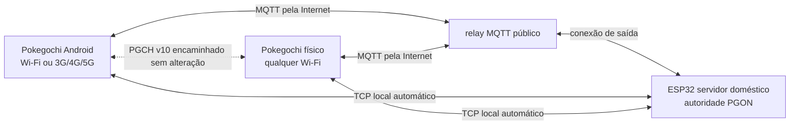

# Multiplayer Wi-Fi do Pokegochi

## Arquitetura

O multiplayer online usa três componentes:

- O ESP32 servidor mantém até 12 clientes e 6 salas em RAM. Ele lista jogadores,
  cria salas e encaminha os pacotes sem receber saves. A única exceção é o
  jogador virtual `99999`: o servidor escolhe o trio e os comandos dele, mas o
  cliente humano continua executando o motor e publicando o estado canônico.
- A batalha determinística continua nos dois clientes. O host de menor Player ID
  publica o estado canônico depois de cada turno.
- Se o servidor reiniciar, o lobby e as salas são reconstruídos vazios. Os
  clientes tentam reconectar e descartam apenas o snapshot temporário do PvP.
- `PGON` é um protocolo binário leve; o payload de jogo continua sendo o mesmo
  `PGCH` usado pelo multiplayer BLE. Na LAN ele viaja em TCP direto; fora dela,
  cada PGON viaja como uma mensagem MQTT até a mesma ESP32 doméstica.

## Interfaces separadas

- `MULTIPLAYER BLE`: descoberta próxima, batalha e troca já existentes.
- `MULTIPLAYER WIFI`: configuração da rede, lobby online e batalha.

No Pokegochi físico, o jogador toca em `SCAN`, escolhe um SSID encontrado e
digita somente a senha da rede. No Android não existe configuração de conexão:
o app usa diretamente a conexão já ativa no celular, inclusive dados móveis, e
começa a procurar jogadores depois de autenticar no relay. Nenhum dos dois
mostra IP, porta, host ou código de servidor. Ambos tentam primeiro o anúncio
DNS-SD `_pokegochi._tcp`, que mantém a rota local mais rápida; se ele não for
encontrado em 1,5 segundo, mudam automaticamente para a rota Internet.

A placa guarda somente redes nas quais a associação terminou com sucesso. São
mantidas até quatro combinações SSID/senha em ordem de uso recente (MRU). Ao
ligar `MULTIPLAYER WIFI`, ela faz um scan e tenta primeiro a rede usada mais
recentemente que estiver visível, seguindo pelas outras três. Uma quinta rede
confirmada substitui a menos recente; senha digitada errada não altera a lista.
O botão `CONFIG` continua disponível para escolher ou trocar a rede manualmente,
e um `*` identifica SSIDs cuja senha já está salva.

Somente um transporte fica ativo por vez. O renderer da placa libera a arena
gráfica antes de iniciar BLE ou Wi-Fi e a restaura ao fechar a Bag. Como o
ESP32 sem PSRAM precisa emprestar ao Wi-Fi a reserva do controlador BLE, sair
do Wi-Fi usa uma curta tela de retorno e um reinício controlado para reconstruir
Home e BLE com a memória íntegra. O save e o cartão SD não são apagados.

## Regras de batalha

Antes da Party, os dois jogadores escolhem:

- `NORMAL`: nível e stats originais.
- `BALANCED`: cópias temporárias no nível 70, com stats recalculados.

Nos dois modos, o snapshot começa com HP e PP completos e sem status. O save e
os Pokémon reais não são curados nem modificados.

Cada lado recebe uma Bag exclusiva da partida:

| Item | Quantidade |
|---|---:|
| Max Revive | 1 |
| Hyper Potion | 3 |
| Full Heal | 4 |
| Max Elixir | 1 |

Os itens são consumidos somente na cópia da batalha e desaparecem ao sair.

## Jogador virtual do servidor

O ID `99999` é reservado e não pode ser autenticado por um cliente comum. Por
ser maior que todo Player ID permitido, ele sempre aparece no fim da lista e o
adversário humano sempre é o host determinístico.

O bot fica disponível tanto pelo TCP local quanto pelo relay MQTT. Quando uma
sessão é aberta, ele some da descoberta para todos os demais jogadores. Ele
aceita batalhas, rejeita trades e volta ao lobby quando a sessão fecha ou o
cliente cai.

Sua Box é gerada uma vez e gravada como roster fixo no firmware: 70 Pokémon
finais, dez por geração I–VII, com movesets, IVs, EVs, nature, ability e held
items definidos. Há um lendário de cada geração e um único shiny. Cada batalha
sorteia três espécies distintas; uma Mega possível e um usuário de Z-Move
distinto recebem os itens especiais, enquanto os outros mantêm itens comuns.
Em `BALANCED` a equipe é materializada no nível 70; em `NORMAL`, no nível 100.

Vitórias do bot em partidas `BALANCED` são contadas somente quando o snapshot
final autoritativo informa a derrota do host. O valor é gravado uma única vez
em NVS, sobrevive a reinícios e segue no `PeerEntry` junto dos contadores dos
jogadores reais.

## Servidor doméstico

O projeto está em `server/PokegochiOnlineServer`. A rede residencial fixa fica
em `include/ServerLocalConfig.h`, ignorado pelo Git; o repositório contém apenas
`ServerLocalConfig.example.h` sem dados privados.

Depois de gravar o DevKit, não é preciso abrir porta, configurar DDNS nem ter
IPv4 público. A ESP32 abre uma conexão de saída com o broker MQTT e, por isso,
funciona atrás de NAT e CGNAT. Na mesma rede, mDNS/DNS-SD ainda encontra
`pokegochi-server.local` automaticamente e evita a volta pela Internet.

O build beta usa o broker público gratuito `broker.emqx.io:1883`. Ele não exige
conta e atende ao volume pequeno atual, mas é um serviço de teste, sem SLA. Os
tópicos carregam somente presença, convites e pacotes temporários de
batalha/trade; o save completo nunca é enviado. Uma versão de distribuição
maior deve trocar a constante em `OnlineRelayConfig.h` por um broker privado
com TLS e autenticação.

## Protocolo

O envelope `PGON` v2 tem header little-endian de 20 bytes, heartbeat, limite de
174 bytes por pacote e validação de origem, destino, sessão e versão. O payload
`Relay` contém exatamente um pacote `PGCH` v10. O `PGON` v2 acrescenta ao
`HELLO` e ao `PeerEntry` o contador de vitórias `BALANCED`. O `PGCH` v10 mantém
a autoridade do iniciador sobre atividade/regras, comandos, Z-Move e snapshots
autoritativos da batalha.

Cliente e servidor enviam heartbeat a cada 10 segundos e consideram o outro
lado indisponível após 30 segundos sem tráfego válido. Fechamentos carregam
sessão e peer exatos: um pacote atrasado de uma sala antiga não pode derrubar
uma sala nova. Queda de um jogador fecha apenas a sala correspondente, avisa o
outro lado e descarta o estado PvP temporário; queda do relay volta ao lobby e
os clientes tentam reconectar a cada cinco segundos. O servidor monta a sala de
forma transacional: se apenas um `SESSION_READY` for entregue, ele desfaz a
abertura em vez de deixar uma meia-sessão presa.
